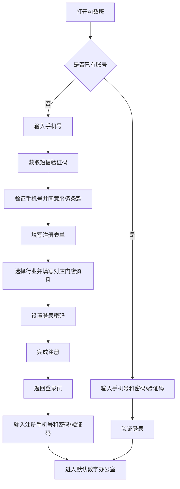
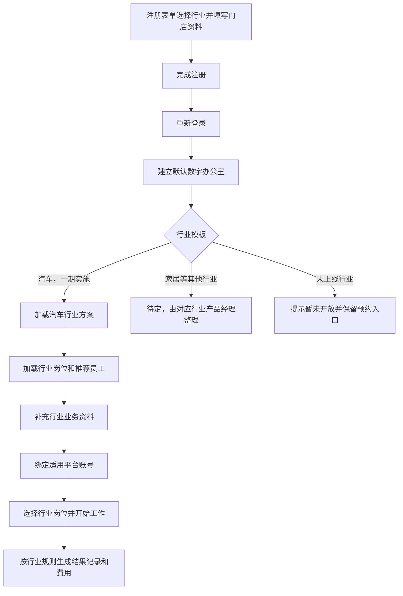
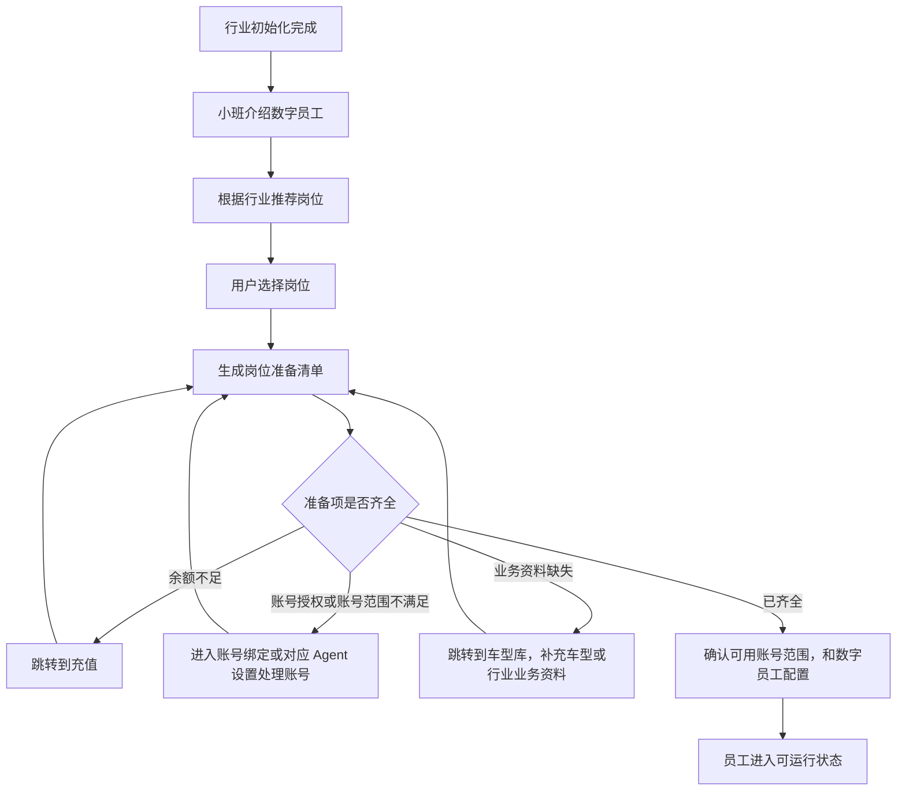
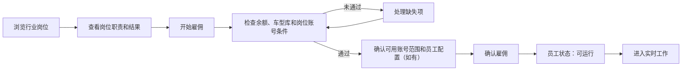
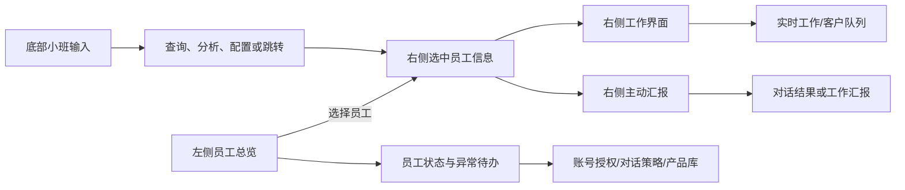
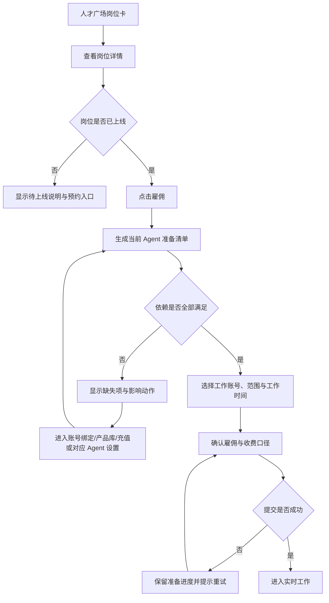
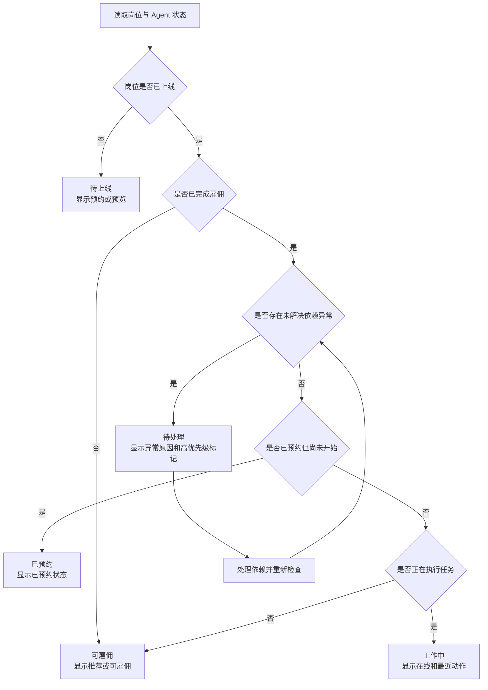
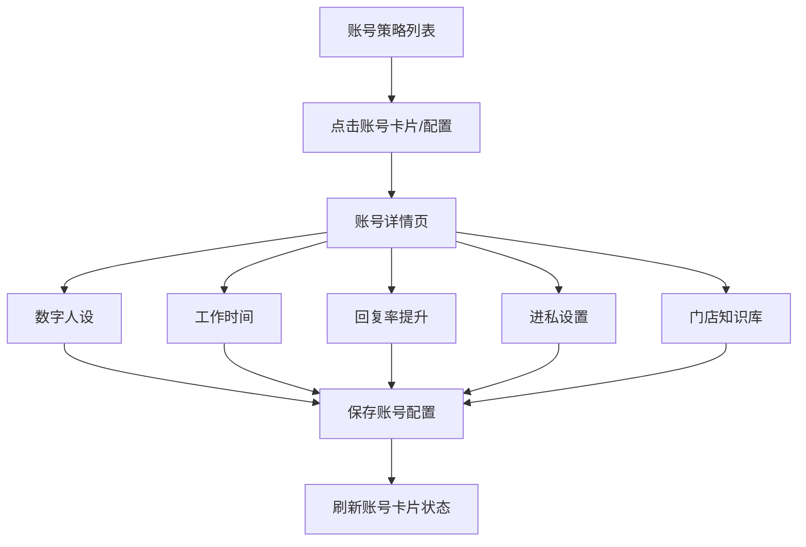

# AI数班产品需求文档

> 基于当前项目中可运行的 `AI数班-汽车数字员工后台Demo-20260717-v73.html` 及关联页面、业务自检材料整理。本文聚焦业务逻辑、核心场景和验收规则，不等同于当前演示原型已经具备的全部能力。

## 0. 版本记录

| 版本 | 日期 | 变更内容 | 影响模块 | 状态 |
|---|---|---|---|---|
| v1.0 | 2026-08-14 | 基于最新原型建立登录、行业分流、数字员工和一级模块 PRD | 全局流程 | 已记录 |
| v1.1 | 2026-08-19 | 补充汽车行业五大受影响模块、依赖异常高优先级待办和开发级交互 | 数字办公室、人才广场、数字员工、知识库、产品库 | 已记录 |
| v1.2-v3.0 | 2026-08-20 | 汇总当天变更：调整版本记录和本期范围；删除用户与数字办公室、注册验收、雇佣验收及核心业务场景等章节；重写数字办公室、Agent 设置、人才广场雇佣、岗位状态、对话和实时工作逻辑；补充主号获客专家指标、潜客来源、直播弹幕和验收口径 | 版本记录、文档结构、登录注册、数字办公室、人才广场、数字员工、对话、实时工作、Agent 设置、需求优先级、业务验收 | 待评审 |
| v3.1-v3.5 | 2026-08-21 | 汇总当天变更：重构对话策略账号列表和详情；明确主号/副号获客专家账号互斥、首次雇佣默认范围和新增账号关闭规则；补充新车/二手车车型库来源、二手车链接配置和手动同步；补充客服专员按日扣费；补充汽车行业抖音营销授权的云电脑前置检查、运营人员开启和二维码渲染流程 | 对话策略、门店知识库、产品库、人才广场、数字办公室、账号绑定、数字员工雇佣、客服专员、充值和消费明细、抖音营销授权 | 待评审 |
| v3.6 | 2026-08-26 | 明确主号/副号获客专家有效线索口径，以及数字办公室客服专员精选线索展示条件 | 数字办公室、主号获客专家、副号获客专家、业务结果验收 | 待评审 |
| v3.7 | 2026-08-31 | 调整客服专员实时工作顶部数据看板为五段式私信转化漏斗，并明确看板按小时刷新、展示最近更新时间 | 客服专员实时工作、原型指标看板 | 待评审 |

> 说明：同一天内的多次修改合并为一条版本记录，版本列保留当天涉及的版本号范围。

## 1. 文档信息

| 项目 | 内容 |
|---|---|
| 产品名称 | AI数班 |
| 产品形态 | 面向品牌与门店经营者的数字员工经营系统 |
| 当前原型 | AI数班 v73（当前项目版本） |
| 一期行业 | 汽车 |
| 后续方向 | 家居等可配置行业模板 |
| 主要用户 | 品牌/集团运营负责人、门店运营负责人、客服和销售管理者 |
| 文档目标 | 明确登录入驻、行业初始化、数字员工雇佣、运行、人工协作、结果和计费闭环，并记录版本变更和开发范围 |

## 2. 产品定义

### 2.1 产品定位

AI数班把汽车经营中的重复工作拆成可雇佣的数字员工岗位。用户完成业务资料、平台账号和工作规则配置后，一期数字员工持续执行获客、客服和销售协作，并将工作过程、业务结果、人工待办和费用统一回传。

产品不以“聊天机器人”或“AI工具集合”为核心，而以“岗位、工作、过程记录和正式结果”作为核心组织方式。

### 2.2 产品目标

1. 用户注册后，可以在明确的行业场景下快速开始使用。
2. 用户能清楚知道每个数字员工负责什么、正在做什么、带回了什么结果。
3. 账号、车型、门店知识和对话策略成为所有相关员工共用的业务依据。
4. AI无法继续工作时，用户能看到原因并直接处理，而不是看到虚假的“运行中”。
5. 正式业务结果和已开启服务产生的费用可以在员工工作和费用记录中追溯，并按明确规则计费；成果中心页面不在本期开发。
6. 一期先把汽车行业核心流程跑通，同时保留后续行业扩展能力。

### 2.3 一期范围

**一期必须形成完整闭环的岗位：**

- 主号获客专家：发现潜客、判断意向、主动触达、回传线索。
- 客服专员：接待平台私信、自动回复、人工接管、回传留资结果。

**本期不列为开发内容的岗位和页面：**

- 短视频矩阵运营数字员工、短视频运营专员及其他内容矩阵岗位；
- 内容/矩阵实时工作、视频审核、批量发布、平台回流和内容归因页面；
- 成果中心页面，包括团队日报、逐人日报、历史明细、内容成果、潜客明细、筛选、导出和费用下钻；
- 成果中心相关的页面跳转、报表订阅和内容结果展示。

上述范围不影响一期保留必要的过程记录、正式结果判定和费用记录；这些记录只作为数字办公室、员工工作和账务逻辑的后台依据，相关结果页面后续版本再开发。

## 3. 登录与注册方案

### 3.1 方案原则

- 使用手机号作为登录和找回身份的主要方式。
- 已有账号可以使用手机号和验证码登录，也可以使用注册时设置的登录密码登录。
- 新用户先完成手机号验证和注册表单，再返回登录页重新登录；注册成功不直接进入业务页面。
- 登录成功后只进入该账号唯一的默认数字办公室，不展示数字办公室选择页。
- 修改手机号必须再次验证新手机号。

### 3.2 注册流程

### 3.3 注册表单

注册表单按照原型分为手机号验证、行业选择、行业资料和登录密码四部分。用户必须完成必填项后才能完成注册。

**通用字段：** 手机号、短信验证码、登录密码、服务条款和相关授权确认。

**新车行业字段：** 门店名称、门店省份和城市、门店详细地址、所属集团、品牌和子品牌。

**二手车行业字段：** 车行名称、所在城市、门店省份和城市、门店详细地址、初始在售车型链接。

注册表单中的二手车在售车型链接只负责录入初始地址；来源类型选择、地址修改和手动同步统一在登录后的车型库中完成。

**注册表单交互：**

1. 用户先验证手机号，手机号验证成功后进入行业资料填写。
2. 选择新车或二手车后，表单只展示对应行业字段。
3. 切换行业时，已填写但不适用的字段需要提示将被清空。
4. 提交前校验必填字段、手机号和密码格式。
5. 注册成功后提示“注册完成，请重新登录”，返回登录页，不直接进入数字办公室。
6. 用户使用刚注册的手机号和密码/验证码重新登录，才进入默认数字办公室。
7. 二手车行业注册时填写的在售车型链接作为车型库初始来源；注册完成后仍可在车型库主页新增或修改该链接，并手动同步库存。

### 3.4 登录、注册和异常状态

| 状态 | 用户可做什么 | 下一步 |
|---|---|---|
| 手机号未验证 | 重新获取验证码 | 完成手机号验证 |
| 注册表单未完成 | 继续填写行业和门店资料 | 完成注册 |
| 注册已完成、尚未重新登录 | 返回登录页 | 使用手机号和密码/验证码登录 |
| 已启用账号 | 进入唯一默认数字办公室 | 正常使用 |
| 登录失败 | 重新输入或重新获取密码/验证码 | 不显示任何业务数据 |

## 4. 行业区分方案

行业不是一个展示标签，而是决定主流程中“需要配置什么、员工做什么、结果如何统计”的业务基础。

### 4.1 行业分流主流程

### 4.2 本期行业范围与受影响模块

本期只整理和交付汽车行业的完整业务闭环。家居等其他行业仅保留行业入口和扩展位置，不在本 PRD 中定义具体岗位、字段、话术或知识模板，后续由对应行业产品经理另行整理和评审。

行业分流会直接影响以下五个一级业务模块：

| 受影响模块 | 汽车行业一期要求 | 其他行业处理方式 |
|---|---|---|
| 人才广场 | 展示汽车行业一期数字员工，如主号获客专家、客服专员、副号获客专家、客服专员等 | 由对应行业产品经理整理行业岗位和展示字段 |
| 数字员工 | 使用汽车业务判断潜客意向、车型、预算、城市、使用汽车门店触达话术、客服话术和人工转接规则 | 由对应行业产品经理定义行业判断、执行动作和话术 |
| 成果中心 | 本期不开发成果中心页面；仅保留线索、潜客、车型、城市、意向等级、触达、回复、留资等后台结果口径 | 后续由对应行业产品经理定义页面字段、标签和指标 |
| 对话策略-门店知识库 | 展示汽车门店知识模板 | 由对应行业产品经理整理行业知识库模板 |
| 产品库（汽车行业为车型库） | 新车按品牌/子品牌自动关联车源；二手车按在售车型链接同步在售车辆，并管理车型、价格、权益和在售状态 | 由对应行业产品经理定义商品/产品库结构 |

行业判断结果必须在注册、默认数字办公室、人才广场、数字员工、门店知识库和产品库之间保持一致；后台结果记录只作为本期员工状态和费用逻辑的依据，不能误显示为已开发的成果中心页面。

### 4.3 后续行业扩展规则

1. 一期只承诺汽车模板的完整闭环，其他行业可以展示预览岗位，但不能伪装成可用能力。
2. 后续新增行业时，复用“注册/行业选择”的共同流程。
4. 一期每个账号只绑定一个主行业。多行业经营不在当前登录和注册流程中创建新的数字办公室，后续另行规划行业隔离和统一经营方式。
5. 一期暂不影响切换具体行业

## 5. 首次初始化与准备清单

### 5.1 初始化目标

让用户知道“要让员工开始工作，需要准备什么”，并且每一项准备都能解释原因、直接处理和重新检查。

### 5.2 初始化流程

### 5.3 准备项规则

| 准备项 | 作用 | 缺失时的业务结果 |
|---|---|---|
| 抖音平台账号授权 | 抖音平台私信消息收发、抖开接口等能力 | 员工不能读取或回复抖音平台私信 |
| 抖音营销授权 | RPA授权，核心是潜客获取能力，私信主动触达能力 | 无法获取潜客、潜客触达 |
| 云电脑服务（汽车行业） | 为抖音营销授权提供 RPA 运行环境 | 未开启时无法发起营销授权，需联系运营人员处理 |
| 行业业务资料 | 保证主动潜客挖掘、客服回复和判断符合门店实际业务 | 通用化，不符合门店页面 |
| 余额 | 支付已确认的有效结果或已开启服务的按日费用 | 余额不足时按岗位计费规则暂停后续执行或进入待处理，历史费用和结果仍可查看 |

汽车行业的云电脑服务由运营人员开启，不作为用户在初始化清单中可自行完成的操作；用户只能查看当前云电脑状态，并在未开启时按提示联系运营人员。

门店知识库和对话策略不属于首次雇佣准备项，不出现在首次雇佣检查清单中，也不作为确认雇佣的阻塞条件。相关配置仍由对应业务模块维护，不能用首次雇佣检查结果代替后续配置状态。

客服专员的授权状态继续按账号绑定和运行规则影响实际接待能力，但不改变已开启功能的日服务费计收；授权缺失时员工可以显示“待处理”，计费状态仍需单独展示。

## 6. 数字员工雇佣

### 6.1 雇佣逻辑

用户从人才广场进入岗位详情，先理解岗位职责、可交付结果和收费口径，再进行准备检查和工作范围配置。

### 6.2 员工状态

| 状态 | 说明 | 是否执行 |
|---|---|---|
| 可雇佣 | 岗位尚未加入当前数字办公室 | 否 |
| 工作中 | 当前正在执行任务 | 是 |
| 空闲中 | 已雇佣但是当前未执行任务 | 否 |
| 待处理 | 因授权、余额等原因业务无法进行 | 否，等待处理 |
| 待上线 | 岗位已展示但一期暂未开放 | 否 |

### 6.3 主号与副号获客专家账号规则

主号获客专家和副号获客专家共用同一批抖音账号，但账号的“启用”归属必须互斥。同一个账号只能在两个数字员工中的一个员工服务范围内处于启用状态；未启用不等于未绑定，账号授权状态与员工服务状态必须分开记录。

#### 6.3.1 可用账号定义

对任一获客专家，账号只有同时满足以下条件才算“可用账号”：

1. 抖音平台授权已完成；
2. 抖音营销授权已完成；
3. 该账号未被另一获客专家启用。

平台授权或营销授权任一不完整时，账号标记为“授权不可用”；已被另一获客专家启用时，标记为“已被另一数字员工使用”。不可用账号仍展示在账号范围列表中，但不能被当前员工启用，必须同时展示不可用原因和处理办法。

#### 6.3.2 主号获客专家

- 首次雇佣时，系统实时计算当前可用账号范围。
- 可用账号数量为 0 时禁止雇佣；阻塞信息必须说明是授权问题、账号被副号获客专家使用，或当前没有满足条件的账号。
- 对授权不可用账号，提供“去账号绑定/重新授权”；对被副号获客专家使用的账号，提供“去副号获客专家 Agent 设置关闭该账号”的处理路径。
- 首次确认雇佣时，所有满足条件的可用抖音账号默认加入主号获客专家并开启。
- 雇佣完成后，用户可在主号获客专家的 Agent 设置中修改账号范围；修改前后均重新校验账号授权和互斥占用。

#### 6.3.3 副号获客专家

- 首次雇佣时，系统实时计算当前可用账号范围。
- 可用账号数量少于 2 个时禁止雇佣；阻塞信息必须说明当前可用数量，并提示至少需要 2 个可用账号。
- 对授权不可用账号，提供“去账号绑定/重新授权”；对被主号获客专家使用的账号，提供“去主号获客专家 Agent 设置关闭该账号”的处理路径。
- 首次确认雇佣时，用户先在可用账号中指定 1 个主号（此处指副号获客专家内部负责获取潜客的账号，不等同于主号获客专家岗位）；其余所有满足条件的可用账号默认作为副号，且全部加入并开启。
- 雇佣完成后，用户可在副号获客专家的 Agent 设置中重新指定主号、调整副号范围和开关；主号与副号的数量校验必须在保存时重新执行。

#### 6.3.4 新增账号与状态变化

- 某一获客专家完成首次雇佣后，之后新增的账号即使授权完整，也不得自动加入该员工的启用范围；账号默认关闭，必须由用户在对应 Agent 设置中手动启用。
- 新增账号被另一获客专家启用时，在当前员工范围内直接显示为不可用，不能通过切换开关绕过互斥规则。
- 账号授权失效、营销授权撤销或账号被另一获客专家启用后，受影响员工重新计算可用范围；若当前启用范围因此出现不可用账号，或没有可用账号、不满足副号最低数量，员工进入“待处理”，并生成高优先级待办。

### 6.4 客服专员按日扣费规则

- **适用范围：** 仅适用于客服专员数字员工；与主号获客专家等岗位按正式结果计费的口径分开记录。
- **计费单价：** 日扣费单价为可配置参数，默认 **50 元/天**。岗位详情、雇佣确认和消费明细均展示当前实际生效单价；修改配置不覆盖历史费用记录。
- **计费开始：** 客服专员雇佣成功且功能开关处于开启状态后开始计费；若雇佣确认时默认开启功能，则以雇佣成功时间作为计费开始时间。
- **计费单位：** 按天计费。一个计费周期内功能开启不足一天，仍按一天计收，不因实际接待时长、会话数量或正式结果数量减少费用。
- **与授权解耦：** 平台账号未授权、授权失效或授权范围不足时，员工按既有规则进入“待处理”或无法实际接待，但只要功能开关保持开启，日服务费继续正常计收；授权状态不得自动暂停、免除或冲销该费用。
- **停止计费：** 用户关闭客服专员功能或解雇员工后，从对应操作生效时间起停止后续日服务费；操作前已产生的费用保留，不因后续授权恢复或关闭回溯改写。
- **费用记录：** 每笔日服务费至少记录员工 ID、账号 ID、计费周期、实际单价、计费天数、应扣金额、扣费状态和触发时间；页面刷新、重复进入或授权重试不得重复扣费。

## 7. 一级工作模块需求

原型左侧一级导航包含 7 个本期开发工作模块。成果中心保留为后续版本页面，不纳入本期开发；顶部另设版本管理全局模块。各模块不是互相独立的页面，而是同一条经营闭环的不同视角：数字办公室负责发现问题和待办，人才广场负责补充岗位，对话负责发起任务，实时工作负责观察过程，对话策略、账号绑定和产品库负责提供员工运行所需的业务依据。

顶部全局模块：

| 模块 | 用户要解决的问题 | 主要输出 |
|---|---|---|
| 版本管理 | 当前使用哪个需求版本，最近改了什么，哪些范围可以开发 | 版本列表、版本差异、影响模块、评审状态、变更记录 |

### 7.1 一级模块总览

| 一级模块 | 用户要解决的问题 | 主要输出 | 主要去向 |
|---|---|---|---|
| 数字办公室 | 今天经营情况如何，谁在工作，哪里需要我处理 | 指标、员工状态、待办、近期结果 | 实时工作、账号绑定、对话策略 |
| 人才广场 | 我还需要什么岗位，哪个岗位值得雇佣 | 岗位详情、准备清单、雇佣结果 | 实时工作、员工配置 |
| 对话 | 我能否直接让系统查数据、处理任务或修改配置 | 对话结果、数据卡片、配置变更 | 实时工作、对话策略 |
| 实时工作 | 员工现在正在做什么，是否需要我接手 | 工作对象、过程节点、队列、人工待办、结果记录 | 账号绑定、员工配置 |
| 对话策略 | 员工应该如何说、何时工作、依据什么回答 | 人设、时间、欢迎语、业务答案 | 对话、实时工作、账号绑定 |
| 账号绑定 | 员工能在哪些平台和账号上执行什么动作 | 账号清单、授权状态、员工关联 | 人才广场、实时工作、数字办公室待办 |
| 产品库（汽车行业为车型库） | 员工向客户提供哪些产品和权益口径 | 汽车行业为在售车型、价格、优惠、补贴、状态 | 对话策略、实时工作、成果复盘 |

### 7.3 数字办公室

#### 7.3.1 模块目标与页面骨架

数字办公室是当前账号唯一默认办公室的日常工作入口。页面采用“左侧员工总览 + 右侧员工工作区”的固定结构：左侧负责选择和比较员工，右侧负责查看被选员工的工作、汇报和待办。顶部提供办公室身份、汽车行业标识、数据更新时间和刷新入口；页面底部保留小班任务输入入口。

#### 7.3.2 左侧：数字员工总览

左侧展示当前数字办公室已经雇佣的员工，不展示未雇佣岗位、其他行业员工或成果中心入口。

- 顶部显示员工总数，以及“工作中、待处理、空闲中、已暂停”的数量；数量与员工当前状态一致。
- 每张员工卡展示形象、昵称、岗位名称、当前状态。
- 单击卡片选中员工，右侧立即切换为该员工；再次刷新或返回页面时保留上一次选中员工，若员工已不存在则选中小班。
- 卡片中的账号选择只影响该卡片和右侧数据，不改变其他员工账号；账号无授权时显示“待授权”及账号绑定入口。
- 没有已雇佣员工时显示岗位推荐和“去人才广场雇佣”；员工列表加载失败时显示重试入口，不显示技术错误码。

#### 7.3.3 左侧：员工选择与状态交互

1. 用户点击员工卡片后，系统锁定员工、岗位，右侧所有区域只读取该员工数据。
2. 用户切换员工时，右侧未完成的输入不丢失；若输入尚未发送，保留在当前员工草稿中，切回后恢复。
3. 员工进入工作中等工作时，左侧状态、右侧状态栏和底部小班可见的状态必须同步更新。
4. 员工处于待处理时，卡片突出异常原因；点击后右侧打开待办详情，显示受影响动作、关联账号和处理入口。
5. 同一依赖影响多个员工时，左侧分别标记受影响员工，在小班处合并为一条高优先级待办，展示影响范围和对话。

#### 7.3.4 右侧：选中员工信息区

右侧顶部固定展示当前选中员工的身份和可操作状态，是左右区域联动的确认区。

- 展示员工头像、昵称、岗位名称
- 展示“查看实时工作”“agent设置”等操作
- 工作中显示当前数字人固定的处理流程
- 任务名称和进度；空闲中显示最近一次有效工作和可发起的任务；工作中展示正在进行的任务
- 每个账号有独立的数字人，点击对应数字人展示对应数字人的账号数据
- 右侧的结果数字必须带统计周期、账号和数据更新时间；无法确认统计口径时显示“待刷新”，不能显示估算值。

#### 7.3.5 右侧：员工工作界面

工作界面展示选中员工当前正在执行或最近完成的业务动作，若为RPA则展示对应的云桌面快照内容，按岗位渲染内容，不使用一个通用空白面板。

- 主号获客专家：展示云电脑RPA触达录屏，5分钟录屏内容就放，历史录屏素材不留存
- 副号获客专家：展示云电脑RPA触达录屏，5分钟录屏内容就放，历史录屏素材不留存
- 客服专员：展示最多 5 条精选线索。精选线索定义为：用户至少发过 3 次消息且 AI 至少发过 2 次消息；每条包含客户昵称、来源账号、最近消息、意向车型/标签、会话状态和人工处理标记；无符合条件线索时显示业务空状态。
- 每个工作界面提供“进入实时工作”入口。
- 工作界面只展示当前或最近周期的过程快照；历史正式结果通过小班汇报或实时工作查看。

#### 7.3.6 右侧：对话区

对话chat区用于员工向负责人说明“完成了什么、发现了什么、需要什么”，不等同于实时工作画面。

- 汇报按员工和数据周期（暂定每天）展示，必须标注生成时间、统计周期、工作账号和数据范围。
- 汇报内容包括完成动作、关键结果、异常事项、下一步建议；金额和正式结果必须与消费明细及后台结果记录一致。
- 用户点击汇报中的结果、异常或建议时，在右侧打开详情或对应处理入口，并保留员工和账号上下文。
- 暂无汇报时显示“当前周期暂无汇报”；生成失败时保留上一次成功汇报并标注更新时间及重试入口。

#### 7.3.7 右侧：员工对话与底部小班输入

- 右侧对话区支持用户与当前员工对话；会话历史按员工、账号和当前数字办公室隔离，切换员工不删除未读消息。
- 用户可输入查询、分析、配置、分配或人工处理指令；涉及配置或外部动作时，必须先确认再执行。
- 底部小班输入框是跨员工任务入口。发送后由小班识别查询、分析、配置或跳转：查询/分析在右侧返回结果卡片，配置先展示变更和影响范围，跳转打开目标模块并携带员工、账号和来源信息。
- 小班可以汇总多个员工的待办和汇报；汇总结果中必须区分员工、账号、周期和数据范围。
- 本期仅支持文字输入。

#### 7.3.8 左右联动和异常处理

- 左侧选中员工是右侧所有数据的唯一上下文；右侧任何跳转、刷新和确认动作都不能丢失员工、账号和当前任务。
- 用户从右侧进入实时工作、账号绑定、对话策略或产品库处理问题后，返回数字办公室自动回到原员工和原待办，并刷新左右两侧状态。
- 依赖异常、授权失效、余额不足时，受影响员工立即在左侧标为“待处理”，由用户处理依赖异常。
- 处理完成后系统重新检查依赖：通过则员工恢复可运行或工作中，待办标记已解决；未通过则保持待处理并提示仍异常；用户关闭只代表关闭提醒，不代表依赖已恢复。
- 页面加载中显示骨架，空数据显示业务原因和下一步操作；不显示其他行业示例数据。当前一期只允许汽车行业，不提供行业和数字办公室切换。

#### 7.3.9 Agent 设置入口与弹窗结构

用户在右侧选中员工信息区点击“Agent 设置”，打开当前员工的设置弹窗。弹窗只编辑当前已选 Agent，不允许在弹窗内切换其他员工；关闭弹窗返回原来的数字办公室左右布局，并保留左侧选中员工、账号和滚动位置。

- 弹窗顶部展示 Agent 头像、岗位名称；右上角提供关闭按钮。
- 设置内容按原型从上到下分为“身份”“知识库”“账号范围”“技能”四个区域；每个区域独立展示用途、当前值和可操作边界。
- Agent 正在工作时允许查看设置；涉及身份、知识库或执行策略的修改，需要先暂停或在确认后于下一次任务生效，不能改变正在执行中的任务上下文。
- 弹窗加载中显示设置骨架；加载失败显示重试入口；重试不得清空已经打开的设置内容。

#### 7.3.10 Agent 设置：身份区域

身份区域用于定义 Agent 对外展示的称呼、人设和说话风格，只影响表达方式，不改变岗位能力、数据权限、工作范围和计费规则。

- “Agent 称呼”为单行文本，默认填充岗位名称；用户可修改，必填且需校验长度，不能输入仅空格或与其他 Agent 完全相同的自定义名称。
- “说话风格”和“Agent人设”进行合并，为多行文本，用于描述角色特点和表达偏好；输入框下方明确提示“人设影响表达方式，不会改变能力和权限”保存后在下一次对话中生效。
- 身份字段只影响 Agent 的称呼、语气和回复表达，不得通过人设文本新增未经授权的业务能力、跳过人工确认或修改行业资料。
- 用户修改身份字段后，关闭弹窗不保存；点击“保存设置”才提交。未保存关闭时弹出“是否放弃修改”确认，选择继续编辑则保留内容。

#### 7.3.11 Agent 设置：知识库区域

知识库区域展示当前 Agent 已关联的业务知识来源，汽车行业一期包含“对话策略”和“车型库”两类卡片。知识内容不在 Agent 设置弹窗内直接编辑，通过卡片进入对应模块维护。

- “对话策略”卡片展示关联状态，主要是账号级别的知识库内容；点击卡片或右侧箭头进入对话策略页面。
- “车型库”卡片展示已关联状态，以及在售车型、门店价、优惠和补贴政策等汽车产品资料；点击卡片或右侧箭头进入产品库。
- 已关联表示 Agent 可以读取当前版本的知识。
- 修改知识库不会回写身份字段；保存知识库后仅对后续新任务生效，正在执行的任务继续使用启动时锁定的知识版本。
- 汽车行业以外的知识库卡片不在一期展示；不得用汽车车型库内容填充其他行业模板。

#### 7.3.12 Agent 设置：账号范围区域

账号范围区域只管理当前 Agent 的员工服务范围，不替代账号绑定模块的授权管理。账号列表必须展示当前账号的抖音平台授权、营销授权、当前员工启用状态、另一获客专家占用状态和最近一次检查时间。

- 账号授权完整且未被另一获客专家启用时，显示“可用”，允许用户开启或关闭当前员工的服务范围。
- 平台授权或营销授权任一不完整时，显示“不可用”，明确标注缺失的授权类型，并提供“去账号绑定/重新授权”入口；不可用账号的开关不可操作。
- 账号已被另一获客专家启用时，显示“不可用 · 已被另一数字员工使用”，并提供进入另一员工 Agent 设置关闭账号的处理入口；当前员工不能强制抢占账号。
- 主号获客专家的范围设置只允许保存满足完整授权且未被副号获客专家占用的账号。
- 副号获客专家的范围设置必须保留 1 个主号和至少 1 个副号；主号和副号均必须来自完整授权且未被主号获客专家占用的可用账号。
- 账号范围保存成功后，互斥占用立即同步到另一获客专家、人才广场、账号绑定和数字办公室；正在执行的任务继续使用启动时锁定的账号范围，新任务使用保存后的范围。
- 某一获客专家完成首次雇佣后新增的账号默认处于“未开启”状态，即使账号可用也不能自动加入工作范围，必须由用户在该员工 Agent 设置中手动开启。

#### 7.3.13 Agent 设置：技能区域

技能区域用于说明当前 Agent 已具备的固定能力，保持与原型一致，仅做展示，不支持添加、删除或调整。

右上角展示“固定 · 不可更改”状态。技能以带序号和勾选标识的卡片展示；切换不同数字人后，卡片内容替换为该数字人的固定技能。

| Agent 岗位 | 原型中展示的固定技能 |
|---|---|
| 客服专员 | 智能回评、私信触达、意图识别、品牌话术 |
| 主号获客专家 | 挖掘直播潜客、挖掘短视频潜客、挖掘粉丝潜客、判断潜客意向、私信触达潜客、转化话术设计、数据报告 |
| 副号获客专家 | 挖掘直播潜客、挖掘短视频潜客、挖掘粉丝潜客、判断潜客意向、私信触达潜客、转化话术设计、数据报告 |

#### 7.3.14 Agent 设置保存、取消与生效规则

1. 用户点击“保存设置”后，系统校验称呼、说话风格、人设、当前知识关联状态和账号范围；必填项缺失、账号不可用或副号账号数量不足时阻止保存，并在对应字段旁说明原因。
2. 保存按钮提交期间显示处理中并禁止重复点击；保存成功后提示修改项、影响范围和生效时点。
3. 身份类修改默认从下一次新对话或新任务生效；知识库类修改从下一次新任务生效；账号范围修改保存并重新检查通过后对新任务生效；技能和授权权限不能通过本弹窗修改。
4. Agent 正在执行任务时，保存身份或知识设置不重启、不暂停当前任务；当前任务继续使用启动时的设置版本。
5. 保存失败时保留用户输入，显示可重试原因；不得将未成功保存的内容显示为已生效。
6. 用户点击关闭或取消时，如果没有未保存修改则直接关闭；有未保存修改时必须二次确认。关闭后右侧员工信息区刷新设置版本和更新时间。
7. 设置保存成功后生成版本记录，记录 Agent、修改人、修改时间、修改项、旧值/新值、账号范围、关联知识版本和生效范围；版本记录只保留在顶部版本管理中，不在本期增加独立版本管理页面。

#### 7.3.15 Agent 设置与左右区域联动

- 从左侧员工卡片或右侧工作区打开 Agent 设置时，始终使用当前选中的员工和账号；禁止打开后静默切换上下文。
- 保存身份或知识设置后，右侧员工信息区更新时间刷新，左侧卡片只更新称呼、状态和待处理标记，不改变员工排序规则。
- 保存账号范围或授权状态变化导致当前启用范围出现不可用账号、可用账号为 0 或可用账号少于副号最低数量时，左侧员工立即标记为“待处理”，右侧显示受影响账号、原因、解决办法，并按高优先级生成待办。
- 主号获客专家和副号获客专家的账号启用状态必须双向实时刷新；一个账号在一方开启后，另一方立即显示不可用且不能开启。
- 用户从设置弹窗进入对话策略或车型库处理问题后，返回时自动回到同一 Agent 设置弹窗；若原设置草稿尚未保存，必须提示用户保留或放弃草稿。
- Agent 被暂停、解雇或待上线时仍可查看设置，但保存按钮按状态限制：已解雇仅允许查看历史配置，待上线允许保存基础身份但不能产生工作结果。

### 7.4 人才广场

#### 7.4.1 模块目标

人才广场是岗位供给和雇佣入口。用户先了解岗位能带来什么结果，再决定是否让该岗位加入当前数字办公室。

#### 7.4.2 页面组成

- 当前行业和岗位总数、已雇佣数量；
- 岗位分类筛选：获客、客服、直播/场控等；
- 状态筛选：全部、已雇佣、可雇佣、待上线；
- 岗位卡：员工形象、岗位名称、岗位说明、技能标签、适用平台、结果和计费口径；
- 查看详情、雇佣、解雇、预约上线等操作。

汽车行业一期的人才广场只展示汽车岗位和汽车岗位能力说明。岗位卡需要明确岗位使用的汽车业务对象，例如潜客、车型、试驾预约或客户会话；家居等其他行业岗位不在本期伪装为可雇佣岗位。

#### 7.4.3 查看岗位详情

用户点击岗位卡或“查看详情”后，打开岗位详情，而不是直接进入配置。

客服专员岗位详情和雇佣确认页必须展示“按日服务费”收费口径，默认显示 50 元/天；若计费后台已配置其他单价，展示当前实际生效单价。授权提示和按日计费提示分开呈现，不能让用户误以为未授权就不会产生费用。

#### 7.4.4 数字员工通用雇佣启用流程

所有数字员工均按“查看岗位—准备依赖—确认雇佣—进入实时工作”的顺序进入工作。岗位不同只改变准备项、账号要求和实时工作内容，不改变整体交互结构。

#### 7.4.5 各数字员工的准备项与首次启用动作

| 数字员工 | 主要准备项 |
|---|---|
| 客服专员 | 至少一个已授权平台账号、车型库、余额 |
| 主号获客专家 | 至少一个满足平台授权与营销授权的可用抖音账号、车型库、余额 |
| 副号获客专家 | 至少两个满足平台授权与营销授权的可用抖音账号、车型库、余额；首次配置 1 个主号和至少 1 个副号 |

准备清单只展示当前岗位实际需要的项目。已完成项目显示已完成，缺失项目显示“去处理”；不适用的账号、知识或能力不加入清单。门店知识库和对话策略不属于上述首次雇佣准备项，不显示为待处理或阻塞项。

客服专员的授权检查仍决定是否具备实际接待能力；雇佣成功后若功能开关保持开启，即使未完成授权或授权失效，也按 6.4 规则正常计收日服务费。授权异常只改变员工运行状态和待办，不改变已产生或正在产生的日服务费。

#### 7.4.6 通用雇佣交互与页面回流

1. 用户点击岗位卡主按钮后进入该岗位的准备页；已雇佣岗位不再显示“雇佣”，“继续准备”“开始工作”或“查看工作”。
2. 提交期间按钮进入处理中并禁止重复点击；提交成功后只有一个去向，即直接进入实时工作，实时工作页按当前依赖、账号和员工状态展示工作现场或待处理提示。
3. 雇佣失败不改变岗位状态，保留已完成准备项和用户选择；解雇只停止后续工作，不删除配置、过程记录和正式结果。
4. 主号获客专家首次雇佣默认开启全部可用抖音账号；副号获客专家首次雇佣在指定 1 个主号后，默认开启其他全部可用账号作为副号。
5. 首次雇佣完成后新增的账号默认关闭，只有在对应数字员工 Agent 设置中手动开启并通过可用性检查后，才进入工作范围。
6. 客服专员雇佣成功且功能开关开启后，按 6.4 规则开始日服务费计收；是否授权、是否产生会话或是否产生正式结果，不改变计费条件。

#### 7.4.7 岗位状态和操作边界

| 岗位状态 | 列表展示 |
|---|---|
| 可雇佣 | 推荐或可雇佣 |
| 工作中 | 在线和最近动作 |
| 待处理 | 异常原因和高优先级标记 |
| 已预约 | 展示已预约状态 |
| 待上线 | 预约或预览 |

岗位状态根据“岗位是否上线、用户是否完成雇佣、依赖是否正常、是否正在执行任务”四项条件判断，前端不得只根据按钮点击结果直接写死状态。

- 状态计算在进入人才广场、返回页面、进入实时工作和手动刷新时重新执行。
- 同一 Agent 只能展示一个当前状态；状态变化后，岗位卡、数字办公室员工卡和实时工作页同步刷新。
- 主号获客专家可雇佣条件包含“可用抖音账号数量至少为 1”；副号获客专家可雇佣条件包含“可用抖音账号数量至少为 2”。可用账号必须同时满足平台授权、营销授权完整且未被另一获客专家启用。
- 账号不可用时，岗位准备页和岗位卡必须展示不可用原因及解决办法；副号账号不足 2 个时，必须明确提示当前数量和“至少需要两个可用账号”。
- 依赖异常优先进入“待处理”，不得继续显示“工作中”；依赖恢复后重新判断是否进入“已预约”或“工作中”。
- “已预约”表示用户已经完成预约或启用安排，但 Agent 尚未开始执行任务；不代表已经产生业务结果。
- “可雇佣”表示岗位可进入雇佣准备或尚未开始真实工作，不代表账号和余额依赖已经全部满足。

- 暂停或解雇前必须二次确认影响的账号、未完成任务、客户跟进和历史结果。
- 解雇只停止后续工作，不删除员工配置、历史过程、正式结果和费用明细。
- 恢复工作前重新检查当前依赖；检查未通过时进入高优先级待办，不显示为在线。

### 7.5 对话

#### 7.5.1 模块定位

对话模块用于用户与小班或岗位群群主进行聊天。账号与数字员工一一对应：雇佣一个账号，即生成一个该岗位的数字员工；同一岗位雇佣多个账号时，多个数字员工归入同一个岗位群。

#### 7.5.2 会话列表

- 小班固定置顶，作为跨岗位的统一入口。
- 岗位群按“岗位名称群（员工数量）”展示，例如“主动获客专家群（12）”；员工数量等于该岗位当前已雇佣且有效的账号数量。
- 同一岗位只有一个账号时仍使用群名称格式，例如“客服专员群（1）”，不单独展示账号名称。
- 会话列表展示群名称、群主头像、最近一条消息、最近消息时间、未读数。
- 账号被解雇、失效或移出当前数字办公室后，员工数量和群状态同步更新；数量为 0 的岗位群不进入可聊天列表。
- 小班和岗位群的对话历史按当前账号及默认数字办公室隔离，不显示其他账号或其他账号的数字办公室数据。

#### 7.5.3 进入聊天页和聊天对象

1. 用户点击小班或任意岗位群，会进入对应的对话聊天页。
2. 进入岗位群后，用户只能与该群群主聊天；群内其他数字员工仅作为该群的工作成员，不提供单独聊天入口。
3. 群主是该岗位群唯一的对话数字人，负责代表群内员工接收用户消息、汇总工作状态并反馈结果。
4. 聊天页顶部展示小班或群名称、群主名称、岗位、员工数量和当前状态；不展示可切换的群成员私聊列表。
5. 用户从数字办公室、实时工作或待办进入聊天页时，携带来源员工、账号、任务或待办上下文；返回其他模块后再次进入，仍回到原岗位群。

#### 7.5.4 群主主动消息和未读提示

- 群主可以根据对话场景主动推送日报、工作进度、数据处理结果、异常提醒和待人工确认事项。
- 主动消息进入对应小班或岗位群聊天流，不另建员工私聊会话。
- 岗位群有未读主动消息时，在会话列表显示未读数量和未读标记；高优先级异常同时显示优先级提示。
- 用户打开岗位群聊天页后，当前已展示的主动消息标记为已读；未读数只在用户实际进入并看到消息后清零。
- 用户离开聊天页后新产生的主动消息重新累计未读数，不因页面刷新或切换模块自动清零。
- 主动消息必须标注群主、岗位群、涉及员工数量、数据时间范围和消息类型；具体日报字段和数据处理场景暂不在本期固定。

#### 7.5.5 用户发送消息

- 用户在小班聊天页发送消息时，由小班统一理解并决定是否需要转交某个岗位群；具体转交场景后续补充。
- 用户在岗位群聊天页发送消息时，消息统一发送给该群群主，由群主根据岗位群内员工和账号情况处理。
- 用户不能在消息输入区直接选择群内某一个账号员工进行私聊；需要指定账号时，由群主在回复中说明受影响账号或引导进入对应工作页面。
- 消息发送失败、群主不可用或岗位群没有有效员工时，显示原因和处理入口，不创建无效会话消息。

#### 7.5.6 当前范围与后续补充

- 本期只确定会话归属、岗位群命名、群主唯一聊天对象、主动消息和未读提示规则。
- 具体对话场景、指令分类、数据卡片类型、群主如何分派给群内员工、结果回传方式和人工确认流程尚未确定，后续以新版本记录补充。
- 在具体场景确定前，PRD 不预先约定查询、分配、配置、日报等消息的详细业务流程，前端只需预留统一消息流、未读状态和群主回复位置。

### 7.6 实时工作

#### 7.6.1 模块目标

实时工作是员工的作业现场，用户能看到当前员工的实时工作状态。

#### 7.6.2 进入和选择员工

1. 用户从数字办公室、人才广场或导航进入实时工作。
2. 只显示当前可查看的员工；未雇佣或待上线岗位不进入真实工作现场。
4. 用户选择员工后，页面同步切换头像、岗位、账号、任务、状态和结果。
5. 选中的员工和账号必须一一对应，不能随机显示其他员工的工作现场。

#### 7.6.3 通用工作现场结构

- 员工身份和工作账号；
- 当前任务和运行状态；
- 工作漏斗或关键指标；
- 当前工作现场或平台内容；

#### 7.6.4 主号获客专家工作现场

主号获客专家实时工作页是汽车行业一期的完整作业现场，页面围绕“获取潜客—判断意向—私信触达—留资结果—本次计费”形成一条可观察的业务链路。每一个账号对应一个主号获客数字员工，页面数据只属于当前账号、当前行业和当前统计周期。

#### 7.6.4.1 页面顶部：经营指标漏斗

顶部固定展示三个指标卡，顺序与业务流程一致：获取潜客、私信触达、留资结果。

- 每张卡展示指标名称、当前周期数值和数据更新时间；卡片和阶段之间的箭头只表达业务流程顺序，不代表可点击跳转。
- 指标只统计当前账号和当前周期，必须显示周期口径；切换账号或刷新周期后重新拉取，不混用其他账号数据。
- 新增结果发生时，数值先显示状态变化再更新总数；刷新页面不会重复计数，也不会重复计费。

#### 7.6.4.2 阶段 Tab：潜客挖掘、私信触达、持续转化

- 页面固定提供三个 Tab：潜客挖掘、私信触达、持续转化；默认进入潜客挖掘。
- 切换 Tab 只切换工作现场和队列筛选，不重置顶部指标、不重复启动 Agent 动作。
- 每个 Tab 保留当前账号和已选客户；返回页面时恢复上次选中的 Tab 和客户。
- Tab 切换时显示短暂加载状态；如果目标阶段没有数据，保留工作现场结构并显示对应业务空状态。

#### 7.6.4.3 左侧：直播/平台工作现场

潜客挖掘 Tab 左侧展示主号账号正在监听的直播或内容平台现场，作为三类潜客信号来源：直播弹幕、短视频评论、粉丝关注。

- 顶部显示平台、账号名称、直播状态；无法获取直播数据时，不继续显示“直播中”。
- 直播现场画面取自擎黄直播现场：直播中展示当前直播画面；未直播首次进入展示缺省页；已直播过展示上一场直播回放。
- 直播弹幕类型：潜客卡展示“直播弹幕”来源类型和弹幕内容；弹幕内容作为客户原话保存并进入后续意向判断。
- 短视频评论类型：潜客卡展示“短视频评论”来源类型和评论内容；评论内容作为客户原话保存并进入后续意向判断。
- 粉丝关注类型：潜客卡展示“粉丝关注”来源类型和关注行为；该类型没有客户内容字段，不展示虚构的评论或弹幕文本。
- 只有直播状态为“直播中”且实时收到弹幕时，才播放“弹幕从直播现场飘入实时工作队列”的动效，并同步在中间队列新增对应用户弹幕卡片。
- 当页面展示上一场直播回放时，回放内容只用于查看历史场景，不播放弹幕飘入动效，也不向实时队列新增潜客；历史回放中已有的潜客记录可以保留在历史工作中。
- 短视频评论和粉丝关注进入队列时，只更新对应来源的队列卡片和数量提示，不使用直播弹幕飘入动效。
- 直播画面加载失败时显示最后更新时间和重试入口；平台连接中断时停止新增实时信号，已入队客户不被删除。

#### 7.6.4.4 中间：实时工作队列

中间区域是主号获客专家的实时工作队列，展示当前阶段正在处理的潜客集合。

- 队列标题显示当前阶段、潜客总数和“历史工作”入口；历史工作只查看历史过程，不改变当前队列。
- 每张潜客卡展示客户昵称、来源类型、来源内容或行为、意向车型、意向状态、触达状态和留资状态。
- 来源类型固定为三种：直播弹幕、短视频评论、粉丝关注。
- 来源字段按类型展示：直播弹幕显示“直播弹幕”和弹幕内容；短视频评论显示“短视频评论”和评论内容；粉丝关注显示“粉丝关注”和关注行为，不显示内容占位符。
- 直播中收到的弹幕卡片必须与直播画面飘入的同一条弹幕对应，使用同一潜客标识、来源时间和原始内容；不能出现画面有飘入但队列无卡片，或队列新增但画面没有对应弹幕的情况。
- 上一场直播回放产生的历史潜客卡片标记为历史来源，不触发实时新增动画；当前直播新增卡片标记为实时来源。
- 状态标签随状态事件实时替换，不叠加互相矛盾的状态。
- 队列按当前阶段和最近更新时间排序；系统自动刷新时只插入新客户、更新状态和数量，不改变用户正在查看的客户详情。
- 点击潜客卡后，中间卡片进入选中状态，右侧切换到该客户流程；点击卡片中的阶段标签可直接定位对应流程节点。
- 队列支持按意向等级、来源类型、处理状态和更新时间筛选；筛选只影响当前展示，不改变 Agent 的实际工作范围。
- 队列为空时根据当前 Tab 显示“暂无待判断潜客”“暂无待触达客户”或“暂无持续转化客户”，并保留返回其他阶段的入口。

#### 7.6.4.5 右侧：客户潜客转化流程

右侧展示当前选中客户的业务流程和判断依据，是中间队列与具体客户动作的联动区域。

- 顶部展示客户昵称、意向车型、意向等级、当前阶段和状态；切换中间卡片时全部同步更新。
- 主流程标题为“潜客转化流程”，节点按获取潜客、获取来源信号、历史互动分析、判断潜客意向、私信触达、留资/试驾结果顺序展示；来源信号节点根据客户类型显示直播弹幕、短视频评论或粉丝关注。
- 每个节点显示状态：待处理、进行中、已完成、失败；已完成节点展示原始证据、完成时间和产生的结果。
- 点击节点展开该步骤详情，包括客户原话、来源平台、引用的车型/门店知识、判断理由、触达账号、发送内容和下一步动作。
- 获取潜客节点完成后才允许进入判断；判断意向完成且符合触达规则后才允许进入私信触达；触达成功后等待客户回复或留资，不得直接标记为留资结果。
- 判断结果展示高意向、中意向、低意向和待确认；用户修改判断结果时必须填写或选择修改原因，并记录修改人和时间。
- 达到正式留资条件后，留资结果节点完成，触发顶部留资指标更新，并写入后台计费记录。

#### 7.6.4.6 私信触达 Tab 左侧切换为远程执行现场：

- 展示云电脑/平台浏览器快照视频，和数字办公室的实时快照逻辑保持一致

#### 7.6.4.7 持续转化 Tab：客户对话与状态面板

持续转化 Tab 面向已经触达的客户，页面主体由客户对话、客户状态和人工接管组成。此处和擎黄会话逻辑保持一致

- 中间区域展示客户与主号获客专家的完整消息时间线，区分客户消息、Agent 消息和人工坐席消息；每条消息显示时间和账号。
- 输入区根据当前状态显示“以人工坐席身份回复客户”或 Agent 可执行状态；人工接管后，发送按钮和消息署名切换为人工坐席。
- 右侧客户状态面板展示客户状态、意向车型、所在城市、预算、账号名称；状态标记为已同步时表示已回写客户记录。
- 客户状态发生变化时，队列卡片、右侧流程节点和顶部指标同步更新；人工备注保存后显示保存时间和操作者。

#### 7.6.4.8 页面动效、刷新和异常规则

- 阶段推进使用节点高亮、进度变化和完成标记表达业务状态；动效只在真实状态事件发生时触发，刷新页面不重复播放。
- 新潜客进入时，左侧信号区域、中间队列卡片和顶部获取潜客指标按“信号发现—入队—计数更新”顺序更新。
- 判断完成时，客户卡片意向标签、右侧判断节点和顶部判断意向指标同步变化；判断失败保留失败原因并停在当前节点。
- 私信发送成功时，远程执行现场显示成功状态，中间卡片从待触达变为已触达，右侧流程进入等待回复；发送失败不更新已触达指标。
- 留资结果确认后，右侧结果节点完成，顶部留资结果更新，并生成可追溯的结果记录。
- 页面自动刷新只拉取状态、指标、队列和客户详情，不重复执行捕获、判断、发送或计费动作；刷新失败保留最后一次成功快照。
- 账号授权失效、余额不足、车型/门店知识缺失或平台连接异常时，顶部状态、左侧现场、中间队列和右侧流程统一显示待处理原因，并生成高优先级待办。

#### 7.6.5 客服专员工作现场

整体逻辑和擎黄私信会话页面逻辑一致。用户画像个人信息处新增字段 城市、预算、金融方案的展示

##### 7.6.5.1 顶部数据看板

客服专员工作现场顶部固定展示横向五段式私信转化漏斗，顺序和指标口径如下：

| 顺序 | 指标 | 统计口径 |
|---|---|---|
| 1 | 进入私信人数 | 当前统计周期内进入客服私信的去重客户人数 |
| 2 | 回复率 | 回复数 ÷ 进入私信人数 |
| 3 | 回复数 | 当前统计周期内已完成回复的客户数 |
| 4 | 回复留资率 | 留资数 ÷ 回复数 |
| 5 | 留资数 | 当前统计周期内完成有效留资的客户数 |

- 五个指标沿同一横向漏斗展示，使用阶段递进的视觉宽度表达从进入私信到留资的转化关系；箭头或收窄只表达流程顺序，不代表可点击跳转。
- 看板数据按小时刷新，不与会话消息、AI 回复或人工接管动作实时联动；会话过程发生变化时，保留当前小时快照，避免用户误认为指标实时更新。
- 看板必须显示“每小时刷新”和“最近更新时间 HH:00”；整点刷新成功后更新五个指标和时间，刷新失败保留上一份成功快照并提示重试。
- 指标仅统计当前客服账号、当前行业和当前统计周期；切换账号或跨小时刷新时重新拉取，不混用其他账号数据。

- 左侧显示精选线索、未读、待人工和会话状态；
- 右侧显示当前客户的完整对话、客户信息和 AI 回复过程；
- 客服可以发送人工消息、 AI、恢复 AI、切换会话；
- AI 回复需要说明是否引用了车型、门店知识或对话策略；
- 待人工会话最后一条客户消息；
- 留资或预约结果回传后，提供分配销售和查看后台结果记录的入口；本期不进入成果中心页面。

#### 7.6.8 实时工作页面通用交互

- 页面顶部固定显示员工昵称、岗位、工作账号、当前状态、最近更新时间和来源入口。
- 员工和账号选择器只展示当前用户有权限且已关联的组合；切换员工后清空上一员工的实时对象，避免短暂串数据。
- 页面进入时先加载员工状态和最近快照，再加载实时队列；两者加载失败时分别显示对应区域的重试入口。
- 有外部影响的操作（发送、分配、关闭、恢复 AI）需要二次确认；确认弹窗显示对象数量和当前账号。

#### 7.6.9 潜客和客户队列交互

- 潜客队列按“待判断、待触达、已触达待回复、已回复、已留资”展示阶段。
- 列表每行展示客户昵称、来源平台/账号、客户原话摘要、城市、意向车型、预算、意向等级。
- 用户点击查看 AI 判断依据和证据。
- 用户点击“触达”查看发送的话术、引用的车型/门店知识、目标账号和发送条件、。
- 客户已回复后，系统更新回复状态。
- 线索已留资后，落入线索中心。

#### 7.6.10 客服会话交互

- 与擎黄私信会话保持一致。

### 7.8 对话策略

#### 7.8.1 模块目标与职责边界

对话策略用于按业务账号配置数字员工的身份、工作时间、欢迎语、回复保障、触达消息和门店知识库关联。页面只管理对话和回复相关配置；账号授权在账号绑定模块维护，车型价格、优惠和补贴等产品事实在产品库维护，不在对话策略重复编辑。

#### 7.8.2 账号策略列表页布局

进入对话策略后，默认展示“按账号配置对话策略”页面。页面以账号卡片为主要内容，当前行业和数字办公室固定在全局上下文中。

- 顶部显示页面标题“按账号配置对话策略”和当前已绑定账号数量。
- 账号区域使用三列卡片布局；卡片按平台账号展示，不按岗位或群展示。
- 卡片顶部展示平台图标、账号名称、平台名称和平台号/账号标识。
- 卡片主体展示以下字段：数字人设、工作时间、进私欢迎语、回复率保障、门店知识库完成度。
- “数字人设”显示当前账号默认使用的人设名称；“工作时间”显示已配置的时间段；“进私欢迎语”显示已配置/未配置；“回复率保障”显示已开启/未开启；“门店知识库”显示已配置数量或完成比例。
- 卡片底部固定显示“点击进入账号详情”和“配置”入口；点击卡片主体或配置按钮进入同一个账号详情页。
- 卡片只展示该账号的配置快照，不在列表页直接编辑字段；列表页刷新后重新读取账号配置状态。
- 账号授权异常时，卡片保留配置内容并显示授权异常提示；不把授权状态当作对话策略配置状态。

#### 7.8.3 账号卡片进入详情页

1. 用户点击账号卡片或“配置”，进入该账号的配置详情页。
2. 进入详情页后，顶部展示平台图标、账号名称、平台号，并提供“返回账号列表”按钮。
3. 详情页只加载当前账号的配置，不显示其他账号的字段或知识答案。
4. 账号没有历史配置时，按当前行业模板生成默认空状态；默认值不代表已保存或已生效。
5. 用户从详情页返回列表时，列表卡片刷新配置摘要、完成度、更新时间和未保存提示。
6. 账号切换不在详情页内完成；用户需要返回账号列表选择另一个账号，避免误把一个账号的配置保存到另一个账号。

#### 7.8.4 账号详情页整体布局

详情页按原型从上到下展示：账号头部、数字人设、工作时间、回复率提升、进私设置、门店知识库。

- 页面顶部固定展示当前账号身份和返回账号列表入口。
- 每个配置区域使用独立卡片，卡片标题、说明、当前状态和编辑控件集中在同一区域内。
- 当前区域有未保存修改时显示未保存标记；离开详情页、返回列表或切换模块前提示保存/放弃/取消。
- 配置保存成功后显示生效时间、影响账号和影响数字员工；保存失败保留用户输入，不更新已生效状态。

#### 7.8.5 数字人设配置区域

- 区域标题为“数字人设”，副说明为选择回复气质；右侧显示当前已选人设。
- 以可选卡片展示人设选项，例如金牌销售、可爱小助理、专业极简、高冷男主播、金牌顾问、专业客服等；当前选项使用选中边框或高亮状态。
- 用户点击人设卡片后只改变当前账号的待保存选择，不立即影响线上回复。
- 人设选择只影响称呼、语气和表达方式，不改变账号授权、岗位能力、产品事实和工作范围。
- 保存后，新的身份表达从后续新任务或新会话生效；正在执行的任务继续使用启动时锁定的策略版本。

#### 7.8.6 工作时间配置区域

- 区域标题为“工作时间”，副说明为自动接待时段，右侧显示已配置的时间段数量。
- 每个时间段由开始时间、结束时间和删除入口组成；允许配置多个时间段。
- 提供“添加时段”入口；新增时段默认进入未保存状态。
- 时间段不能结束早于开始时间，时间段之间不能产生冲突；校验失败时在对应时段内提示原因。
- 工作时间只控制该账号数字员工允许自动接待、回复或触达的时间范围；不改变账号授权和历史记录。
- 工作时间外收到消息时，AI不进行回复，具体非工作时间场景沿用擎黄业务规则。

#### 7.8.7 回复率提升配置区域

- 区域标题为“回复率提升”，副说明展示当前账号的回复策略；右侧使用开关显示已开启/未开启。
- 开启后显示当前策略摘要，例如优先接住高意向咨询、自动补位和减少漏回；关闭后仅停止该策略，不删除其他对话配置。
- 用户点击开关后进入待保存状态；保存前不改变线上回复行为。
- 账号授权、工作时间或门店知识库不满足运行条件时，开关可以保留已保存状态，但详情页显示受影响提示，不伪装为正常执行。

#### 7.8.8 进私设置区域

- 区域标题为“进私设置”，副说明为最多 3 次触达并支持文字和图片；右上角显示已配置数量，例如 1/3。
- 页面以“第 1 次触达”“第 2 次触达”“第 3 次触达”卡片展示触达顺序；每张卡显示即时/延时状态、消息内容和未配置状态。
- 第一次触达默认支持立即发送；第二、三次触达可配置为未配置或按规则延时发送。
- 每张触达卡支持编辑文字内容、选择是否附带图片、设置触达时间；没有内容时显示“添加一条触达消息”。
- “添加触达消息”只增加当前账号的待保存配置；达到 3 次后不再新增卡片。
- 触达顺序按第 1、2、3 次固定执行；删除或停用某次触达后，后续触达不自动前移，避免改变已确认的业务顺序。
- 保存后仅影响后续新触达任务；已发送消息不回溯修改。

#### 7.8.9 门店知识库区域

- 区域标题为“门店知识库”，副说明为高频问题与标准答案，右侧展示已配置数量/总问题数，例如 13/20 已配置。
- 门店知识库是账号详情页中的独立配置区域，不与数字人设、工作时间、回复率提升或进私设置混写。
- 页面按“问题列表—标准答案—回复预览”三栏展示：左侧为问题搜索和问题列表，中间为当前问题及标准答案选项，右侧为当前账号平台的回复预览。
- 左侧问题列表卡片展示问题标题、所属知识分类、启用状态和是否已配置；点击问题后，中间和右侧同步切换。
- 中间详情展示当前问题、可选标准答案、启用状态和保存入口；用户选择或编辑答案后标记为未保存。
- 右侧预览展示当前账号、平台标识、客户问题和数字员工拟回复内容；预览不产生真实发送、客户记录或费用。
- 门店知识库的分类、字段、问题数量、标准答案结构和页面模板，必须根据 AI 中台配置的行业模板定制展示；前端不得写死汽车行业以外的字段，也不得自行新增模板内容。
- 汽车行业一期使用 AI 中台下发的汽车门店知识库模板；车型价格、优惠、补贴等产品事实仍从产品库读取，门店知识库只展示模板中配置的门店问答和服务规则。
- 知识库保存后，后续新回复使用新版本；已发送消息和历史对话保留当时使用的知识版本。

#### 7.8.10 保存、生效和返回规则

1. 用户点击保存时，系统校验当前账号的身份、工作时间、回复率提升、进私设置和门店知识库变更。
2. 保存按钮提交期间显示处理中并禁止重复点击；成功后刷新各区域状态、更新时间和完成度。
3. 保存成功提示生效账号、生效时间、影响数字员工和未完成配置项；未完成的门店知识库不阻止其他已完成配置保存，但显示待完善状态。
4. 保存失败时保留输入和选中状态，不更新列表页卡片，不显示为已生效。
5. 返回账号列表时，若存在未保存修改，弹出保存、放弃修改、取消返回三项选择；放弃后恢复最近一次已保存版本。
6. 配置变更写入版本记录，记录账号、修改区域、修改时间、修改人、旧值/新值和生效范围；不新增独立知识库版本管理页面。

### 7.9 账号绑定

#### 7.9.1 模块目标

集中管理抖音、快手、小红书等业务账号，并明确每个账号的基础授权、营销授权和关联员工。

#### 7.9.2 页面组成

- 授权异常提示；
- 已绑定账号数量、正常数量、即将到期数量；
- 账号卡片和账号表格；
- 平台账号名称、账号类型、平台号、关联员工；
- 平台基础授权状态；
- 营销/业务授权状态；
- 汽车行业云电脑服务状态（未开启/已开启）；
- 绑定新账号、扫码重连、扫码续期、管理授权等操作。

#### 7.9.3 绑定新账号

1. 用户点击“绑定新账号”，选择抖音、快手或小红书。
2. 页面说明该平台将授予哪些业务能力，以及这些能力会被哪些岗位使用。
3. 按平台授权流程进行；若进入抖音营销授权，则先按 7.9.3.1 检查云电脑状态，再决定是否渲染二维码。
4. 授权成功后补充账号名称、账号类型和业务范围。
5. 系统检查该账号是否可以被当前行业岗位使用。
6. 账号进入已绑定列表，并显示待关联员工或可关联员工。

#### 7.9.3.1 抖音营销授权与云电脑依赖

- 本规则适用于汽车行业的抖音账号。云电脑服务由运营人员负责开启，用户不能在账号绑定页面自行开启云电脑。
- 用户点击“抖音营销授权”或“重新授权”时，系统先实时检查当前账号的云电脑服务状态，再决定是否进入二维码流程；检查期间显示处理中，禁止重复提交。
- 账号云电脑未开启时，不渲染二维码页面，直接弹出提示：**“请联系运营人员开启云电脑服务后重试”**；保留当前营销授权状态和页面上下文，用户可在运营人员处理后点击重试。
- 账号云电脑已开启时，进入二维码渲染页面，页面显示“正在渲染二维码”状态；二维码渲染完成后，用户才可以扫码完成抖音营销授权。
- 云电脑已开启不等同于抖音营销授权已完成；只有用户完成扫码、平台确认并通过权限检查后，营销授权状态才更新为“已授权”。
- 二维码渲染失败、扫码取消或营销授权失败时，保留失败原因和重试入口，不把云电脑已开启直接标记为营销授权成功。
- 营销授权成功后，系统重新检查主号/副号获客专家的账号可用范围和受影响员工；仅云电脑状态变化不自动开启任何员工账号范围。

#### 7.9.4 授权状态规则

| 状态 | 账号可做什么 | 对员工的影响 |
|---|---|---|
| 已授权 | 使用已开通的账号能力 | 相关员工可以正常运行 |
| 即将到期 | 暂时继续工作 | 数字办公室和账号页生成提醒 |
| 待授权 | 只能完成已允许的基础查看 | 依赖主动动作的员工暂停 |
| 已失效 | 不再执行对应平台动作 | 员工进入待处理并保留历史结果 |
| 用户主动暂停 | 用户关闭该账号工作 | 关联员工按账号范围暂停 |

#### 7.9.5 账号与员工关联

- 账号列表要显示关联员工数量和员工名称；
- 用户可以从账号进入员工工作设置，也可以从员工设置进入账号；
- 主号获客、客服等岗位的账号权限可能不同，必须分别显示；
- 主号获客专家和副号获客专家共享同一账号池，但同一账号只能在其中一个获客专家中处于“已启用”状态；另一获客专家中显示“不可用 · 已被另一数字员工使用”；
- 账号关联必须分别展示“已绑定、授权状态、当前员工是否启用、是否被另一获客专家占用”，不能把账号绑定状态直接当作员工启用状态；
- 汽车行业抖音账号必须额外展示云电脑服务状态；云电脑未开启时，营销授权入口显示不可继续并提供“联系运营人员开启后重试”的处理说明。
- 主号获客专家和副号获客专家的账号范围发生变化时，另一员工的可用账号、岗位准备状态和待办必须同步更新；
- 变更账号关联前，提示会影响哪些正在执行的任务；
- 解绑账号不会删除历史结果，但会停止后续使用该账号的工作。

#### 7.9.6 授权异常处理

- 数字办公室待办、账号页提示和员工状态必须使用同一授权结果；
- “重新授权”成功后自动重新检查员工依赖；
- 只恢复基础授权时，不得把需要营销授权的员工标成正常；
- 授权恢复后，账号只恢复“可用”状态，不自动恢复已关闭的员工服务范围；首次雇佣完成后新增账号仍需用户在对应 Agent 设置中手动开启；
- 授权失败要保留失败原因和再次尝试入口；
- 汽车行业抖音营销授权在云电脑未开启时，不记录为平台授权失败，弹窗固定提示“请联系运营人员开启云电脑服务后重试”，并保留重试入口；
- 云电脑已开启但二维码渲染失败、扫码取消或平台授权失败时，分别记录对应失败原因，不得混淆为云电脑未开启；
- 账号被平台限制时，提示用户处理平台侧问题，不继续自动重试造成骚扰。

#### 7.9.7 账号列表和详情交互

- 账号列表支持按平台、账号类型、授权状态、关联员工和即将到期时间筛选；默认将异常账号置顶。
- 账号卡片展示平台图标、账号名称、平台号、绑定时间、授权状态、授权范围、关联员工数和最近一次检查时间。
- 汽车行业抖音账号卡片和详情展示云电脑服务状态、最近一次云电脑状态检查时间和营销授权入口状态；云电脑状态与营销授权状态分开记录。
- 点击账号卡片打开账号详情，展示授权能力、关联员工、最近失败动作、待处理事项和历史授权记录。
- 基础授权和营销/业务授权分开显示；任一授权缺失时，只限制依赖该权限的员工，不把所有员工统一标记为异常。
- 账号卡片和员工设置中的账号范围列表都要展示主号获客专家、副号获客专家的启用状态；不可用账号必须展示原因和处理入口。
- 账号切换或详情关闭时保留列表筛选和滚动位置；从待办进入时默认展开对应异常区域。
- 账号列表加载失败只影响账号模块，不改变已有员工历史结果；页面显示重试和联系平台处理入口。

#### 7.9.8 绑定、续期和解绑

- 绑定新账号采用“选择平台—扫码授权—确认权限—补充账号资料—关联员工—完成”的步骤；每一步显示当前步骤和失败原因。
- 抖音营销授权采用“检查云电脑状态—未开启则提示联系运营人员/已开启则渲染二维码—扫码确认权限—完成营销授权”的步骤；不得跳过云电脑检查直接渲染二维码。
- 用户取消扫码或授权失败时，账号不写入已绑定列表；允许重新扫码，不能生成半绑定账号。
- 授权成功后先完成平台权限检查，再允许关联需要该权限的员工；权限检查未完成时显示处理中。
- 新绑定账号授权成功后，已完成首次雇佣的获客专家不得自动开启该账号；账号进入对应 Agent 设置的“可用但未开启”状态。
- 续期只更新授权有效期和权限结果，不覆盖账号名称、员工关系和历史结果；续期成功后重新检查受影响员工。
- 解绑前展示受影响员工、未完成任务和后续停止动作；确认解绑后停止新动作，保留历史数据和费用。
- 解绑或授权失败会由小班生成高优先级待办；用户处理前，受影响员工显示待处理。

### 7.10 产品库（汽车行业为车型库）

#### 7.10.1 模块目标

原型一级菜单当前显示为“车型配置”，业务上将其归入产品库。汽车行业一期的产品库具体表现为车型库，维护所有数字员工共用的车型、价格、优惠和置换权益口径，确保客服、获客、销售和内容员工使用同一套事实。其他行业的商品或产品字段由对应行业产品经理另行定义。

车型库来源由账号所属行业决定：

- 新车行业：用户选择品牌或子品牌后，系统自动关联对应车源并展示车型；车型库不通过在售车型链接维护。
- 二手车行业：系统通过在售车型链接获取并展示在售车型。注册时填写的链接作为初始来源；注册后必须支持在车型库主页新增或修改来源链接，并支持手动同步库存。
- 车型库页面、空状态、同步状态和来源配置均按当前登录账号的行业渲染，不得把新车和二手车两套来源混用。

#### 7.10.2 页面组成

- 已接入车型、当前在售、已配置权益、待补充口径摘要；
- 关键词搜索；
- 车系筛选、在售/停售筛选、年款筛选；
- 车型表格：车系/车型、在售状态、指导价、门店报价、优惠、置换补贴；
- 单车型编辑；
- 多车型批量修改；
- 二手车行业额外展示“在售车型链接”和“手动同步”操作；新车行业不展示这两个操作。

#### 7.10.2.1 来源与操作入口

- 新车行业进入车型库后，页面展示当前已选择的品牌/子品牌和自动关联的车源；品牌或子品牌发生变化后重新关联并刷新车型列表。
- 二手车行业进入车型库后，页面展示当前在售车型来源状态、最近同步时间和同步结果。
- 二手车车型库为空时，页面必须展示显性引导，说明“请先填写在售车型链接以获取车型库”，并提供“在售车型链接”按钮进入上传弹窗。
- 二手车车型库已有数据时，页面顶部仍展示“在售车型链接”按钮；点击后打开已回填当前来源的弹窗，支持修改并保存。
- 二手车行业展示“手动同步”按钮；没有已保存的来源链接时，点击按钮先提示需要填写在售车型链接，不执行同步；有来源链接时执行当前来源的库存同步。

#### 7.10.2.2 在售车型链接弹窗

二手车用户点击“在售车型链接”后打开弹窗。首次打开时来源类型默认不选择；已有来源时回填已保存的来源类型和库存来源地址。

| 字段 | 交互规则 |
|---|---|
| 来源类型 | 单选框，默认不选择；选项为懂车帝、大风车、二手车之家、查博士 |
| 库存来源地址 | 输入框，用于填写对应平台的在售车型/库存链接 |
| 保存 | 校验来源类型和地址后保存当前来源；保存成功后提示“保存完成，正在同步中，请稍后查看”，并立即进入同步中状态 |

- 来源类型未选择或库存来源地址为空时，保存被阻止，并在对应字段旁提示补充原因。
- 已有车型来源时，保存修改覆盖当前来源配置；保存成功后保留历史同步记录，并以新来源作为后续同步依据。
- 保存过程显示处理中并禁止重复提交；保存失败保留用户输入，并提供重试入口。

#### 7.10.2.3 手动同步

- 用户点击“手动同步”后，系统使用当前已保存的库存来源地址执行同步，不要求重新填写来源。
- 点击后按钮进入处理中并禁止重复点击，页面提示“正在同步中，请稍后查看”。
- 同步中展示同步状态、开始时间和最近一次同步结果；同步完成后刷新车型列表、数量、更新时间和资料完整度。
- 同步失败时保留上一次成功的车型数据，展示失败原因和再次同步入口，不把失败状态展示为同步成功或空车型库。
- 同步只更新来源返回的车型和库存状态，不覆盖用户已维护的价格、优惠、补贴等本地业务口径；发生车型下架时保留历史结果，但限制新任务继续推荐。

#### 7.10.3 单车型编辑

1. 用户点击车型进入编辑面板。
2. 系统展示当前官方指导价、门店自定义价格、优惠、置换补贴和在售状态。
3. 用户修改字段时，页面提示哪些数字员工会使用该口径。
4. 用户关闭“当前在售”时，提示该车型将不能被员工继续推荐。
5. 点击保存后展示变更摘要和同步范围。
6. 保存成功后，新的口径用于后续回复、触达和试驾任务；历史结果保留原有口径快照。

新车行业的车型基础信息来自品牌/子品牌自动关联车源；二手车行业的车型基础信息来自最近一次成功同步的在售车型链接。两类来源字段不得在同一个账号内互相覆盖。

#### 7.10.4 批量修改

- 用户先勾选车型，再点击批量修改；
- 可以批量设置在售状态、指导价、门店报价、优惠或置换补贴；
- 未勾选的字段保持原值；
- 保存前显示将影响的车型数量和关联员工数量；
- 批量保存失败时，不允许只成功一部分却提示全部完成；
- 批量修改后，数字办公室和对话策略中的待补充提示同步刷新。

#### 7.10.5 资料状态

- 当前在售：可被员工推荐并用于新回复和触达；
- 暂停售：保留历史记录，但不可用于新的推荐；
- 待补充口径：可以查看，但限制涉及价格或权益的自动回复；
- 同步中：保留上一版车型数据，显示同步开始时间和“正在同步中，请稍后查看”；
- 同步失败：保留上一版车型数据，显示失败原因和再次同步入口；
- 已完善：允许相关员工按行业规则使用。

#### 7.10.6 与其他模块的联动

- 对话策略预览使用当前车型口径；
- 实时工作中的回复要显示引用的车型和权益；
- 后台结果记录保留当时使用的车型版本，供后续成果中心版本追溯；
- 车型停售或价格变更时，数字办公室可生成需要重新确认的待办；
- 雇佣检查会根据岗位判断车型资料是否达到最低可用标准；二手车来源未配置或同步失败时，使用车型资料的岗位进入待处理。

#### 7.10.7 产品库列表和车型详情交互

- 产品库默认展示汽车行业当前产品，支持按品牌、车系、年款、在售状态、资料完整度和更新时间筛选。
- 列表字段至少包含品牌、车系、车型、年款、在售状态、指导价、门店价、优惠、置换补贴、资料完整度和更新时间。
- 搜索支持车型名称、车系和品牌关键词；无结果时显示搜索词和清除入口。
- 点击车型打开详情抽屉，展示基础信息、价格权益、在售状态、引用该车型的员工、最近修改记录和历史版本。
- 价格和权益字段显示来源、有效时间和最后确认人；缺少来源或有效时间时标记为待确认。
- 停售车型仍可查看和用于历史结果复盘，但不能被新任务推荐或用于新话术。
- 车型版本变更时，保存前显示会影响的员工、策略预览和后续新任务；历史客户结果继续引用原版本。

#### 7.10.8 批量编辑、校验和生效

- 用户选择车型后进入批量编辑，未选择的字段保持原值；批量编辑前显示选中数量和当前筛选条件。
- 保存前校验价格格式、优惠范围、补贴有效期、在售状态和必填字段；校验失败时逐项显示错误，不提交任何一条。
- 批量保存采用全部成功或全部失败的结果反馈；失败时保留用户输入，不能提示“已完成”。
- 保存成功后生成版本记录和影响范围，后续新任务使用新版本；正在执行的回复使用开始执行时锁定的版本。
- 产品资料不完整或待确认时，数字办公室生成资料待办，受影响员工进入待处理或限制相关动作。
- 用户可查看最近版本并恢复上一版本；恢复前显示影响的员工、账号和新任务，恢复后不修改历史结果。
- 二手车来源链接保存、修改、同步开始、同步成功和同步失败均生成可追溯的操作记录；同步失败不得清空上一版车型库。

### 7.11 跨模块支撑流程

以下功能在原型中通过顶部按钮、弹窗或待办进入，虽然不是一级导航，但会直接影响一级模块的业务闭环。

#### 7.11.1 首次引导和雇佣配置

- 新用户进入数字办公室前，先由小班介绍岗位和结果；
- 用户选择岗位后，弹出岗位准备清单；
- 用户可在清单中完成账号授权、车型配置和充值；
- 二手车账号可以从车型库补填或修改在售车型链接，并手动同步库存；
- 关闭引导后，未完成事项保留在数字办公室待办；
- 引导完成不等于员工已雇佣，只有确认雇佣后才改变员工状态。

客服专员雇佣确认后，只要功能开关处于开启状态即按日计费；授权未完成或后续失效时，按运行规则展示待处理，不暂停日服务费。

首次雇佣清单不检查门店知识库和对话策略；主号/副号获客专家必须在清单中完成各自的可用账号数量和互斥占用检查。

#### 7.11.1.1 引导弹窗和返回逻辑

- 引导弹窗显示当前步骤、已完成项、未完成项和关闭入口；关闭不等于完成，关闭后从数字办公室待办继续进入。
- 用户点击准备项时打开对应模块的处理页面，并携带岗位、账号和准备项 ID；返回时自动重新检查该项。
- 二手车车型库来源缺失或同步失败时，准备项进入车型库处理入口；返回后重新检查车型来源和同步状态。
- 同一准备项被多个岗位依赖时，处理完成后一次更新所有岗位的准备状态，并在结果中列出受影响岗位。
- 准备项检查中显示检查中状态，检查失败显示业务原因和重试入口，不把网络失败标记为准备项不通过。
- 所有必需项通过后，才显示雇佣确认；用户只完成账号授权或充值不能直接进入在线工作。

#### 7.11.2 充值和消费明细

- 顶部余额入口打开充值和消费明细；
- 充值支持固定金额和自定义金额，并显示到账电力值、有效期和充值规则；
- 用户可以查看支付状态、充值凭证、合同/发票申请和消费明细；
- 消费明细按日期、员工、账号、费用类型（按日服务费/结果计费）、计费周期、扣费状态和金额展示；客服专员日服务费即使没有正式结果，也必须生成独立费用记录；
- 余额不足时，充值完成后重新检查受影响员工，不能只更新余额数字。

#### 7.11.2.1 充值交互和余额状态

- 充值面板显示当前余额、冻结金额、可用余额、充值金额、预计到账值和有效期规则；金额输入必须校验最小值、最大值和格式。
- 用户提交充值后进入支付中状态，禁止重复提交；支付成功、支付失败、支付取消分别展示下一步操作。
- 支付成功但余额未更新时显示“到账确认中”，提供刷新和联系客服入口，不允许用户重复购买造成重复扣款。
- 消费明细支持按日期、员工、账号、费用类型、计费周期和扣费状态筛选；结果计费记录可进入对应正式结果详情，客服专员日服务费记录进入员工和计费周期详情。
- 余额不足待办显示余额缺口、受影响员工和暂停动作；充值到账后只恢复检查通过的员工，仍有其他依赖异常的员工继续待处理。
- 充值和扣费记录不可由前端删除或修改；退款、冲正等状态由账务结果更新并保留原始记录。

#### 7.11.3 通知中心

- 通知只用于真实结果、授权异常、余额、人工待办、工作汇报和任务失败；
- 通知显示来源员工、账号、时间和处理入口；
- 点击通知进入对应模块并带入上下文；
- 已读只改变通知状态，不代表事项已处理；
- 事项解决后，相关通知标记为已完成或关闭。

#### 7.11.3.1 通知分组和处理

- 通知按高优先级待办、员工工作、结果汇报、账号授权、余额、任务失败分组；高优先级待办默认置顶。
- 通知卡片显示标题、来源员工/账号、发生时间、影响范围、当前状态和处理按钮；标题不能只显示“系统提醒”。
- 点击通知进入业务详情并携带通知 ID、对象 ID和来源模块；返回后通知保留已读状态但重新显示处理状态。
- 用户可批量标记已读，但不能批量关闭高优先级待办；关闭待办必须进入对应业务详情并满足可关闭条件。
- 同一异常的重复检测只更新原待办的最新时间和影响范围，不重复创建无限相同通知。

#### 7.11.4 个人中心和工作环境

- 个人中心管理用户昵称、手机号和当前默认数字办公室信息；
- 修改手机号需要验证新手机号；
- 当前账号不提供数字办公室切换入口；
- 主题、侧边栏收起等界面偏好不影响业务状态；
- 退出登录后不显示上一个账号的数字办公室数据。

#### 7.11.5 页面通用状态和导航回流

- 所有页面统一使用加载中、加载失败、空数据、无权限、处理中、成功和失败状态；状态文案要说明用户可以做什么。
- 页面跳转使用来源模块、员工 ID、账号 ID、客户/结果 ID、日期和筛选条件传递上下文；没有上下文时使用模块默认值。
- 用户通过浏览器返回、关闭弹窗或点击面包屑返回时，恢复上一页面的筛选、滚动位置和选中对象，但不恢复已失效的状态。
- 同一操作触发多个模块更新时，先显示操作结果，再刷新受影响模块；任一模块刷新失败要提示哪个模块未更新，不影响已成功的业务写入。
- 页面显示的时间统一使用数字办公室时区；平台原始时间在详情中保留，避免跨平台时间误判。
- 用户退出登录、登录另一个账号或会话失效后，清理上一账号的员工、客户、账号、结果和通知缓存。

## 8. 业务状态和口径统一

### 8.1 员工状态

数字办公室、人才广场和实时工作必须使用同一套员工状态，不允许一处显示“在线”、另一处显示“待授权”。后台结果记录只保存状态变化和结果依据，不作为本期页面展示模块。

员工状态至少包括：

- 可雇佣：岗位尚未加入当前数字办公室；
- 准备中：已开始雇佣准备，但仍有账号、产品资料或余额依赖未通过；
- 可运行：已雇佣且依赖通过，可进入实时工作；
- 工作中：正在执行任务或处于允许的工作时间；
- 待处理：依赖异常、平台限制或人工判断导致无法继续执行，必须关联高优先级或人工待办；
- 已暂停：用户主动暂停，不接收新任务；
- 已完成/已关闭：岗位或任务已结束，只保留历史结果。

状态变化必须记录变更时间、触发原因、关联账号/依赖和操作者。依赖异常恢复后，只有重新检查通过的员工才能从“待处理”恢复为“可运行”或“工作中”。

### 8.2 结果口径

有效线索按获客专家岗位分别统计：近 7 天内被主号获客专家触达且已留资的线索，计入主号获客专家有效线索；近 7 天内被副号获客专家触达且已留资的线索，计入副号获客专家有效线索。

| 结果类型 | 进入正式结果的条件 | 典型关联岗位 |
|---|---|---|
| 有效线索 | 近 7 天内被对应获客专家触达过，且已留资 | 主号获客专家、副号获客专家 |
| 有效回复 | 客户收到符合规则的回复并完成记录 | 客服专员 |
| 留资/预约 | 客户明确留下联系方式或预约信息 | 获客、客服 |

### 8.3 指标原则

- 指标必须注明统计时间、行业、账号、员工和结果范围。
- “动作数”不等于“有效结果数”。
- “进入队列”不等于“已完成”或“已留资”。
- 所有页面使用相同的日期和时区口径。

## 9. 权限与人工协作

### 9.1 权限原则

- 负责人可以管理数字办公室、行业资料、账号、余额、员工和成员。
- 运营负责人可以管理员工配置、策略和待办，但不能改变数字办公室归属。
- 客服/销售成员只能处理被分配的客户和会话，并查看必要的上下文。
- 不同成员只能看到其有权限的数字办公室、账号和结果。

### 9.2 人工协作原则

- 高风险回复、授权异常和余额不足可以形成待办。
- 待办必须说明原因、影响和处理动作。
- 用户处理后，系统要明确显示“已恢复、已关闭或仍需处理”。
- 人工接管期间保留客户上下文和此前的 AI 工作记录。
- 依赖异常发生时，小班必须先汇总受影响员工并生成高优先级待办，再引导用户处理具体依赖；不能让用户自行在多个页面寻找错误来源。
- 一个待办可以关联多个受影响员工，但必须逐员工展示受影响动作和恢复条件。
- 用户未处理高优先级待办时，受影响员工不能显示正常在线；用户完成处理后，系统必须重新检查并返回明确结果。

## 10. 需求优先级

### P0：核心闭环必须完成

- 手机号登录、注册和数字办公室隔离；
- 注册后的行业选择和行业初始化；
- 汽车行业业务资料准备；
- 账号基础授权和营销/业务授权状态；
- 汽车行业抖音营销授权的云电脑前置检查、运营人员开启和二维码授权流程；
- 主号获客专家雇佣、获客、触达、留资和结果回传；
- 主号获客专家与副号获客专家账号互斥启用、首次雇佣默认账号范围和新增账号默认关闭；
- 新车/二手车车型库来源分流、二手车链接配置、修改和手动库存同步；
- 客服专员接待、人工接管、恢复 AI 和结果回传；
- 客服专员雇佣成功且功能开启后的按日扣费，默认 50 元/天、单价可配置且不足一天按一天计收；
- 统一员工状态、客户状态和正式结果；
- 后台结果记录、费用关联和小班汇报；
- 余额不足、授权失效和人工待办处理。

### P1：提升经营效率和行业扩展

- 行业模板配置和行业岗位筛选；
- 小班周期汇报和结果订阅；
- 成员邀请、负责人和运营成员权限；
- 组/小班的多员工管理入口。

### P2：规模化能力

- 总部/集团多门店聚合；
- 多行业统一经营总览；
- 更多行业岗位和自定义岗位。

## 11. 业务验收标准

### 入驻验收

- 新用户能完成手机号注册、生成默认数字办公室、选择行业并进入初始化。
- 新用户不会看到其他账号的员工、结果、余额和账号。
- 中断后重新登录可以继续初始化。

### 行业验收

- 选择汽车后，初始化、岗位、字段、指标和结果均采用汽车口径。
- 新车行业选择品牌或子品牌后，车型库自动关联并展示对应车源；不显示二手车在售车型链接入口。
- 二手车行业以在售车型链接作为车型库来源；注册后的账号可以在车型库主页新增或修改链接，并可通过手动同步刷新库存。
- 未上线行业只能展示预约或预览，不得进入假工作流程。
- 行业资料缺失时，系统能说明哪些岗位受到影响。

### 员工验收

- 用户能理解岗位职责、前置准备和结果收费方式。
- 缺少授权、资料或余额时，员工不会显示为正常在线。
- 客服专员雇佣成功且功能开关开启后，不论授权是否完成、是否产生会话或正式结果，均按日扣费；默认 50 元/天，单价可配置，不足一天按一天计收。
- 首次雇佣不展示门店知识库和对话策略检查项；主号获客专家无可用账号时不能雇佣，副号获客专家可用账号少于 2 个时不能雇佣。
- 首次雇佣时主号默认开启全部可用账号；副号在设置 1 个主号后默认开启其余全部可用账号；新增账号默认关闭。
- 同一账号不能同时在主号获客专家和副号获客专家中启用；授权不完整或被另一获客专家使用时，账号必须显示不可用原因和解决办法。
- 从准备清单处理问题后，可以重新检查并恢复工作。

### 业务结果验收

- 主号获客专家可以从潜客来源走到触达、留资和门店回传。
- 客服专员可以从客户私信走到自动回复、人工接管和结果记录。
- 数字办公室和实时工作中的结果记录可以追溯到员工、客户、账号或具体动作。
- 结果计费可以说明对应的正式结果；客服专员按日服务费可以说明员工、账号、计费周期、单价、天数和扣费状态，不要求存在正式结果。

### 异常验收

- 授权失效、余额不足、资料/策略异常、平台限制、任务失败和需要人工处理时，都有清晰待办。
- 依赖异常发生后，小班会主动提醒用户，列出受影响的全部数字员工，并生成高优先级待办。
- 同一依赖影响多个员工时合并待办，不同依赖分别记录；待办未处理前员工保持待处理状态。
- 用户处理依赖后，系统只恢复重新检查通过的员工；仍异常的员工和待办继续保留失败原因。
- 用户处理完成后，员工状态、数字办公室和实时工作保持一致；后台结果记录同步更新。
- 空数据、无结果、部分成功和全部失败都有明确反馈。

### 一级模块验收

#### 数字办公室

- 可以从数字办公室任务输入发起查询、分析、配置和跳转任务，并进入对应结果或模块。
- 员工卡片按岗位展示对应的账号、任务、实时摘要或客服精选线索，不用虚构数据填充空状态。
- 员工卡片显示的岗位、账号、任务和状态与实时工作一致；工作账号切换后不能串用其他账号数据。
- 授权、人工、余额、产品资料和策略待办都可以从数字办公室直接处理或进入正确的处理页面。
- 依赖异常时小班主动提醒并生成高优先级待办，待办包含影响员工、账号、动作和处理入口。
- 指标、小班汇报摘要和近期结果可以进入实时工作或后台结果详情，且员工、账号和行业范围正确。
- 刷新只更新状态和数据快照，不重复执行员工动作或重复计费；返回页面后待办和员工状态同步刷新。

#### 人才广场

- 岗位卡可以说明职责、结果、准备项和收费方式。
- 客服专员岗位卡、详情和雇佣确认页展示按日服务费，默认 50 元/天；已配置单价变化后展示实际生效单价。
- 岗位卡的主操作随岗位状态变化，已雇佣岗位不能再次显示“雇佣”。
- 岗位状态可以在可雇佣、准备中、可运行、在线工作、已暂停和待上线之间正确变化。
- 雇佣前缺失项可以直接处理，处理后能重新检查并完成雇佣。
- 主号/副号获客专家的准备页实时展示可用账号、不可用原因和处理办法，并按 1 个/2 个可用账号门槛阻止不满足条件的雇佣。
- 首次雇佣默认范围与新增账号默认关闭规则生效，账号范围可以在对应 Agent 设置中重新调整。
- 待上线岗位不能生成真实工作数据或进入假工作状态。
- 暂停、恢复、解雇前展示影响范围，历史结果不被删除。

#### 对话

- 用户可以在小班和具体数字员工之间切换，且不会混淆身份和工作账号。
- 查询、筛选、分配、配置和汇报任务分别返回相应结果或确认步骤。
- 数据卡片可以进入实时工作或后台结果详情，分配和配置操作会说明范围、影响和生效时间。
- 任务失败或权限不足时，提供重试、人工处理或进入相关模块的路径。
- 发送、分配、配置、暂停和恢复等有影响操作必须二次确认；执行中不能重复提交。
- 对话区只接受本期支持的文字输入，不支持的素材类型有明确提示；员工主动汇报包含数据周期和账号范围。

#### 实时工作

- 选择员工后只展示该员工及其账号的工作现场、任务和结果。
- 获客岗位能展示潜客搜寻、私信触达和客户转化过程。
- 客服岗位能展示客户会话、自动回复、人工接管、恢复 AI 和结果回传。
- 暂停、恢复、授权异常和余额不足会改变工作状态，且不会删除已产生的历史结果。
- 工作对象详情能追溯来源、判断依据、当前阶段、下一动作、关联账号和历史动作。
- 客户队列、客服会话和直播公屏均能区分过程状态、人工待办和正式结果；结果写入后台记录但不进入成果中心页面。

#### 对话策略

- 可以按账号配置员工称呼、岗位目标、人设、语气、工作时间和门店业务答案。
- 修改后可以在客户私信预览中看到变化，并明确作用账号、关联员工和生效时间。
- 停用知识答案后，相关员工不会继续使用该答案作为有效口径。
- 车型价格和权益类事实来自产品库，不能在多个配置区出现互相冲突的版本。
- 账号或员工切换时未保存内容有保存/放弃/取消提示；预览不产生真实发送和费用。
- 门店知识库支持分类筛选、启停、引用来源和版本追溯，停用条目能明确转人工或备用规则。

#### 账号绑定

- 可以绑定、重新授权、续期和管理抖音、快手、小红书账号。
- 平台基础授权和营销/业务授权分别显示，并分别影响员工能力。
- 汽车行业进行抖音营销授权时，账号云电脑未开启必须弹出“请联系运营人员开启云电脑服务后重试”，不得渲染二维码页面。
- 账号云电脑已开启时，抖音营销授权进入二维码渲染页面；二维码渲染完成后才允许扫码授权，云电脑开启状态不能直接视为营销授权成功。
- 授权状态变化后，账号页、数字办公室待办、人才广场和实时工作状态一致。
- 主号获客专家与副号获客专家不能同时启用同一账号；账号被另一员工启用时，当前员工显示不可用及关闭另一员工账号的处理入口。
- 首次雇佣后的新增账号默认不启用，必须在对应 Agent 设置中手动开启并通过授权、互斥和最低数量校验。
- 解绑或暂停账号会停止后续工作，但不删除历史结果和费用记录。
- 绑定、续期、解绑和授权失败都有处理中、成功、失败状态，不生成半绑定账号。
- 授权异常先由小班生成高优先级待办并列出受影响员工，用户处理后重新检查权限再恢复工作。

#### 产品库（汽车行业为车型库）

- 可以搜索、筛选、编辑单车型并批量修改在售状态、价格和权益口径。
- 新车行业按品牌或子品牌自动关联车源；二手车行业在车型库为空时有显性填写引导，已有车型时可修改在售车型链接。
- 二手车在售车型链接弹窗包含来源类型单选、库存来源地址和保存操作；来源类型默认不选择，选项必须包含懂车帝、大风车、二手车之家、查博士。
- 保存链接后提示“保存完成，正在同步中，请稍后查看”；手动同步后提示“正在同步中，请稍后查看”。
- 同步状态、最近同步时间和失败原因可见；同步失败保留上一版车型数据。
- 保存前提示影响车型、员工和后续业务；保存后新任务使用新口径。
- 停售或口径不完整的车型不能被员工当作当前可推荐车型。
- 历史客户结果保留当时使用的车型和权益口径，便于复盘。
- 单车型和批量编辑均校验价格、权益有效期和必填字段；批量失败时不能部分成功却提示全部完成。
- 产品版本变更会提示影响员工和新任务，正在执行的任务使用已锁定版本，历史结果不被改写。

## 12. 当前不纳入正式承诺的内容

- 旧版实时工作页面和旧版兼容逻辑；
- 只改变演示计数、弹窗或提示语但没有正式结果的交互；
- 未完成“成片—审核—发布—平台回流”的短视频生产闭环；
- 未确认的总部总览、多行业统一聚合和大规模组协作；
- 没有实际业务结果支撑的纯聊天岗位。

## 13. 待产品评审确认事项

1. 主号获客专家与副号获客专家的最终中文命名是否调整。
2. 客服响应时间阈值和不同平台的差异。
3. 留资和预约试驾的其他最终判定条件。
4. 小班工作汇报生成时间、模板和推送渠道。
5. 后续是否支持同一账号多行业，以及多行业数据、员工和结果如何隔离。
6. 短视频矩阵运营进入正式开发的版本和人工协作方式。
