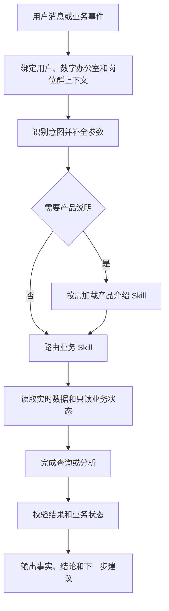
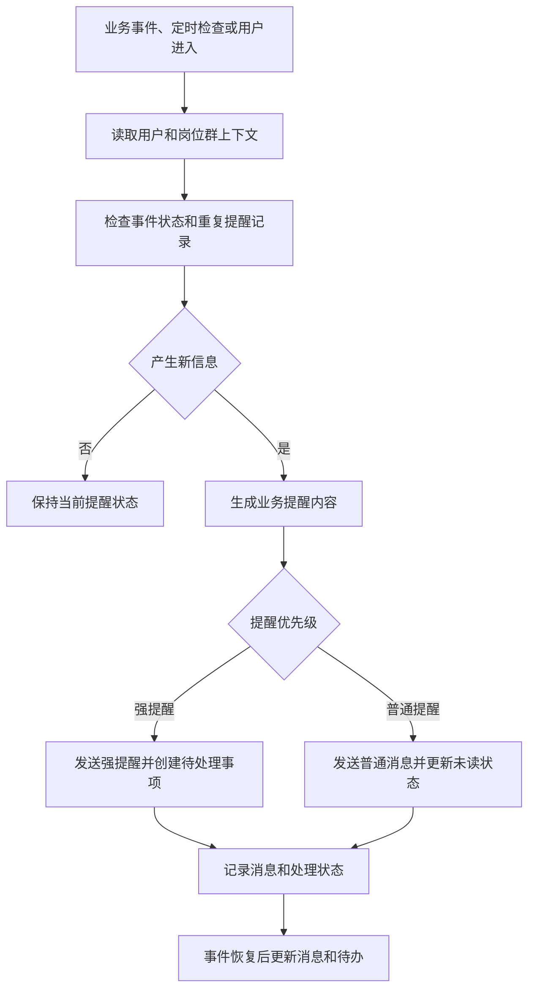
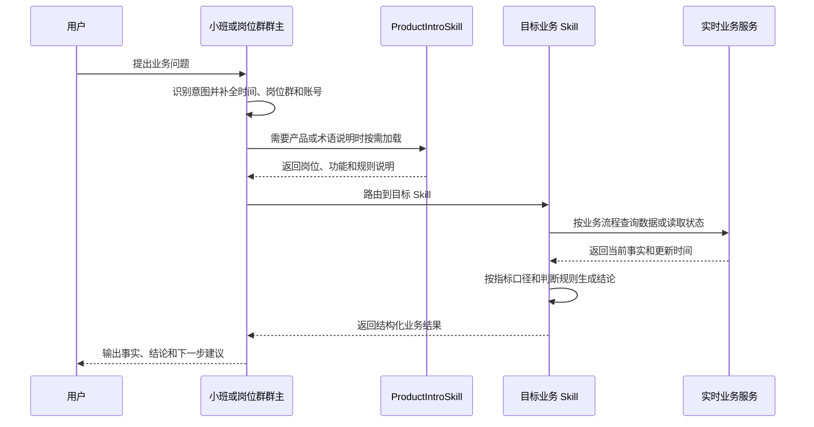
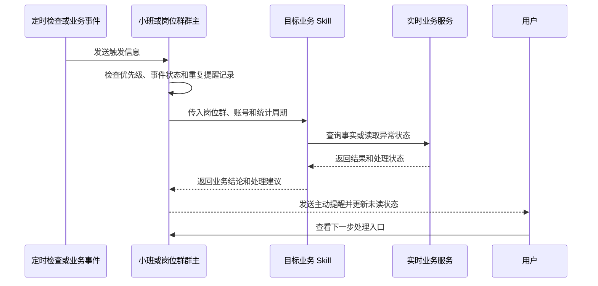
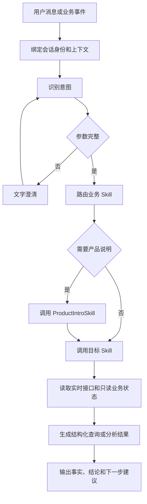
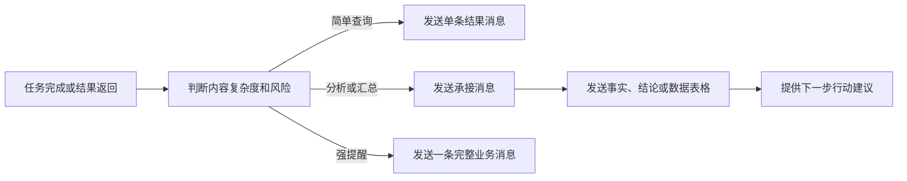
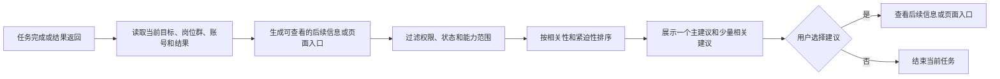
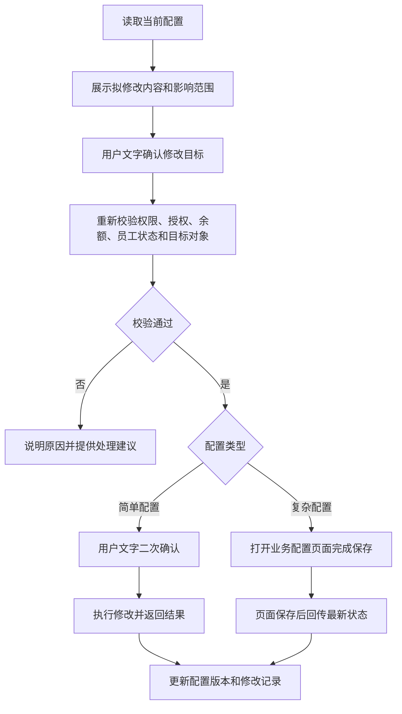
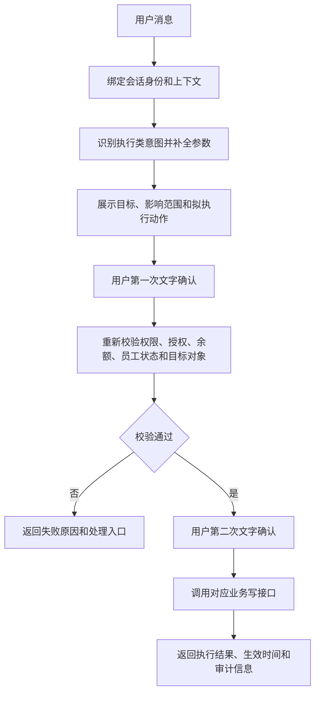

# AI数班对话逻辑设计方案

> 版本：v3.0
> 日期：2026-09-01
> 状态：查询与展示设计方案

> 本期范围：仅处理数据查询、分析和消息展示。配置修改、任务控制、话术写入、人工接管、报表订阅和页面保存等执行接口统一收录于文末附录，本期不处理。

本方案定义 AI 数班中小班、岗位群群主和业务 Skill 的对话身份、数据边界、数据查询、主动服务、消息协议与异常处理。系统以当前用户、数字办公室、岗位群、账号和任务为统一业务上下文。

# 第一部分：系统能力与服务端机制

## 1. Agent 能力结构

Agent 的工作链路为：

```text
接收用户消息或业务事件
 → 绑定身份和业务上下文
 → 识别意图
 → 补全参数
 → 路由查询或分析 Skill
 → 按需调用 ProductIntroSkill 加载产品说明
 → 读取实时数据并完成查询或分析
 → 返回事实、结论和下一步建议
```



| 能力层 | 具体能力 | 产出 |
|---|---|---|
| 身份与表达 | 称呼、人设风格、岗位职责和群主身份 | 稳定的表达方式 |
| 上下文 | 用户、数字办公室、岗位群、账号、任务、统计周期 | 完整工作范围 |
| 意图识别 | 查询、分析、解释、汇报和异常说明 | 结构化用户目标 |
| 参数补全 | 时间、岗位群、账号、指标和对象 | 可查询参数集 |
| Skill 路由 | 匹配业务场景和查询/分析工作流 | 目标 Skill |
| 数据查询 | 查询数据、读取只读状态和提供结果入口 | 业务结果 |
| 回复组织 | 事实、结论、操作建议和状态反馈 | 用户可理解的消息 |
| 记忆与反馈 | 会话、任务、用户偏好、配置版本和事件状态 | 连续协作体验 |

Agent 负责意图理解、Skill 路由和回复组织。业务 Skill 负责确定性的数据查询、判断和结果校验；业务系统负责权限、授权、余额、计费和任务状态。配置修改、任务控制和其他外部动作不属于本期对话执行范围，详见附录 A。

## 2. 数据查询能力

### 2.1 通用查询规则

- 所有 Agent 统计和明细查询的单次时间范围最长为 30 天，结束日期为当天或更早日期；客服实时工作数据按照接口返回的当前统计周期查询；
- 查询结果包含指标名称、指标口径、统计周期、岗位群/账号范围、数据更新时间和数据来源；
- 数据按照当前用户、数字办公室、岗位群和账号权限过滤；
- 记录量超过上下文预算时，服务端先返回聚合摘要，再提供缩小范围的选择；
- 原始客服消息仅以脱敏文本形式进入 Agent 上下文。

### 2.2 主号获客专家

查询范围为主号获客专家岗位群启用的账号，潜客统计和明细最大查询范围为 30 天。除账号授权状态外，业务数据分为“统计数据”和“潜客明细”两类。

#### 2.2.1 统计数据

统计数据用于查看指定统计周期内的获客链路汇总结果，返回以下指标：

| 指标类别 | 指标 |
|---|---|
| 获客规模 | 潜客数 |
| 获客规模 | 潜客分析数 |
| 获客规模 | 高意向潜客数 |
| 触达效果 | 触达潜客数 |
| 触达效果 | 触达回复数 |
| 触达效果 | 待触达数 |
| 转化结果 | 潜客对话数 |
| 转化结果 | 潜客留资数 |

#### 2.2.2 潜客明细

潜客明细用于查看单个潜客的记录和当前状态，返回以下字段：

| 字段类别 | 字段 |
|---|---|
| 潜客信息 | 昵称 |
| 潜客信息 | 意向度 |
| 潜客信息 | 车型 |
| 潜客信息 | 城市 |
| 触达过程 | 触达状态 |
| 触达过程 | 触达时间 |
| 触达过程 | 触达账号 |
| 转化状态 | 回复状态 |
| 转化状态 | 留资状态 |
| 来源信息 | 潜客账号 |
| 来源信息 | 潜客搜寻时间 |

账号授权状态作为独立结果返回，不与统计数据或潜客明细混合。

### 2.3 副号获客专家

查询范围、统计数据和潜客明细的字段结构与主号获客专家一致，数据范围为副号获客专家岗位群启用的账号；副号数据与主号数据独立统计、独立返回。

### 2.4 客服专员每小时数据

客服专员数据按照实时工作页规则按小时刷新，页面显示“每小时刷新”和最近更新时间（整点时刻）。指标仅统计当前客服账号、当前行业和当前统计周期；刷新失败保留最近一次成功快照并提供重试。

客服专员数据分为“私信转化漏斗”和“客户消息明细查询”两类。

#### 2.4.1 私信转化漏斗

私信转化漏斗用于展示当前统计周期内从进入私信到完成留资的转化过程：

| 顺序 | 指标 | 统计口径 |
|---|---|---|
| 1 | 进入私信人数 | 当前统计周期内进入客服私信的去重客户人数 |
| 2 | 回复率 | 回复数 ÷ 进入私信人数 |
| 3 | 回复数 | 当前统计周期内已完成回复的客户数 |
| 4 | 回复留资率 | 留资数 ÷ 回复数 |
| 5 | 留资数 | 当前统计周期内完成有效留资的客户数 |

#### 2.4.2 客户消息明细查询

客户消息明细查询用于查看具体会话及其消息内容，返回以下字段：

| 字段 | 返回内容 |
|---|---|
| 会话标识 | 会话 ID 或其他可追溯的会话标识 |
| 消息双方 | 发送方、接收方 |
| 消息时间 | 消息发送或接收时间 |
| 消息内容 | 脱敏后的文本内容 |

图片、附件和无法完成脱敏的内容以占位信息返回。大规模会话明细采用聚合、分页和范围缩小策略。

### 2.5 小班

小班可以调用已雇佣岗位群的数据接口并进行跨岗位汇总，汇总内容包括获客岗位潜客/触达/留资、客服五段式漏斗和各岗位运行状态。

小班可以查询线索明细、账号授权状态、余额和余额有效期：

| 数据 | 返回内容 |
|---|---|
| 线索明细 | 客户昵称、留资次数、联系方式类型、平台、转化类型、车系、城市、最新获客时间、获客账号 |
| 授权状态 | 开放平台授权、营销授权、云电脑依赖、授权到期时间、异常原因 |
| 付费状态 | 可用余额、最后充值时间、余额有效期截止时间、剩余天数、付费状态、受影响岗位群 |

联系方式只返回“手机号”“微信号”等类型；客服消息返回脱敏文本。

### 2.6 授权状态说明

所有岗位群账号状态统一说明以下业务信息：

| 业务信息 | 说明 |
|---|---|
| 抖音开放平台授权状态 | 说明账号读取和处理抖音平台私信的授权情况 |
| 抖音营销授权状态 | 说明账号执行潜客获取和主动触达的授权情况 |
| 云电脑运行状态 | 说明营销授权所依赖的云电脑是否正常运行 |
| 授权有效期 | 说明当前授权的到期时间 |
| 授权异常原因 | 说明异常原因和处理方式 |

云电脑是营销授权的运行依赖，独立记录和展示。

## 3. 本期接口边界

本期不处理配置修改、话术写入、任务控制、人工接管、报表订阅和页面保存等执行接口。正文只读取当前配置、状态和事件，并以查询结果或处理入口的形式展示；完整能力清单、接口边界和后续流程统一见文末附录 A。

## 4. 权限、隐私和上下文边界

1. Agent 只读取当前用户有权限的数字办公室、岗位群和账号；
2. 不同用户的数据、会话、任务和配置版本保持隔离；
3. 业务服务负责权限和状态校验，Agent 按服务端结果组织回复；
4. 未雇佣岗位的可用能力说明由 ProductIntroSkill 提供，业务数据由人才广场入口承接；
5. 授权过期时保留历史数据，并标注数据截止时间；
6. 客服会话分析使用当前用户有权限账号范围内的脱敏文本；
7. 联系方式以类型参与分析，具体号码保存在业务服务侧并隔离于 Agent 上下文。

## 5. 主动触发机制

### 5.1 触发事件

| 触发事件 | 接收方 | 消息内容 |
|---|---|---|
| 进入数字办公室 | 小班 | 整体工作状态、核心数据和待处理事项 |
| 点击岗位群 | 对应岗位群主 | 岗位群状态、最新结果和待处理事项 |
| 授权异常 | 小班或受影响岗位群主 | 异常字段、影响范围和处理方式 |
| 余额金额告警 | 小班 | 500/100/0 档位、当前余额、影响和联系运营人员提示 |
| 余额有效期告警 | 小班 | 到期日期、剩余天数、影响和联系运营人员提示 |
| 已有经营日报 | 小班 | 已有订阅范围内的经营数据和建议；本期不创建或修改订阅 |

### 5.2 冷却和去重

- 岗位群问候采用 30 分钟冷却规则；冷却参数读取当前配置，本期不提供修改；
- 授权异常、余额金额告警、余额有效期告警按事件状态即时处理；
- 相同异常、账号、授权类别和付费主体使用服务端的重复提醒识别信息；
- Agent 根据最近消息判断语义重复，判定没有新增信息时返回空结果；
- 事件恢复后保留历史消息并更新恢复状态；新账号、新授权类型或原因变化生成新事件；
- 主动消息进入对应聊天流后记录为未读；用户进入对应会话并看到消息后更新为已读。

主动提醒按照以下业务流程处理：



### 5.3 余额金额告警

余额档位按可用余额区间计算：500 元档位为 101 至 500 元，100 元档位为 1 至 100 元，0 元档位为 0 元及以下。同一付费主体同一自然日只发送一次金额告警。

- 可用余额首次进入 500 元档位，发送 500 元提醒；
- 可用余额首次进入 100 元档位，发送 100 元提醒；
- 可用余额降至 0 元或以下，发送 0 元告警并将受影响岗位群置为待处理/暂停状态；
- 一次扣费跨过多个档位时，发送当前余额对应的最低已命中档位；
- 次日重置当日发送记录，充值成功后按新余额重新计算。

余额金额告警文案：

| 档位 | 文案 |
|---|---|
| 500 元 | **余额提醒**：当前账户可用余额为 **实际余额** 元，已进入 500 元提醒档位。为避免后续服务受到影响，请联系运营人员进行充值。 |
| 100 元 | **余额提醒**：当前账户可用余额为 **实际余额** 元，余额即将用尽，可能影响数字员工继续工作。请联系运营人员进行充值。 |
| 0 元 | **余额告警**：当前账户余额已为 **0 元**，受影响的数字员工已暂停后续工作。请联系运营人员进行充值，充值完成后由运营人员重新检查并启用。 |

首期消息仅展示联系运营人员进行充值的文字提示；充值页面、充值按钮和自助充值跳转属于后续能力。

### 5.4 余额有效期告警

余额有效期以最后一次充值时间为起点向后计算 365 天，截止日期作为本次充值周期的余额有效期。

系统每天 08:00（Asia/Shanghai）检查余额有效期：

- 到期前 7 天发送一次提醒；
- 到期前 1 天发送一次提醒；
- 到期当天余额归零，受影响岗位群进入待处理/暂停状态，并发送一次 P0 告警；
- 充值成功后更新最后充值时间和有效期截止时间，恢复通过依赖校验的岗位群并清理上一周期提醒标记；
- 同一充值周期的 7 天、1 天和到期提醒各发送一次。

充值成功和岗位恢复仅作为外部事件读取并展示，本期不提供充值、启用或恢复操作。

余额有效期告警文案：

| 节点 | 文案 |
|---|---|
| 到期前 7 天 | **余额有效期提醒**：当前账户余额有效期将于 **余额有效期截止日期** 到期，距离到期还有 7 天。到期后余额将归 0，数字员工将暂停工作，请联系运营人员进行充值。 |
| 到期前 1 天 | **余额有效期提醒**：当前账户余额有效期将于 **余额有效期截止日期** 到期，距离到期还有 1 天。为避免数字员工暂停工作，请联系运营人员进行充值。 |
| 到期当天 | **余额有效期告警**：当前账户余额有效期已于 **余额有效期截止日期** 到期，余额已归 0，受影响的数字员工已暂停后续工作。请联系运营人员进行充值，充值完成后由运营人员重新检查并启用。 |

余额有效期到期造成余额归零时，与 0 元金额告警合并为一条“付费有效期到期并停用”消息，展示到期原因、受影响岗位群和联系运营人员提示。

### 5.5 授权异常事件

授权/账号服务产生异常事件，Agent 根据以下业务信息组装强提醒：

| 业务信息 | 说明 |
|---|---|
| 异常事件编号 | 用于追踪本次异常及关联后续恢复结果 |
| 异常类型 | 授权失效、授权撤销、授权校验失败或云电脑不可用 |
| 首次检测时间 | 记录系统首次发现异常的时间 |
| 数字办公室 | 标明异常所属的数字办公室 |
| 受影响岗位群 | 标明受到影响的岗位群 |
| 受影响账号 | 列出异常账号及账号名称 |
| 授权类别 | 区分抖音开放平台授权和抖音营销授权 |
| 运行依赖 | 说明云电脑等外部运行依赖的状态 |
| 当前状态 | 展示异常前状态、当前状态和恢复状态 |
| 异常原因 | 展示业务可读的原因说明 |
| 影响范围 | 说明受影响的能力、任务和数据 |
| 受影响任务 | 列出需要关注的运行中或待执行任务 |
| 提醒级别 | 授权异常统一使用 P0 强提醒 |
| 重复提醒识别信息 | 用于识别同一异常并控制重复提醒 |
| 处理入口 | 指向账号绑定、授权处理或运营人员联系入口 |

异常消息按以下结构展示：

```text
标题：授权异常
异常事件：异常事件编号、异常类型
事实：岗位群、账号和授权类型
原因：业务原因和检测时间
影响：受影响能力、任务和数据范围
动作：处理方式和账号绑定跳转
状态：当前授权状态和处理状态
```

典型文案：

- **开放平台授权失效**：主号获客专家的账号「账号名称」抖音开放平台授权已于检测时间失效。该账号暂时无法读取和处理抖音私信，受影响任务：受影响任务摘要。请进入账号绑定重新授权。
- **营销授权失效**：主号获客专家的受影响账号缺少抖音营销授权，原因是“业务原因”。这些账号暂时无法执行潜客获取和主动触达。请进入账号绑定处理营销授权。
- **云电脑依赖异常**：账号「账号名称」的营销授权运行依赖云电脑当前不可用，潜客获取和主动触达任务进入待处理状态，请联系运营人员处理云电脑依赖。

每条强提醒消息在正文中展示异常事件编号、检测时间和当前状态。账号绑定跳转包含数字办公室、受影响账号、授权类别、异常事件编号和处理页面信息。授权恢复以授权服务回传状态为准，恢复后更新消息和待办为“已恢复”并记录恢复时间。

## 6. 消息协议与交互状态

### 6.1 一期消息类型

| 类型 | 使用场景 |
|---|---|
| 文字消息 | 普通查询、分析、解释和异常说明 |
| Markdown 表格 | 多指标、账号对比和漏斗数据 |
| 跳转按钮 | 账号绑定、复杂配置和业务页面入口；本期仅提供入口，不执行页面操作 |
| 强提醒消息 | 授权异常、0 元余额和有效期到期 |
| “正在处理”加载状态 | 查询或分析 Skill 处理期间的统一等待状态 |
| SSE 流式输出 | 分析结果和较长文本的增量展示 |

内部工具调用、原始思考过程和代码属于服务端处理信息，消息流只展示用户可读的处理状态和最终结果。

### 6.2 SSE 与幂等

- 用户发送消息后立即创建任务并展示“正在处理”；
- 文本结果通过 SSE 增量返回；
- SSE 中断时保留已收到内容并提供整组重试；
- 重试沿用同一查询任务的唯一识别信息，查询和分析只执行一次；配置修改、任务控制和计费动作不在本期处理；
- 单个会话的上一任务完成后开放下一次发送，多个会话可以并行执行。

### 6.3 输入区

一期提供多行文本输入、发送按钮和查询快捷指令建议。发送按钮在当前会话查询任务完成后可用；消息以文字和 Markdown 为主要输入输出格式。

## 7. 记忆和数据边界

### 7.1 记忆类型

| 类型 | 内容 |
|---|---|
| 会话记忆 | 当前问题、确认参数、最近回复 |
| 任务记忆 | 任务目标、执行阶段、待确认内容、任务唯一识别信息 |
| 用户偏好 | 常用时间、范围和表达偏好 |
| 岗位群业务上下文 | 群主身份、业务规则和账号范围（只读） |
| 客户会话记忆 | 车型、预算、意向、历史问题和脱敏消息 |
| 异常事件记录 | 异常事件编号、重复提醒状态、处理状态、恢复时间 |

页面路径、会话未读状态和待处理任务按照数字办公室与岗位群保存。

### 7.2 数据优先级

```text
实时业务接口 > 当前配置 > 行业/门店知识 > 通用运营知识
```

回复引用实时数据时标明统计周期、范围和更新时间。产品、岗位、功能和术语知识由 ProductIntroSkill 按需加载；指标口径和查询规则由目标 Skill 随查询上下文加载。

# 第二部分：对话策略与业务 Skill

## 8. 会话容器与身份

### 8.1 会话对象

对话模块包含小班会话和岗位群会话：

- 小班固定置顶，负责跨岗位理解、汇总、通用说明和主动提醒；
- 每个岗位群由群主代表群内数字员工接收消息、汇总状态并回复；
- 同一岗位的多个账号归入同一个岗位群，岗位群群主统一承接成员工作结果；
- 主动消息进入对应小班或岗位群聊天流，并在会话列表产生未读状态；
- 会话历史按数字办公室、岗位群和账号范围隔离。

### 8.2 会话上下文

会话上下文包含以下业务信息：

| 业务信息 | 说明 |
|---|---|
| 当前用户 | 当前会话所属用户 |
| 数字办公室 | 当前操作所属的数字办公室 |
| 会话范围 | 小班会话或岗位群会话 |
| 岗位群和群主 | 当前岗位群及负责沟通的群主 |
| 岗位和账号范围 | 当前岗位以及可查询的账号 |
| 关联任务和异常事件 | 当前消息对应的任务或异常来源 |
| 统计周期 | 当前查询使用的时间范围 |
| 知识版本 | 当前使用的产品和行业知识版本 |

用户从数字办公室、实时工作或待办进入会话时携带来源岗位群、账号、任务或事件上下文；返回其他模块后恢复原会话和待办。

### 8.3 小班委派表达

小班直接使用小班身份输出结果，并在事实中标注来源岗位群、账号和统计周期：

> 昨日主号获客专家岗位群共发现 32 条潜客记录，其中 8 条已完成触达。需要我按账号查看回复和留资情况吗？

岗位群会话聚焦当前岗位群的数据、账号和统计周期。小班承担跨岗位聚合，岗位群主承担岗位内汇总。

## 9. Agent 身份声明

每个小班或岗位群主的系统身份声明包含：

1. 身份、岗位职责和群主职责；
2. 当前用户、数字办公室、岗位群和账号范围；
3. 可查询数据和能力边界；
4. 指标定义、统计周期和数据更新时间要求；
5. 权限、授权、余额、有效期和人工处理规则；
6. 表达风格：先结论、后事实、最后给出下一步建议；
7. 当前会话的知识版本、任务状态和事件状态。

身份文本只影响称呼、语气和表达方式，岗位能力、数据权限、账号范围、计费和业务判断由服务端配置决定。

## 10. ProductIntroSkill

### 10.1 定位

ProductIntroSkill 是系统支撑型 Skill，负责解释产品、岗位、功能、授权依赖和业务术语，与一期 7 个查询/分析 Skill 分开管理。

历史 PRD 已定义新用户进入数字办公室前由小班介绍岗位和结果；Agent 设置中的知识通过对话策略和车型库等业务模块维护。ProductIntroSkill 将岗位说明和功能说明按需加载到当前会话。

### 10.2 触发条件

- 用户询问岗位职责、可查询数据或能力边界；
- 用户询问授权、余额、有效期、一店一型或配置项含义；
- Agent 识别业务意图时缺少岗位、功能或术语定义；
- 新用户进入数字办公室，需要了解岗位和结果。

### 10.3 工作流

```text
识别产品说明需求
 → 调用 ProductIntroSkill
 → 加载行业、岗位、功能、依赖、术语和跳转入口
 → 写入当前会话上下文
 → 继续目标 Skill 或直接生成说明回复
```

ProductIntroSkill 返回岗位职责、能力边界、账号和授权依赖、余额/有效期规则、常用术语和页面入口。消息流展示用户可读的岗位说明和业务结果；实时接口和当前配置结果优先于产品说明。

## 11. 一期查询与分析 Skill 目录

| 编号 | 场景 | 优先级 | 适用会话 |
|---|---|---|---|
| S01 | 潜客数据查询 | P0 | 小班、主号获客岗位群、副号获客岗位群 |
| S02 | 潜客转化分析 | P0 | 小班、主号获客岗位群、副号获客岗位群 |
| S03 | 客服私信漏斗总览 | P0 | 小班、客服岗位群 |
| S04 | 授权异常查询与说明 | P0 | 小班、对应岗位群 |
| S05 | 跨岗位经营汇总 | P0 | 小班 |
| S06 | 触达效果分析 | P1 | 小班、主号获客岗位群、副号获客岗位群 |
| S07 | 客服会话分析 | P1 | 小班、客服岗位群 |

ProductIntroSkill 为系统支撑 Skill，配合上述查询与分析 Skill 工作。人工接管、日报/周报设置等执行类 Skill 统一收录于附录 A，本期不处理。

### 11.1 S01 潜客数据查询

| 要素 | 内容 |
|---|---|
| 触发条件 | 查询潜客、触达、回复或留资数据 |
| 必填参数 | 时间范围，默认昨日；岗位群和账号可按上下文补全 |
| 工作流 | 校验 30 天范围 → 查询统计和明细 → 返回事实 |
| 输出 | 文字消息或 Markdown 表格 |
| 必须包含 | 统计周期、岗位群/账号范围、核心数字、更新时间 |
| 后续建议 | S06 触达效果分析或 S02 潜客转化分析 |

### 11.2 S02 潜客转化分析

| 要素 | 内容 |
|---|---|
| 触发条件 | 询问留资下降、回复率变化或转化原因 |
| 必填参数 | 对比周期，默认昨日与前一日；岗位群和账号可补全 |
| 工作流 | 查询潜客→触达→回复→留资全链路 → 按账号比较 → 定位下降环节 |
| 输出 | 文字消息和 Markdown 对比表 |
| 必须包含 | 变化环节、涉及账号、变化幅度、样本周期 |
| 异常处理 | 样本量不足时返回样本量和扩大范围建议 |

### 11.3 S03 客服私信漏斗总览

| 要素 | 内容 |
|---|---|
| 触发条件 | 查询客服接待、私信转化或留资表现 |
| 必填参数 | 客服账号和统计周期，默认当前周期 |
| 工作流 | 读取每小时快照 → 返回五段式漏斗 → 标注更新时间 |
| 指标 | 进入私信人数、回复率、回复数、回复留资率、留资数 |
| 输出 | 文字消息或 Markdown 表格 |
| 异常处理 | 刷新失败返回最近成功快照、更新时间和重试提示 |

### 11.4 S04 授权异常查询与说明

| 要素 | 内容 |
|---|---|
| 触发条件 | 用户查询授权状态或收到授权异常事件 |
| 必填信息 | 目标岗位群、账号和异常事件业务信息 |
| 工作流 | 读取事件 → 按授权类型解释影响 → 生成 P0 消息 → 返回账号绑定入口（不执行授权操作） |
| 输出 | 强提醒文字消息和跳转按钮 |
| 必须包含 | 异常事件编号、岗位群、账号、授权类别、检测时间、原因、影响、任务和处理入口 |
| 状态 | 检测到异常 → 待处理 → 授权服务确认恢复 → 已恢复 |

### 11.5 S05 跨岗位经营汇总

| 要素 | 内容 |
|---|---|
| 触发条件 | 用户询问整体经营情况 |
| 必填参数 | 统计周期，默认昨日或订阅周期 |
| 工作流 | 并行读取各岗位群指标 → 汇总来源 → 标注异常和余额/有效期状态 |
| 输出 | 文字消息或 Markdown 表格 |
| 后续建议 | S01、S03 或 S04 |

### 11.6 S06 触达效果分析

按触达账号查询触达数、回复率和留资率，返回账号对比、周期、样本量和效果最低账号；后续可衔接 S04 授权异常查询与说明。

### 11.7 S07 客服会话分析

读取当前权限范围内的脱敏文本，按车型、预算和问题主题聚合，返回统计结论、样本量、分析周期和排名；后续可衔接 S01 查看高意向客户留资状态。

### 11.8 Skill 查询与分析示例

Skill 调用分为用户发问驱动和主动服务驱动。两类流程都由 Agent 负责理解或接收触发信息，由目标 Skill 完成确定性的数据查询、判断和结果返回。

#### 11.8.1 用户发问驱动



**示例一：分析昨日留资减少**

用户提问：“为什么昨天留资少？”

执行过程：

1. Agent 将问题识别为潜客转化分析，默认比较昨日与前一日，路由到 S02 潜客转化分析。
2. S02 加载潜客、触达、回复、留资和留资率的业务口径。
3. S02 查询两个周期的全链路数据，并按账号比较各环节变化。
4. S02 定位下降最大的环节和对应账号，返回样本量、变化幅度和统计周期。
5. Agent 组织结论并建议继续查看相关账号的触达效果。

示例回复：“昨日潜客数量与前一日接近，但回复数下降 28%，主要来自账号 A 和账号 B，留资减少发生在回复环节。需要我继续查看这两个账号的触达效果吗？”

**示例二：排查主号获客专家状态**

用户提问：“为什么主号获客专家今天没有工作？”

执行过程：

1. Agent 将问题识别为授权和运行状态查询，路由到 S04 授权异常查询与说明。
2. S04 按岗位群、账号、开放平台授权、营销授权、云电脑依赖、余额和员工状态读取当前信息。
3. S04 识别营销授权缺失，确认受影响账号和潜客获取、主动触达任务。
4. Agent 输出包含异常事件编号、授权类别、检测时间、原因、影响范围和账号绑定入口的强提醒。

示例回复：“主号获客专家有 2 个账号缺少抖音营销授权，当前潜客获取和主动触达任务受到影响，其他账号仍可工作。请进入账号绑定处理营销授权。”

**示例三：分析客服客户关注点**

用户提问：“客户最近都在问哪些车型和预算？”

执行过程：

1. Agent 将问题识别为客服会话分析，路由到 S07 客服会话分析。
2. S07 读取当前权限范围内的脱敏文本，按车型和预算聚合会话内容。
3. S07 返回排名、样本量、统计周期和最近更新时间。
4. Agent 建议继续查看高意向客户的留资状态。

示例回复：“最近会话中客户关注最多的是车型 A 和车型 B，预算主要集中在 15 至 20 万元区间。车型 A 相关会话中有 12 位客户表达明确购车计划，其中 4 位尚未留资，需要我继续查看这些客户吗？”

#### 11.8.2 主动服务驱动

主动服务由定时检查、授权异常、余额档位、余额有效期或用户进入页面触发。系统先依据事件状态和重复提醒记录判断是否产生新信息，再由目标 Skill 生成消息。



**示例一：工作日经营日报**

- 触发：工作日 09:00 到达日报订阅时间。
- 路由：S05 跨岗位经营汇总，使用订阅中保存的岗位群、指标和统计周期。
- 处理：并行读取各岗位群核心指标，标注异常和余额/有效期状态。
- 回复：“早上好，昨日新增潜客 32 条，留资 6 条。需要我按账号查看回复和留资情况吗？”

**示例二：余额档位提醒**

- 触发：可用余额首次进入 500 元、100 元或 0 元档位。
- 处理：同一付费主体同一自然日只发送一次金额告警；0 元时同步展示受影响员工和暂停状态。
- 回复：“余额提醒：当前账户可用余额已进入 500 元提醒档位。为避免后续服务受到影响，请联系运营人员进行充值。”

**示例三：授权异常强提醒**

- 触发：授权服务发现开放平台授权、营销授权或云电脑依赖异常。
- 处理：S04 按异常事件业务信息生成 P0 消息，列明异常类型、账号、授权类别、检测时间、原因、影响范围和处理入口；相同异常保持一条未读提醒，授权恢复后更新消息和待办状态。
- 回复：“授权异常：主号获客专家的账号 A 抖音营销授权已失效，潜客获取和主动触达任务受到影响。请进入账号绑定处理营销授权。”

**示例四：余额有效期提醒**

- 触发：系统每天 08:00 检查最后一次充值时间向后 365 天的余额有效期。
- 处理：到期前 7 天、1 天和到期当天分别提醒；到期当天余额归 0 并暂停受影响员工；首期统一提示联系运营人员充值。
- 回复：“余额有效期提醒：当前账户余额有效期将于余额有效期截止日期到期，距离到期还有 7 天。到期后余额将归 0，数字员工将暂停工作，请联系运营人员进行充值。”

## 12. 意图识别与参数补全

### 12.1 意图类型

```text
查询数据
分析原因
解释产品或业务规则
查询授权异常
分析客服会话
跨岗位汇总
```

配置修改、任务控制、人工接管和报表订阅等执行类意图本期只返回“不在本期范围”的说明，具体能力见附录 A。

### 12.2 参数规则

| 信息状态 | 处理动作 |
|---|---|
| 岗位群、账号、周期和指标完整 | 直接路由 Skill |
| 缺少必要参数 | 一次询问最多两个参数 |
| 存在多种理解 | 提供最多两个候选理解 |
| 可使用默认值 | 使用默认值并在回复中标明 |
| 连续澄清 | 最多两轮，之后返回可选范围和查询入口 |
| 超出岗位群能力 | 说明可用岗位群和对应入口 |

## 13. 岗位群能力范围

| 岗位群 | 本期开放的查询和分析 |
|---|---|
| 小班 | 跨岗位汇总、余额/有效期和授权状态 |
| 主号获客专家岗位群 | 潜客、触达、回复、留资和授权状态 |
| 副号获客专家岗位群 | 潜客、触达、回复、留资和授权状态 |
| 客服专员岗位群 | 每小时五段式私信漏斗和脱敏会话 |
| 短视频运营专员岗位群 | 后续版本接入 |

配置修改和执行接口能力不在本期开放，统一见附录 A。

## 14. 统一对话处理流程



## 15. 本期执行边界

配置修改、话术写入、任务控制、人工接管、报表订阅、页面保存及其他外部动作均不在本期执行。正文仅展示当前状态、事件、查询结果和页面入口；后续接口能力、流程和约束集中于文末附录 A，并统一标注“本期不处理”。

## 16. 主动服务内容策略

### 16.1 优先级

```text
P0：授权异常、余额归零、余额有效期到期
P1：留资骤降、回复率异常等经营指标异常
P2：日报、周报、进入办公室和岗位群问候
P3：成果达成和经营里程碑
```

P0 消息独立展示事实、影响和处理动作；P1 可以并入 P2 汇报；P3 作为一句补充。一次主动消息包含 2-3 个业务要点。

### 16.2 岗位群访问

首次进入岗位群时，群主发送岗位状态、最新结果和一个主建议。30 分钟内重复进入沿用当前会话；状态、待办或结果发生变化后生成更新问候。

### 16.3 等待状态

用户消息或主动事件进入处理后显示“正在处理”。数据或模型结果返回后替换为正式消息；超过 5 秒显示“数据量较大，正在继续处理”；超时返回失败原因和重试操作。

## 17. 回复组织与下一步行动

### 17.1 回复结构与分段策略

每项任务按照以下结构组织：

```text
承接问题 → 返回事实和判断 → 提供一个主建议
```

简单查询发送一条结果消息；分析结果使用文字和 Markdown 表格；P0 消息集中展示异常、影响和处理入口。配置修改、任务控制等执行结果本期不展示。

回复分段属于展示层策略。一次任务只生成一个执行计划和一个结果，系统根据内容复杂度决定使用单条消息或 2-3 条连续消息，保持事实、结论和建议的完整关联。

回复组织流程如下：



分段规则：

1. 简单查询、单项状态和异常说明直接发送一条消息。
2. 同时需要说明背景、关键结果和下一步时，按“承接说明 → 事实与结论 → 下一步建议”发送 2-3 条连续消息。
3. 承接说明只表达当前查询或分析处理，存在可感知等待时使用“正在处理”加载态；同步返回的结果直接合并。
4. 错误原因、金额和关键数字保持在同一组消息中；配置预览和生效结果本期不处理。
5. 授权异常、0 元余额和余额有效期到期使用一条完整强提醒，集中展示事实、影响和处理入口。
6. 每段消息共享同一岗位群、账号、任务和上下文；任一段发送失败时保留已发送内容，并提供整组重试。
7. 分段发送使用同一查询任务的唯一识别信息，重试仅补发消息；配置、任务控制和计费动作本期不处理。

分段示例：

1. “我整理了昨日与前一日的潜客转化数据。”
2. “昨日潜客数量与前一日接近，但回复数下降 28%，主要来自账号 A 和账号 B，留资减少发生在回复环节。”
3. “需要我继续查看这两个账号的触达效果吗？”

### 17.2 建议规则

- 默认提供一个主建议，最多补充两个相关建议；
- 建议来自当前岗位群已开放的能力；
- 用户选择建议后查看下一步信息并沿用上下文；
- 授权异常建议进入账号绑定；复杂配置仅提供对应配置页面入口，本期不执行页面保存；
- 余额和有效期告警统一提示联系运营人员进行充值。

下一步建议来源：

- 查询结果的自然延续，例如按账号展开明细、查看触达和留资环节；
- 当前结果暴露的经营问题，例如回复率下降后查看效果最低账号；
- 当前任务的后续环节，例如从高意向客户分析进入留资状态查询；
- 已有业务结果的自然延续，例如按同一范围查看日报或周报数据。

建议生成规则：

1. 建议依据当前会话、岗位群、账号、任务和实际结果生成，并沿用当前统计周期和数据范围。
2. 建议先经过权限、岗位能力、账号状态和任务状态校验，再按相关性和紧迫性排序。
3. 默认展示一个主建议，最多补充两个相关建议；当前任务完成且没有自然后续时直接结束会话。
4. 用户选择建议后继续使用原上下文；复杂配置只展示业务页面入口，简单配置和其他执行动作本期不处理。
5. P0/P1 异常优先展示解决当前问题的动作，余额和有效期告警统一提供联系运营人员充值的处理提示。

建议示例：

| 当前结果 | 主建议 | 后续处理 |
|---|---|---|
| 回复数下降，集中在账号 A、B | 查看这两个账号的触达效果 | 进入 S06 触达效果分析 |
| 发现账号营销授权失效 | 处理营销授权 | 打开账号绑定页面 |
| 车型 A 相关会话有高意向客户 | 查看高意向客户留资状态 | 进入 S01 潜客数据查询 |
| 周报数据已生成 | 查看周报数据 | 查看已有汇报结果 |
| 查询结果完整且无后续业务动作 | 当前任务已完成 | 结束当前任务 |

下一步行动建议流程如下：



## 18. 兜底策略

### 18.1 业务相关但信息不足

Agent 展示可选岗位群、时间范围或指标，单次补齐最多两个参数，连续澄清最多两轮，之后返回默认范围供用户确认查询。

### 18.2 产品说明需求

Agent 调用 ProductIntroSkill 解释岗位职责、功能边界、授权依赖、余额有效期和页面入口，再继续用户的业务问题。

### 18.3 当前能力范围外

Agent 返回当前可查询的相近能力和对应页面；配置与执行类能力只展示入口，不执行实际操作：

- 复杂配置进入对应配置页面（本期不保存）；
- 未雇佣岗位进入人才广场；
- 授权异常进入账号绑定或联系运营人员；
- 数据接口维护期间展示最近成功快照和重试提示；
- 任务控制、人工接管和报表订阅进入附录 A（本期不处理）。

## 19. 一期交付范围

一期包含：

1. 小班和岗位群群主双类会话入口；
2. ProductIntroSkill 和 7 个查询/分析 Skill（S01-S07）；
3. 意图识别、参数补全、上下文记忆和下一步建议；
4. 潜客查询、转化分析、客服每小时五段式漏斗和跨岗位汇总；
5. 授权异常、余额金额、余额有效期和已有经营日报主动提醒（不创建或修改订阅）；
6. 查询结果的文字、Markdown 表格、跳转入口、强提醒、加载状态和 SSE 展示；
7. 脱敏、权限、服务端去重、查询重试和审计记录。

配置修改、话术写入、任务启动/暂停/重试、人工接管、日报/周报订阅、页面表单保存和其他外部执行接口不属于一期交付，统一见附录 A。

## 20. 产品原则

1. 每个岗位群拥有清晰的身份、知识、数据和能力边界；
2. ProductIntroSkill 提供产品和岗位说明，业务 Skill 提供查询和分析路径，实时接口提供当前事实；
3. 信息完整时直接返回查询结果，信息缺失时精准补全，能力范围外提供明确入口；
4. 配置和外部动作本期不处理，相关设计统一收录于附录 A；
5. 主动消息围绕事实、影响和下一步行动组织；
6. 主动提醒使用服务端事件状态、重复提醒识别信息和恢复状态管理；
7. 余额金额和余额有效期分别计算、分别记录，并在同日归零时合并消息；
8. 用户可理解的消息只展示业务结果、处理状态和查看入口，不代表配置或外部动作已经执行。

# 附录 A：配置与执行接口能力清单（本期不处理）

> 本附录用于记录后续版本的接口设计和能力边界，不属于本期开发、联调或验收范围。本期对话仅可读取相关状态并展示说明或页面入口，不执行配置写入、任务控制、外部操作或人工接管。

## A.1 配置能力范围（本期不处理）

| 配置对象 | 后续接口能力 | 本期处理 |
|---|---|---|
| Agent 称呼、人设风格 | 读取、预览和修改 | 不处理配置写入 |
| AI 工作时间 | 读取、预览和修改 | 不处理配置写入 |
| 私信对话人设 | 读取、预览和修改 | 不处理配置写入 |
| 私信回复率兜底 | 读取、预览和修改 | 不处理配置写入 |
| 主号/副号账号范围 | 读取、预览和保存账号范围 | 不处理页面保存 |
| 主号/副号关系 | 读取、预览和保存主副号关系 | 不处理页面保存 |
| 潜客意向判断规则 | 读取、预览和修改判断规则 | 不处理配置写入 |
| 一店一型、组件类配置 | 检索、跳转页面或打开弹窗后保存 | 仅可展示入口 |
| 触达话术、开口话术 | 读取和写入默认行业模板 | 不处理话术写入 |
| 客服人机协作、关键词 | 读取和修改协作规则 | 后续版本接入 |
| 私信提示音 | 读取和修改前端设置项 | 后续版本接入 |

主号和副号获客专家的账号范围、主副号关联关系、潜客意向规则等业务配置由对应业务页面保存。Agent 后续可提供配置查询、说明和跳转参数，但本期不执行保存。

## A.2 配置变更流程（本期不处理）

后续版本的配置变更流程如下：



配置修改消息应包含配置名称、旧值、新值、影响账号、影响岗位群、生效时间和执行结果。配置详情页、数字办公室状态和后续任务使用最新配置；已执行任务保留启动时的配置版本。

每次配置修改均需要同一用户完成两次文字确认，并重新校验最新配置、权限、授权、余额、员工状态和目标对象。执行成功后更新配置版本、配置详情页、岗位群状态和后续新任务；审计记录保存修改人、时间、旧值、新值、影响范围、生效时间和执行结果。

## A.3 话术中台接口（本期不处理）

后续版本的话术能力使用通用行业模板编号，支持读取和修改一条默认文本：

- 读取当前模板编号、模板版本和默认文本；
- 将用户确认后的文本写入中台模板；
- 模板版本变化时重新读取并生成预览；
- 单次修改失败时返回配置页跳转和失败原因；
- 话术修改记录写入 Agent 配置历史。

## A.4 任务与外部动作接口（本期不处理）

| 能力 | 后续接口动作 | 本期处理 |
|---|---|---|
| 任务控制 | 启动、暂停、恢复、重试或取消任务 | 不处理实际任务动作 |
| 待办与状态写入 | 创建待办、更新任务状态、确认异常恢复 | 仅读取和展示当前状态 |
| 账号授权处理 | 打开账号绑定、重新授权、开启营销授权 | 仅提供处理入口 |
| 页面配置保存 | 保存账号范围、主副号关系、车型或组件配置 | 仅提供页面入口 |
| 消息发送 | 发送人工消息、触达消息或开口话术 | 不处理发送动作 |
| 充值与计费操作 | 发起充值、扣费、退费或调整账务 | 仅读取余额和费用状态 |
| 报表订阅 | 创建、修改、暂停或取消日报/周报订阅 | 仅查看已有汇报数据 |

任务控制、页面保存、消息发送和账务操作均需由对应业务服务完成；Agent 后续只负责参数补全、确认提示、结果回传和审计记录，本期不调用上述写接口。

## A.5 人工接管接口（本期不处理）

后续版本中，客服系统保存转人工规则和命中证据。用户主动询问待接管会话时，Agent 返回客户信息、触发原因和当前状态，并提供人工接管入口；客服系统回传状态后更新消息和任务：

```text
已触发 → 待接管 → 人工处理中 → 已结束
```

本期仅支持查询脱敏会话和展示待人工状态，不执行打开会话、接管、发送人工消息或结束接管。

## A.6 日报/周报订阅接口（本期不处理）

后续版本支持用户通过文字设置指标、频率、时间和岗位群范围。Agent 生成文字预览，用户完成两次文字确认后保存订阅；默认工作日 09:00 推送，订阅范围遵循当前用户权限。

本期不创建或修改订阅，仅支持查询已有汇报数据；日报触发、消息发送和订阅状态写入由后续版本处理。

## A.7 执行类意图与统一接口约束（本期不处理）

后续版本可识别以下执行类意图：

```text
修改简单配置
查看复杂配置并跳转
启动、暂停或重试任务
创建、修改或取消日报/周报
处理授权异常
人工接管
```

执行类意图的统一流程如下：



统一约束：

1. 执行前必须展示对象、旧值/新值、影响范围和生效时间；
2. 配置修改、任务控制、人工接管和报表订阅均需两次文字确认；
3. 每次执行携带唯一任务标识，重试不得重复写入、发送、计费或创建订阅；
4. 所有写接口由业务服务完成权限、授权、余额、状态和幂等校验；
5. 执行结果写入配置历史、任务记录、消息记录或审计记录；
6. 页面跳转参数至少包含页面类型、页面位置、弹窗类型、数字办公室、岗位群、账号和来源任务；
7. 本期遇到执行类请求时，仅返回“不在本期范围”的说明和对应处理入口，不调用业务写接口。
