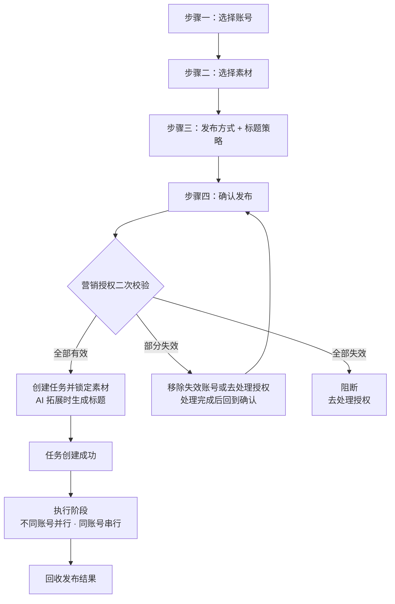
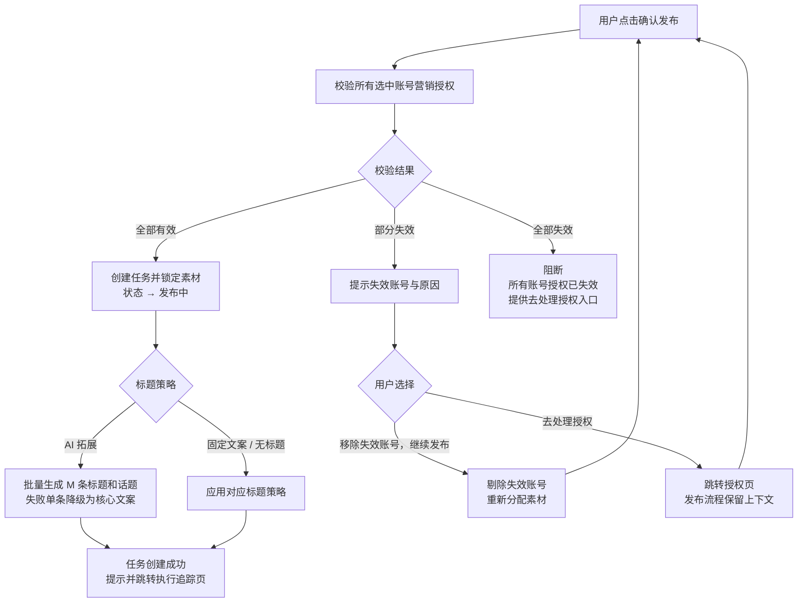
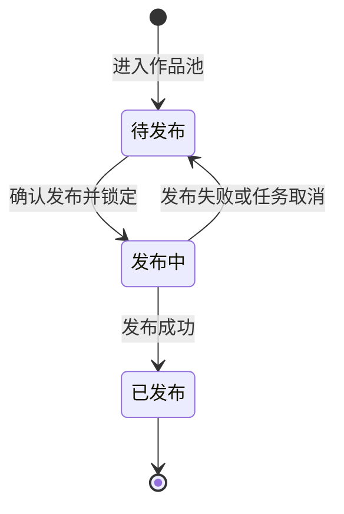
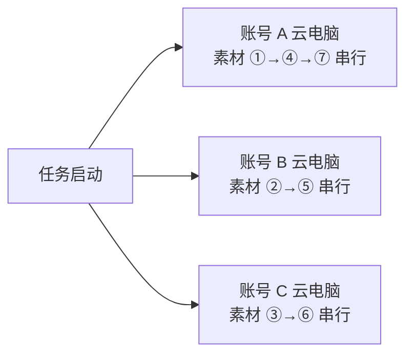

# AI数班 V1.3 · 短视频运营专员 PRD

> 版本：V1.3（当前 V1.3.12）
> 更新日期：2026-09-11
> 本次修订：计费口径由"按账号按月托管"改为"按账号按日扣费"（¥5/账号/天，当日开启即扣、T+1 结算），同步更新人才广场扣费透出与消耗展示；雇佣流程删除平台营销授权字段（前置条件仅余额 + 抖音营销授权），补充雇佣时账号勾选与启用/关闭规则；作品库用户上传增加格式、大小、时长、分辨率校验（按抖音官方视频发布限制，大小上限以云电脑实际发布带宽要求为准），所有"待发布"视频增加下载入口；作品库-监控抖音账号-添加账号时补充有效性校验（带加载状态），首次添加抓取 15 条，并明确作品去重规则（同一账号相同作品去重、不同账号相同作品不去重）；总览页面"正在发布"状态不再展示发布过程视频（发布完成后才可获取），仅"已发布"展示视频；作品库所有视频卡片删除"去发布"按钮，仅保留"下载视频"，发布统一从"发布任务 → 选择素材"发起；作品库-监控抖音账号列表删除"状态"列，监控状态由每日自动抓取开关与操作列体现；AI 拓展发布改为仅基于核心文案（必填）生成标题，删除基于文件名、素材原始标题、二创视频标题的改写逻辑，并补充话题标签的展示与编辑规则；确认页支持逐条编辑标题正文与话题标签（标题正文不再只读）；确认页"AI 标题预览"与"分配预览"合并为「素材 → 目标账号 → 发布标题」逐条展示；确认页顶部摘要行文案精简（发布素材只显示条数、标题策略只显示模式名）
> 状态：V1.3 需求已定稿
> 上游依据：V2.0 评审会议结论、《V2.0评审-后续动作总结.md》第三部分、《V1.3-短视频运营专员-发布流程逻辑补充方案.md》、现有高保真原型 v73

---

## 版本管理

> 本表记录本文档的历次变更，包含**变更位置**（章节，缩进表示从属子节）与**变更内容**。变更内容按 `① ② ③` 分条、`·` 列具体规则。后续每次调整在表末追加一行，并同步更新头部"更新日期""本次修订"与"版本"。

| 版本 | 日期 | 变更位置 | 变更内容 |
|------|------|----------|----------|
| V1.3.0 | 2026-09-04 | 全文 | 基线版本：短视频矩阵搬运发布（账号绑定/授权、监控抖音账号、发布任务、总览、作品库、内容效果记录），计费口径为"按账号按月托管（¥199/账号/月，暂定）" |
| V1.3.1 | 2026-09-11 | 1.2 本期目标<br>2.1 人物设定（计费行）<br>2.2 账号绑定/授权<br>2.3.2 权限区域<br>**2.5 计费规则（新增）**<br>　2.5.1 人才广场扣费透出<br>　2.5.2 消耗展示<br>　2.5.3 计费与消耗验收标准<br>4.8 素材状态与占用 | **① 计费口径：按账号按月托管 → 按账号按日扣费**（采纳 PRD-v1.0 第 204 行口径）<br>　· 默认 ¥5/账号/天，单价可配置，展示当前实际生效单价<br>　· 当日开启即产生当日费用，开启不足一天仍按一天计收<br>　· 次日结算时点扣减（T+1），计费自然日与扣费时间分列记录<br>　· 关闭当天仍计收当日费用、次日起停止，历史费用不回溯修改<br>　· 授权未完成或失效时，只要账号保持开启仍继续计费，不自动暂停或冲销<br>　· 余额不足时停止发布并进入"待处理"，但日费用照常计收<br>**② 2.5.1 人才广场扣费透出**<br>　· 岗位卡 / 岗位详情 / 雇佣确认页展示"按日服务费 ¥5/账号/天"<br>　· 按日计费提示与授权提示分开呈现，避免"未授权即不产生费用"的误解<br>**③ 2.5.2 消耗展示**<br>　· 每个账号每个计费自然日生成一条独立费用记录，不重复<br>　· 消耗明细固定四列：扣费时间 / 扣费账号 / 电力值 / 扣费备注<br>　· 备注固定展示"日消耗扣费"，不拼接账号、日期等信息<br>　· 明细按扣费时间倒序；表格列的拓展性设计不入本期 PRD<br>**④ 2.5.3 计费与消耗验收标准**：新增 8 条<br>**⑤ 用语区分（4.8）**：标题"素材状态与消耗"→"素材状态与占用"，正文"消耗 / 永久消耗"→"占用 / 永久占用"<br>**⑥ 2.3.2**：补充"账号开关同时是计费开关"说明 |
| V1.3.2 | 2026-09-11 | 2.4 人才市场雇佣流程<br>　2.4.1 进入雇佣确认<br>　2.4.2 核心依赖检查<br>　**2.4.3 账号勾选与启用/关闭规则（新增）**<br>　2.4.4 依赖通过后的直接雇佣<br>　2.4.5 雇佣失败、取消与回流<br>4.3 步骤一：选择账号 | **① 删除"平台营销授权"字段与文案**（该能力已砍）<br>　· 前置条件仅保留"余额 + 抖音营销授权"两项<br>　· 弹窗与核心依赖表中不再出现平台授权状态<br>**② 新增 2.4.3 账号勾选与启用/关闭规则**<br>　· 勾选 = 纳入发布范围的账号；开关 = 范围内账号当前是否工作<br>　· 仅营销授权有效的账号可勾选；已完成授权的账号默认全部勾选并开启<br>　· 勾选是启用开关的前置条件：未勾选时开关置灰为"已关闭"，取消勾选同时回落"已关闭"<br>　· 勾选但未开启的账号进入范围但不参与发布；发布任务只从"已启用"账号中选取<br>　· 至少 1 个账号"已勾选 + 已开启"才能确认雇佣<br>　· 雇佣成功当日处于"已开启"的账号即产生当日费用，仅勾选未开启不计费<br>　· 雇佣完成后新增账号默认进入范围但为"已关闭"，需手动开启<br>**③ 章节顺延与口径同步**：原 2.4.3 / 2.4.4 → 2.4.4 / 2.4.5，"月托管费用""开始计费"等表述改为按日计费口径<br>**④ 4.3**：明确账号范围由雇佣时的勾选结果决定，"已开启"由 Agent 设置「账号范围」开关决定 |
| V1.3.3 | 2026-09-11 | 2.3.2 权限区域（账号范围） | **Agent 设置中的抖音平台授权同步删除**<br>· 权限区域只管理参与矩阵发布的账号范围，平台授权状态不再展示与校验<br>· 账号行字段调整：<br>　原"账号名称、抖音平台授权、营销授权、启用状态、最近一次授权检查时间"<br>　→ 新"账号名称、抖音营销授权、启用状态、最近一次授权检查时间"<br>· 表述调整："抖音平台授权和营销授权管理仍由账号绑定模块承载"<br>　→"抖音营销授权管理仍由账号绑定模块承载，本区域不展示平台授权状态" |
| V1.3.4 | 2026-09-11 | 6.5 用户上传<br>6.3 列表展示与素材状态<br>4.4 步骤二：选择素材 | **① 上传本地视频增加抖音官方视频发布限制校验**（未通过的文件不进入作品池，同批次其他文件不受影响）<br>　· 格式：MP4 / MOV / WebM（H.264）<br>　· 大小：单个文件 ≤ 4GB（标注"抖音发布限制，具体发布大小以云电脑实际发布带宽要求为准"）<br>　· 时长：单条 ≤ 15 分钟<br>　· 分辨率：不低于 720p（横屏 ≥ 1280×720、竖屏 ≥ 720×1280，推荐 1080×1920）<br>　· 时长与分辨率通过读取视频元信息校验，不需用户额外填写<br>　· 帧率、码率等画质参数仅作发布前提示，不作上传拦截<br>**② 作品卡片展示**：校验通过后展示文件大小与时长<br>**③ 所有"待发布"视频增加下载入口**<br>　· 作品库待发布卡片 + 发布任务"选择素材"列表均提供"下载视频"<br>　· 下载原文件，文件名沿用素材原始标题<br>　· 点击下载不改变素材勾选状态 |
| V1.3.5 | 2026-09-11 | 6.4 监控抖音账号配置 | **① 添加账号补充有效性校验（带加载状态）**<br>　· 输入抖音号 → 点击"开始监控" → 校验期间按钮呈"校验中…"加载态、抖音号不可编辑，校验通过后加入监控列表并自动开始监控<br>　· 校验项：抖音号格式、账号是否存在、账号状态是否正常、是否已在监控列表<br>　· 校验不通过时在弹窗内就地提示原因（格式不正确 / 未找到该抖音号 / 抖音号状态异常 / 已在监控列表中），账号不进入列表，可直接修改重试<br>**② 首次添加抓取 15 条**<br>　· 校验通过后立即执行首次抓取，抓取该账号最近 15 条作品，去重后进入作品池<br>**③ 明确作品去重规则**<br>　· 同一账号的相同作品去重：同一账号重复抓取到同一条抖音作品时只保留一条<br>　· 不同账号发布的同一条作品不去重：按账号分别保留，各自进入作品池（以抖音作品ID 判定）<br>　· 同步结果提示给出抓取/新增/去重数量 |
| V1.3.6 | 2026-09-11 | 5.2 视觉方案<br>5.4 交互<br>3.2 数字办公室侧栏概览 | **① 总览页面发布过程视频展示规则调整**<br>　· "正在发布"不再展示视频：发布过程视频需在作品发布完成后才能从抖音获取，正在发布阶段获取不到<br>　· 仅"已发布"展示动态视频（静音、循环播放，当天"HH:mm"、隔天"MM-DD · HH:mm"）<br>　· 正在发布改为绿色进行中空态："正在发布 / 发布过程视频将在发布完成后展示"，保留进度条与预计完成时间<br>　· 5.4 交互同步：正在发布卡片不展示视频，已发布卡片展示最近一次发布视频<br>　· 小标题同步：每个账号展示当前状态，已完成发布的账号展示最近一次发布视频<br>**② 侧栏工作界面同步**：视频优先展示最近一次已完成发布的账号（正在发布阶段不展示视频，改为进行中空态） |
| V1.3.7 | 2026-09-11 | 6.3 列表展示与素材状态<br>4.1 定位<br>5.x 控件说明 | **作品库卡片删除"去发布"按钮**<br>　· 作品库中所有视频（监控抓取 + 用户上传）卡片只保留"下载视频"，不再提供"去发布"入口<br>　· 发布统一从"发布任务 → 选择素材"发起，避免卡片上出现与任务流程重复的发布入口<br>　· 4.1 同步口径：作品库只作为素材来源，卡片仅提供"下载视频"，不提供发布入口<br>　· 控件说明同步：结果动作示例由"去发布""查看作品"改为"下载视频""查看作品""去处理" |
| V1.3.8 | 2026-09-11 | 6.4 监控抖音账号配置 | **监控账号列表删除"状态"列**<br>　· 列表列调整为：账号 + 已获取作品数 + 最近抓取时间 + 每日自动抓取开关 + 操作（同步/恢复监控、删除）<br>　· 监控状态不单列展示：是否在监控由"每日自动抓取"开关与操作列按钮体现，不再单独展示"监控中/已暂停" |
| V1.3.9 | 2026-09-11 | 4.5.2 标题策略<br>　AI 拓展发布<br>　话题标签的展示与编辑规则（新增）<br>4.6.1 确认页展示内容<br>4.13 本期范围边界<br>7.6 数据结构 | **① AI 拓展发布仅基于核心文案生成标题**<br>　· 核心文案为**必填**，为空时"下一步"禁用并提示"请输入核心文案"<br>　· 删除基于文件名、素材原始标题、二创视频标题的改写逻辑：素材信息不参与生成，仅以 `materialId` 与分配顺序用于回写到对应素材<br>　· Prompt 输入调整为"素材标识（仅用于回写，不参与生成）"，要求第 1 条改为"只依据核心文案生成"<br>**② 话题标签保留，新增"话题标签的展示与编辑规则"**<br>　· 展示：确认页按素材逐条展示标题正文与话题标签（标签以独立 chip 展示），拼接后即实际发布标题并实时校验 55 字符；任务详情与发布结果沿用同一展示<br>　· 编辑位置：确认页逐条编辑话题标签（新增/修改/删除）；标题正文保持 AI 批量生成，不提供逐条编辑<br>　· 格式：必须 `#` 开头，未带 `#` 自动补全，不得为空或仅为 `#`<br>　· 数量：每条最多 3 个，超出时提示"最多添加 3 个话题标签"；可删至 0 个<br>　· 去重：同一条发布标题内不重复，重复提示"该话题标签已存在"<br>　· 长度：编辑后拼接总长 > 55 字符时就地提示并禁用"确认发布"<br>　· 生效范围：编辑作用于该条素材，其分发到的所有账号使用同一份标题与标签<br>　· 标记与兜底：用户编辑过的条目标记"用户修改"；删除全部标签后按"仅标题正文"发布，不自动补回<br>**③ 边界同步**：4.13 由"标题和话题标签均不提供逐条编辑"调整为"标题不提供逐条编辑，话题标签可在确认页逐条编辑"；7.6 `topicTags` 说明补充"或经用户编辑后的最终结果" |
| V1.3.10 | 2026-09-11 | 4.5.2 标题策略<br>　话题标签的展示与编辑规则<br>4.6.1 确认页展示内容<br>4.13 本期范围边界 | **① 标题正文与话题标签均可在确认页逐条编辑**（此前仅话题标签可编辑）<br>　· 编辑位置：确认页（步骤四）逐条编辑标题正文与话题标签，二者均为可编辑项<br>　· 标题正文：单行可编辑、不得为空；与话题标签拼接后不得超过 55 个字符，超出时就地提示并禁用"确认发布"<br>　· 支持操作补充为：修改标题正文、新增标签、修改标签文字、删除标签<br>　· 展示同步：确认页标题正文由文本展示改为单行输入框<br>**② 标记与兜底同步**：标题正文或话题标签被编辑过即标记"用户修改"；用户修改后的标题正文不被 AI 结果覆盖<br>**③ 边界同步**：4.13 调整为"AI 标题与话题标签批量生成，生成结果可在确认页逐条编辑（标题正文与话题标签），除确认页外不提供逐条预审" |
| V1.3.11 | 2026-09-11 | 4.7.3 确认页分发预览<br>4.6.1 确认页展示内容<br>4.5.2 话题标签的展示与编辑规则 | **① 确认页"AI 标题预览"与"分配预览"合并为一个模块**<br>　· 合并为「素材 → 目标账号 → 发布标题」逐条展示，一行一条素材，一处确认"哪个视频发给哪个账号、用什么标题发布"<br>　· 4.7.3 由"按账号维度平铺展示、只读"改为按素材逐条展示<br>　· 发布标题列随标题策略变化：无标题=「—（无标题）」只读；固定文案=统一文案只读（修改回步骤三）；AI 拓展=标题正文与话题标签可直接在本页逐条编辑<br>**② 4.6.1 分发预览行同步**为「素材 → 目标账号 → 发布标题」；4.5.2 展示规则同步说明"同一行展示目标账号" |
| V1.3.12 | 2026-09-11 | 4.6.1 确认页展示内容 | **确认页顶部摘要行文案精简**<br>　· 发布素材：由"7 条（去重分发，每条发到唯一账号）"精简为"7 条"<br>　· 标题策略：由"AI 拓展：基于「核心文案」生成 N 条不同标题"精简为模式名"AI 拓展"（固定文案同理，不再回显文案内容）<br>　· 补充口径：摘要行只给结论值，标题与话题的具体内容、素材与账号的对应关系统一在下方"分发预览"逐条呈现；"去重分发"说明归入"素材总数"行 |

---

## 一、产品概述

### 1.1 定位

短视频运营专员是统一管理客户抖音账号矩阵的数字员工。其核心能力为**短视频矩阵搬运发布**：从监控抖音账号抓取、或由客户上传的视频进入待发布作品池，按发布任务去重分发到已授权的抖音账号，回收单账号发布结果及作品效果指标，并在成果中心沉淀内容效果记录。

### 1.2 本期目标

- 跑通"账号 → 素材 → 发布"完整闭环。
- 在**实时工作**页面下交付三个核心模块：**发布任务（核心入口）、总览（账号发布状态）、作品库（待发布池）**。
- 在**成果中心**交付**内容效果记录**，支持按时间、账号和作品名称组合查询、访问抖音作品及导出发布效果。
- 提供账号绑定/授权、监控抖音账号两个前置能力。
- 在人才广场提供单页雇佣确认入口，保留余额、抖音账号授权状态与按日计费口径展示；核心依赖为余额和抖音营销授权。

### 1.3 版本规划

| 版本 | 交付能力 |
|------|----------|
| 本期 V1.3 | 短视频矩阵搬运发布：账号管理、素材聚合、去重分发、批量发布、结果回收、内容效果记录与导出 |
| 后续版本 | AI 内容创作、二创素材编辑、一键文解 |

---

## 二、角色与账号

### 2.1 人物设定

| 项 | 内容 |
|----|------|
| 中文名 | 短视频运营专员（昵称"由客户进行自定义"） |
| 平台 | 仅抖音 |
| 人设 | 完成抖音平台短视频矩阵账号的快速孵化，完成批量短视频发布 |
| 形象 | 视觉而定，区分雇佣前后：雇佣前"可雇佣"；雇佣后"工作中 / 空闲中 / 待处理 / 已暂停" |
| 计费 | ¥5 / 账号 / 天（按账号按日计费：当日开启即扣、次日结算，关闭当天仍计费、次日起停止；单价可配置） |

### 2.2 账号绑定/授权

抖音营销授权是发布任务的**前置条件**，抖音账号无营销授权则无法发布。

- 绑定入口：总览页账号发布状态区域末尾的"＋"占位卡片，点击发起新账号绑定。
- 授权：完成抖音营销授权后加入账号发布范围；账号保持开启即按日计费，与授权是否完成、是否实际发布解耦。
- 授权状态：以现有营销授权流程为准。
- 授权异常：由小班和对应数字员工高通过对话并列出受影响账号；用户处理后重新检查权限并恢复发布。
- 账号权限：由短视频运营专员 Agent 设置中的账号范围控制哪些账号参与矩阵发布。
- 授权状态变化后，账号页、数字办公室待办、人才广场和实时工作状态保持一致。

### 2.3 Agent 设置（工作设置）

用户可从数字办公室侧栏身份头部、实时工作页员工操作菜单进入"Agent 设置"。设置页仅编辑当前短视频运营专员；切换其他数字员工需关闭设置页返回数字办公室。关闭后返回原页面，并保留当前账号、任务和滚动位置。

- 设置页沿用客服专员 Agent 设置的工作区样式：顶部工作区身份栏、标签导航、浅灰内容底色和白色设置卡片保持一致；当前员工名称、岗位、状态和关闭入口均来自统一组件。
- 进入 Agent 设置后，顶部导航仅保留"Agent 设置"当前项；关闭设置页返回原页面，若从实时工作进入则恢复实时工作下的模块导航。
- 设置内容按原型从上到下仅分为"身份""技能""权限"三个区域，每个区域展示用途、当前值和可操作边界。
- "知识库""策略""记忆"不属于短视频运营专员 Agent 设置；内容来源和发布规则分别在作品库、发布任务流程中配置，长期规则通过任务上下文处理。
- Agent 正在工作时允许查看设置；身份和账号范围的修改从下一次新任务生效，正在执行中的任务沿用任务创建时的设置版本。
- 设置页加载中显示设置骨架；加载失败显示重试入口；重试保留已经打开的设置内容。

#### 2.3.1 身份区域

身份区域用于定义短视频运营专员对外展示的称呼和表达方式，仅影响对话表达，发布能力、数据权限、账号范围与计费规则不受影响。

- "Agent 称呼"为单行文本，默认填充"短视频运营专员"；用户可修改，必填，且需为有效内容并与已有 Agent 自定义名称相区分。
- "Agent 人设"为多行文本，默认描述"负责抖音账号矩阵的内容排期、批量发布和效果回收"；输入框提示"人设影响表达方式，不会改变能力和权限"。
- 身份字段仅承载表达方式，不承载内容创作、平台操作或数据权限等能力。
- 修改身份后，关闭设置页不保存；点击"保存设置"才提交。存在未保存修改时关闭，需二次确认是否放弃修改。

#### 2.3.2 权限区域（账号范围）

权限区域只管理当前 Agent 参与矩阵发布的账号范围；抖音营销授权管理仍由账号绑定模块承载，本区域不展示平台授权状态。账号列表按单个账号展示，筛选仅支持账号维度。

- 每行展示账号名称、抖音营销授权、启用状态、最近一次授权检查时间。
- 营销授权完整时显示"可用"，允许用户开启或关闭该账号的发布范围；开启后新发布任务才可选择该账号。
- 账号开关同时是计费开关：当日该账号保持开启即产生当日费用；关闭当天仍计收当日费用、自次日起停止计费；开关变更不影响已产生的历史费用。
- 营销授权不完整时显示"不可用"，并提供"去账号绑定/重新授权"入口；不可用账号的开关置灰。
- 账号被关闭后保留历史发布结果，不再进入新任务；正在执行的任务继续使用任务创建时锁定的账号范围。
- 没有可用账号时显示业务空态"暂无可用账号"，提供"去绑定账号"入口；保存前重新校验授权状态和账号可用性。
- 保存账号范围后，账号绑定、数字办公室待办、人才广场和实时工作状态立即同步；新增账号默认关闭，需在此处手动开启。

#### 2.3.3 技能区域

技能区域用于展示短视频运营专员的固定能力，仅做展示，不提供添加、删除或调整。右上角展示"固定 · 不可更改"状态。

| 序号 | 固定技能 |
|------|----------|
| 01 | 矩阵账号管理 |
| 02 | 抖音账号监控 |
| 03 | 自动发布 |
| 04 | 效果回收 |

#### 2.3.4 设置保存、取消与生效规则

1. 点击"保存设置"时，系统校验 Agent 称呼、人设和账号范围；必填项缺失或账号不可用时阻止保存，并在对应区域说明原因。
2. 保存期间按钮显示处理中并禁止重复点击；保存成功后提示修改项、影响范围和生效时点。
3. 身份修改从下一次新对话或新任务生效；账号范围保存并通过授权检查后对新任务生效；技能和授权权限由本设置页以外的模块承载。内容来源和发布方式在对应工作区流程中修改。
4. Agent 正在执行任务时，保存设置不影响当前任务的执行；当前任务继续使用启动时的设置版本。
5. 保存失败时保留用户输入并显示可重试原因；只有保存成功的内容才标记为已生效。
6. 设置保存成功后刷新数字办公室侧栏、实时工作状态和 Agent 设置页，并记录 Agent、修改人、修改时间、修改项、账号范围和生效范围。

### 2.4 人才市场雇佣流程

短视频运营专员从人才市场岗位卡进入单页雇佣确认。弹窗展示余额、抖音营销授权状态和账号勾选列表，一步完成雇佣确认；系统在确认前校验依赖，校验通过后直接创建员工。

#### 2.4.1 进入雇佣确认

- 用户在人才市场点击短视频运营专员岗位卡的"雇佣"后，打开"雇佣短视频运营专员"弹窗。
- 弹窗顶部展示岗位头像、岗位名称和关闭按钮；副标题为"确认余额与抖音营销授权状态后即可开始矩阵发布"。
- 弹窗直接展示余额、抖音营销授权状态、账号勾选列表与确认按钮。
- 余额和账号授权状态加载或刷新时，仅在对应状态区域显示处理中；状态就绪后直接展示可雇佣条件和确认按钮。

#### 2.4.2 核心依赖检查

| 检查项 | 通过条件 | 未通过时的展示与处理 |
|------|----------|----------------------|
| 余额 | 当前余额足以覆盖当日已开启账号的按日费用（最低口径：至少 1 个账号 × 1 日单价） | 标记"余额不足"，提供"去充值"入口；补足前禁止雇佣 |
| 抖音营销授权 | 至少一个已绑定抖音账号的营销授权有效，可参与发布 | 标记"待授权"，展示受影响账号和授权状态，提供"去账号绑定/授权"入口；满足前禁止雇佣 |

- 抖音营销授权状态沿用主号获客专家的账号行展示：按单个账号列出账号名称、抖音号、营销授权状态和当前可用性，并提供"去授权/查看"操作；筛选和范围判断仅按账号维度。
- 雇佣校验只包含余额与抖音营销授权两项，不校验平台授权；雇佣流程不出现"平台授权""平台营销授权"字段与文案（该能力已砍，仅保留营销授权）。
- 已完成抖音营销授权的账号默认勾选并处于开启状态，构成短视频运营专员的初始工作范围；未完成授权的账号不进入工作范围，后续可在 Agent 设置中手动开启。
- 授权检查通过后的账号勾选与启用/关闭规则见 2.4.3。
- 余额或授权状态在检查完成后发生变化时，用户点击确认雇佣前需重新检查；检查未通过时不创建员工。

#### 2.4.3 账号勾选与启用/关闭规则

账号勾选发生在雇佣确认页，决定"本次雇佣把哪些账号纳入发布范围"；启用/关闭开关决定"纳入范围内的账号当前是否工作"。两者共同决定雇佣成功后的初始账号范围和雇佣当日的计费账号。

- 账号列表按单个账号展示账号名称、抖音号、营销授权状态、勾选框和启用/关闭开关，并提供"去授权/查看"操作；雇佣流程不展示平台授权状态。
- 仅营销授权有效的账号可勾选；未完成营销授权的账号置灰不可勾选，展示"营销待授权"和"去授权"入口，授权完成后自动变为可勾选。
- 已完成营销授权的账号默认全部勾选并处于"开启"状态，列表支持全选与取消全选。
- 勾选是启用开关的前置条件：账号未被勾选时，启用/关闭开关置灰不可操作，并统一显示为"已关闭"；取消勾选会同时把该账号的开关回落到"已关闭"。
- 勾选但未开启的账号进入账号范围但不参与发布；发布任务只从"已启用"的账号中选取（见 4.3）。
- 至少需要 1 个账号处于"已勾选 + 已开启"状态才能确认雇佣；不满足时确认按钮保持禁用，并在账号区域提示"至少启用 1 个账号"。
- 确认雇佣后，勾选与开关结果作为初始状态写入 Agent 设置「账号范围」，并作为雇佣成功当日的计费账号范围：雇佣成功当日处于"已开启"的账号即产生当日费用，仅勾选而未开启的账号不产生费用（计费口径见 2.5）。
- 雇佣完成后，用户可在 Agent 设置「账号范围」中继续勾选账号或切换启用/关闭开关；账号开关同时是计费开关，关闭当天仍计收当日费用、自次日起停止计费。
- 雇佣完成后新增的抖音账号走 Agent 设置「账号范围」规则：默认进入账号范围但处于"已关闭"状态，需手动开启（见 2.3.2）；雇佣确认页内新完成授权的账号仍按默认勾选并开启处理。

#### 2.4.4 依赖通过后的直接雇佣

- 两项核心依赖均通过、且账号勾选满足 2.4.3 的启用要求时，底部主按钮显示"确认并雇佣短视频运营专员"。
- 用户点击确认后，按钮进入处理中并禁止重复提交；系统创建数字员工、按 2.4.3 保存初始账号范围（勾选与启用状态）并建立按账号按日计费关系。
- 雇佣成功后提示"雇佣成功"，短视频运营专员状态更新为"工作中"，并直接进入实时工作页。
- 实时工作页首次打开时进入"总览"，展示已纳入账号范围、当前发布状态和可执行的发布任务入口；首次打开即可开始工作，Agent 设置为雇佣后的可选调整。
- Agent 设置属于雇佣后的可选调整入口，用户可在数字办公室侧栏或实时工作页中继续修改身份和账号范围；发布方式回到发布任务流程中调整。

#### 2.4.5 雇佣失败、取消与回流

1. 任一依赖未通过时，确认按钮保持禁用；用户可点击"去充值"或"去账号绑定/授权"，处理完成后返回原检查弹窗并保留检查上下文。
2. 用户点击关闭或取消时，岗位雇佣状态保持不变，不产生任何日费用，已获取的余额、账号授权状态和勾选/开关结果保留。
3. 提交失败时保留检查结果和账号授权状态，提示可重试原因；仅在创建成功后才标记为已雇佣，并以雇佣成功时间作为首个计费自然日开始计费。
4. 雇佣成功后再次进入人才广场，岗位卡显示"已雇佣/查看工作"。

### 2.5 计费规则（按账号按日扣费）

短视频运营专员与客服专员采用一致的按日扣费口径，计费单位由"账号 × 月"改为"账号 × 自然日"。

- **计费单位：** 以"账号在短视频运营专员下处于开启状态的自然日"为单位计费，与是否创建发布任务、是否发布成功、发布条数均无关。
- **计费依据：** 账号在 Agent 设置「账号范围」中的启用/关闭开关；雇佣时勾选的账号默认开启，仅勾选未开启的账号不计费。
- **计费单价：** 按账号按日单价，默认 **¥5/账号/天**。单价为可配置参数，岗位卡、岗位详情、雇佣确认页和消费明细均展示当前实际生效单价；修改配置不覆盖历史费用记录。
- **计费开始：** 雇佣成功且账号处于开启状态后开始计费；雇佣确认时默认开启的账号，以雇佣成功时间作为首个计费自然日。
- **当日判定：** 该自然日内账号任意时刻处于开启状态，即产生当日费用；开启不足一天仍按一天计收。用户当天先开启后关闭，当日费用照常产生。
- **扣费时点（T+1）：** 当日费用在次日结算时点扣减。费用记录中"计费自然日"与"扣费时间"分别记录，扣费时间晚于计费自然日一天。
- **与授权解耦：** 账号营销授权未完成、授权失效或平台不可用时，按既有规则进入"待处理"或无法发布，但只要该账号在该岗位下保持开启，日费用继续正常计收；授权状态不得自动暂停、免除或冲销该费用。
- **停止计费：** 用户在 Agent 设置中关闭该账号、或解雇短视频运营专员后，操作当天仍计收当日费用，自次日起停止计费；操作前已产生的费用保留，按日计费记录不得回溯修改。
- **余额不足：** 余额不足以覆盖待扣日费用时，账号保持开启状态与计费不停，但发布任务暂停执行并进入"待处理"，待办中说明缺口金额、受影响账号和处理入口；已产生的日费用照常扣减、不冲销。充值到账后只恢复重新检查通过的账号。
- **费用记录：** 每笔日费用至少记录员工 ID、账号 ID、计费自然日、扣费时间、实际单价、应扣金额和扣费状态；页面刷新、重复进入或授权重试不得重复扣费。

#### 2.5.1 人才广场扣费透出

- 岗位卡、岗位详情和雇佣确认页展示"按日服务费"口径，默认显示 ¥5/账号/天；计费后台已配置其他单价时展示当前实际生效单价。
- 计费提示需同时说明："按账号按日计费，¥5/账号/天；当日开启即产生当日费用，次日扣费；关闭当天仍计费，次日起停止。"
- 授权提示与按日计费提示**分开呈现**，不能让用户误以为未授权就不会产生费用。
- 雇佣确认页的余额检查口径与本岗位按日单价一致，不展示"月托管费"口径。

#### 2.5.2 消耗展示

- 消耗按"按账号按日扣费"规则统计：每个账号每个计费自然日生成一条独立费用记录，即使当日没有发布任务或没有发布成功记录。
- 同一账号同一计费自然日不得出现重复记录；计费自然日作为每条费用记录的必存字段保留，明细按 T+1 扣费时间倒序展示。
- 消耗汇总（本月消耗、消耗看板）按日计费规则累加，不展示"月托管费"口径。

**消耗明细字段列：**

| 序号 | 列名 | 字段 | 展示口径 |
|------|------|------|----------|
| 1 | 扣费时间 | `chargedAt` | 该笔日费用的实际扣减时间，取计费自然日的次日结算时点（T+1），精确到秒 |
| 2 | 扣费账号 | `account` | 产生该笔日费用的抖音账号名称；同一账号每个计费自然日对应一条记录 |
| 3 | 电力值 | `power` | 该笔日费用的扣减电力值，按当前实际生效单价和平台电力值换算规则折算后以负数展示 |
| 4 | 扣费备注 | `remark` | 固定展示"日消耗扣费"，不拼接账号、日期等其他信息 |

- 明细默认按扣费时间倒序排列，超过一页时提供翻页；表格列的后续拓展性设计不在本期 PRD 范围。

#### 2.5.3 计费与消耗验收标准

1. 岗位卡、岗位详情和雇佣确认页展示 ¥5/账号/天 与"当日开启即扣、次日结算"口径，展示值与后台实际生效单价一致。
2. 账号在计费自然日内开启即生成该日费用；当天先开启后关闭同样生成；关闭当天仍计收，次日起不再生成。
3. 当日费用在次日扣减，费用记录中计费自然日与扣费时间可区分且一一对应。
4. 未完成授权或授权失效的账号，只要保持开启仍正常计收日费用。
5. 同一账号同一计费自然日不出现重复扣费记录。
6. 每条记录可追溯到员工、账号、计费自然日、扣费时间、单价、金额和扣费状态。
7. 余额不足时账号停止发布并进入"待处理"，但日费用继续计收且不被冲销。
8. 消耗明细按"扣费时间、扣费账号、电力值、扣费备注"四列展示：账号列展示产生该笔费用的抖音账号名称，备注列固定为"日消耗扣费"，明细按扣费时间倒序排列。

---

## 三、页面结构

### 3.1 页面层级

数字办公室与实时工作是并列的一级页面。数字办公室中的短视频运营专员侧栏只承担员工概览、主动汇报和对话入口；发布任务、账号发布状态和待发布作品等完整工作流统一收纳在实时工作页面下。

```
数字办公室
  └── 短视频运营专员侧栏概览

实时工作
  └── 短视频运营专员
      ├── ① 发布任务（核心入口）
      ├── ② 总览（账号发布状态）
      └── ③ 作品库（待发布作品池）

Agent 设置（独立工作区，不属于上述三个实时工作子页面）

成果中心
  └── 内容效果记录（发布完成作品的效果记录）
```

成果中心与数字办公室、实时工作共同构成一级页面。实时工作承载发布过程，成果中心承载发布完成作品的只读结果。

### 3.2 数字办公室侧栏概览

点击办公室中的短视频运营专员后，打开员工侧栏概览。侧栏与实时工作页面并列，不承载实时工作页面的模块导航和完整操作流程。用户在侧栏内查看员工状态、主动汇报和对话，需要执行发布任务或查看完整账号状态时进入实时工作页面。

| 区块 | 内容 |
|------|------|
| 身份头部 | 头像 + 客户自定义昵称 + 岗位名称 + 状态（工作中/空闲中/待处理）+ "抖音 N 个账号"；提供进入实时工作和 Agent 设置入口 |
| 上方：工作界面 | 参考主号/副号获客专家侧栏的工作界面结构，使用大尺寸账号发布过程视频（**发布过程视频在作品发布完成后才可获取，"正在发布"阶段不展示视频**；多个发布过程视频任意选择一个，无任何发布过程视频隐藏该模块）作为主视觉；默认展示最近一次已完成发布账号的视频，"正在发布"时展示进行中空态；视频区域叠加当前状态标签，底部文案精简为左侧"处理待发布作品与账号待办。"，右侧提供"查看实时工作"按钮 | |
| 下方：主动汇报 | 以"向老板汇报"的口吻说明当前执行状态：先报本周已发布数量，再拆分已发布/正在发布/排队中/发布异常账号，补充待发布作品数、授权或素材风险和下一步动作；数据必须标注统计周期、账号范围和更新时间，使用具体数字而非空泛表述 |
| 下方：对话区域 | 用户可直接与短视频运营专员对话，查询发布进度和结果、处理授权；对话上下文 |
| 对话输入 | 提供文字输入框和发送按钮；占位提示示例为"问进度、暂停工作，或告诉员工一条规则" |

侧栏交互要求：

- 工作界面的视频优先展示最近一次已完成发布操作的录屏（"正在发布"阶段视频尚不可获取，发布完成后展示），录屏区域占据区块主要空间；没有可展示视频时隐藏该模块
- 点击"查看实时工作"按钮或身份头部的展开入口进入实时工作 > 总览，并保留当前员工、账号和任务上下文；不打开创作弹层。

- 进入侧栏时触发该员工主动问候和汇报；最近 30 分钟内已汇报过则沿用当前会话，不重复发送。
- 无已授权账号、无待发布作品或授权异常时，工作界面展示最近一次视频发布过程视频；对话区提供异常的处理入口。

### 3.3 实时工作

实时工作是与数字办公室并列的完整工作页面。进入页面后，顶部模块导航按以下顺序展示三个子页面，**发布任务置于第一位**：

#### 3.3.1 发布任务

详见第四章。发布任务是实时工作的核心入口。

#### 3.3.2 总览

详见第五章。总览展示账号发布状态，是实时工作的默认落点。

#### 3.3.3 作品库

详见第六章。作品库维护待发布作品池，为发布任务提供素材。

> 设计依据（评审结论）：“发布任务这件事情，肯定是放在第一位的。没有任务，这些模块都动不起来。”

> Agent 设置为独立工作区状态，顶部使用独立的 Agent 设置导航；从设置页返回实时工作后，恢复“发布任务 / 总览 / 作品库”导航。

---

## 四、实时工作 / 发布任务（核心入口）

### 4.1 定位

发布任务是短视频运营专员的第一入口与核心动作，其他模块（总览、作品库）均服务于发布动作。作品库只作为素材来源，其作品卡片仅提供"下载视频"，不提供发布入口。

### 4.2 发布流程总览

发布任务按四步执行，素材经去重分发后由各账号串行发布：



### 4.3 步骤一：选择账号

- 仅展示账号范围内已开启、且营销授权有效的账号列表；账号范围由雇佣时的勾选结果决定，"已开启"由 Agent 设置「账号范围」的启用/关闭开关决定（见 2.4.3）；未勾选、未开启或授权无效的账号不出现在可选列表。
- 支持全选与批量选择。
- 校验：至少选择 1 个账号，否则"下一步"禁用并提示"请至少选择 1 个账号"。
- 无可用账号时：展示空态"暂无可用账号"，提供"去绑定账号"或"去开启账号"入口。

### 4.4 步骤二：选择素材

- 素材来源为作品库（待发布作品池）："待发布"素材可选；"发布中"素材置灰展示并提示"已分配到任务中"；"已发布"素材不出现在列表。
- 展示视频缩略图 + 标题（素材原始标题）+ 来源标签（监控抓取 / 用户上传）+ 时长。
- 支持多选，支持按来源筛选。
- 每条"待发布"素材提供"下载"入口，可在选择前下载视频原文件核对内容；点击下载不改变该条素材的勾选状态。
- 素材为空时：展示空态"作品库暂无可发布内容"，提供两个入口：① 去上传视频 ② 去配置监控抖音账号。

| 校验 | 通过条件 | 未通过时的处理 |
|------|----------|----------------|
| 最低数量 | 选中 ≥ 1 条素材 | "下一步"禁用 + "请至少选择 1 条素材" |
| 数量匹配 | 素材数 ≥ 账号数（每个账号至少 1 条） | "下一步"禁用 + "当前已选 M 条素材，不足以覆盖 N 个账号（每个账号至少需要 1 条素材）。请补充素材或返回上一步减少账号。" |

### 4.5 步骤三：发布方式与标题策略

本步骤同时确定发布方式（二选一）与标题策略（三选一），两项组合作用于本次任务的所有素材。

#### 4.5.1 发布方式

| 方式 | 说明 |
|------|------|
| 立即发布 | 确认后立即开始串行执行 |
| 定时发布 | 选择**一个**未来时间点，到点自动执行 |

- 默认选中"立即发布"。
- 每个发布任务仅设置一个发布时间；多时间点需求通过创建多个发布任务实现，每个任务设定各自的时间点。
- 时间选择器：日期 + 时分（精确到分钟）。
- 提供快捷时段按钮：09:00 / 12:00 / 18:00（当天或次日）。
- 校验：所选时间必须晚于当前时间，否则提示"所选时间已过，请重新选择"。
- 定时任务创建后到设定时间之间处于"待触发（已排期）"状态，到点后自动开始串行执行；若到点时该账号有其他任务正在执行，则进入排队（见 4.9）。

#### 4.5.2 标题策略

| 模式 | 用户操作 | 系统行为 |
|------|----------|----------|
| **无标题发布** | 无需输入 | 所有素材发布时标题为空 |
| **固定文案发布** | 输入一段固定文案 | 所有素材统一使用该文案作为发布标题 |
| **AI 拓展发布** | 输入一句核心文案（必填） | AI **仅基于该句核心文案**拓展为 M 条不同标题，并为每条标题生成相关话题标签；每条素材对应一个不同的标题与话题组合；不读取文件名、素材原始标题或二创视频标题 |

- 默认选中"无标题发布"，用户可随时切换。
- 标题术语：素材原始标题（作品池原题）、核心文案（AI 拓展输入）、发布标题（实际发布所用标题正文与话题标签组合）、话题标签（以 `#` 开头、随发布标题一同提交的标签）。

**无标题发布**

- 用户选择后无需额外操作，无标题校验。
- 确认页标题列统一显示"—（无标题）"。

**固定文案发布**

- 用户输入一段文案（单行或多行文本框），输入框 placeholder："输入发布文案，将应用到本次所有素材"。
- 校验：选择此模式后文案需非空，为空时"下一步"禁用并提示"请输入发布文案"。
- 发布前校验文案总长度不超过 55 个字符；超出时"下一步"禁用并提示"发布文案不能超过 55 个字符"。
- 确认页标题列统一显示该文案内容；所有账号、所有素材发布时使用完全相同的标题。

**AI 拓展发布**

- 用户输入一句核心文案（单行文本框），输入框 placeholder："输入一句核心文案，AI 将自动拓展标题并生成话题标签"。
- 示例提示："如：优质车型推荐 → AI 将生成多个变体，并添加 #优质车型 #奥迪A6L 等相关话题"。
- 校验：选择此模式后核心文案需非空（**必填**），为空时"下一步"禁用并提示"请输入核心文案"。
- **生成输入仅为核心文案**：标题与话题标签的生成、改写只以用户输入的核心文案为依据；文件名、素材原始标题（含用户上传文件名与二创视频标题）一律不参与生成，素材仅以 `materialId` 与分配顺序用于把生成结果回写到对应素材（见下方 Prompt 输入）。
- 核心文案作为 AI 生成输入不设置 55 个字符的输入长度限制；仅对最终发布标题（标题正文与话题标签合计）执行 55 个字符的平台校验。
- 生成时机：任务创建时（点击"确认发布"后）批量生成。
- 生成数量：等于本次任务的素材总数 M，每条素材对应一个唯一标题和一组话题标签。
- 话题模块：AI 根据核心文案自动提取或归纳 1-3 个相关话题标签，格式为以 `#` 开头的短标签，多个标签以空格分隔；优先使用核心文案中的品牌、车型、地点、用途等明确关键词；核心文案没有可用语义时允许不生成话题；生成后按下方"话题标签的展示与编辑规则"展示并支持编辑。
- 生成规则：**仅以核心文案为输入**，保留核心语义和关键词；每条标题表述不同（改写、扩写、换角度）；标题正文与话题标签合并后的发布标题不超过 55 个字符。

**话题标签的展示与编辑规则**

- 适用范围：话题标签仅由"AI 拓展发布"产生；"无标题发布"不产生标签，"固定文案发布"中用户输入的 `#` 内容按普通文案文本处理，不解析为话题标签。
- 展示规则：
  - 确认页在「分发预览」内按素材逐条展示该条的标题正文与话题标签：标题正文为单行输入框（可直接编辑），话题标签以独立标签（chip）形式跟随其后，与标题正文视觉区分；同一行同时展示该条素材分配到的目标账号。
  - 标题正文与话题标签按一个空格拼接后即为该条的实际发布标题；确认页展示拼接结果，实时校验总长度不超过 55 个字符。
  - 任务详情与发布结果沿用同一展示方式，展示的是本次任务提交的标题正文与话题标签，不随抖音平台侧的改动回写。
- 编辑规则：
  - **编辑位置**：确认页（步骤四）逐条编辑该条素材的标题正文与话题标签，二者均为可编辑项。
  - **标题正文**：单行可编辑，不得为空；编辑后与话题标签拼接的总长度不得超过 55 个字符，超出时就地提示并禁用"确认发布"。
  - **支持操作**：修改标题正文、新增标签、修改标签文字、删除标签。
  - **格式**：标签必须以 `#` 开头，用户输入未带 `#` 时系统自动补全；标签不得为空或仅为 `#`。
  - **数量**：每条发布标题最多 3 个话题标签，达到上限后不再允许新增并提示"最多添加 3 个话题标签"；允许删除至 0 个。
  - **去重**：同一条发布标题内标签不重复，重复时提示"该话题标签已存在"。
  - **长度校验**：编辑后标题正文与话题标签拼接的总长度不得超过 55 个字符，超出时就地提示"发布标题不能超过 55 个字符"并禁用"确认发布"，直至调整合规。
  - **生效范围**：编辑作用于该条素材；该素材分发到的所有账号使用同一份标题正文与话题标签（去重分发按素材维度），不跨素材、不跨任务生效。
  - **标记**：标题正文或话题标签被用户编辑过的条目，在任务详情中标记为"用户修改"，与"AI 生成""降级兜底"区分。
  - **兜底**：用户删除全部标签后，该条按"仅标题正文"发布，不自动补回 AI 生成的标签；用户修改后的标题正文不被 AI 结果覆盖。

**AI 标题与话题生成 Prompt（V1.3）**

任务创建时，系统将以下模板连同本次任务参数发送给模型。抖音发布标题（标题正文与话题标签合计）固定最多 55 个字符，`M` 为本次任务的素材总数。

```text
你是抖音短视频矩阵运营专员，负责将用户提供的核心文案改写成适合抖音发布的短视频标题，并生成相关话题标签。

【输入】
- 核心文案：{{coreCopy}}
- 素材标识（按发布分配顺序，仅用于回写，不参与生成）：
{{materials}}
- 生成数量：{{M}}

【要求】
1. 只依据核心文案生成：严格围绕核心文案改写，保留核心主题、事实、品牌/车型/地点等明确关键词；不得读取、引用或改写文件名、素材原始标题、二创视频标题等核心文案之外的任何输入，不得改变核心文案的传播意图。
2. 输出 {{M}} 条标题，按素材列表顺序一一对应；每条标题正文必须唯一，不能只是替换标点或增删一个字。
3. 通过改写、扩写、提问、利益点、场景和行动引导等方式形成不同表达，但不得为了制造差异虚构价格、优惠、性能、活动、时间、地点、用户评价或其他未提供的信息。
4. 语言自然、简洁、口语化，适合抖音信息流阅读；避免夸大承诺、绝对化用语、敏感/违规词、无意义的营销套话和连续重复标点。
5. 为每条标题生成 1-3 个与核心文案直接相关的话题标签；核心文案没有可用语义时返回空数组。标签必须以 `#` 开头，优先使用核心文案中的品牌、车型、地点、用途等关键词，例如 `#优质车型`、`#奥迪A6L`，不得虚构未提供的事实或泛化为无关热点。
6. 标题正文与话题标签用一个空格拼接后，整条抖音发布标题不得超过 55 个字符；不得带序号、引号、解释、换行或 Markdown 标记。需要压缩长度时，优先精简表达，仍超长时减少话题标签数量。

【输出格式】
只返回合法 JSON 数组，不要输出任何说明文字：
[
  {"index": 1, "materialId": "{{materialId_1}}", "title": "标题正文 1", "topicTags": ["#优质车型", "#奥迪A6L"]},
  {"index": 2, "materialId": "{{materialId_2}}", "title": "标题正文 2", "topicTags": ["#优质车型", "#奥迪A6L"]}
]
数组长度必须等于 {{M}}；index 从 1 开始连续递增；materialId 必须原样返回；title 不得为空；topicTags 必须为 0-3 个以 `#` 开头的标签，有可用语义时至少返回 1 个。服务端将 `title` 与 `topicTags` 用一个空格拼接为实际发布标题。
```

- `materials` 仅包含每条素材的 `materialId`（按发布分配顺序排列），不传入文件名、素材原始标题或二创视频标题；服务端不依赖模型返回顺序，以 `materialId` 将生成结果回写到对应素材。
- 服务端校验 JSON 可解析、数组长度为 M、`index` 连续、`materialId` 无重复且与输入完全一致、标题正文非空、`topicTags` 数量及格式合法且标题正文与话题标签合并后不超过 55 个字符；校验失败时仅重试失败条目，不重复生成已通过条目。
- 服务端将模型返回的 `topicTags` 持久化为发布结果的`topicTags`，并将 `title` 与 `topicTags` 拼接后写入`publishedTitle`。
- 确认页展示："AI 将基于您的文案自动生成 M 条不同标题及相关话题标签"；预览行展示标题正文与话题标签拼接后的实际发布标题，并支持逐条编辑话题标签（见上方"话题标签的展示与编辑规则"）。
- 生成失败处理：单条标题或话题生成失败时，该条素材降级使用用户输入的核心文案作为发布标题且不附加话题；核心文案超过 55 个字符时，先压缩为不超过 55 个字符的语义完整文案再兜底；生成失败不阻断任务创建；任务详情中标记 AI 生成与降级兜底的条目。

### 4.6 步骤四：确认发布

#### 4.6.1 确认页展示内容

| 展示项 | 内容 |
|--------|------|
| 发布账号 | N 个账号名称列表 |
| 素材总数 | M 条（去重分发，每条素材发到唯一账号） |
| 分发预览 | 按「素材 → 目标账号 → 发布标题」逐条展示分配与标题（见 4.7.3） |
| 标题策略 | 当前所选模式名（无标题发布 / 固定文案 / AI 拓展） |
| 发布方式 | 立即发布 / 定时发布 + 时间 |
| 预计发布总数 | = M 次（去重分发，每条素材发一次） |

- 顶部摘要行只给结论值（账号个数、素材条数、模式名、发布方式），不放解释性长句；标题与话题的具体内容、以及素材与账号的对应关系，统一在下方"分发预览"逐条呈现。

AI 拓展模式在确认页预览每条素材的标题正文、话题标签及二者拼接后的实际发布标题，并可逐条编辑标题正文与话题标签；所有模式的最终发布标题均按抖音规则校验，总长度不得超过 55 个字符。

确认页兜底校验：每个账号至少分配到 1 条素材（步骤二已保证，正常不触发）。

#### 4.6.2 点击"确认发布"后的授权二次校验



- 点击确认时实时校验所有选中账号的营销授权。
- 全部有效：创建任务并锁定素材 → （若为 AI 拓展）批量生成标题 → 任务创建成功。
- 部分失效（K 个失效，K < N）：弹出提示列出失效账号与失效原因，并说明剩余 N-K 个账号可正常发布；提供"去处理授权"与"移除失效账号，继续发布"两个入口。
  - 移除失效账号后：剔除失效账号，将 M 条素材重新分配到 N-K 个有效账号，更新确认页预览，用户需再次点击"确认发布"。
  - 去处理授权：跳转授权页并保留发布流程上下文，返回后重新进入确认页并再次确认。
- 全部失效：阻断任务创建，提示"所有账号授权已失效，无法创建任务"，提供"去处理授权"入口。

### 4.7 素材分发规则

#### 4.7.1 去重分发

- 每条素材只发到一个账号，每个账号获得不同的素材。
- 分配顺序：按用户在步骤二中选择素材的顺序，依次分配给步骤一中选择的账号（按选择顺序）。
- 分配算法：轮询。第 1 条素材 → 第 1 个账号，第 2 条素材 → 第 2 个账号……第 N+1 条素材 → 回到第 1 个账号。
- 分配完成后素材数需覆盖账号数，该约束在步骤二校验（见 4.4）。

#### 4.7.2 分配示例

用户选了 3 个账号（按选择顺序：A、B、C），选了 7 条素材（按选择顺序 ①~⑦）：

| 账号 | 分配到的素材 | 数量 |
|------|-------------|------|
| A | ①④⑦ | 3 条 |
| B | ②⑤ | 2 条 |
| C | ③⑥ | 2 条 |

余数从第一个账号开始多分（7 ÷ 3 = 每人 2 条，余 1 条给 A）。

#### 4.7.3 确认页分发预览

按「**素材 → 目标账号 → 发布标题**」逐条展示，一行一条素材，把"哪个视频发给哪个账号、用什么标题发布"合并在一处确认；分配结果由轮询规则自动生成：

```
① 视频标题xxx  02:15   →  账号 A（济南）   →  济南二手车怎么挑？这条讲清楚 #二手车 #买车攻略
④ 视频标题xxx  01:30   →  账号 B（青岛）   →  为什么大家都在聊济南二手车 #济南二手车推荐
```

- 账号与素材的对应关系不可在本页调整；调整分配通过返回步骤二、改变素材选择顺序实现。
- 发布标题列随标题策略变化：
  - **无标题发布**：展示"—（无标题）"，只读。
  - **固定文案发布**：展示本次统一文案，只读；修改需返回步骤三。
  - **AI 拓展发布**：展示该条素材的标题正文与话题标签，可**直接在本页逐条编辑**（展示与编辑规则见 4.5.2）。
- 标题正文与话题标签拼接后的实际发布标题在同一行内展示并实时校验，总长度不得超过 55 个字符。

### 4.8 素材状态与占用

#### 4.8.1 素材生命周期



- 素材进入作品池后处于"待发布"。
- 被选入任务并确认发布后锁定为"发布中"。
- 发布成功转为"已发布"（永久占用，不可再选）。
- 发布失败（含重试耗尽、授权失效、文件异常、平台风控拦截）或任务取消后，释放回"待发布"，可重新选入其他任务。

#### 4.8.2 各状态在界面中的表现

| 素材状态 | 作品库列表 | 发布任务"选素材"步骤 |
|----------|-----------|---------------------|
| 待发布 | 可见，正常展示 | 可选 |
| 发布中 | 可见，灰色标记"发布中" | 不可选，置灰 + 提示"已分配到任务中" |
| 已发布 | 可见，标记"已发布" | 不出现在可选列表 |

#### 4.8.3 锁定与释放规则

- 锁定时机：用户点击"确认发布" → 授权校验通过 → 创建任务，任务创建成功的同时素材锁定为"发布中"。
- 释放条件：发布失败且自动重试耗尽（3 次重试全部失败）；或任务被用户取消（仅取消尚未执行的部分，已发布不回退）。
- 发布成功即为永久占用，不可逆。

### 4.9 执行模型：并行与串行

#### 4.9.1 单任务执行方式

一个发布任务内，不同账号并行执行（每个账号使用各自的云电脑），同一账号内被分配到的多条素材按分配顺序串行依次发布：



#### 4.9.2 多任务同账号排队

同一账号的发布任务严格串行，同一账号同一时间只执行一个任务；按任务创建时间先到先执行。账号在任务 A 中的发布全部完成后，才开始执行任务 B 中该账号的部分。

- 排队展示：云电脑监控墙中该账号卡片状态为"排队中"，展示"前方有 1 个任务执行中，预计 xx:xx 开始"；任务详情中该账号状态为"等待中 — 有其他任务正在使用该账号"。
- 定时任务排队：多个任务定时到同一时间点时，到点后按任务创建时间排序，先创建的先执行，后创建的排队等待。

#### 4.9.3 并行与串行总结

| 场景 | 执行方式 | 原因 |
|------|----------|------|
| 同一任务内，不同账号 | 并行（多台云电脑同时工作） | 每个账号有独立云电脑 |
| 同一账号内，多条素材 | 串行（逐条发布） | 一台云电脑一次只操作一条 |
| 不同任务，同一账号 | 串行排队 | 同一台云电脑不能同时执行两个任务 |
| 不同任务，不同账号 | 并行 | 互不影响 |

### 4.10 发布失败与重试

#### 4.10.1 失败分类与处理

| 失败类型 | 自动重试 | 次数 | 间隔 | 重试耗尽后 |
|----------|---------|------|------|-----------|
| RPA 执行异常（超时/网络/页面错误） | 是 | 3 次 | 5 分钟 | 标记失败，素材释放，生成待办 |
| 营销授权失效 | 否 | — | — | 立即标记失败，生成高优先级待办 |
| 视频文件异常（损坏/格式不支持） | 否 | — | — | 标记失败，素材释放，提示检查文件 |
| 平台风控拦截 | 否 | — | — | 标记失败，素材释放，提示内容风险 |

#### 4.10.2 重试期间状态

| 位置 | 展示 |
|------|------|
| 监控墙该账号卡片 | 橙色"重试中（1/3）"，无视频画面 |
| 任务详情 | 该条素材："RPA 异常 · 第 1 次重试中 · 预计 xx:xx 重试" |
| 侧栏汇报 | 纳入"发布异常"统计，说明正在重试 |

#### 4.10.3 重试耗尽后

- 该条素材标记"发布失败"。
- 素材状态释放回"待发布"，可被后续任务重新选择。
- 生成小班待办通知："账号 X 的素材《xxx》发布失败（已重试 3 次），原因：RPA 执行超时。建议稍后重新创建发布任务。"
- 单条失败素材通过创建新任务重新发布。

### 4.11 任务整体状态

| 条件 | 状态 | 标记颜色 |
|------|------|----------|
| 定时任务已创建、未到发布时间 | 待触发（已排期） | 中性 |
| 所有素材发布成功 | 已完成 | 绿色 |
| 部分执行中/重试中 | 执行中 | 蓝色 |
| 部分成功 + 部分最终失败 | 部分完成 | 橙色，展示"已发布 x/M" |
| 全部失败 | 发布失败 | 红色 |

### 4.12 发布结果列表

| 字段 | 说明 |
|------|------|
| 账号名 | 已授权抖音账号名称 |
| 待发布 | 该账号当前待发布的视频数量，按账号维度实时展示 |
| 已发布 | 该账号累计已发布数量 |
| 操作 | "查看作品" → 打开该账号作品列表弹窗 |

- 列表顶部提供账号维度筛选。
- 点击"查看账号"后，以弹窗展示该账号的作品列表，不离开当前页面；作品列表中的每条作品都必须展示发布状态。
- 弹窗顶部提供六个发布状态 Tab，按状态快速筛选：**全部、待发布、发布中、发布完成、发布失败、取消发布**；每个 Tab 展示当前账号对应作品数量，默认选中"全部"。
- 弹窗列表字段为：封面图、作品标题、发布状态、时长、发布时间、播放量、点赞数、评论数、收藏数、分享数、操作。
- 发布状态字段枚举值固定为：**待发布、发布中、发布完成、发布失败、取消发布**。状态标签使用统一的颜色和文案，筛选和统计均按该枚举值执行。
- 发布失败的作品在操作列展示"重试发布"按钮；点击后不离开弹窗，直接将该作品状态更新为"待发布"，并保留作品原有信息，用户可继续安排发布。
- 封面图采用 9:16 竖屏比例并支持点击，打开该条作品对应的抖音作品链接；链接同步阶段展示“链接同步中”。
- 弹窗关闭后返回发布结果列表，并保留原账号筛选条件和滚动位置。

### 4.13 本期范围边界

- 确认页分配结果只读，由轮询规则自动生成；调整通过返回步骤二改变素材选择顺序实现。
- 失败素材释放后通过创建新任务重新发布。
- 已发布内容的撤回与删除属于抖音侧操作，本期不承接。
- 每个任务仅一个发布时间点；多时间点通过创建多个任务实现。
- AI 标题与话题标签按批量场景一次性生成，生成结果可在确认页逐条编辑（标题正文与话题标签，规则见 4.5.2）；除确认页外不提供逐条预审。

---

## 五、实时工作 / 总览（账号发布状态）

### 5.1 定位

实时展示所有账号的发布状态，按卡片平铺展示。每个账号显示当前状态；**已完成发布（"已发布"）的账号额外展示最近一次发布视频**，让用户直观看到"多少个账号正在发布、在排队、已完成或需要处理"。

### 5.2 视觉方案

- 多账号卡片平铺展示，**一行 5 个账号**，多行向下排列。
- 每个账号卡片包含：
  - 发布过程视频：**仅在"已发布"时展示动态视频**——发布过程视频需在作品发布完成后才能从抖音获取，"正在发布"阶段获取不到，不展示视频；正在发布、排队、重试和异常状态使用对应空态。
  - 账号名。
  - 状态标签 + 进度条 + 时间信息：已发布时展示发布时分，跨天后补充发布日期；未发布时展示预计发布时间或异常原因。

| 状态 | 视觉 |
|------|------|
| 排队中 | 无任何画面，使用中性等待空态，显示"排队中 / 待发布，暂时没有可展示视频"；保留预计发布时间 |
| 待触发（已排期） | 无任何画面，使用中性等待空态，显示"已排期，预计 xx:xx 发布"；保留预计发布时间 |
| 正在发布 | 无任何画面（发布完成前无法获取该视频），使用绿色进行中空态，显示"正在发布 / 发布过程视频将在发布完成后展示"；保留进度条与预计完成时间 |
| 已发布 | 展示该账号最近一次发布视频，视频静音、循环播放，使用已完成状态；当天只展示"HH:mm"，隔天起展示"MM-DD · HH:mm" |
| 重试中 | 无任何画面，使用橙色重试空态，显示"重试中（x/3）"与预计重试时间 |
| 发布异常 | 无任何画面，使用异常空态并展示具体失败原因，使用红色异常状态 |

发布异常分为两类：

- **营销未授权**：展示"营销未授权"和授权失效原因，卡片提供"去处理"按钮，点击进入该账号的账号绑定/营销授权处理入口；授权完成后重新检查并恢复发布。
- **发布失败**：展示"发布失败"和"发布失败，请稍后重试"，不跳转授权入口；卡片保留异常记录，用户可稍后重新进入实时工作查看重试结果。

### 5.3 规模适配

| 规模 | 展示策略 |
|------|----------|
| 5 个账号 | 一行展示 |
| 20 个账号 | 4 行 × 5 列 |
| 50 个账号 | 10 行 × 5 列，按账号维度展示 |
| 100 个账号 | 按账号维度展示，默认展示部分 + "展开全部" |

> 设计依据（评审结论）："一行能放下 5 个就一直往下排，平铺最直观。"

### 5.4 交互

- 点击某个账号卡片 → 查看该账号的作品列表与发布状态。
- 已发布卡片展示该账号最近一次发布的视频（静音、循环播放），并同步展示最近一次发布的时间口径；正在发布卡片不展示视频，显示进行中空态与进度、预计完成时间。
- 正在发布、排队中、重试中和发布异常卡片不展示视频或静态封面，直接显示对应空态和状态说明。
- 查看已发布视频 → 打开对应的抖音作品链接；链接不可用时展示不可用状态。
- 账号状态区域末尾保留一张"＋"占位卡片，点击发起账号绑定。

账号状态区域末尾的账号绑定入口使用与页面主操作一致的高保真按钮样式：白色内容面、实线边界、账号管理提示、黑色"去绑定账号"主按钮和箭头操作反馈；支持 hover、键盘 focus 和窄屏触控尺寸。

实时工作区的所有可操作控件统一使用高保真样式：顶部模块导航和作品库分类使用带选中态的分段控件；上传、添加监控账号、创建发布任务和确认发布使用黑色主按钮；全选、上一步、取消、快捷时段和表格动作使用白底弱边界次按钮；"下载视频""查看作品""去处理"等结果动作使用带轻底色的链接按钮。按钮需提供 hover/focus 反馈，窄屏触控高度不低于 44px。

---

## 六、实时工作 / 作品库（待发布作品池）

### 6.1 定位

作品库聚合两个内容来源——**监控抓取**与**用户上传**，作为发布任务的素材来源。

### 6.2 内容来源

| 来源 | 说明 |
|------|------|
| 监控抓取 | 从配置的监控抖音账号自动抓取的作品，自动进入待发布作品池 |
| 用户上传 | 客户自行上传的视频，上传后进入待发布作品池 |

### 6.3 列表展示与素材状态

- 视频缩略图 + 标题 + 来源标签（监控抓取 / 用户上传）+ 抓取/上传时间 + 时长。
- 支持批量选择（作为发布任务的素材数据源）。
- 支持按来源筛选与搜索。
- 列表展示素材状态：待发布（正常展示）、发布中（灰色标记"发布中"）、已发布（标记"已发布"）。
- **所有"待发布"视频均提供"下载视频"入口**：作品库列表中，每张待发布作品卡片提供"下载视频"操作，点击后下载该视频原文件（文件名沿用素材原始标题）；发布任务的"选择素材"列表同样提供该入口（见 4.4）。
- **作品卡片不提供"去发布"入口**：作品库卡片只保留"下载视频"操作，发布统一从"发布任务 → 选择素材"发起，避免卡片上出现与任务流程重复的发布入口。

### 6.4 监控抖音账号配置

监控账号是作品池的抓取来源，属于**前置能力**：账号添加并**通过有效性校验**后自动开始监控，首次抓取 15 条作品，其同步到的作品按去重规则处理后进入作品池。

| 项 | 说明 |
|----|------|
| 添加监控账号 | 输入抖音账号 → 点击"开始监控" → 有效性校验（**带加载状态**）→ 校验通过后加入监控列表并自动开始监控；校验不通过时就地反馈原因，账号不进入列表 |
| 有效性校验 | 校验期间按钮呈加载态（"校验中…"）且抖音号不可编辑，避免重复提交；校验项：抖音号格式、账号是否存在、账号状态是否正常、是否已在监控列表中 |
| 校验失败反馈 | 格式不正确 / 未找到该抖音号 / 抖音号状态异常 / 已在监控列表中，均在添加弹窗内就地提示原因，用户可直接修改后重试 |
| 首次抓取 | 校验通过后立即执行首次抓取，抓取该账号**最近 15 条**作品，按去重规则处理后进入作品池 |
| 作品去重规则 | **同一账号的相同作品去重**：同一账号重复抓取到同一条抖音作品时只保留一条；**不同账号发布的同一条作品不去重**：同一条作品被多个监控账号发布时，按账号分别保留、各自进入作品池（以抖音作品ID 判定是否同一条作品） |
| 开始/停止监控 | 每个账号独立开关；新添加账号默认开启 |
| 监控账号列表 | 账号 + 已获取作品数 + 最近抓取时间 + 每日自动抓取开关 + 操作（同步/恢复监控、删除）；**不单列"状态"列** |
| 抓取规则 | 每个自然日 10:00 自动同步该账号的新发布作品，按上述去重规则处理后进入作品池 |

- 监控状态不单列展示：账号是否处于监控中，由"每日自动抓取"开关（开启/关闭）与操作列按钮（"同步" / "恢复监控"）体现，列表不再单独展示"监控中 / 已暂停"状态列。
- 入口位置：作品库页内提供"监控抖音账号"管理入口。
- 校验通过后账号名称默认取抖音号；首次抓取的作品在列表"已获取作品"与作品池中同步可见，去重后新增数量在同步结果提示中给出（如"本次抓取 15 条，新增 1 条，同一账号相同作品去重 14 条"）。

### 6.5 用户上传

- 支持批量上传视频文件（本地文件选择，可多选）。
- 上传时按**抖音官方视频发布限制**做格式、大小、时长、分辨率校验，未通过校验的文件不进入作品池：

| 校验项 | 限制（按抖音官方视频发布限制） | 未通过时的处理 |
|--------|--------------------------------|----------------|
| 格式 | MP4 / MOV / WebM（H.264 编码） | 拦截该文件并提示"仅支持 MP4 / MOV / WebM 格式（抖音发布限制）" |
| 大小 | 单个文件 ≤ 4GB（抖音发布限制，具体发布大小以云电脑实际发布带宽要求为准） | 拦截该文件并提示"单个视频不能超过 4GB（抖音发布限制），当前文件 xx" |
| 时长 | 单条视频 ≤ 15 分钟 | 拦截该文件并提示"单个视频时长不能超过 15 分钟（抖音发布限制），当前时长 xx" |
| 分辨率 | 不低于 720p：横屏 ≥ 1280 × 720，竖屏 ≥ 720 × 1280；推荐 1080 × 1920 | 拦截该文件并提示"视频分辨率低于 720p（抖音发布限制），当前分辨率 xx" |

- 批量上传时逐个文件校验：通过的文件正常进入作品池，未通过的文件单独提示，不影响同批次其他文件的入库。
- 校验通过后，作品卡片展示该视频文件大小与时长，便于发布前核对。
- 上传后进入作品池，来源标记为"用户上传"，可用于发布任务。
- 时长、分辨率在上传环节通过读取视频元信息完成校验，不需要用户额外填写；帧率、码率等画质参数仅作为发布前提示，不作为上传拦截项（具体发布参数以云电脑实际发布带宽要求为准）。

---

## 七、成果中心 / 内容效果记录

### 7.1 定位与数据来源

内容效果记录是短视频运营专员发布成果的只读记录页。页面以单账号发布结果为基础业务对象：一条作品成功发布到一个账号后生成一条内容效果记录，同一作品发布到多个账号时分别生成对应记录。

- 页面层级：成果中心 → 内容效果记录。
- 收录范围：`发布状态 = 发布完成`的抖音作品。
- 唯一标识：`publishResultId`。
- 数据来源：实时工作发布结果与成果中心使用同一份发布结果数据；作品信息、账号快照、实际发布时间、抖音作品链接和效果指标持续关联到同一条记录。
- 默认排序：按`publishedAt`倒序。
- 历史账号：记录保存发布时的账号名称和头像快照，账号授权状态变化后历史记录继续展示。

### 7.2 页面结构与筛选

页面顶部展示标题“内容效果记录”和数据更新时间，筛选区从左到右排列时间范围、发布账号、作品名称、重置和导出。

| 筛选项 | 规则 |
|--------|------|
| 时间范围 | 按实际发布时间`publishedAt`筛选，默认最近 30 天；开始日期按 00:00:00 计算，结束日期按 23:59:59 计算 |
| 发布账号 | 默认“全部账号”，选项范围包含当前账号范围与历史记录中的账号；按`accountId`筛选 |
| 作品名称 | 支持模糊匹配素材原始名称`materialTitle`和实际发布标题`publishedTitle` |
| 重置 | 恢复最近 30 天、全部账号和空作品名称 |

- 时间、账号和作品名称组合生效。
- 日期或账号变化后立即刷新结果；作品名称输入采用 300ms 防抖，并支持 Enter 触发查询。
- 筛选条件变化后返回第一页。
- 页面显示当前筛选结果总数，每页展示 20 条。

### 7.3 列表字段与交互

| 字段 | 展示规则 |
|------|----------|
| 作品 | 展示 9:16 竖屏封面、时长角标和实际发布标题；标题最多两行，完整标题通过悬停提示查看 |
| 发布时间 | 展示格式为`YYYY-MM-DD HH:mm` |
| 发布账号 | 展示 32px 圆形账号头像和账号名称 |
| 抖音发布链接 | 展示“查看作品 ↗”，指向该条发布结果的`douyinWorkUrl` |
| 播放数 | 使用千分位格式、等宽数字并右对齐 |
| 点赞数 | 使用千分位格式、等宽数字并右对齐 |
| 评论数 | 使用千分位格式、等宽数字并右对齐 |
| 收藏数 | 使用千分位格式、等宽数字并右对齐 |
| 分享数 | 使用千分位格式、等宽数字并右对齐 |

- 作品封面采用 9:16 比例，桌面端建议尺寸为 54 × 96px，时长角标位于封面右下角。
- 标题优先展示`publishedTitle`，该字段为空时展示`materialTitle`。
- 作品封面、标题和“查看作品 ↗”均在新标签页打开`douyinWorkUrl`。
- 跳转链接携带`rel="noopener noreferrer"`，键盘焦点态清晰可见。
- 抖音链接同步阶段展示“链接同步中”；同步完成后展示跳转入口。
- 指标真实值为零时显示`0`，指标同步阶段显示`—`。
- 窄屏采用作品卡片布局，作品信息、账号、发布时间、抖音链接和五项效果指标按信息层级纵向排列。

### 7.4 数据更新与页面状态

- 每条记录保存指标最后更新时间`metricsUpdatedAt`，页面顶部展示当前结果中的最近更新时间。
- 首次加载使用表格骨架屏。
- 发布结果为空时展示“暂无内容效果记录，发布完成的作品将在这里展示。”。
- 筛选结果为空时展示“当前筛选条件下暂无内容效果记录。”，并提供“重置筛选”操作。
- 抖音链接同步阶段展示“链接同步中”。
- 指标同步阶段在对应指标中展示`—`，其余已回收字段正常展示。

### 7.5 导出

导出范围为当前时间、账号和作品名称筛选条件下的全部记录，覆盖全部分页。导出文件使用`.xlsx`格式。

| 导出字段 | 对应数据 |
|----------|----------|
| 作品标题 | `publishedTitle`，为空时取`materialTitle` |
| 话题标签 | `topicTags`，多个标签以空格分隔 |
| 素材原始名称 | `materialTitle` |
| 封面链接 | `coverUrl` |
| 视频时长 | `durationSeconds`格式化后的`MM:SS` |
| 发布时间 | `publishedAt` |
| 发布账号名称 | `accountName` |
| 抖音发布链接 | `douyinWorkUrl`，在 Excel 中保存为可点击超链接 |
| 播放数 | `views` |
| 点赞数 | `likes` |
| 评论数 | `comments` |
| 收藏数 | `favorites` |
| 分享数 | `shares` |
| 指标更新时间 | `metricsUpdatedAt` |

文件名格式：`内容效果记录_开始日期-结束日期_账号名称.xlsx`，例如`内容效果记录_20260901-20260904_全部账号.xlsx`。

- 当前结果存在记录时导出按钮可用。
- 导出期间按钮展示“正在导出”并锁定重复操作。
- 导出完成后展示成功提示，生成失败时展示原因和重试入口。

### 7.6 数据结构

| 字段 | 说明 |
|------|------|
| `publishResultId` | 发布结果唯一标识 |
| `taskId` | 发布任务 ID |
| `materialId` | 素材 ID |
| `materialTitle` | 素材原始名称 |
| `publishedTitle` | 标题正文与话题标签拼接后的实际发布标题 |
| `topicTags` | 随发布标题提交的话题标签：AI 生成、或在确认页经用户编辑后的最终结果 |
| `publishStatus` | 发布状态：待发布、发布中、发布完成、发布失败、取消发布 |
| `coverUrl` | 9:16 视频封面 |
| `durationSeconds` | 视频时长，单位为秒 |
| `accountId` | 发布账号 ID |
| `accountName` | 发布时的账号名称快照 |
| `accountAvatarUrl` | 发布时的账号头像快照 |
| `douyinAccountId` | 抖音账号标识 |
| `douyinWorkId` | 抖音作品 ID |
| `douyinWorkUrl` | 抖音作品发布链接 |
| `publishedAt` | 实际发布时间 |
| `views` | 播放数 |
| `likes` | 点赞数 |
| `comments` | 评论数 |
| `favorites` | 收藏数 |
| `shares` | 分享数 |
| `failureReason` | 发布失败或异常原因 |
| `metricsUpdatedAt` | 指标最后更新时间 |

### 7.7 验收标准

1. 成果中心只展示发布状态为“发布完成”的短视频运营专员作品。
2. 一条作品发布到多个账号时，每个账号生成一条独立记录。
3. 时间、账号和作品名称支持组合筛选，重置后恢复默认筛选条件。
4. 作品封面按照 9:16 竖屏比例展示，封面包含时长角标。
5. 发布账号同时展示头像和账号名称。
6. 点击作品封面、标题或“查看作品 ↗”均打开对应抖音发布链接。
7. 播放、点赞、评论、收藏、分享与发布结果正确关联，零值与同步中状态清晰区分。
8. 导出文件包含当前筛选结果中的全部记录和全部规定字段，抖音链接可直接点击访问。
9. 成果中心与实时工作读取同一份发布结果，任务、作品、账号和效果指标关联一致。
10. 对话仅支持按账号名称和时间范围查询短视频发布情况，能够返回账号作品发布状态及内容效果记录，不提供其他数据查询。

---

## 八、对话能力

本期对话仅支持按账号名称查询和汇报短视频发布情况，不支持创建、调整发布任务或处理其他业务。

### 8.1 数据查询与汇报（P0）

对话查询只支持按账号名称查询短视频发布情况，不创建或调整发布任务。回答中标注查询时间范围、账号名称、数据更新时间和来源页面。

#### 8.1.1 账号名称发布查询

数据只支持以下两个来源，均按账号名称关联：

1. **每个账号的作品发布情况**
   - 页面入口：实时工作 → 发布任务 → 发布结果 → 查看作品。
   - 页面字段：账号名、待发布、已发布、封面、作品标题、发布状态、时长、发布时间、播放、点赞、评论、收藏、分享、操作。
   - 查询逻辑：按账号名称、作品名称、发布时间范围和发布状态筛选；返回该账号的作品总数、各状态数量及作品明细，保留每条作品的发布状态。

2. **内容效果记录-短视频运营的数据字段**
   - 页面入口：成果中心 → 内容效果记录。
   - 页面字段：作品、作品标题、发布时间、发布账号、抖音发布链接、播放数、点赞数、评论数、收藏数、分享数。
   - 查询逻辑：只统计发布完成的作品，按账号名称和发布时间范围筛选；返回该账号的发布完成数、效果指标汇总及对应作品记录。

时间范围默认按发布时间筛选，日期范围的开始时间按 00:00:00、结束时间按 23:59:59 计算。待发布、发布中和取消发布作品保留状态，但没有实际发布时间时不计入发布完成数。

#### 8.1.2 标准统计指标与口径

为避免每次对话都把作品明细交给模型重新分析，系统在发布状态变化和效果指标回收后预先计算并维护账号发布统计。模型默认先读取统计结果，用户明确要求作品清单、链接或具体指标时再读取对应页面明细。

| 统计内容（模型直接取用） | 统计维度 | 直接提供的数据 | 统计口径 |
|----------|----------|----------|----------|
| 账号发布统计 | 账号、时间范围、发布状态 | 计划发布数、发布完成数、发布中数、待发布数、发布失败数、取消发布数、完成率、失败率、首次发布时间、最近发布时间 | 由账号作品发布结果和任务计划汇总；发布完成数只统计状态为“发布完成”的作品；完成率 = 发布完成数 ÷ 已进入执行或已到计划时间的计划数 |
| 账号内容效果统计 | 账号、时间范围 | 发布完成数、播放总数、点赞总数、评论总数、收藏总数、分享总数、互动总数、平均播放、平均互动 | 由成果中心内容效果记录汇总；互动量 = 点赞 + 评论 + 收藏 + 分享；指标未回收的作品不计入效果均值 |

系统同时维护以下常用派生指标，模型可直接用于比较和汇报：

- **时间范围发布完成率**：按账号返回计划发布数、发布完成数、发布失败数、执行中数和完成率；没有计划数时返回 0，不使用估算值。
- **账号作品状态分布**：按账号返回待发布、发布中、发布完成、发布失败、取消发布数量及作品总数。
- **账号内容效果汇总与排名**：按时间范围返回播放、点赞、评论、收藏、分享、互动量和平均值；只有指标已回收的发布完成作品参与效果排名。

统计结果在发布状态或效果指标更新后刷新，并记录统计更新时间。模型使用统计结果回答发布数量、完成率、状态分布和效果排名；只有用户要求“列出哪些作品/打开哪个链接/查看具体指标”时，才按 8.1.1 的页面字段下钻明细。无数据时返回 0 或空列表并说明来源页面。

#### 8.1.3 典型查询示例

- “2026-08-01 到 2026-08-31，鸿途汽车·上海旗舰店发布了多少条？” → 返回该账号的计划发布数、发布完成数、失败数、完成率和时间范围。
- “每个账号的作品发布情况怎么样？” → 返回各账号作品状态分布；用户要求清单时，再打开账号作品弹窗，返回作品标题、状态、发布时间和效果指标。
- “鸿途汽车·上海旗舰店哪些作品发布完成，效果怎么样？” → 返回成果中心内容效果记录中的作品标题、发布时间、抖音链接和播放互动数据。
- “哪个账号在这段时间发布效果最好？” → 按指定时间范围比较各账号播放量或互动量，并说明使用的指标和统计范围。

### 8.2 主动汇报（P0）

触发逻辑同之前数字人一致，主动汇报内容由AI设计师确定。

### 8.3 执行反馈分段回复（P1）

用于数据查询和主动汇报时，回复拆分为：查询范围 → 查询结果 → 必要的下一步建议；结尾附带一句"需要我帮你做 XX 吗"。
