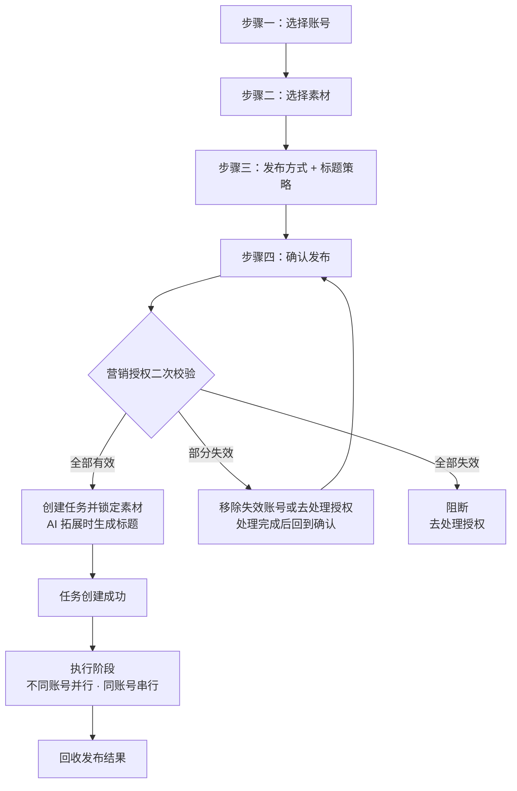
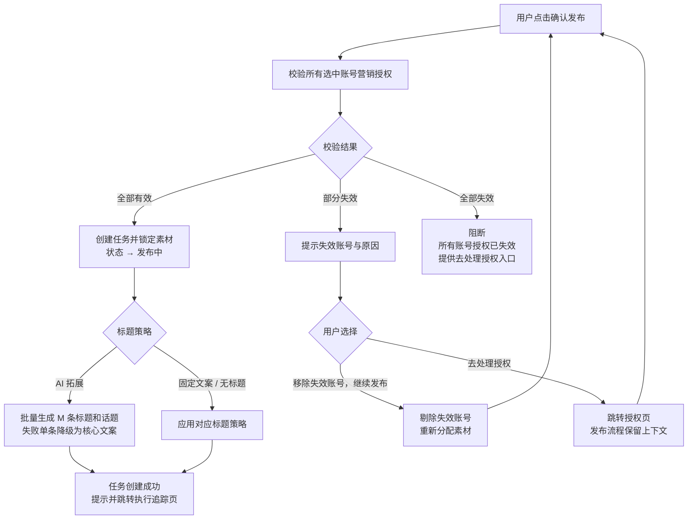
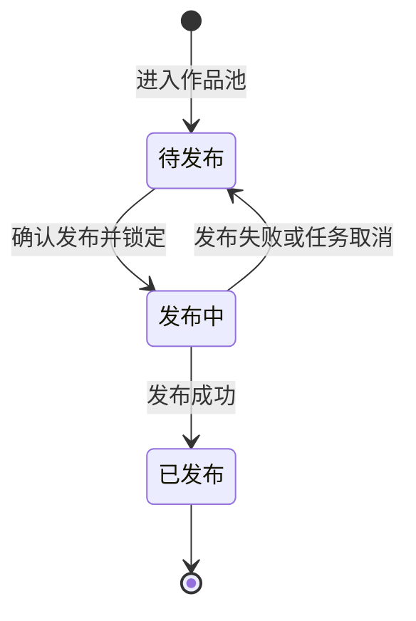
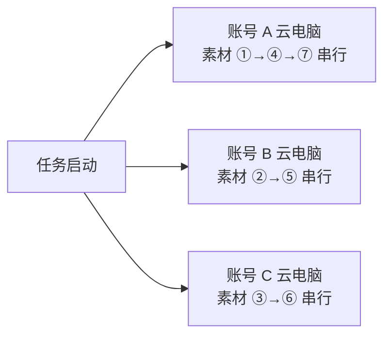

# AI数班 V1.3 · 短视频运营专员 PRD

> 版本：V1.3
> 更新日期：2026-09-04
> 状态：V1.3 需求已定稿
> 上游依据：V2.0 评审会议结论、《V2.0评审-后续动作总结.md》第三部分、《V1.3-短视频运营专员-发布流程逻辑补充方案.md》、现有高保真原型 v73

---

## 一、产品概述

### 1.1 定位

短视频运营专员是统一管理客户抖音账号矩阵的数字员工。其核心能力为**短视频矩阵搬运发布**：从监控抖音账号抓取、或由客户上传的视频进入待发布作品池，按发布任务去重分发到已授权的抖音账号，回收单账号发布结果及作品效果指标，并在成果中心沉淀内容效果记录。

### 1.2 本期目标

- 跑通"账号 → 素材 → 发布"完整闭环。
- 在**实时工作**页面下交付三个核心模块：**发布任务（核心入口）、总览（账号发布状态）、作品库（待发布池）**。
- 在**成果中心**交付**内容效果记录**，支持按时间、账号和作品名称组合查询、访问抖音作品及导出发布效果。
- 提供账号绑定/授权、监控抖音账号两个前置能力。
- 在人才市场提供单页雇佣确认入口，保留余额与抖音账号授权状态展示；核心依赖为余额和抖音营销授权。

### 1.3 版本规划

| 版本 | 交付能力 |
|------|----------|
| 本期 V1.3 | 短视频矩阵搬运发布：账号管理、素材聚合、去重分发、批量发布、结果回收、内容效果记录与导出 |
| 后续版本 | AI 内容创作、二创素材编辑、一键文解 |

---

## 二、角色与账号

### 2.1 人物设定

| 项 | 内容 |
|----|------|
| 中文名 | 短视频运营专员（昵称"由客户进行自定义"） |
| 平台 | 仅抖音 |
| 人设 | 完成抖音平台短视频矩阵账号的快速孵化，完成批量短视频发布 |
| 形象 | 视觉而定，区分雇佣前后：雇佣前"可雇佣"；雇佣后"工作中 / 空闲中 / 待处理 / 已暂停" |
| 计费 | ¥199（暂定） / 账号 / 月（按账号按月托管） |

### 2.2 账号绑定/授权

抖音营销授权是发布任务的**前置条件**，抖音账号无营销授权则无法发布。

- 绑定入口：总览页账号发布状态区域末尾的"＋"占位卡片，点击发起新账号绑定。
- 授权：完成抖音营销授权后加入账号发布范围，每个接入账号按月计费。
- 授权状态：以现有营销授权流程为准。
- 授权异常：由小班和对应数字员工高通过对话并列出受影响账号；用户处理后重新检查权限并恢复发布。
- 账号权限：由短视频运营专员 Agent 设置中的账号范围控制哪些账号参与矩阵发布。
- 授权状态变化后，账号页、数字办公室待办、人才广场和实时工作状态保持一致。

### 2.3 Agent 设置（工作设置）

用户可从数字办公室侧栏身份头部、实时工作页员工操作菜单进入"Agent 设置"。设置页仅编辑当前短视频运营专员；切换其他数字员工需关闭设置页返回数字办公室。关闭后返回原页面，并保留当前账号、任务和滚动位置。

- 设置页沿用客服专员 Agent 设置的工作区样式：顶部工作区身份栏、标签导航、浅灰内容底色和白色设置卡片保持一致；当前员工名称、岗位、状态和关闭入口均来自统一组件。
- 进入 Agent 设置后，顶部导航仅保留"Agent 设置"当前项；关闭设置页返回原页面，若从实时工作进入则恢复实时工作下的模块导航。
- 设置内容按原型从上到下仅分为"身份""技能""权限"三个区域，每个区域展示用途、当前值和可操作边界。
- "知识库""策略""记忆"不属于短视频运营专员 Agent 设置；内容来源和发布规则分别在作品库、发布任务流程中配置，长期规则通过任务上下文处理。
- Agent 正在工作时允许查看设置；身份和账号范围的修改从下一次新任务生效，正在执行中的任务沿用任务创建时的设置版本。
- 设置页加载中显示设置骨架；加载失败显示重试入口；重试保留已经打开的设置内容。

#### 2.3.1 身份区域

身份区域用于定义短视频运营专员对外展示的称呼和表达方式，仅影响对话表达，发布能力、数据权限、账号范围与计费规则不受影响。

- "Agent 称呼"为单行文本，默认填充"短视频运营专员"；用户可修改，必填，且需为有效内容并与已有 Agent 自定义名称相区分。
- "Agent 人设"为多行文本，默认描述"负责抖音账号矩阵的内容排期、批量发布和效果回收"；输入框提示"人设影响表达方式，不会改变能力和权限"。
- 身份字段仅承载表达方式，不承载内容创作、平台操作或数据权限等能力。
- 修改身份后，关闭设置页不保存；点击"保存设置"才提交。存在未保存修改时关闭，需二次确认是否放弃修改。

#### 2.3.2 权限区域（账号范围）

权限区域只管理当前 Agent 参与矩阵发布的账号范围；抖音平台授权和营销授权管理仍由账号绑定模块承载。账号列表按单个账号展示，筛选仅支持账号维度。

- 每行展示账号名称、抖音平台授权、营销授权、启用状态、最近一次授权检查时间。
- 营销授权完整时显示"可用"，允许用户开启或关闭该账号的发布范围；开启后新发布任务才可选择该账号。
- 营销授权不完整时显示"不可用"，并提供"去账号绑定/重新授权"入口；不可用账号的开关置灰。
- 账号被关闭后保留历史发布结果，不再进入新任务；正在执行的任务继续使用任务创建时锁定的账号范围。
- 没有可用账号时显示业务空态"暂无可用账号"，提供"去绑定账号"入口；保存前重新校验授权状态和账号可用性。
- 保存账号范围后，账号绑定、数字办公室待办、人才广场和实时工作状态立即同步；新增账号默认关闭，需在此处手动开启。

#### 2.3.3 技能区域

技能区域用于展示短视频运营专员的固定能力，仅做展示，不提供添加、删除或调整。右上角展示"固定 · 不可更改"状态。

| 序号 | 固定技能 |
|------|----------|
| 01 | 矩阵账号管理 |
| 02 | 抖音账号监控 |
| 03 | 自动发布 |
| 04 | 效果回收 |

#### 2.3.4 设置保存、取消与生效规则

1. 点击"保存设置"时，系统校验 Agent 称呼、人设和账号范围；必填项缺失或账号不可用时阻止保存，并在对应区域说明原因。
2. 保存期间按钮显示处理中并禁止重复点击；保存成功后提示修改项、影响范围和生效时点。
3. 身份修改从下一次新对话或新任务生效；账号范围保存并通过授权检查后对新任务生效；技能和授权权限由本设置页以外的模块承载。内容来源和发布方式在对应工作区流程中修改。
4. Agent 正在执行任务时，保存设置不影响当前任务的执行；当前任务继续使用启动时的设置版本。
5. 保存失败时保留用户输入并显示可重试原因；只有保存成功的内容才标记为已生效。
6. 设置保存成功后刷新数字办公室侧栏、实时工作状态和 Agent 设置页，并记录 Agent、修改人、修改时间、修改项、账号范围和生效范围。

### 2.4 人才市场雇佣流程

短视频运营专员从人才市场岗位卡进入单页雇佣确认。弹窗展示余额和抖音账号授权状态，一步完成雇佣确认；系统在确认前校验依赖，校验通过后直接创建员工。

#### 2.4.1 进入雇佣确认

- 用户在人才市场点击短视频运营专员岗位卡的"雇佣"后，打开"雇佣短视频运营专员"弹窗。
- 弹窗顶部展示岗位头像、岗位名称和关闭按钮；副标题为"确认余额与抖音营销授权状态后即可开始矩阵发布"。
- 弹窗直接展示余额、账号授权状态与确认按钮。
- 余额和账号授权状态加载或刷新时，仅在对应状态区域显示处理中；状态就绪后直接展示可雇佣条件和确认按钮。

#### 2.4.2 核心依赖检查

| 检查项 | 通过条件 | 未通过时的展示与处理 |
|------|----------|----------------------|
| 余额 | 当前余额足以覆盖本岗位按账号按月托管的最低费用 | 标记"余额不足"，提供"去充值"入口；补足前禁止雇佣 |
| 抖音营销授权 | 至少一个已绑定抖音账号的营销授权有效，可参与发布 | 标记"待授权"，展示受影响账号和授权状态，提供"去账号绑定/授权"入口；满足前禁止雇佣 |

- 抖音营销授权状态沿用主号获客专家的账号行展示：按单个账号列出账号名称、抖音号、平台授权状态、营销授权状态和当前可用性，并提供"去授权/查看"操作；筛选和范围判断仅按账号维度。
- 授权检查通过后，将当前已完成抖音营销授权的账号纳入短视频运营专员的初始工作范围；未完成授权的账号不进入工作范围，后续可在 Agent 设置中手动开启。
- 余额或授权状态在检查完成后发生变化时，用户点击确认雇佣前需重新检查；检查未通过时不创建员工。

#### 2.4.3 依赖通过后的直接雇佣

- 两项核心依赖均通过时，底部主按钮显示"确认并雇佣短视频运营专员"。
- 用户点击确认后，按钮进入处理中并禁止重复提交；系统创建数字员工、保存初始账号范围并建立按账号按月托管关系。
- 雇佣成功后提示"雇佣成功"，短视频运营专员状态更新为"工作中"，并直接进入实时工作页。
- 实时工作页首次打开时进入"总览"，展示已纳入账号范围、当前发布状态和可执行的发布任务入口；首次打开即可开始工作，Agent 设置为雇佣后的可选调整。
- Agent 设置属于雇佣后的可选调整入口，用户可在数字办公室侧栏或实时工作页中继续修改身份和账号范围；发布方式回到发布任务流程中调整。

#### 2.4.4 雇佣失败、取消与回流

1. 任一依赖未通过时，确认按钮保持禁用；用户可点击"去充值"或"去账号绑定/授权"，处理完成后返回原检查弹窗并保留检查上下文。
2. 用户点击关闭或取消时，岗位雇佣状态保持不变，产生零托管费用，已获取的余额与账号授权状态保留。
3. 提交失败时保留检查结果和账号授权状态，提示可重试原因；仅在创建成功后才标记为已雇佣并开始计费。
4. 雇佣成功后再次进入人才市场，岗位卡显示"已雇佣/查看工作"。

---

## 三、页面结构

### 3.1 页面层级

数字办公室与实时工作是并列的一级页面。数字办公室中的短视频运营专员侧栏只承担员工概览、主动汇报和对话入口；发布任务、账号发布状态和待发布作品等完整工作流统一收纳在实时工作页面下。

```
数字办公室
  └── 短视频运营专员侧栏概览

实时工作
  └── 短视频运营专员
      ├── ① 发布任务（核心入口）
      ├── ② 总览（账号发布状态）
      └── ③ 作品库（待发布作品池）

Agent 设置（独立工作区，不属于上述三个实时工作子页面）

成果中心
  └── 内容效果记录（发布完成作品的效果记录）
```

成果中心与数字办公室、实时工作共同构成一级页面。实时工作承载发布过程，成果中心承载发布完成作品的只读结果。

### 3.2 数字办公室侧栏概览

点击办公室中的短视频运营专员后，打开员工侧栏概览。侧栏与实时工作页面并列，不承载实时工作页面的模块导航和完整操作流程。用户在侧栏内查看员工状态、主动汇报和对话，需要执行发布任务或查看完整账号状态时进入实时工作页面。

| 区块 | 内容 |
|------|------|
| 身份头部 | 头像 + 客户自定义昵称 + 岗位名称 + 状态（工作中/空闲中/待处理）+ "抖音 N 个账号"；提供进入实时工作和 Agent 设置入口 |
| 上方：工作界面 | 参考主号/副号获客专家侧栏的工作界面结构，使用大尺寸账号发布过程视频（多个发布过程视频任意选择一个，无任何发布过程视频隐藏该模块）作为主视觉；视频区域叠加当前状态标签，底部文案精简为左侧"处理待发布作品与账号待办。"，右侧提供"查看实时工作"按钮 | |
| 下方：主动汇报 | 以"向老板汇报"的口吻说明当前执行状态：先报本周已发布数量，再拆分已发布/正在发布/排队中/发布异常账号，补充待发布作品数、授权或素材风险和下一步动作；数据必须标注统计周期、账号范围和更新时间，使用具体数字而非空泛表述 |
| 下方：对话区域 | 用户可直接与短视频运营专员对话，查询发布进度和结果、处理授权；对话上下文 |
| 对话输入 | 提供文字输入框和发送按钮；占位提示示例为"问进度、暂停工作，或告诉员工一条规则" |

侧栏交互要求：

- 工作界面的视频优先展示当前或最近一次发布操作的录屏，录屏区域占据区块主要空间；没有可展示视频时隐藏该模块
- 点击"查看实时工作"按钮或身份头部的展开入口进入实时工作 > 总览，并保留当前员工、账号和任务上下文；不打开创作弹层。

- 进入侧栏时触发该员工主动问候和汇报；最近 30 分钟内已汇报过则沿用当前会话，不重复发送。
- 无已授权账号、无待发布作品或授权异常时，工作界面展示最近一次视频发布过程视频；对话区提供异常的处理入口。

### 3.3 实时工作

实时工作是与数字办公室并列的完整工作页面。进入页面后，顶部模块导航按以下顺序展示三个子页面，**发布任务置于第一位**：

#### 3.3.1 发布任务

详见第四章。发布任务是实时工作的核心入口。

#### 3.3.2 总览

详见第五章。总览展示账号发布状态，是实时工作的默认落点。

#### 3.3.3 作品库

详见第六章。作品库维护待发布作品池，为发布任务提供素材。

> 设计依据（评审结论）：“发布任务这件事情，肯定是放在第一位的。没有任务，这些模块都动不起来。”

> Agent 设置为独立工作区状态，顶部使用独立的 Agent 设置导航；从设置页返回实时工作后，恢复“发布任务 / 总览 / 作品库”导航。

---

## 四、实时工作 / 发布任务（核心入口）

### 4.1 定位

发布任务是短视频运营专员的第一入口与核心动作，其他模块（总览、作品库）均服务于发布动作。

### 4.2 发布流程总览

发布任务按四步执行，素材经去重分发后由各账号串行发布：



### 4.3 步骤一：选择账号

- 仅展示账号范围内已开启、且营销授权有效的账号列表；未开启或授权无效的账号不出现在可选列表。
- 支持全选与批量选择。
- 校验：至少选择 1 个账号，否则"下一步"禁用并提示"请至少选择 1 个账号"。
- 无可用账号时：展示空态"暂无可用账号"，提供"去绑定账号"或"去开启账号"入口。

### 4.4 步骤二：选择素材

- 素材来源为作品库（待发布作品池）："待发布"素材可选；"发布中"素材置灰展示并提示"已分配到任务中"；"已发布"素材不出现在列表。
- 展示视频缩略图 + 标题（素材原始标题）+ 来源标签（监控抓取 / 用户上传）+ 时长。
- 支持多选，支持按来源筛选。
- 素材为空时：展示空态"作品库暂无可发布内容"，提供两个入口：① 去上传视频 ② 去配置监控抖音账号。

| 校验 | 通过条件 | 未通过时的处理 |
|------|----------|----------------|
| 最低数量 | 选中 ≥ 1 条素材 | "下一步"禁用 + "请至少选择 1 条素材" |
| 数量匹配 | 素材数 ≥ 账号数（每个账号至少 1 条） | "下一步"禁用 + "当前已选 M 条素材，不足以覆盖 N 个账号（每个账号至少需要 1 条素材）。请补充素材或返回上一步减少账号。" |

### 4.5 步骤三：发布方式与标题策略

本步骤同时确定发布方式（二选一）与标题策略（三选一），两项组合作用于本次任务的所有素材。

#### 4.5.1 发布方式

| 方式 | 说明 |
|------|------|
| 立即发布 | 确认后立即开始串行执行 |
| 定时发布 | 选择**一个**未来时间点，到点自动执行 |

- 默认选中"立即发布"。
- 每个发布任务仅设置一个发布时间；多时间点需求通过创建多个发布任务实现，每个任务设定各自的时间点。
- 时间选择器：日期 + 时分（精确到分钟）。
- 提供快捷时段按钮：09:00 / 12:00 / 18:00（当天或次日）。
- 校验：所选时间必须晚于当前时间，否则提示"所选时间已过，请重新选择"。
- 定时任务创建后到设定时间之间处于"待触发（已排期）"状态，到点后自动开始串行执行；若到点时该账号有其他任务正在执行，则进入排队（见 4.9）。

#### 4.5.2 标题策略

| 模式 | 用户操作 | 系统行为 |
|------|----------|----------|
| **无标题发布** | 无需输入 | 所有素材发布时标题为空 |
| **固定文案发布** | 输入一段固定文案 | 所有素材统一使用该文案作为发布标题 |
| **AI 拓展发布** | 输入一句核心文案 | AI 基于该句拓展为 M 条不同标题，并为每条标题生成相关话题标签；每条素材对应一个不同的标题与话题组合 |

- 默认选中"无标题发布"，用户可随时切换。
- 标题术语：素材原始标题（作品池原题）、核心文案（AI 拓展输入）、发布标题（实际发布所用标题正文与话题标签组合）、话题标签（以 `#` 开头、随发布标题一同提交的标签）。

**无标题发布**

- 用户选择后无需额外操作，无标题校验。
- 确认页标题列统一显示"—（无标题）"。

**固定文案发布**

- 用户输入一段文案（单行或多行文本框），输入框 placeholder："输入发布文案，将应用到本次所有素材"。
- 校验：选择此模式后文案需非空，为空时"下一步"禁用并提示"请输入发布文案"。
- 发布前校验文案总长度不超过 55 个字符；超出时"下一步"禁用并提示"发布文案不能超过 55 个字符"。
- 确认页标题列统一显示该文案内容；所有账号、所有素材发布时使用完全相同的标题。

**AI 拓展发布**

- 用户输入一句核心文案（单行文本框），输入框 placeholder："输入一句核心文案，AI 将自动拓展标题并生成话题标签"。
- 示例提示："如：优质车型推荐 → AI 将生成多个变体，并添加 #优质车型 #奥迪A6L 等相关话题"。
- 校验：选择此模式后核心文案需非空，为空时"下一步"禁用并提示"请输入核心文案"。
- 核心文案作为 AI 生成输入不设置 55 个字符的输入长度限制；仅对最终发布标题（标题正文与话题标签合计）执行 55 个字符的平台校验。
- 生成时机：任务创建时（点击"确认发布"后）批量生成。
- 生成数量：等于本次任务的素材总数 M，每条素材对应一个唯一标题和一组话题标签。
- 话题模块：AI 根据核心文案自动提取或归纳 1-3 个相关话题标签，格式为以 `#` 开头的短标签，多个标签以空格分隔；优先使用核心文案中的品牌、车型、地点、用途等明确关键词；核心文案没有可用语义时允许不生成话题。
- 生成规则：保留核心语义和关键词；每条标题表述不同（改写、扩写、换角度）；标题正文与话题标签合并后的发布标题不超过 55 个字符。

**AI 标题与话题生成 Prompt（V1.3）**

任务创建时，系统将以下模板连同本次任务参数发送给模型。抖音发布标题（标题正文与话题标签合计）固定最多 55 个字符，`M` 为本次任务的素材总数。

```text
你是抖音短视频矩阵运营专员，负责将用户提供的核心文案改写成适合抖音发布的短视频标题，并生成相关话题标签。

【输入】
- 核心文案：{{coreCopy}}
- 素材列表（按发布分配顺序）：
{{materials}}
- 生成数量：{{M}}

【要求】
1. 严格围绕核心文案改写，保留核心主题、事实、品牌/车型/地点等明确关键词；素材原始标题仅用于理解对应素材，不得改变核心文案的传播意图。
2. 输出 {{M}} 条标题，按素材列表顺序一一对应；每条标题正文必须唯一，不能只是替换标点或增删一个字。
3. 通过改写、扩写、提问、利益点、场景和行动引导等方式形成不同表达，但不得为了制造差异虚构价格、优惠、性能、活动、时间、地点、用户评价或其他未提供的信息。
4. 语言自然、简洁、口语化，适合抖音信息流阅读；避免夸大承诺、绝对化用语、敏感/违规词、无意义的营销套话和连续重复标点。
5. 为每条标题生成 1-3 个与核心文案直接相关的话题标签；核心文案没有可用语义时返回空数组。标签必须以 `#` 开头，优先使用核心文案中的品牌、车型、地点、用途等关键词，例如 `#优质车型`、`#奥迪A6L`，不得虚构未提供的事实或泛化为无关热点。
6. 标题正文与话题标签用一个空格拼接后，整条抖音发布标题不得超过 55 个字符；不得带序号、引号、解释、换行或 Markdown 标记。需要压缩长度时，优先精简表达，仍超长时减少话题标签数量。

【输出格式】
只返回合法 JSON 数组，不要输出任何说明文字：
[
  {"index": 1, "materialId": "{{materialId_1}}", "title": "标题正文 1", "topicTags": ["#优质车型", "#奥迪A6L"]},
  {"index": 2, "materialId": "{{materialId_2}}", "title": "标题正文 2", "topicTags": ["#优质车型", "#奥迪A6L"]}
]
数组长度必须等于 {{M}}；index 从 1 开始连续递增；materialId 必须原样返回；title 不得为空；topicTags 必须为 0-3 个以 `#` 开头的标签，有可用语义时至少返回 1 个。服务端将 `title` 与 `topicTags` 用一个空格拼接为实际发布标题。
```

- `materials` 至少包含每条素材的 `materialId` 和素材原始标题；服务端不依赖模型返回顺序，以 `materialId` 将标题回写到对应素材。
- 服务端校验 JSON 可解析、数组长度为 M、`index` 连续、`materialId` 无重复且与输入完全一致、标题正文非空、`topicTags` 数量及格式合法且标题正文与话题标签合并后不超过 55 个字符；校验失败时仅重试失败条目，不重复生成已通过条目。
- 服务端将模型返回的 `topicTags` 持久化为发布结果的`topicTags`，并将 `title` 与 `topicTags` 拼接后写入`publishedTitle`。
- 确认页展示："AI 将基于您的文案自动生成 M 条不同标题及相关话题标签"；预览行展示标题正文与话题标签拼接后的实际发布标题。
- 生成失败处理：单条标题或话题生成失败时，该条素材降级使用用户输入的核心文案作为发布标题且不附加话题；核心文案超过 55 个字符时，先压缩为不超过 55 个字符的语义完整文案再兜底；生成失败不阻断任务创建；任务详情中标记 AI 生成与降级兜底的条目。

### 4.6 步骤四：确认发布

#### 4.6.1 确认页展示内容

| 展示项 | 内容 |
|--------|------|
| 发布账号 | N 个账号名称列表 |
| 素材总数 | M 条 |
| 分发预览 | 按账号维度展示分配详情（见 4.7） |
| 标题策略 | 当前所选模式 + 相应说明 |
| 发布方式 | 立即发布 / 定时发布 + 时间 |
| 预计发布总数 | = M 次（去重分发，每条素材发一次） |

AI 拓展模式在确认页预览每条素材的标题正文、话题标签及二者拼接后的实际发布标题；所有模式的最终发布标题均按抖音规则校验，总长度不得超过 55 个字符。

确认页兜底校验：每个账号至少分配到 1 条素材（步骤二已保证，正常不触发）。

#### 4.6.2 点击"确认发布"后的授权二次校验



- 点击确认时实时校验所有选中账号的营销授权。
- 全部有效：创建任务并锁定素材 → （若为 AI 拓展）批量生成标题 → 任务创建成功。
- 部分失效（K 个失效，K < N）：弹出提示列出失效账号与失效原因，并说明剩余 N-K 个账号可正常发布；提供"去处理授权"与"移除失效账号，继续发布"两个入口。
  - 移除失效账号后：剔除失效账号，将 M 条素材重新分配到 N-K 个有效账号，更新确认页预览，用户需再次点击"确认发布"。
  - 去处理授权：跳转授权页并保留发布流程上下文，返回后重新进入确认页并再次确认。
- 全部失效：阻断任务创建，提示"所有账号授权已失效，无法创建任务"，提供"去处理授权"入口。

### 4.7 素材分发规则

#### 4.7.1 去重分发

- 每条素材只发到一个账号，每个账号获得不同的素材。
- 分配顺序：按用户在步骤二中选择素材的顺序，依次分配给步骤一中选择的账号（按选择顺序）。
- 分配算法：轮询。第 1 条素材 → 第 1 个账号，第 2 条素材 → 第 2 个账号……第 N+1 条素材 → 回到第 1 个账号。
- 分配完成后素材数需覆盖账号数，该约束在步骤二校验（见 4.4）。

#### 4.7.2 分配示例

用户选了 3 个账号（按选择顺序：A、B、C），选了 7 条素材（按选择顺序 ①~⑦）：

| 账号 | 分配到的素材 | 数量 |
|------|-------------|------|
| A | ①④⑦ | 3 条 |
| B | ②⑤ | 2 条 |
| C | ③⑥ | 2 条 |

余数从第一个账号开始多分（7 ÷ 3 = 每人 2 条，余 1 条给 A）。

#### 4.7.3 确认页分配预览

按账号维度平铺展示分配结果，结果由轮询规则自动生成，只读展示：

```
账号 A（济南）— 3 条
  ├ ① 视频标题xxx  02:15
  ├ ④ 视频标题xxx  01:30
  └ ⑦ 视频标题xxx  00:58

账号 B（青岛）— 2 条
  ├ ② 视频标题xxx  01:45
  └ ⑤ 视频标题xxx  02:00

账号 C（烟台）— 2 条
  ├ ③ 视频标题xxx  01:20
  └ ⑥ 视频标题xxx  01:55
```

调整分配结果通过返回步骤二、改变素材选择顺序实现。

### 4.8 素材状态与消耗

#### 4.8.1 素材生命周期



- 素材进入作品池后处于"待发布"。
- 被选入任务并确认发布后锁定为"发布中"。
- 发布成功转为"已发布"（消耗，不可再选）。
- 发布失败（含重试耗尽、授权失效、文件异常、平台风控拦截）或任务取消后，释放回"待发布"，可重新选入其他任务。

#### 4.8.2 各状态在界面中的表现

| 素材状态 | 作品库列表 | 发布任务"选素材"步骤 |
|----------|-----------|---------------------|
| 待发布 | 可见，正常展示 | 可选 |
| 发布中 | 可见，灰色标记"发布中" | 不可选，置灰 + 提示"已分配到任务中" |
| 已发布 | 可见，标记"已发布" | 不出现在可选列表 |

#### 4.8.3 锁定与释放规则

- 锁定时机：用户点击"确认发布" → 授权校验通过 → 创建任务，任务创建成功的同时素材锁定为"发布中"。
- 释放条件：发布失败且自动重试耗尽（3 次重试全部失败）；或任务被用户取消（仅取消尚未执行的部分，已发布不回退）。
- 发布成功即为永久消耗，不可逆。

### 4.9 执行模型：并行与串行

#### 4.9.1 单任务执行方式

一个发布任务内，不同账号并行执行（每个账号使用各自的云电脑），同一账号内被分配到的多条素材按分配顺序串行依次发布：



#### 4.9.2 多任务同账号排队

同一账号的发布任务严格串行，同一账号同一时间只执行一个任务；按任务创建时间先到先执行。账号在任务 A 中的发布全部完成后，才开始执行任务 B 中该账号的部分。

- 排队展示：云电脑监控墙中该账号卡片状态为"排队中"，展示"前方有 1 个任务执行中，预计 xx:xx 开始"；任务详情中该账号状态为"等待中 — 有其他任务正在使用该账号"。
- 定时任务排队：多个任务定时到同一时间点时，到点后按任务创建时间排序，先创建的先执行，后创建的排队等待。

#### 4.9.3 并行与串行总结

| 场景 | 执行方式 | 原因 |
|------|----------|------|
| 同一任务内，不同账号 | 并行（多台云电脑同时工作） | 每个账号有独立云电脑 |
| 同一账号内，多条素材 | 串行（逐条发布） | 一台云电脑一次只操作一条 |
| 不同任务，同一账号 | 串行排队 | 同一台云电脑不能同时执行两个任务 |
| 不同任务，不同账号 | 并行 | 互不影响 |

### 4.10 发布失败与重试

#### 4.10.1 失败分类与处理

| 失败类型 | 自动重试 | 次数 | 间隔 | 重试耗尽后 |
|----------|---------|------|------|-----------|
| RPA 执行异常（超时/网络/页面错误） | 是 | 3 次 | 5 分钟 | 标记失败，素材释放，生成待办 |
| 营销授权失效 | 否 | — | — | 立即标记失败，生成高优先级待办 |
| 视频文件异常（损坏/格式不支持） | 否 | — | — | 标记失败，素材释放，提示检查文件 |
| 平台风控拦截 | 否 | — | — | 标记失败，素材释放，提示内容风险 |

#### 4.10.2 重试期间状态

| 位置 | 展示 |
|------|------|
| 监控墙该账号卡片 | 橙色"重试中（1/3）"，无视频画面 |
| 任务详情 | 该条素材："RPA 异常 · 第 1 次重试中 · 预计 xx:xx 重试" |
| 侧栏汇报 | 纳入"发布异常"统计，说明正在重试 |

#### 4.10.3 重试耗尽后

- 该条素材标记"发布失败"。
- 素材状态释放回"待发布"，可被后续任务重新选择。
- 生成小班待办通知："账号 X 的素材《xxx》发布失败（已重试 3 次），原因：RPA 执行超时。建议稍后重新创建发布任务。"
- 单条失败素材通过创建新任务重新发布。

### 4.11 任务整体状态

| 条件 | 状态 | 标记颜色 |
|------|------|----------|
| 定时任务已创建、未到发布时间 | 待触发（已排期） | 中性 |
| 所有素材发布成功 | 已完成 | 绿色 |
| 部分执行中/重试中 | 执行中 | 蓝色 |
| 部分成功 + 部分最终失败 | 部分完成 | 橙色，展示"已发布 x/M" |
| 全部失败 | 发布失败 | 红色 |

### 4.12 发布结果列表

| 字段 | 说明 |
|------|------|
| 账号名 | 已授权抖音账号名称 |
| 待发布 | 该账号当前待发布的视频数量，按账号维度实时展示 |
| 已发布 | 该账号累计已发布数量 |
| 操作 | "查看作品" → 打开该账号作品列表弹窗 |

- 列表顶部提供账号维度筛选。
- 点击"查看账号"后，以弹窗展示该账号的作品列表，不离开当前页面；作品列表中的每条作品都必须展示发布状态。
- 弹窗顶部提供六个发布状态 Tab，按状态快速筛选：**全部、待发布、发布中、发布完成、发布失败、取消发布**；每个 Tab 展示当前账号对应作品数量，默认选中"全部"。
- 弹窗列表字段为：封面图、作品标题、发布状态、时长、发布时间、播放量、点赞数、评论数、收藏数、分享数、操作。
- 发布状态字段枚举值固定为：**待发布、发布中、发布完成、发布失败、取消发布**。状态标签使用统一的颜色和文案，筛选和统计均按该枚举值执行。
- 发布失败的作品在操作列展示"重试发布"按钮；点击后不离开弹窗，直接将该作品状态更新为"待发布"，并保留作品原有信息，用户可继续安排发布。
- 封面图采用 9:16 竖屏比例并支持点击，打开该条作品对应的抖音作品链接；链接同步阶段展示“链接同步中”。
- 弹窗关闭后返回发布结果列表，并保留原账号筛选条件和滚动位置。

### 4.13 本期范围边界

- 确认页分配结果只读，由轮询规则自动生成；调整通过返回步骤二改变素材选择顺序实现。
- 失败素材释放后通过创建新任务重新发布。
- 已发布内容的撤回与删除属于抖音侧操作，本期不承接。
- 每个任务仅一个发布时间点；多时间点通过创建多个任务实现。
- AI 标题和话题标签按批量场景一次性生成，不提供逐条预审与编辑。

---

## 五、实时工作 / 总览（账号发布状态）

### 5.1 定位

实时展示所有账号的发布状态，按卡片平铺展示。每个账号显示最近一次发布视频与当前状态，让用户直观看到"多少个账号正在发布、在排队、已完成或需要处理"。

### 5.2 视觉方案

- 多账号卡片平铺展示，**一行 5 个账号**，多行向下排列。
- 每个账号卡片包含：
  - 发布过程视频：仅在"正在发布"和"已发布"时展示动态视频；排队、重试和异常状态使用对应空态。
  - 账号名。
  - 状态标签 + 进度条 + 时间信息：已发布时展示发布时分，跨天后补充发布日期；未发布时展示预计发布时间或异常原因。

| 状态 | 视觉 |
|------|------|
| 排队中 | 无任何画面，使用中性等待空态，显示"排队中 / 待发布，暂时没有可展示视频"；保留预计发布时间 |
| 待触发（已排期） | 无任何画面，使用中性等待空态，显示"已排期，预计 xx:xx 发布"；保留预计发布时间 |
| 正在发布 | 展示该账号正在发布时的动态视频，视频静音、循环播放，使用绿色进行中状态 |
| 已发布 | 展示该账号最近一次发布视频，视频静音、循环播放，使用已完成状态；当天只展示"HH:mm"，隔天起展示"MM-DD · HH:mm" |
| 重试中 | 无任何画面，使用橙色重试空态，显示"重试中（x/3）"与预计重试时间 |
| 发布异常 | 无任何画面，使用异常空态并展示具体失败原因，使用红色异常状态 |

发布异常分为两类：

- **营销未授权**：展示"营销未授权"和授权失效原因，卡片提供"去处理"按钮，点击进入该账号的账号绑定/营销授权处理入口；授权完成后重新检查并恢复发布。
- **发布失败**：展示"发布失败"和"发布失败，请稍后重试"，不跳转授权入口；卡片保留异常记录，用户可稍后重新进入实时工作查看重试结果。

### 5.3 规模适配

| 规模 | 展示策略 |
|------|----------|
| 5 个账号 | 一行展示 |
| 20 个账号 | 4 行 × 5 列 |
| 50 个账号 | 10 行 × 5 列，按账号维度展示 |
| 100 个账号 | 按账号维度展示，默认展示部分 + "展开全部" |

> 设计依据（评审结论）："一行能放下 5 个就一直往下排，平铺最直观。"

### 5.4 交互

- 点击某个账号卡片 → 查看该账号最近一次发布的视频。
- 点击正在发布或已发布卡片 → 查看对应账号的动态发布视频；已发布卡片同步展示最近一次发布的时间口径。
- 排队中、重试中和发布异常卡片不展示视频或静态封面，直接显示对应空态和状态说明。
- 查看已发布视频 → 打开对应的抖音作品链接；链接不可用时展示不可用状态。
- 账号状态区域末尾保留一张"＋"占位卡片，点击发起账号绑定。

账号状态区域末尾的账号绑定入口使用与页面主操作一致的高保真按钮样式：白色内容面、实线边界、账号管理提示、黑色"去绑定账号"主按钮和箭头操作反馈；支持 hover、键盘 focus 和窄屏触控尺寸。

实时工作区的所有可操作控件统一使用高保真样式：顶部模块导航和作品库分类使用带选中态的分段控件；上传、添加监控账号、创建发布任务和确认发布使用黑色主按钮；全选、上一步、取消、快捷时段和表格动作使用白底弱边界次按钮；"去发布""查看作品"等结果动作使用带轻底色的链接按钮。按钮需提供 hover/focus 反馈，窄屏触控高度不低于 44px。

---

## 六、实时工作 / 作品库（待发布作品池）

### 6.1 定位

作品库聚合两个内容来源——**监控抓取**与**用户上传**，作为发布任务的素材来源。

### 6.2 内容来源

| 来源 | 说明 |
|------|------|
| 监控抓取 | 从配置的监控抖音账号自动抓取的作品，自动进入待发布作品池 |
| 用户上传 | 客户自行上传的视频，上传后进入待发布作品池 |

### 6.3 列表展示与素材状态

- 视频缩略图 + 标题 + 来源标签（监控抓取 / 用户上传）+ 抓取/上传时间 + 时长。
- 支持批量选择（作为发布任务的素材数据源）。
- 支持按来源筛选与搜索。
- 列表展示素材状态：待发布（正常展示）、发布中（灰色标记"发布中"）、已发布（标记"已发布"）。

### 6.4 监控抖音账号配置

监控账号是作品池的抓取来源，属于**前置能力**：账号添加并校验通过后自动开始监控，其同步到的作品去重后进入作品池。

| 项 | 说明 |
|----|------|
| 添加监控账号 | 输入抖音账号 → 校验 → 添加；校验通过后自动开始监控 |
| 开始/停止监控 | 每个账号独立开关；新添加账号默认开启 |
| 监控账号列表 | 账号 + 状态 + 最近抓取时间 + 操作（暂停/删除） |
| 抓取规则 | 每个自然日 10:00 自动同步该账号的新发布作品，去重后进入作品池 |

- 入口位置：作品库页内提供"监控抖音账号"管理入口。

### 6.5 用户上传

- 支持批量上传视频文件。
- 上传后进入作品池，来源标记为"用户上传"，可用于发布任务。

---

## 七、成果中心 / 内容效果记录

### 7.1 定位与数据来源

内容效果记录是短视频运营专员发布成果的只读记录页。页面以单账号发布结果为基础业务对象：一条作品成功发布到一个账号后生成一条内容效果记录，同一作品发布到多个账号时分别生成对应记录。

- 页面层级：成果中心 → 内容效果记录。
- 收录范围：`发布状态 = 发布完成`的抖音作品。
- 唯一标识：`publishResultId`。
- 数据来源：实时工作发布结果与成果中心使用同一份发布结果数据；作品信息、账号快照、实际发布时间、抖音作品链接和效果指标持续关联到同一条记录。
- 默认排序：按`publishedAt`倒序。
- 历史账号：记录保存发布时的账号名称和头像快照，账号授权状态变化后历史记录继续展示。

### 7.2 页面结构与筛选

页面顶部展示标题“内容效果记录”和数据更新时间，筛选区从左到右排列时间范围、发布账号、作品名称、重置和导出。

| 筛选项 | 规则 |
|--------|------|
| 时间范围 | 按实际发布时间`publishedAt`筛选，默认最近 30 天；开始日期按 00:00:00 计算，结束日期按 23:59:59 计算 |
| 发布账号 | 默认“全部账号”，选项范围包含当前账号范围与历史记录中的账号；按`accountId`筛选 |
| 作品名称 | 支持模糊匹配素材原始名称`materialTitle`和实际发布标题`publishedTitle` |
| 重置 | 恢复最近 30 天、全部账号和空作品名称 |

- 时间、账号和作品名称组合生效。
- 日期或账号变化后立即刷新结果；作品名称输入采用 300ms 防抖，并支持 Enter 触发查询。
- 筛选条件变化后返回第一页。
- 页面显示当前筛选结果总数，每页展示 20 条。

### 7.3 列表字段与交互

| 字段 | 展示规则 |
|------|----------|
| 作品 | 展示 9:16 竖屏封面、时长角标和实际发布标题；标题最多两行，完整标题通过悬停提示查看 |
| 发布时间 | 展示格式为`YYYY-MM-DD HH:mm` |
| 发布账号 | 展示 32px 圆形账号头像和账号名称 |
| 抖音发布链接 | 展示“查看作品 ↗”，指向该条发布结果的`douyinWorkUrl` |
| 播放数 | 使用千分位格式、等宽数字并右对齐 |
| 点赞数 | 使用千分位格式、等宽数字并右对齐 |
| 评论数 | 使用千分位格式、等宽数字并右对齐 |
| 收藏数 | 使用千分位格式、等宽数字并右对齐 |
| 分享数 | 使用千分位格式、等宽数字并右对齐 |

- 作品封面采用 9:16 比例，桌面端建议尺寸为 54 × 96px，时长角标位于封面右下角。
- 标题优先展示`publishedTitle`，该字段为空时展示`materialTitle`。
- 作品封面、标题和“查看作品 ↗”均在新标签页打开`douyinWorkUrl`。
- 跳转链接携带`rel="noopener noreferrer"`，键盘焦点态清晰可见。
- 抖音链接同步阶段展示“链接同步中”；同步完成后展示跳转入口。
- 指标真实值为零时显示`0`，指标同步阶段显示`—`。
- 窄屏采用作品卡片布局，作品信息、账号、发布时间、抖音链接和五项效果指标按信息层级纵向排列。

### 7.4 数据更新与页面状态

- 每条记录保存指标最后更新时间`metricsUpdatedAt`，页面顶部展示当前结果中的最近更新时间。
- 首次加载使用表格骨架屏。
- 发布结果为空时展示“暂无内容效果记录，发布完成的作品将在这里展示。”。
- 筛选结果为空时展示“当前筛选条件下暂无内容效果记录。”，并提供“重置筛选”操作。
- 抖音链接同步阶段展示“链接同步中”。
- 指标同步阶段在对应指标中展示`—`，其余已回收字段正常展示。

### 7.5 导出

导出范围为当前时间、账号和作品名称筛选条件下的全部记录，覆盖全部分页。导出文件使用`.xlsx`格式。

| 导出字段 | 对应数据 |
|----------|----------|
| 作品标题 | `publishedTitle`，为空时取`materialTitle` |
| 话题标签 | `topicTags`，多个标签以空格分隔 |
| 素材原始名称 | `materialTitle` |
| 封面链接 | `coverUrl` |
| 视频时长 | `durationSeconds`格式化后的`MM:SS` |
| 发布时间 | `publishedAt` |
| 发布账号名称 | `accountName` |
| 抖音发布链接 | `douyinWorkUrl`，在 Excel 中保存为可点击超链接 |
| 播放数 | `views` |
| 点赞数 | `likes` |
| 评论数 | `comments` |
| 收藏数 | `favorites` |
| 分享数 | `shares` |
| 指标更新时间 | `metricsUpdatedAt` |

文件名格式：`内容效果记录_开始日期-结束日期_账号名称.xlsx`，例如`内容效果记录_20260901-20260904_全部账号.xlsx`。

- 当前结果存在记录时导出按钮可用。
- 导出期间按钮展示“正在导出”并锁定重复操作。
- 导出完成后展示成功提示，生成失败时展示原因和重试入口。

### 7.6 数据结构

| 字段 | 说明 |
|------|------|
| `publishResultId` | 发布结果唯一标识 |
| `taskId` | 发布任务 ID |
| `materialId` | 素材 ID |
| `materialTitle` | 素材原始名称 |
| `publishedTitle` | 标题正文与话题标签拼接后的实际发布标题 |
| `topicTags` | AI 生成并随发布标题提交的话题标签 |
| `publishStatus` | 发布状态：待发布、发布中、发布完成、发布失败、取消发布 |
| `coverUrl` | 9:16 视频封面 |
| `durationSeconds` | 视频时长，单位为秒 |
| `accountId` | 发布账号 ID |
| `accountName` | 发布时的账号名称快照 |
| `accountAvatarUrl` | 发布时的账号头像快照 |
| `douyinAccountId` | 抖音账号标识 |
| `douyinWorkId` | 抖音作品 ID |
| `douyinWorkUrl` | 抖音作品发布链接 |
| `publishedAt` | 实际发布时间 |
| `views` | 播放数 |
| `likes` | 点赞数 |
| `comments` | 评论数 |
| `favorites` | 收藏数 |
| `shares` | 分享数 |
| `failureReason` | 发布失败或异常原因 |
| `metricsUpdatedAt` | 指标最后更新时间 |

### 7.7 验收标准

1. 成果中心只展示发布状态为“发布完成”的短视频运营专员作品。
2. 一条作品发布到多个账号时，每个账号生成一条独立记录。
3. 时间、账号和作品名称支持组合筛选，重置后恢复默认筛选条件。
4. 作品封面按照 9:16 竖屏比例展示，封面包含时长角标。
5. 发布账号同时展示头像和账号名称。
6. 点击作品封面、标题或“查看作品 ↗”均打开对应抖音发布链接。
7. 播放、点赞、评论、收藏、分享与发布结果正确关联，零值与同步中状态清晰区分。
8. 导出文件包含当前筛选结果中的全部记录和全部规定字段，抖音链接可直接点击访问。
9. 成果中心与实时工作读取同一份发布结果，任务、作品、账号和效果指标关联一致。
10. 对话仅支持按账号名称和时间范围查询短视频发布情况，能够返回账号作品发布状态及内容效果记录，不提供其他数据查询。

---

## 八、对话能力

本期对话仅支持按账号名称查询和汇报短视频发布情况，不支持创建、调整发布任务或处理其他业务。

### 8.1 数据查询与汇报（P0）

对话查询只支持按账号名称查询短视频发布情况，不创建或调整发布任务。回答中标注查询时间范围、账号名称、数据更新时间和来源页面。

#### 8.1.1 账号名称发布查询

数据只支持以下两个来源，均按账号名称关联：

1. **每个账号的作品发布情况**
   - 页面入口：实时工作 → 发布任务 → 发布结果 → 查看作品。
   - 页面字段：账号名、待发布、已发布、封面、作品标题、发布状态、时长、发布时间、播放、点赞、评论、收藏、分享、操作。
   - 查询逻辑：按账号名称、作品名称、发布时间范围和发布状态筛选；返回该账号的作品总数、各状态数量及作品明细，保留每条作品的发布状态。

2. **内容效果记录-短视频运营的数据字段**
   - 页面入口：成果中心 → 内容效果记录。
   - 页面字段：作品、作品标题、发布时间、发布账号、抖音发布链接、播放数、点赞数、评论数、收藏数、分享数。
   - 查询逻辑：只统计发布完成的作品，按账号名称和发布时间范围筛选；返回该账号的发布完成数、效果指标汇总及对应作品记录。

时间范围默认按发布时间筛选，日期范围的开始时间按 00:00:00、结束时间按 23:59:59 计算。待发布、发布中和取消发布作品保留状态，但没有实际发布时间时不计入发布完成数。

#### 8.1.2 标准统计指标与口径

为避免每次对话都把作品明细交给模型重新分析，系统在发布状态变化和效果指标回收后预先计算并维护账号发布统计。模型默认先读取统计结果，用户明确要求作品清单、链接或具体指标时再读取对应页面明细。

| 统计内容（模型直接取用） | 统计维度 | 直接提供的数据 | 统计口径 |
|----------|----------|----------|----------|
| 账号发布统计 | 账号、时间范围、发布状态 | 计划发布数、发布完成数、发布中数、待发布数、发布失败数、取消发布数、完成率、失败率、首次发布时间、最近发布时间 | 由账号作品发布结果和任务计划汇总；发布完成数只统计状态为“发布完成”的作品；完成率 = 发布完成数 ÷ 已进入执行或已到计划时间的计划数 |
| 账号内容效果统计 | 账号、时间范围 | 发布完成数、播放总数、点赞总数、评论总数、收藏总数、分享总数、互动总数、平均播放、平均互动 | 由成果中心内容效果记录汇总；互动量 = 点赞 + 评论 + 收藏 + 分享；指标未回收的作品不计入效果均值 |

系统同时维护以下常用派生指标，模型可直接用于比较和汇报：

- **时间范围发布完成率**：按账号返回计划发布数、发布完成数、发布失败数、执行中数和完成率；没有计划数时返回 0，不使用估算值。
- **账号作品状态分布**：按账号返回待发布、发布中、发布完成、发布失败、取消发布数量及作品总数。
- **账号内容效果汇总与排名**：按时间范围返回播放、点赞、评论、收藏、分享、互动量和平均值；只有指标已回收的发布完成作品参与效果排名。

统计结果在发布状态或效果指标更新后刷新，并记录统计更新时间。模型使用统计结果回答发布数量、完成率、状态分布和效果排名；只有用户要求“列出哪些作品/打开哪个链接/查看具体指标”时，才按 8.1.1 的页面字段下钻明细。无数据时返回 0 或空列表并说明来源页面。

#### 8.1.3 典型查询示例

- “2026-08-01 到 2026-08-31，鸿途汽车·上海旗舰店发布了多少条？” → 返回该账号的计划发布数、发布完成数、失败数、完成率和时间范围。
- “每个账号的作品发布情况怎么样？” → 返回各账号作品状态分布；用户要求清单时，再打开账号作品弹窗，返回作品标题、状态、发布时间和效果指标。
- “鸿途汽车·上海旗舰店哪些作品发布完成，效果怎么样？” → 返回成果中心内容效果记录中的作品标题、发布时间、抖音链接和播放互动数据。
- “哪个账号在这段时间发布效果最好？” → 按指定时间范围比较各账号播放量或互动量，并说明使用的指标和统计范围。

### 8.2 主动汇报（P0）

触发逻辑同之前数字人一致，主动汇报内容由AI设计师确定。

### 8.3 执行反馈分段回复（P1）

用于数据查询和主动汇报时，回复拆分为：查询范围 → 查询结果 → 必要的下一步建议；结尾附带一句"需要我帮你做 XX 吗"。
