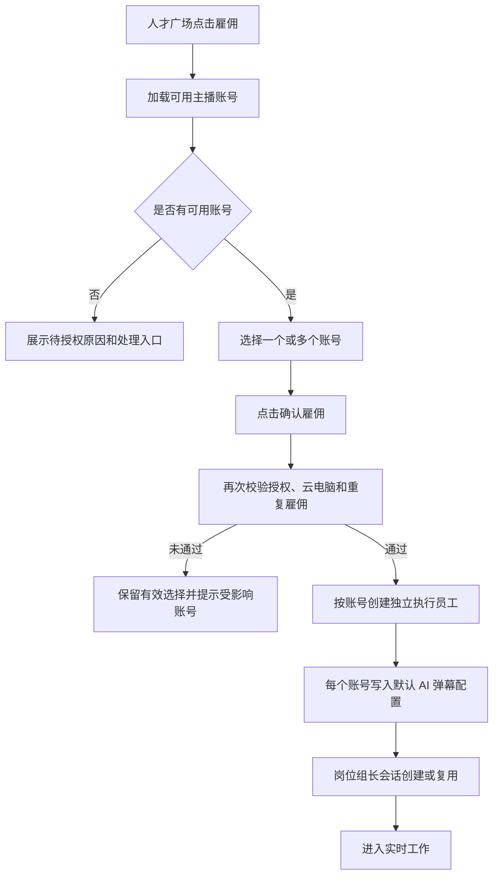

# AI数班 V1.4 · 直播场控专家 PRD

> 版本：V1.4  
> 更新日期：2026-09-04  
> 状态：方案评审稿  
> 上游依据：直播场控专家方案讨论、现有 AI 弹幕营销 SaaS 界面、`PRD-v1.0.md`、`PRD-v1.1-对话逻辑设计方案.md`、`PRD-v1.3-短视频运营专员.md`、现有 AI数班原型及设计系统  
> 配套原型：`AI数班-V1.4-直播场控专家-线框原型.html`

---

## 一、产品概述

### 1.1 定位

直播场控专家是服务抖音直播间的数字员工岗位。用户在人才广场一次雇佣该岗位，并为一个或多个已完成抖音营销授权的主播账号创建账号级执行员工；每名执行员工通过对应云电脑实时监听直播弹幕，沿用原 SaaS 逻辑完成智能回弹幕与弹幕循环播报。

多个账号级执行员工在数字办公室和实时工作中分别展示、可同时工作；用户在对话中只与岗位级“直播场控专家组长”沟通，由组长聚合查询该岗位下全部账号的弹幕数据并处理异常通知。

### 1.2 用户价值

- 在主播直播过程中持续监听弹幕，降低人工场控重复回复成本。
- 对直播间常见问题或高意向弹幕进行自动回复，承接原 SaaS 的弹幕营销能力。
- 定时循环播报预设话术，引导用户点击转化组件、福袋或完成点赞、关注等互动。
- 通过真实云电脑投屏，让负责人确认数字员工正在做什么。
- 通过岗位组长统一查询多账号、多场次弹幕，不必逐个员工重复对话。
- 当云电脑、登录或授权异常导致无法工作时，主动通知负责人处理。

### 1.3 本期目标

1. 在人才广场交付单岗位、多账号选择的雇佣流程。
2. 按“一个主播账号对应一个执行员工”在数字办公室和实时工作中展示多个直播场控专家。
3. 在数字办公室侧栏展示账号级实时工作投屏、状态摘要及岗位组长对话。
4. 在实时工作中交付“实时工作”和“AI弹幕配置”两个 Tab。
5. 迁移原 SaaS 的智能回弹幕、白名单、屏蔽福袋口令和弹幕循环播报配置能力。
6. 在对话中提供最近 30 天内的跨账号、跨直播场次弹幕查询；最终时间范围以技术调研为准。
7. 为云电脑掉线、抖音登录失效、授权失效及直播连接异常提供 Agent 主动通知。

### 1.4 非目标

- 不在本 PRD 中重新定义智能回弹幕、自动回复、限频、冲突处理、重试及循环播报的底层业务逻辑；全部沿用原 SaaS 系统。
- 不增加发送前模拟测试。
- 不增加云电脑接管、点击、键盘输入、重启等远程控制能力。
- 不增加独立的紧急暂停能力；账号是否参与工作由 Agent 设置中的账号范围控制，原 SaaS 已有功能开关按原逻辑保留。
- 不支持在对话中查询数字员工的回复内容、命中规则或发送结果。
- 不支持弹幕查询结果分页或导出。
- 不在成果中心新增直播场控专家入口、报表或记录。
- 不迁移原 SaaS 的完整历史直播场次数据看板和潜客查看能力。
- 不在本期重新定义岗位单价、计费周期及余额规则；如商业化校验存在，沿用平台通用雇佣与计费逻辑。

---

## 二、核心概念与组织模型

### 2.1 三层模型

| 层级 | 产品对象 | 展示与职责 |
|------|----------|------------|
| 岗位层 | 直播场控专家 | 人才广场只展示一个岗位卡片；负责岗位介绍、首次雇佣和已雇佣后的管理入口 |
| 对话层 | 直播场控专家组长 | 岗位下唯一对话对象；聚合全部执行员工的数据、上下文和异常通知，不作为额外员工展示 |
| 执行层 | 账号级直播场控数字员工 | 一个主播抖音账号对应一个员工实例；拥有独立配置、状态、云电脑、直播场次和工作记录 |

组织关系：

```text
直播场控专家岗位
├── 岗位组长：统一对话、跨账号查询、异常通知
├── 执行员工 A：主播账号 A、独立配置、独立云电脑
├── 执行员工 B：主播账号 B、独立配置、独立云电脑
└── 执行员工 C：主播账号 C、独立配置、独立云电脑
```

### 2.2 核心业务规则

1. 一个主播抖音账号在同一数字办公室中只对应一个直播场控执行员工。
2. 用户可一次选择多个账号雇佣；系统为每个选中账号分别创建执行员工。
3. 多个执行员工可以同时监听各自直播间并执行弹幕动作，状态和故障互不覆盖。
4. AI 弹幕配置按主播账号隔离，不在账号之间共享或继承。
5. 新增或更换账号时，新员工使用原 SaaS 的系统默认配置；旧账号配置不迁移到新账号。
6. 数字办公室与实时工作展示账号级员工；对话列表只展示一个岗位组长会话。
7. 从某个账号级员工进入对话时，仍进入组长会话，但自动携带当前主播账号作为默认查询上下文。
8. 解雇只停止数字员工，不解除抖音账号绑定、抖音营销授权或云电脑授权关系。

### 2.3 字段命名

为避免“弹幕账号”含义混淆，本期统一使用以下名称：

| 字段 | 定义 |
|------|------|
| 主播抖音账号 | 企业用于开播、被直播场控专家服务的账号 |
| 弹幕用户 | 在直播间发送弹幕的观众昵称 |
| 观众账号 | 弹幕用户对应的平台账号标识；如接口仅返回昵称，则按实际可用字段展示 |
| 直播场次 | 一次完整开播至下播形成的场次记录，具有唯一场次 ID |

---

## 三、外部依赖与能力边界

### 3.1 抖音营销授权

抖音营销授权是雇佣和工作的前置依赖，具体授权流程沿用账号绑定模块及主号获客专家的既有逻辑。

- 账号只有在抖音营销授权有效、云电脑可用时，才能在雇佣弹窗中被选择。
- 授权无效账号仍展示，但不可选，并提供“去授权/重新授权”入口。
- 雇佣提交前再次校验所选账号的授权状态，避免使用过期检查结果。
- 授权完成后返回原雇佣弹窗，保留仍然有效的账号选择。
- 解雇员工或将账号移出工作范围，不解除账号已有授权。

### 3.2 云电脑

- 每个账号级执行员工关联该主播账号对应的云电脑运行实例。
- 云电脑画面以真实实时投屏方式展示，不是模拟动画或定时截图。
- 用户只能观看，不能对云电脑进行点击、输入、接管、刷新或重启操作。
- 原型中的视频区域只表达布局；真实投屏协议、清晰度、延迟、音频和兼容性由技术方案确定。

### 3.3 原 SaaS 逻辑复用

下列能力不在本 PRD 中重新设计，由开发直接沿用原系统：

- 弹幕监听与触发条件；
- 智能回弹幕的识别、关键词组合、回复选择和发送动作；
- 同一用户或同类弹幕的限频、去重与冷却；
- 多条规则同时命中时的优先级；
- 智能回复与循环播报同时触发时的调度；
- 发送失败重试、终止及平台风控处理；
- 循环播报顺序、随机机制、计时间点与重复控制；
- 字段长度、配置数量和输入校验上限；
- 原 SaaS 已提供的模块功能开关。

前端迁移需保持原系统字段含义、默认值、校验提示和执行结果一致；如 AI数班视觉语言与原 SaaS 组件冲突，仅调整呈现，不改变业务逻辑。

---

## 四、信息架构与页面关系

### 4.1 页面结构

```text
人才广场
└── 直播场控专家岗位
    ├── 岗位详情
    └── 雇佣确认：多选主播抖音账号

数字办公室
├── 直播场控执行员工 A（主播账号 A）
├── 直播场控执行员工 B（主播账号 B）
└── 账号级员工侧栏
    ├── 身份与状态
    ├── 云电脑实时投屏 / 上一场直播画面
    ├── 当前或上一场摘要
    └── 岗位组长对话（自动携带账号上下文）

对话
└── 直播场控专家组长
    ├── 跨账号、跨场次弹幕查询
    └── 异常主动通知

实时工作
└── 直播场控专家
    ├── 账号级执行员工选择
    ├── Tab 1：实时工作
    └── Tab 2：AI弹幕配置

Agent 设置
├── 身份
├── 技能
└── 权限：账号范围

成果中心
└── 本期无直播场控专家展示
```

### 4.2 页面职责

| 页面 | 回答的问题 | 核心内容 |
|------|------------|----------|
| 人才广场 | 我要不要雇佣，哪些账号可以交给它 | 岗位价值、依赖、账号选择、雇佣结果 |
| 数字办公室 | 哪些直播场控员工在工作，哪里异常 | 多员工状态、实时投屏、上一场摘要、组长对话 |
| 对话 | 各账号直播间发生过什么 | 原始弹幕查询、跨账号聚合、异常通知 |
| 实时工作 | 某个账号现在做什么、配置是什么 | 账号选择、实时云电脑、过程事件、AI弹幕配置 |
| Agent 设置 | 哪些账号由该岗位服务 | 组长身份、固定技能、账号范围 |

---

## 五、人才广场与雇佣流程

### 5.1 岗位卡片

人才广场只展示一个“直播场控专家”岗位卡片，不按主播账号重复展示。

卡片内容：

- 岗位名称：直播场控专家；
- 岗位说明：实时监听直播弹幕，自动回复高意向或常见问题，并循环播报互动与转化话术；
- 平台：抖音；
- 核心依赖：抖音营销授权（云电脑）；
- 能力标签：智能回弹幕、循环播报、实时投屏、弹幕查询；
- 状态：可雇佣 / 已雇佣 N 名 / 待授权；
- 主操作：雇佣 / 管理员工 / 查看实时工作。

已雇佣至少一名执行员工后，岗位卡显示“已雇佣 N 名”，不为每名员工生成新岗位卡。

### 5.2 进入雇佣

点击“雇佣”打开单页确认弹窗：

1. 顶部展示岗位名称、能力说明和关闭入口。
2. 展示抖音营销授权依赖说明。
3. 按账号列出当前用户有权限查看的主播抖音账号。
4. 用户可勾选一个或多个可用账号，至少选择一个。
5. 底部实时展示“将创建 N 名直播场控数字员工”。
6. 若平台存在通用余额或计费校验，同屏展示并沿用通用处理逻辑。

### 5.3 账号列表字段

| 字段 | 说明 |
|------|------|
| 选择 | 仅授权和云电脑均可用的账号可选 |
| 主播抖音账号 | 头像、昵称、抖音号 |
| 抖音营销授权 | 已授权 / 待授权 / 已失效 |
| 云电脑 | 可用 / 掉线 / 未开通 |
| 当前占用 | 未雇佣 / 已创建直播场控员工 |
| 操作 | 去授权、重新授权或查看账号 |

已存在直播场控执行员工的账号不可重复选择，并显示“已雇佣”。

### 5.4 确认雇佣



提交规则：

- 未选择账号时主按钮禁用，并说明至少选择一个账号。
- 提交过程中禁止重复点击。
- 部分账号在提交时失效，不创建部分成功结果；用户移除失效账号后重新确认。
- 成功后为每个账号生成独立员工 ID、状态、配置和云电脑关联。
- 多账号雇佣只创建一个岗位组长会话；已有会话时直接复用。
- 成功后默认进入实时工作，选中本次创建的第一名员工。

### 5.5 已雇佣后的新增账号

- 人才广场岗位卡的主操作改为“管理员工”，进入 Agent 设置的账号范围。
- 用户在 Agent 设置中开启新的可用账号后，为该账号创建新的执行员工。
- 新员工使用系统默认 AI 弹幕配置，不复制当前选中员工或其他账号的配置。
- 新增员工出现在数字办公室和实时工作员工列表中，并自动纳入岗位组长的对话查询范围。

### 5.6 解雇

解雇分为单员工解雇和岗位全部解雇：

| 场景 | 入口 | 结果 |
|------|------|------|
| 单员工解雇 | 数字办公室员工菜单、Agent 设置账号范围 | 停止该主播账号对应员工；其他账号员工继续工作 |
| 岗位全部解雇 | 人才广场“管理员工”或 Agent 设置 | 停止岗位下全部执行员工，岗位恢复“可雇佣” |

单员工解雇确认需展示主播账号、当前直播状态和影响：

- 正在直播时，说明确认后该员工不再监听或发送弹幕；
- 解雇只停止数字员工，不解绑主播账号、不解除抖音营销授权；
- 该员工的 AI 弹幕配置不迁移给其他账号；再次为该账号创建员工时按默认配置初始化；
- 历史直播场次及原始弹幕按数据保留规则保存，但不在成果中心展示；
- 解雇最后一名员工后，岗位组长停止产生新的业务消息，历史对话保留只读，岗位卡恢复可雇佣。

---

## 六、数字办公室

### 6.1 多员工展示

数字办公室按账号级实例分别展示直播场控数字员工，不合并为单张岗位卡。

每张员工卡展示：

- 数字员工形象；
- 显示名称：“直播场控专家 · 主播账号昵称”；
- 主播账号头像、昵称或抖音号；
- 当前主状态；
- 当前直播间名称或“等待开播”；
- 最近动作，如“正在回复弹幕”“正在循环播报”“监听中”；
- 最近更新时间；
- “查看员工”入口。

同一岗位的多个员工可以处于不同状态，例如账号 A 正在直播、账号 B 已下播、账号 C 因云电脑掉线待处理。

### 6.2 员工状态

| 状态 | 触发条件 | 是否执行 |
|------|----------|----------|
| 等待开播 | 授权、云电脑和配置正常，但主播账号未直播 | 否；持续等待直播开始 |
| 直播监听中 | 已检测到直播，正在监听弹幕 | 是 |
| 正在回复 | 已触发智能回复且正在执行发送 | 是 |
| 正在播报 | 正在执行循环播报 | 是 |
| 直播已结束 | 当前未直播，存在上一场直播记录 | 否；展示上一场摘要 |
| 待处理 | 云电脑、登录、授权或直播连接异常 | 否或受限，以原系统结果为准 |
| 已停止 | 账号已移出工作范围或员工被解雇 | 否 |

员工卡只显示一个主状态，优先级为：`待处理 > 正在回复/正在播报 > 直播监听中 > 直播已结束/等待开播 > 已停止`。

### 6.3 员工侧栏

点击员工卡打开右侧侧栏，侧栏只展示当前账号级员工的信息，但对话对象仍为岗位组长。

#### 6.3.1 身份头部

- 数字员工形象；
- “直播场控专家 · 主播账号昵称”；
- 主播抖音账号；
- 当前状态和更新时间；
- “查看实时工作”“Agent 设置”入口；
- 更多操作中提供单员工解雇。

#### 6.3.2 工作界面

- 正在直播：展示真实云电脑实时投屏，叠加“只读投屏”提示和直播状态。
- 未在直播且存在上一场：展示上一场最后可用画面或系统提供的回看状态，明确标注“上一场直播”。
- 从未直播：展示“等待该账号开播”的业务空态。
- 云电脑不可用：不展示虚假实时画面，显示异常原因、发生时间和处理入口。
- 视频区域不得提供点击、键盘、远程接管、重启或暂停控制。

#### 6.3.3 当前或上一场摘要

| 场景 | 展示内容 |
|------|----------|
| 正在直播 | 直播间名称、开播时间、已运行时长、监听弹幕数、智能回复数、循环播报数、失败数、最近动作 |
| 直播已结束 | 上一场直播名称、开播时间、下播时间、直播时长、监听弹幕数、智能回复数、循环播报数、失败数、最后若干条执行记录 |
| 等待开播 | 主播账号、配置就绪状态、最近一次直播时间或“暂无直播记录” |
| 待处理 | 异常类型、影响账号、发生时间、停止的能力和处理办法 |

以上数字用于说明工作过程，不形成成果中心记录。

#### 6.3.4 组长对话

- 侧栏下方沿用现有员工对话布局，但会话身份固定为“直播场控专家组长”。
- 会话顶部显示“当前上下文：主播账号昵称”。
- 用户直接提问时，组长默认以当前账号为查询范围；用户明确指定其他账号或“全部账号”时覆盖默认范围。
- 从不同账号员工进入侧栏，均复用同一条组长会话，不创建多个聊天线程。
- 切换员工不删除会话历史，只更新当前默认账号上下文。

---

## 七、Agent 设置

### 7.1 定位

Agent 设置为岗位级管理页，负责组长身份、固定技能和账号工作范围。智能回弹幕与循环播报的业务配置不在 Agent 设置中编辑，统一进入实时工作 > AI弹幕配置按账号维护。

从任一账号级员工进入 Agent 设置时打开同一页面，并定位到该主播账号行；关闭后返回原员工和原页面位置。

### 7.2 身份

- Agent 称呼：默认“直播场控专家组长”，影响岗位对话列表和回复称呼。
- Agent 人设：默认“负责汇总多个直播场控员工的工作状态、查询直播弹幕并通知异常”。
- 身份设置只影响组长表达，不改变执行员工数量、账号权限或 SaaS 工作逻辑。
- 保存后从下一次新回复生效。

### 7.3 固定技能

技能仅展示，不允许增加、删除或排序：

| 序号 | 技能 |
|------|------|
| 01 | 直播弹幕监听 |
| 02 | 智能回弹幕 |
| 03 | 弹幕循环播报 |
| 04 | 云电脑过程回传 |
| 05 | 弹幕数据查询 |

### 7.4 权限：账号范围

账号范围按主播抖音账号逐行展示：

| 字段 | 说明 |
|------|------|
| 主播账号 | 头像、昵称、抖音号 |
| 营销授权 | 可用、待授权或已失效 |
| 云电脑 | 在线、掉线或未开通 |
| 员工状态 | 等待开播、直播中、待处理、未雇佣 |
| 工作范围 | 开启/关闭 |
| 操作 | 查看配置、去授权或查看异常 |

规则：

1. 授权和云电脑可用的未雇佣账号可以开启；保存成功后创建账号级执行员工并写入默认配置。
2. 已雇佣账号可以关闭；保存前按单员工解雇规则二次确认。
3. 关闭只停止该员工，不解除账号授权。
4. 授权失效不是用户主动关闭，不自动解雇员工；员工进入待处理，保留账号行和处理入口。
5. 同一账号不得重复创建执行员工。
6. 至少保留一名员工才能保持岗位为已雇佣；关闭最后一个账号时按“岗位全部解雇”确认。
7. 账号范围保存后，数字办公室、实时工作、人才广场岗位数量和组长查询范围同步更新。
8. 正在直播的账号被关闭时，确认文案必须明确自动监听和发送将立即停止。

### 7.5 保存与失败

- 有未保存修改时关闭页面，提示是否放弃。
- 保存时重新校验授权、云电脑和重复创建状态。
- 保存中禁用重复提交。
- 保存失败保留用户输入和原生效范围，不产生半成功员工。
- 保存成功提示新增、停止的员工数量及生效账号。

---

## 八、实时工作

### 8.1 页面结构

实时工作先展示岗位下全部账号级员工，再展示当前选中员工的工作区。

推荐桌面布局：

- 左侧或顶部：账号级员工选择区，展示员工名称、主播账号和状态；
- 右侧或下方：当前员工工作区；
- 工作区顶部固定展示当前主播账号、直播状态、授权/云电脑状态、最近更新时间；
- 工作区使用两个 Tab：`实时工作`、`AI弹幕配置`。

首次进入规则：

1. 从数字办公室进入时，默认选中来源员工。
2. 从人才广场雇佣成功进入时，默认选中本次创建的第一名员工。
3. 从左侧导航直接进入时，优先选中正在直播或待处理员工；否则使用上次选择。

### 8.2 Tab 一：实时工作

#### 8.2.1 正在直播

页面展示：

- 直播间名称、主播账号、开播时间、直播时长和“正在直播”状态；
- 云电脑真实实时投屏，明确标记“只读”；
- 当前工作阶段：监听弹幕 / 智能回复 / 循环播报；
- 本场摘要：监听弹幕数、智能回复数、循环播报数、失败数；
- 最近执行过程，参考主动获客专家的 RPA 工作过程表达。

过程事件至少包含：

| 字段 | 示例 |
|------|------|
| 时间 | 20:36:18 |
| 类型 | 收到弹幕 / 智能回复 / 循环播报 / 系统状态 |
| 对象 | 弹幕用户或系统 |
| 摘要 | 收到“这款车最低多少钱”；准备执行原系统回复 |
| 状态 | 处理中 / 已完成 / 失败 |

实时工作允许展示过程摘要，但不改变第九章对话查询边界；组长对话仍不提供历史回复内容和发送结果查询。

#### 8.2.2 未在直播

若存在上一场直播，默认展示上一场状态：

- 直播间名称；
- 开播时间、下播时间和直播时长；
- 监听弹幕数、智能回复数、循环播报数和失败数；
- 上一场云电脑最后可用画面或回看状态；
- 最后若干条过程事件；
- 明确提示“直播已结束，当前等待下一次开播”。

不提供完整历史场次表、日期筛选、“查看潜客”或成果中心跳转。

若从未产生直播场次，显示等待开播空态，并提供“查看 AI 弹幕配置”和“检查账号授权”入口。

#### 8.2.3 异常状态

云电脑、登录、授权或直播连接异常时：

- 停止展示“实时”语义，避免将旧画面误认为当前画面；
- 页面顶部显示待处理状态；
- 展示异常类型、发生时间、影响能力和处理建议；
- 提供去账号绑定、重新授权或联系运营等现有处理入口；
- 岗位组长同步发送主动通知。

### 8.3 Tab 二：AI弹幕配置

AI弹幕配置只编辑当前选中主播账号。顶部必须固定显示账号身份，避免用户误改其他员工。

页面由两个核心模块组成：

1. 智能回弹幕；
2. 弹幕循环播报。

两个模块的执行逻辑、功能开关、默认值、校验和风控规则沿用原 SaaS。本 PRD 只规定迁移后的信息结构、账号隔离和入口关系。

### 8.4 智能回弹幕

#### 8.4.1 模块摘要

摘要卡展示：

- 当前功能开关和工作状态；
- 触发条件：监测到符合原系统规则的弹幕；
- 回复方式：沿用原系统智能识别及对应语料；
- 已配置关键词/问答数量；
- 白名单账号数量；
- 屏蔽福袋口令数量；
- 最近修改时间；
- “配置回复语料”“设置白名单”“设置屏蔽口令”入口。

#### 8.4.2 弹幕回复语料

沿用原 SaaS 的列表与编辑逻辑：

- 列表列：弹幕关键词、机器人回复内容、操作；
- 支持新增、编辑和删除；
- 新增时分别编辑关键词和回复内容；
- 多关键词组合、回车添加多条、字数及数量限制沿用原系统；
- AI 润色、预览示例和推荐语料沿用原系统；
- 用户自定义内容的合规提示沿用原系统。

#### 8.4.3 回复白名单

- 白名单用于屏蔽对指定观众账号的自动回复。
- 列表展示观众账号昵称、备注、屏蔽类型、修改时间和操作。
- 支持搜索、新增、编辑和删除。
- 新增账号时填写观众账号昵称和备注，屏蔽类型固定为“弹幕回复”。

#### 8.4.4 屏蔽福袋口令

- 配置命中的福袋口令不触发智能回复。
- 列表展示口令、备注、修改时间和操作。
- 支持搜索、新增、编辑和删除。
- 字段长度与匹配逻辑沿用原系统。

### 8.5 弹幕循环播报

模块展示：

- 当前功能开关和工作状态；
- 开始条件：检测到直播开始后按原系统自动播报；
- 播报间隔：最短秒数至最长秒数；
- 已配置循环话术数量；
- 话术摘要和原系统所需的合规提示；
- “修改配置”入口。

配置结构沿用原 SaaS：

- 轮播模式：按时间间隔轮播；
- 最短间隔、最长间隔；
- 多条循环播报话术；
- AI 润色和推荐语料；
- 输入上限、发送顺序、随机与去重、调度和失败处理沿用原系统。

### 8.6 配置保存与账号隔离

1. 页面始终显示当前主播账号，切换员工后重新加载该账号配置。
2. 存在未保存内容时切换员工或 Tab，提示是否放弃修改。
3. 保存时仅更新当前账号版本，不覆盖其他账号。
4. 保存成功显示账号、修改模块和生效时间。
5. 保存失败保留当前输入并允许重试。
6. 新员工首次进入时读取原 SaaS 默认配置。
7. 移除账号后其配置不迁移；再次创建员工时重新使用默认配置。

---

## 九、岗位组长对话

### 9.1 会话模型

- 对话列表只展示一个“直播场控专家组长”，不按账号生成多个 Agent 会话。
- 组长可访问当前岗位下全部已雇佣执行员工有权限的数据。
- 所有账号的提问、查询结果和异常通知写入同一会话流。
- 从账号级员工侧栏进入时携带默认主播账号；从一级对话入口进入时默认范围为岗位下全部账号。
- 每次查询回复必须展示实际使用的账号范围、时间范围和数据更新时间。

### 9.2 可查询数据

本期只支持原始弹幕数据查询：

| 字段 | 说明 | 可筛选 |
|------|------|--------|
| 弹幕内容 | 观众发送的原始弹幕文本 | 支持关键词或文本条件 |
| 弹幕时间 | 弹幕产生时间 | 支持时间范围 |
| 弹幕用户 | 观众昵称 | 支持 |
| 观众账号 | 平台可提供的观众账号标识 | 以技术接口为准 |
| 主播抖音账号 | 接收弹幕的企业主播账号 | 支持单选或多选 |
| 直播场次 | 弹幕所属直播场次名称、场次 ID | 支持单场或跨场 |

明确不返回：

- 数字员工的回复内容；
- 命中的关键词或规则；
- 回复发送状态和失败原因；
- 潜客或留资结果；
- 成果中心记录。

### 9.3 时间范围和返回规则

- 暂定支持最近 30 天内的数据，最终保留时长以技术调研为准。
- 支持单账号、多账号、单场次和跨场次组合查询。
- 查询结果不分页，一次返回当前条件下的结果。
- 当结果超过服务端或对话上下文安全上限时，不生成分页器；组长说明结果过多，并引导用户缩小时间、账号、场次或关键词范围。
- 不支持导出。
- 用户没有指定时间时，组长根据“今天、昨天、上一场”等自然语言解析；无法确定时先询问必要条件。
- 用户没有指定主播账号时，从一级对话入口按全部已雇佣账号查询；从员工侧栏入口按当前账号查询。

### 9.4 查询示例

- “上一场直播有哪些人问过价格？”
- “查一下昨晚 8 点以后包含‘试驾’的弹幕。”
- “观众小王最近三场直播说过什么？”
- “比较门店主号和新能源体验店昨天的弹幕。”
- “全部账号最近 7 天提到优惠的弹幕有哪些？”

组长回复中的每条结果至少包含：弹幕时间、弹幕内容、弹幕用户、主播抖音账号和直播场次；观众账号按接口可用性展示。

### 9.5 异常主动通知

#### 9.5.1 触发范围

首期至少考虑以下异常，最终异常字典以原 SaaS 和技术调研为准：

- 云电脑掉线；
- 抖音登录失效；
- 抖音营销授权失效；
- 直播间连接异常；
- 其他导致弹幕监听或发送无法继续的运行异常。

#### 9.5.2 通知内容

每条通知需包含：

- 异常账号；
- 异常类型；
- 发生时间；
- 受影响能力；
- 当前员工状态；
- 建议处理方式和可用入口；
- 数据截止时间。

示例：

> **门店主号需要处理**：20:46 检测到云电脑连接中断，我已停止该账号的弹幕监听和自动发送。其他 2 名直播场控员工仍正常工作。请前往账号绑定检查云电脑状态，恢复后我会重新检查并继续等待直播。

#### 9.5.3 去重与恢复

- 同一账号、同一异常类型和同一异常状态只保留一条有效提醒，避免重复刷屏。
- 异常状态变化或影响扩大时更新原提醒或发送新消息。
- 恢复后在同一会话中更新“已恢复”状态，并写明恢复时间。
- 异常通知不自动解除授权、不自动操作云电脑。

---

## 十、数据与状态模型

### 10.1 核心实体

| 实体 | 关键字段 |
|------|----------|
| 岗位 | `roleId`、岗位名称、雇佣状态、执行员工数量、组长会话 ID |
| 岗位组长 | `leaderAgentId`、称呼、人设、账号查询范围、会话状态 |
| 执行员工 | `employeeId`、`roleId`、主播账号 ID、显示名称、员工状态、创建/停止时间 |
| 主播账号 | 账号 ID、昵称、抖音号、平台授权、营销授权、云电脑状态 |
| AI 弹幕配置 | 主播账号 ID、智能回弹幕开关及配置、白名单、屏蔽口令、循环播报配置、配置版本、修改时间 |
| 直播场次 | 场次 ID、主播账号 ID、直播间名称、开播/下播时间、场次状态、摘要指标 |
| 弹幕记录 | 记录 ID、场次 ID、主播账号 ID、弹幕时间、弹幕内容、弹幕用户、观众账号 |
| 工作过程事件 | 事件 ID、员工 ID、场次 ID、时间、事件类型、摘要、状态 |
| 异常事件 | 异常 ID、员工 ID、账号 ID、异常类型、发生/恢复时间、影响能力、处理状态 |

### 10.2 状态分层

| 层级 | 状态用途 |
|------|----------|
| 岗位状态 | 可雇佣 / 已雇佣 N 名 / 待处理 |
| 执行员工状态 | 等待开播 / 直播监听中 / 正在回复 / 正在播报 / 直播已结束 / 待处理 / 已停止 |
| 直播场次状态 | 直播中 / 已结束 |
| 云电脑状态 | 在线 / 掉线 / 未开通 / 检查中 |
| 配置状态 | 已保存 / 有未保存修改 / 保存中 / 保存失败 |

岗位状态为聚合结果：只要存在一名执行员工即为已雇佣；存在待处理员工时在岗位数量旁显示异常数量，但不覆盖其他员工的正常状态。

### 10.3 数据保留

- 弹幕数据暂定保留并可查询最近 30 天，最终以技术调研为准。
- 解雇不删除账号授权和已产生的原始弹幕数据；历史数据按用户权限和保留周期查询。
- AI 弹幕配置按账号隔离，但移除后不迁移、不用于新员工初始化。
- 云电脑画面是否留存及上一场画面来源由技术方案确定；产品不得承诺超出原系统的数据留存能力。

---

## 十一、页面状态与异常处理

### 11.1 通用页面状态

所有页面需覆盖：

- 加载中：使用结构骨架，保留稳定布局；
- 空数据：说明业务原因和下一步操作；
- 加载失败：保留当前上下文并提供重试；
- 无权限：说明账号或岗位权限不足，不展示其他账号数据；
- 数据过期：展示最近成功更新时间和重新检查入口。

### 11.2 关键空态

| 场景 | 文案方向 | 操作 |
|------|----------|------|
| 无可雇佣账号 | 暂无营销授权和云电脑均可用的抖音账号 | 去账号绑定/授权 |
| 已雇佣但未开播 | 当前账号尚未开播，员工会持续等待 | 查看 AI 弹幕配置 |
| 从未直播 | 暂无直播记录 | 检查账号、等待开播 |
| 无匹配弹幕 | 当前条件下没有查到弹幕 | 修改时间、账号、场次或关键词 |
| 全部员工异常 | 当前直播场控员工均需要处理 | 查看异常账号 |

### 11.3 一致性

- 账号授权状态在账号绑定、人才广场、数字办公室、实时工作和 Agent 设置中保持一致。
- 员工新增或停止后，岗位数量、办公室卡片、实时工作列表和组长查询范围同步刷新。
- 当前直播结束后，员工状态、侧栏摘要和实时工作同时切换为上一场状态。
- 不使用“在线工作”描述已经下播或云电脑掉线的员工。

---

## 十二、权限、审计与安全

1. 用户只能查看当前数字办公室及当前账号权限范围内的主播账号、弹幕和云电脑画面。
2. 岗位组长跨账号查询仍受当前用户的数据权限限制。
3. 云电脑投屏只读，前端不得透传鼠标、键盘或远程控制事件。
4. 雇佣、解雇、账号范围修改和 AI 弹幕配置保存需记录操作者、时间、账号、修改前后值和结果。
5. 自定义弹幕话术沿用原 SaaS 的平台合规提示和处理边界。
6. 授权失效后不继续展示可能误导用户的实时状态；历史数据注明截止时间。

---

## 十三、优先级

| 优先级 | 能力 | 说明 |
|--------|------|------|
| P0 | 人才广场岗位与多账号雇佣 | 单岗位入口，按账号创建多个执行员工 |
| P0 | 数字办公室多员工展示 | 每个主播账号独立员工、状态和侧栏 |
| P0 | 云电脑实时只读投屏 | 正在直播展示实时画面，未直播展示上一场状态 |
| P0 | 实时工作双 Tab | 实时工作、AI弹幕配置 |
| P0 | 智能回弹幕配置迁移 | 语料、白名单、屏蔽福袋口令，逻辑沿用 SaaS |
| P0 | 弹幕循环播报配置迁移 | 间隔和多条话术，逻辑沿用 SaaS |
| P0 | 岗位组长聚合对话 | 单会话、跨账号/场次原始弹幕查询 |
| P0 | Agent 设置账号范围 | 新增/停止账号级员工，配置隔离 |
| P0 | 异常 Agent 通知 | 云电脑、登录、授权及直播连接异常 |
| P1 | 上一场直播摘要 | 下播后的必要工作过程摘要 |

---

## 十四、验收标准

### 14.1 人才广场与雇佣

1. 人才广场只出现一张直播场控专家岗位卡。
2. 雇佣弹窗支持同时选择多个可用主播账号，未选账号不能提交。
3. 选择 N 个账号后成功创建 N 名执行员工，且只创建或复用一个岗位组长会话。
4. 授权或云电脑不可用的账号不可选择，并有明确处理入口。
5. 同一主播账号不能重复创建直播场控执行员工。

### 14.2 数字办公室

1. 不同主播账号的执行员工分别展示，可同时处于不同状态。
2. 点击任一员工可查看对应账号的真实云电脑只读投屏或上一场状态。
3. 侧栏对话始终进入岗位组长会话，并展示当前账号上下文。
4. 云电脑异常时不把旧画面标为实时，并提供异常原因和处理方式。

### 14.3 实时工作与配置

1. 页面能够选择岗位下不同账号级员工，切换后状态、画面、摘要和配置同步切换。
2. “实时工作”和“AI弹幕配置”两个 Tab 职责明确。
3. 正在直播时展示直播状态、实时投屏、本场摘要和执行过程。
4. 下播后展示上一场名称、起止时间、监听弹幕数、智能回复数、循环播报数、失败数和最近过程。
5. 智能回弹幕、白名单、屏蔽口令和循环播报配置字段与原 SaaS 一致。
6. 一个账号的配置修改不会覆盖其他账号；新增账号使用默认配置。
7. 云电脑视频区域不存在任何远程控制操作。

### 14.4 对话

1. 对话列表只展示一个直播场控专家组长，不为每名执行员工创建独立对话。
2. 组长支持按弹幕内容、时间、弹幕用户、观众账号、主播抖音账号和直播场次查询原始弹幕。
3. 支持最近 30 天内的跨账号、跨场次查询，最终时间范围可随技术结论调整。
4. 查询不提供分页、导出、数字员工回复内容、命中规则和发送结果。
5. 从员工侧栏发起查询时默认限定当前主播账号，从一级对话进入时默认查询全部已雇佣账号。
6. 异常通知能够点名受影响账号、原因、时间、影响和处理方式，恢复后更新状态。

### 14.5 解雇

1. 可单独解雇某个账号级员工，其他员工不受影响。
2. 解雇最后一名员工后岗位恢复可雇佣，岗位组长不再产生新业务消息。
3. 解雇不解除抖音账号绑定、抖音营销授权或云电脑授权关系。
4. 再次为账号创建员工时使用默认配置，不自动恢复或复制旧员工配置。

---

## 十五、待技术确认

1. 原始弹幕数据是否可以稳定支持 30 天查询，以及观众账号字段的实际可用性。
2. 云电脑实时投屏协议、延迟、清晰度、并发量和上一场最后画面的获取方式。
3. 原 SaaS 能够输出的异常类型、错误码、恢复事件及处理入口映射。
4. 原 SaaS 配置字段、默认值、数量限制和校验文案的完整清单。
5. 直播场次 ID、直播间名称、开播/下播事件和场次摘要的接口口径。
6. 多账号同时直播时，实时状态和投屏连接的并发上限。
7. 岗位单价、账号级计费起止和余额不足处理继续沿用哪一版通用商业化规则。
