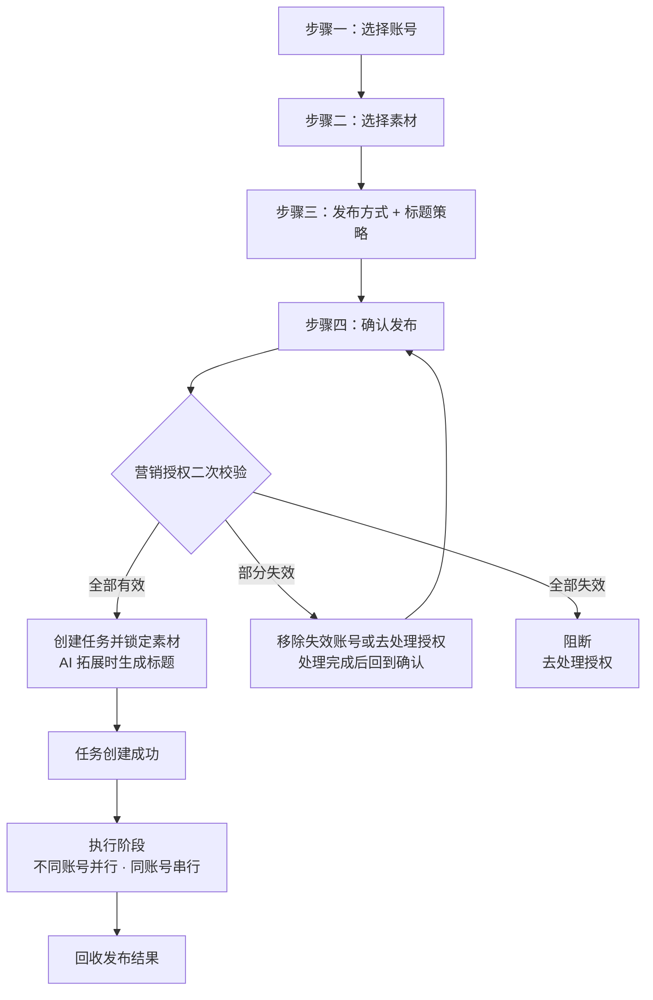
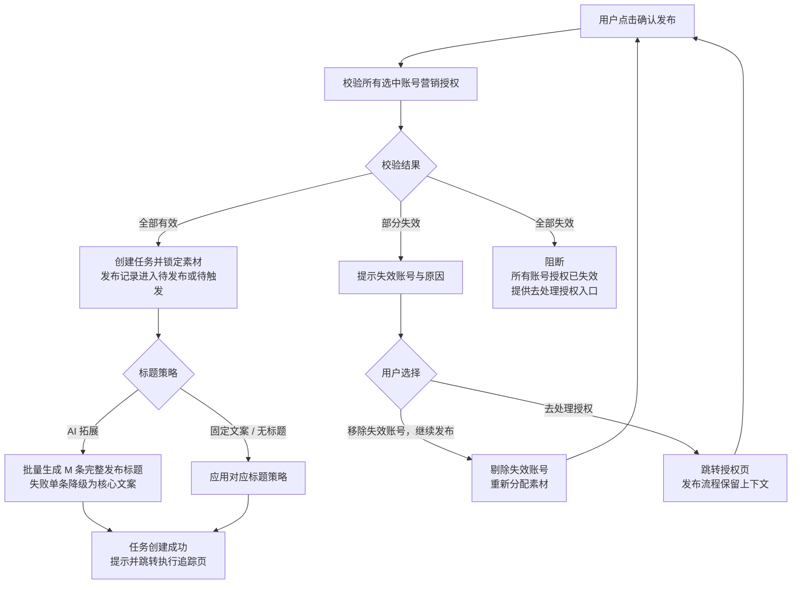
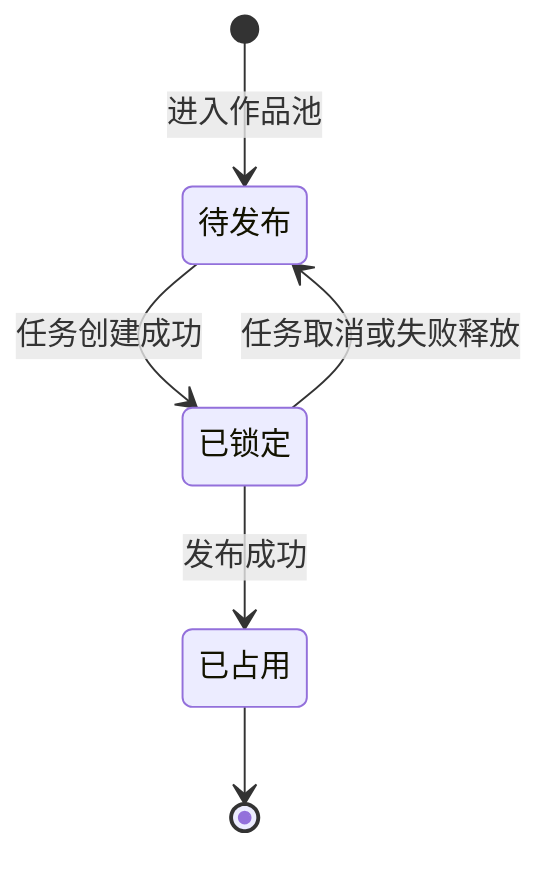
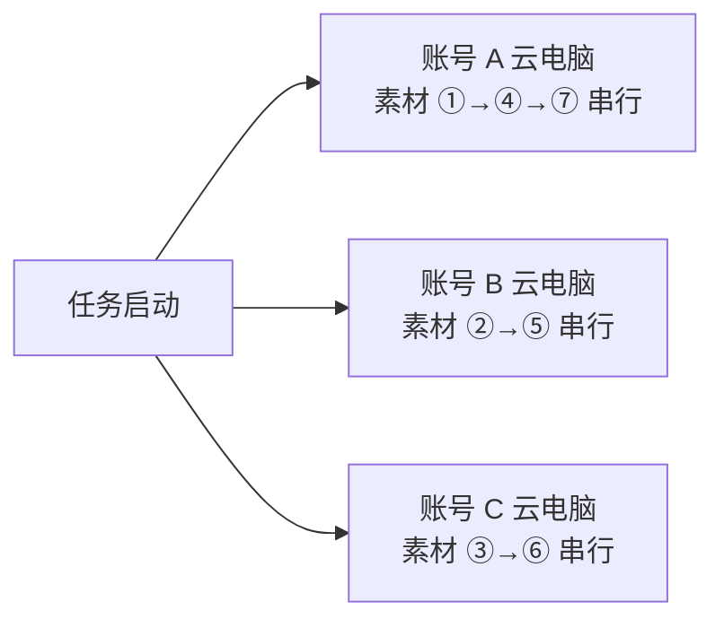

# AI数班 V1.3 · 短视频运营专员 PRD

> 版本：V1.3（当前 V1.3.18）
> 更新日期：2026-09-18
> 状态：V1.3 需求已定稿
> 适用原型：AI数班短视频运营专员高保真原型 v73

---

## 版本管理

> 本表记录本文档的历次变更，包含**变更位置**（章节，缩进表示从属子节）与**变更内容**。变更内容按 `① ② ③` 分条、`·` 列具体规则。**本表按模块一行**：同一模块被多次调整时只保留最新结论，**直接改该模块所在行**，不在表末追加新行；**只有新模块才在表末新增一行**。每次调整同步更新头部"更新日期"与"版本"。

| 版本 | 日期 | 变更位置 | 变更内容 |
|------|------|----------|----------|
| V1.3.1 | 2026-09-11 | 1.2 本期目标<br>2.1 人物设定（计费行）<br>2.2 账号绑定/授权<br>2.3.2 权限区域<br>**2.5 计费规则（新增）**<br>　2.5.1 人才广场扣费透出<br>　2.5.2 消耗展示<br>　2.5.3 计费与消耗验收标准<br>4.8 素材状态与占用<br>4.12.7 发布结果验收标准 | **① 计费口径：按账号按月托管 → 按账号按日扣费 → 按发布结果计费**（采纳 PRD-v1.0 第 204 行口径）<br>　· 一次发布 = 一个账号成功发布一条作品；n 个账号发布同一作品计 n 次，一个账号发布 m 条计 m 次<br>　· 默认 ¥2/次发布，单价可配置，展示当前实际生效单价；¥2 折算 20 电力值<br>　· 仅"发布完成"产生费用，待发布 / 发布中 / 发布失败 / 取消发布均不计费<br>　· 发布完成即时扣减，扣费时间 = 作品发布时间；取消 T+1 次日结算与"计费自然日"字段<br>　· 发布失败不计费，重试成功只计 1 次；幂等键为员工 ID + 账号 ID + 作品标识<br>　· 账号开关不再是计费开关，只控制发布范围；关闭与解雇动作本身不计费<br>　· 余额不足时发布任务进入"待处理"、不执行发布，因此不产生费用<br>**② 2.5.1 人才广场扣费透出**<br>　· 岗位卡 / 岗位详情 / 雇佣确认页展示"按次服务费 ¥2/次发布"<br>　· 雇佣确认页不再展示"雇佣当日预计费用"（取决于后续发布条数，只展示单价与计费规则）<br>　· 按次计费提示与授权提示分开呈现，避免"未授权即不产生费用"的误解<br>**③ 2.5.2 消耗展示**<br>　· 每条成功发布的作品生成一条独立费用记录，重复回收同一作品结果不重复计费<br>　· 消耗明细固定五列：扣费时间 / 扣费账号 / **发布作品** / 电力值 / 扣费备注<br>　· 备注固定展示"作品发布扣费"，不拼接账号、日期等信息；发布作品列展示作品标题 + 所属任务<br>　· 明细按扣费时间（= 作品发布时间）倒序；表格列的拓展性设计不入本期 PRD<br>**④ 2.5.3 计费与消耗验收标准**：新增 10 条<br>**⑤ 用语区分（4.8）**：标题"素材状态与消耗"→"素材状态与占用"，正文"消耗 / 永久消耗"→"占用 / 永久占用"<br>**⑥ 2.3.2**：账号开关只控制发布范围、**不是计费开关**，开关动作不产生费用<br>**⑦ 4.12.7**：补 1 条计费联动验收（发布完成即时计费、失败重试不重复）<br>**⑧ 4.8.3（V1.3.18 补）**：释放条件补充"员工解雇导致的取消发布"——解雇时排队作品取消后，素材释放回"待发布"池（见 2.6.2） |
| V1.3.2 | 2026-09-11 | 2.4 人才市场雇佣流程<br>　2.4.1 进入雇佣确认<br>　2.4.2 核心依赖检查<br>　**2.4.3 账号勾选与启用/关闭规则（新增）**<br>　2.4.4 依赖通过后的直接雇佣<br>　2.4.5 雇佣失败、取消与回流<br>4.3 步骤一：选择账号 | **① 删除"平台营销授权"字段与文案**（该能力已砍）<br>　· 前置条件仅保留"余额 + 抖音营销授权"两项<br>　· 弹窗与核心依赖表中不再出现平台授权状态<br>**② 新增 2.4.3 账号勾选与启用/关闭规则**<br>　· 勾选 = 纳入发布范围的账号；开关 = 范围内账号当前是否工作<br>　· 仅营销授权有效的账号可勾选；已完成授权的账号默认全部勾选并开启<br>　· 勾选是启用开关的前置条件：未勾选时开关置灰为"已关闭"，取消勾选同时回落"已关闭"<br>　· 勾选但未开启的账号进入范围但不参与发布；发布任务只从"已启用"账号中选取<br>　· 至少 1 个账号"已勾选 + 已开启"才能确认雇佣<br>　· 雇佣本身不产生费用，费用按后续实际发布成功的次数产生（见 2.5）<br>　· 雇佣完成后新增账号默认进入范围但为"已关闭"，需手动开启<br>**③ 章节顺延与口径同步**：原 2.4.3 / 2.4.4 → 2.4.4 / 2.4.5，"月托管费用""开始计费"等表述改为按次计费口径（雇佣动作本身不计费）<br>**④ 4.3**：明确账号范围由雇佣时的勾选结果决定，"已开启"由 Agent 设置「账号范围」开关决定 |
| V1.3.3 | 2026-09-11 | 2.3.2 权限区域（账号范围） | **Agent 设置中的抖音平台授权同步删除**<br>· 权限区域只管理参与矩阵发布的账号范围，平台授权状态不再展示与校验<br>· 账号行字段调整：<br>　原"账号名称、抖音平台授权、营销授权、启用状态、最近一次授权检查时间"<br>　→ 新"账号名称、抖音营销授权、启用状态、最近一次授权检查时间"<br>· 表述调整："抖音平台授权和营销授权管理仍由账号绑定模块承载"<br>　→"抖音营销授权管理仍由账号绑定模块承载，本区域不展示平台授权状态"<br>**③ 2.3.2（V1.3.18 补）**：明确账号开关关闭与员工解雇是两件事——开关关闭只控制发布范围、**不停止执行中的任务**；员工解雇会停止在途任务中的排队作品（见 2.6.2） |
| V1.3.4 | 2026-09-11 | 6.5 用户上传<br>6.3 列表展示与素材状态<br>4.4 步骤二：选择素材 | **① 上传本地视频增加抖音官方视频发布限制校验**（未通过的文件不进入作品池，同批次其他文件不受影响）<br>　· 格式：MP4 / MOV / WebM（H.264）<br>　· 大小：单个文件 ≤ 4GB（标注"抖音发布限制，具体发布大小以云电脑实际发布带宽要求为准"）<br>　· 时长：单条 ≤ 15 分钟<br>　· 分辨率：不低于 720p（横屏 ≥ 1280×720、竖屏 ≥ 720×1280，推荐 1080×1920）<br>　· 时长与分辨率通过读取视频元信息校验，不需用户额外填写<br>　· 帧率、码率等画质参数仅作发布前提示，不作上传拦截<br>**② 作品卡片展示**：校验通过后展示文件大小与时长<br>**③ 所有"待发布"视频增加下载入口**<br>　· 作品库待发布卡片 + 发布任务"选择素材"列表均提供"下载视频"<br>　· 下载原文件，文件名沿用素材原始标题<br>　· 点击下载不改变素材勾选状态 |
| V1.3.5 | 2026-09-11 | 6.4 监控抖音账号配置 | **① 添加账号补充有效性校验（带加载状态）**<br>　· 输入抖音号 → 点击"开始监控" → 校验期间按钮呈"校验中…"加载态、抖音号不可编辑，校验通过后加入监控列表并自动开始监控<br>　· 校验项：抖音号格式、账号是否存在、账号状态是否正常、是否已在监控列表<br>　· 校验不通过时在弹窗内就地提示原因（格式不正确 / 未找到该抖音号 / 抖音号状态异常 / 已在监控列表中），账号不进入列表，可直接修改重试<br>**② 首次添加抓取 15 条**<br>　· 校验通过后立即执行首次抓取，抓取该账号最近 15 条作品，去重后进入作品池<br>**③ 明确作品去重规则**<br>　· 同一账号的相同作品去重：同一账号重复抓取到同一条抖音作品时只保留一条<br>　· 不同账号发布的同一条作品不去重：按账号分别保留，各自进入作品池（以抖音作品ID 判定）<br>　· 同步结果提示给出抓取/新增/去重数量 |
| V1.3.6 | 2026-09-11 | 5.2 视觉方案<br>5.4 交互<br>3.2 数字办公室侧栏概览 | **① 总览页面发布过程视频展示规则调整**<br>　· "正在发布"不再展示视频：发布过程视频需在作品发布完成后才能从抖音获取，正在发布阶段获取不到<br>　· 仅"已发布"展示动态视频（静音、循环播放，当天"HH:mm"、隔天"MM-DD · HH:mm"）<br>　· 正在发布改为绿色进行中空态："正在发布 / 发布过程视频将在发布完成后展示"，保留进度条与预计完成时间<br>　· 5.4 交互同步：正在发布卡片不展示视频，已发布卡片展示最近一次发布视频<br>　· 小标题同步：每个账号展示当前状态，已完成发布的账号展示最近一次发布视频<br>**② 侧栏工作界面同步**：视频优先展示最近一次已完成发布的账号（正在发布阶段不展示视频，改为进行中空态） |
| V1.3.7 | 2026-09-11 | 6.3 列表展示与素材状态<br>4.1 定位<br>5.x 控件说明 | **作品库卡片删除"去发布"按钮**<br>　· 作品库中所有视频（监控抓取 + 用户上传）卡片只保留"下载视频"，不再提供"去发布"入口<br>　· 发布统一从"发布任务 → 选择素材"发起，避免卡片上出现与任务流程重复的发布入口<br>　· 4.1 同步口径：作品库只作为素材来源，卡片仅提供"下载视频"，不提供发布入口<br>　· 控件说明同步：结果动作示例由"去发布""查看作品"改为"下载视频""查看作品""去处理" |
| V1.3.8 | 2026-09-11 | 6.4 监控抖音账号配置 | **监控账号列表删除"状态"列**<br>　· 列表列调整为：账号 + 已获取作品数 + 最近抓取时间 + 每日自动抓取开关 + 操作（同步/恢复监控、删除）<br>　· 监控状态不单列展示：是否在监控由"每日自动抓取"开关与操作列按钮体现，不再单独展示"监控中/已暂停" |
| V1.3.9 | 2026-09-11 | 4.5.2 标题策略<br>　AI 拓展发布<br>　话题标签的展示与编辑规则（新增）<br>4.6.1 确认页展示内容<br>7.6 数据结构 | **① AI 拓展发布仅基于核心文案生成标题**<br>　· 核心文案为**必填**，为空时"下一步"禁用并提示"请输入核心文案"<br>　· 删除基于文件名、素材原始标题、二创视频标题的改写逻辑，素材信息不参与生成<br>**② 话题标签保留，新增"话题标签的展示与编辑规则"**<br>　· 展示：确认页按素材逐条展示标题正文与话题标签，拼接后即实际发布标题并实时校验 55 字符；任务详情与发布结果沿用同一展示<br>　· 格式：必须 `#` 开头，未带 `#` 自动补全，不得为空或仅为 `#`<br>　· 去重：同一条发布标题内不重复，重复提示"该话题标签已存在"<br>　· 长度：编辑后拼接总长 > 55 字符时就地提示并禁用"确认发布"<br>　· 生效范围：编辑作用于该条素材，其分发到的所有账号使用同一份标题与标签<br>　· 标记与兜底：用户编辑过的条目标记"用户修改"；删除全部标签后按"仅标题正文"发布，不自动补回<br>**③ 7.6 数据结构**：`topicTags` 说明补充"或经用户编辑后的最终结果" |
| V1.3.10 | 2026-09-11 | 4.5.2 标题策略<br>　话题标签的展示与编辑规则<br>4.6.1 确认页展示内容 | **① 标题正文与话题标签均可在确认页逐条编辑**（此前仅话题标签可编辑）<br>　· 编辑位置：确认页（步骤四）逐条编辑标题正文与话题标签<br>　· 标题正文：单行可编辑、不得为空；与话题标签拼接后不得超过 55 个字符，超出时就地提示并禁用"确认发布"<br>　· 展示同步：确认页标题正文由文本展示改为单行输入框<br>**② 标记与兜底同步**：标题正文或话题标签被编辑过即标记"用户修改"；用户修改后的标题正文不被 AI 结果覆盖 |
| V1.3.11 | 2026-09-11 | 4.7.3 确认页分发预览<br>4.6.1 确认页展示内容<br>4.5.2 话题标签的展示与编辑规则 | **① 确认页"AI 标题预览"与"分配预览"合并为一个模块**<br>　· 合并为「素材 → 目标账号 → 发布标题」逐条展示，一行一条素材，一处确认"哪个视频发给哪个账号、用什么标题发布"<br>　· 4.7.3 由"按账号维度平铺展示、只读"改为按素材逐条展示<br>　· 发布标题列随标题策略变化：无标题=「—（无标题）」只读；固定文案=统一文案只读（修改回步骤三）；AI 拓展=完整发布标题可直接在本页逐条编辑<br>**② 4.6.1 分发预览行同步**为「素材 → 目标账号 → 发布标题」；4.5.2 展示规则同步说明"同一行展示目标账号" |
| V1.3.12 | 2026-09-11 | 4.6.1 确认页展示内容 | **确认页顶部摘要行文案精简**<br>　· 发布素材：由"7 条（去重分发，每条发到唯一账号）"精简为"7 条"<br>　· 标题策略：由"AI 拓展：基于「核心文案」生成 N 条不同标题"精简为模式名"AI 拓展"（固定文案同理，不再回显文案内容）<br>　· 补充口径：摘要行只给结论值，标题与话题的具体内容、素材与账号的对应关系统一在下方"分发预览"逐条呈现；"去重分发"说明归入"素材总数"行 |
| V1.3.13 | 2026-09-14 | 7.2 页面结构与筛选<br>　**综合数据看板（新增）** | **内容效果记录上方增加综合数据看板**（采纳 V1.3 评审会第 11、24 条）<br>　· 位置：筛选区下方、记录列表上方，样式与线索记录看板一致<br>　· 4 个核心指标：发布账号数（筛选范围内存在发布完成记录的账号去重）／发布作品数（发布完成记录条数，同一作品发布到多个账号分别计数）／累计播放量（`views`合计）／累计评论量（`comments`合计）<br>　· 随筛选同步：时间范围、发布账号和作品名称变化后看板数值同步刷新<br>　· 累计口径：播放量与评论量每天抓取时用抖音最新数据覆盖更新，不做当日增量<br>　· 兜底：指标未回收（同步阶段）的记录按 0 计入合计；无记录时 4 项指标均展示 0<br>　· 7.2 页面结构口径同步为"标题与数据更新时间 → 筛选区 → 综合数据看板 → 内容效果记录列表" |
| V1.3.14 | 2026-09-14 | 4.12 发布结果列表（重写）<br>　4.12.1 筛选项<br>　4.12.3 列表字段与排序<br>　4.12.4 操作列与单条处理<br>　4.12.5 顶部看板（与列表同口径）<br>　4.12.6 账号作品弹窗取消<br>　**4.12.7 发布结果验收标准（新增）**<br>5.4 交互<br>8.1.1 账号名称发布查询 | **① 发布结果由"账号级汇总表 + 账号作品弹窗"改为统一作品明细列表**（采纳 V1.3 评审会 §3「发布失败支持单条重试」）<br>　· 一行一条作品（作品 × 账号），原"账号名 / 待发布 / 已发布 / 查看作品"账号级列全部取消<br>　· 列固定 13 列：封面、作品标题、**所属账号**、**所属任务**、发布状态、时长、发布时间、播放、点赞、评论、收藏、分享、操作<br>　· 所属账号列展示账号名 + 副行「城市 · 分组」；所属任务列展示任务名 + 副行「N 个作品」<br>　· 排序统一按发布时间倒序；分页 20 条/页，页脚展示"共 N 条作品"与「上一页 / x / y / 下一页」，筛选变化后回到第 1 页<br>**② 列表顶部新增筛选项**<br>　· 所属账号：全部账号、当前账号范围账号与发布结果中的历史账号下拉<br>**③ 发布失败支持单条重试、待发布支持单条取消**（均在列表操作列就地完成，不进入弹窗）<br>　· 发布失败 → "重试发布"：状态更新为"待发布"、保留作品原有信息，自动切到"待发布"状态筛选，并提示"已重新加入待发布"<br>　· 待发布 → "取消发布"：状态更新为"取消发布"，自动切到"取消发布"状态筛选<br>　· 取消发布展示"已取消"（不可再操作）；发布完成展示"打开抖音"（链接同步阶段为"链接同步中"）；封面 9:16 可点击，等同"打开抖音"<br>　· 发布时间列：仅"发布完成"展示真实发布时间（`YYYY-MM-DD HH:mm`），其余状态展示状态文案（正在发布 / 待安排 / 发布失败 / 已取消）<br>**④ 账号作品弹窗取消**<br>　· 发布结果不再有二级弹窗，"弹窗关闭后保留原筛选与滚动位置"规则删除<br>　· 5.4 交互同步：总览页账号卡片点击/查看作品 → 跳转到 发布任务 → 发布结果，并按该账号预筛（同时复位状态筛选，任务时间恢复默认最近一个月）<br>**⑤ 顶部看板改为与列表同口径**<br>　· 三张卡：发布账号（当前筛选范围内出现过的账号去重数）／已发布作品（当前筛选范围内状态为"发布完成"的作品条数）／发布任务（当前筛选范围内出现过的已创建发布任务去重数）<br>　· 三张卡都跟随全部筛选条件（含状态筛选），与列表条数和页脚"共 N 条"一致<br>　· 口径变化说明：原"累计已发布"取各账号累计发布字段合计（14 个账号展示为 535 条），改为按发布结果明细统计后为 14 条，属口径变更、非数据缺失<br>**⑥ 8.1.1 同步**：账号发布查询入口改为"实时工作 → 发布任务 → 发布结果（按所属账号筛选）"，返回字段同步为 13 列明细<br>**⑦ 4.12.4（V1.3.18 补）**："取消发布"不提供行内重试入口；因解雇、授权失效或用户主动取消产生的取消发布作品，重新发布通过新建发布任务实现（素材已释放回"待发布"池） |
| V1.3.15 | 2026-09-14 | 4.12.1 筛选项<br>　4.12.2 状态筛选<br>　4.12.3 列表字段与排序<br>　4.12.5 顶部看板（与列表同口径）<br>　**4.12.7 发布结果验收标准** | **① 状态筛选由分段控件改为下拉筛选项**<br>　· 形式与「所属账号」「所属任务」完全一致：`发布状态` 标签 + 单选下拉，与另外两个筛选、时间范围、重置同排展示，原来单独一行的分段控件删除<br>　· 六项枚举不变：全部状态 / 待发布 / 发布中 / 发布完成 / 发布失败 / 取消发布，默认「全部状态」<br>　· 原分段控件上的条数移入选项文案，展示为「发布失败（14）」，含义不变（点选该项会剩几条；"全部状态"的计数等于未加状态筛选时的条数，与页脚"共 N 条作品"一致）<br>**②「所属任务」删除"历史发布任务"占位，统一按"时间 + 作品数量"标识**<br>　· 任务名一律为「任务 · MM/DD HH:mm」，副行为「N 个作品」；列表列、任务筛选下拉、顶部看板三处口径一致<br>　· 已创建的发布任务取任务创建时间；接入前的历史批次取该批**最早的发布时间**作为任务时间，作品数量取该批作品总数<br>　· 历史记录仍合并为 1 个批次（不按 14 个账号拆成 14 个任务），下拉里只出现一项，避免同名选项<br>　· 页面不再出现"历史发布任务""接入前的历史发布记录"文案<br>　· 任务筛选下拉的选项文案同步为「任务 · MM/DD HH:mm（N 个作品）」，与列表列展示对齐 |
| V1.3.16 | 2026-09-14 | 4.12.1 筛选项<br>　4.12.2 状态筛选<br>　4.12.6 账号作品弹窗取消<br>　**4.12.7 发布结果验收标准**<br>5.4 交互 | **① 时间筛选由"发布时间"改为"任务时间"，默认最近一个月**<br>　· 控件文案：`发布时间` → `任务时间`，仍是起止两个日期选择器，与另外三个筛选、重置同排展示<br>　· 筛选口径：比的是作品**所属发布任务的任务时间**——已创建的发布任务取任务创建时间，历史批次取该批**最早的发布时间**（与「所属任务」列的标识时间同源）<br>　· 默认值＝**最近一个月**（进入当天往前一个月 ~ 进入当天），进入页面即生效，列表首屏、状态计数、顶部看板都按该区间统计<br>　· 与发布状态无关：待发布 / 发布中 / 发布失败 / 取消发布的作品**同样按任务时间参与筛选**，不再因为没有发布时间被隐藏；原"时间范围只对'发布完成'的作品生效"口径作废<br>　· 只填一端时按单边区间处理，不做区间交换；两端都清空＝该维度不参与筛选（重新进入页面回到默认最近一个月）<br>　· 「重置」与空态"重置筛选"＝恢复默认视图，任务时间回到默认最近一个月，不是清空成不限<br>　· 空态文案补上默认区间提示（展示当前起止日期）<br>**② 口径说明文案同步**：筛选区下方的说明改为"时间范围按所属任务的创建时间筛选（历史批次按该批最早发布时间计），与发布状态无关"<br>**③ 5.4 交互同步**：总览页"查看作品"跳转本列表时，任务时间复位为默认最近一个月 |
| V1.3.17 | 2026-09-15 | 4.4 步骤二：选择素材<br>4.5.2 标题策略<br>4.6.1 确认发布<br>4.7.3 分发预览<br>5.4 交互<br>7.6 数据结构 | **当前生效规则**<br>　· AI 拓展基于核心文案生成发布标题，标题正文与话题标签融合为一个发布标题字符串，例如“正文内容  #话题  #话题2”；话题数量不设上限，合并字符串长度上限为 55 个字符<br>　· 生成 Prompt 只携带核心文案与生成条数两项，**不传素材标识、素材标题与分配顺序**；模型直接输出 M 条完整发布标题字符串（不再拆 `title` / `topicTags` 两个字段），服务端随机分配到 M 条素材；`topicTags` 由服务端从 `publishedTitle` 的 `#` 片段解析<br>　· Prompt **不预设行业**：话题关键词口径为“品牌、品类、地点、用途”，示例改为跨行业中性文案，并要求模型按核心文案自行判断行业、不引入文案未提及的行业词与品牌名<br>　· 确认页逐条展示并编辑完整发布标题；顶部摘要展示发布账号、素材条数、发布方式和标题策略，摘要信息不包含预计发布数据<br>　· 账号矩阵按账号维度平铺管理，账号名称作为账号识别信息<br>　· 作品库作为素材来源，待发布素材提供下载原文件入口；成果记录沿用最终发布标题快照 |
| V1.3.18 | 2026-09-18 | **2.6 解雇与重新雇佣（新增）**<br>　2.6.1 解雇确认<br>　2.6.2 在途任务处理<br>　2.6.3 重新雇佣<br>　2.6.4 验收标准<br>4.10 发布失败与重试<br>4.11 任务整体状态 | **① 新增 2.6 解雇与重新雇佣，补齐 V1.3 缺失的解雇场景在途任务口径**<br>　· 解雇确认弹窗固定文案："解雇后排队发布的作品将会取消发布，但历史结果和计费记录会保留，是否继续？"（不展示作品条数）<br>　· 发布中的作品**不因解雇中断**：跑完当前发布动作并展示最终状态，且**不进入 4.10 的自动重试流程**<br>　· 排队中 / 待发布的作品统一走取消发布，素材释放回"待发布"池<br>　· 影响范围按账号维度生效：同一任务中其他账号照常执行，任务不整单终止<br>　· 解雇不解除账号绑定与抖音营销授权；账号记录、历史发布结果、内容效果记录与计费记录全部保留<br>　· 重新雇佣**不做任何处理**：不恢复、不回填、不自动补发；营销授权有效的账号默认全部开启，不沿用解雇前的开关结果<br>**② 4.11**：「部分完成」口径纳入取消发布项（分母 M 含取消项）；任务全部作品均为取消发布时同样落「部分完成」，展示"已发布 0/M"<br>**③ 4.10**：补"解雇时不进入自动重试流程"说明 |

短视频运营专员是统一管理客户抖音账号矩阵的数字员工。其核心能力为**短视频矩阵搬运发布**：从监控抖音账号抓取、或由客户上传的视频进入待发布作品池，按发布任务去重分发到已授权的抖音账号，回收单账号发布结果及作品效果指标，并在成果中心沉淀内容效果记录。

### 1.2 本期目标

- 跑通"账号 → 素材 → 发布"完整闭环。
- 在**实时工作**页面下交付三个核心模块：**发布任务（核心入口）、总览（账号发布状态）、作品库（待发布池）**。
- 在**成果中心**交付**内容效果记录**，支持按时间、账号和作品名称组合查询、访问抖音作品及导出发布效果。
- 提供账号绑定/授权、监控抖音账号两个前置能力。
- 在人才广场提供单页雇佣确认入口，展示余额、抖音营销授权状态与按次计费口径；核心依赖为余额和抖音营销授权。

### 1.3 版本规划

| 版本 | 交付能力 |
|------|----------|
| 本期 V1.3 | 短视频矩阵搬运发布：账号管理、素材聚合、去重分发、批量发布、结果回收、内容效果记录与导出 |
| 后续版本 | AI 内容创作、二创素材编辑、一键文解 |

---

## 二、角色与账号

### 2.1 人物设定

| 项 | 内容 |
|----|------|
| 中文名 | 短视频运营专员（昵称"由客户进行自定义"） |
| 平台 | 仅抖音 |
| 人设 | 完成抖音平台短视频矩阵账号的快速孵化，完成批量短视频发布 |
| 形象 | 视觉而定，区分雇佣前后：雇佣前"可雇佣"；雇佣后"工作中 / 空闲中 / 待处理 / 已暂停" |
| 计费 | ¥2 / 次发布（按发布结果计费：发布成功才扣费、即时扣减；发布失败不计费、重试成功只计一次；单价可配置） |

### 2.2 账号绑定/授权

抖音营销授权是发布任务的**前置条件**，发布任务只使用营销授权有效的抖音账号。

- 绑定入口：总览页账号发布状态区域末尾的"＋"占位卡片，点击发起新账号绑定。
- 授权：完成抖音营销授权后加入账号发布范围；账号开关只决定发布范围、不产生费用，费用只在作品实际发布成功时产生。
- 授权状态：以现有营销授权流程为准。
- 授权异常：由小班和对应数字员工高通过对话并列出受影响账号；用户处理后重新检查权限并恢复发布。
- 账号权限：由短视频运营专员 Agent 设置中的账号范围控制哪些账号参与矩阵发布。
- 授权状态变化后，账号页、数字办公室待办、人才广场和实时工作状态保持一致。

### 2.3 Agent 设置（工作设置）

用户可从数字办公室侧栏身份头部、实时工作页员工操作菜单进入"Agent 设置"。设置页仅编辑当前短视频运营专员；切换其他数字员工需关闭设置页返回数字办公室。关闭后返回原页面，并保留当前账号、任务和滚动位置。

- 设置页沿用客服专员 Agent 设置的工作区样式：顶部工作区身份栏、标签导航、浅灰内容底色和白色设置卡片保持一致；当前员工名称、岗位、状态和关闭入口均来自统一组件。
- 进入 Agent 设置后，顶部导航仅保留"Agent 设置"当前项；关闭设置页返回原页面，若从实时工作进入则恢复实时工作下的模块导航。
- 设置内容按原型从上到下仅分为"身份""技能""权限"三个区域，每个区域展示用途、当前值和可操作边界。
- 内容来源在作品库中配置，发布规则在发布任务流程中配置，长期规则由任务上下文承载。
- Agent 正在工作时允许查看设置；身份和账号范围的修改从下一次新任务生效，正在执行中的任务沿用任务创建时的设置版本。
- 设置页加载中显示设置骨架；加载失败显示重试入口；重试保留已经打开的设置内容。

#### 2.3.1 身份区域

身份区域用于定义短视频运营专员对外展示的称呼和表达方式；发布能力、数据权限、账号范围与计费规则按岗位定义执行。

- "Agent 称呼"为单行文本，默认填充"短视频运营专员"；用户可修改，必填，且需为有效内容并与已有 Agent 自定义名称相区分。
- "Agent 人设"为多行文本，默认描述"负责抖音账号矩阵的内容排期、批量发布和效果回收"；输入框提示"人设影响表达方式，能力和权限沿用岗位定义"。
- 身份字段聚焦表达方式；内容创作、平台操作和数据权限沿用岗位能力定义。
- 设置页关闭时舍弃未提交修改；点击"保存设置"提交修改；存在未提交修改时关闭触发二次确认。

#### 2.3.2 权限区域（账号范围）

权限区域管理当前 Agent 参与矩阵发布的账号范围，账号绑定模块管理抖音营销授权。账号列表按单个账号展示，筛选按账号维度执行。

- 每行展示账号名称、抖音营销授权状态、启用状态、最近一次授权检查时间。
- 营销授权完整时显示"可用"，账号开关控制其发布范围；开启后该账号进入新发布任务的可选列表。
- 账号开关只控制发布范围，**不是计费开关**，开关动作本身不产生任何费用；关闭账号后不再参与新的发布任务，已产生的发布费用保持原记录。
- 营销授权未完成时显示"待授权"，并提供"去账号绑定/重新授权"入口；该账号开关呈置灰状态。
- 账号关闭后保留历史发布结果；新任务从开启账号中选择，执行中的任务沿用创建时锁定的账号范围。
- **账号开关关闭与员工解雇是两件事**：本区域的开关只控制发布范围，**不停止执行中的任务**；员工解雇会停止在途任务中的排队作品，处理规则见 2.6.2。
- 可用账号为空时显示业务空态"暂无可用账号"，提供"去绑定账号"入口；保存动作触发授权状态和账号可用性校验。
- 保存账号范围后，账号绑定、数字办公室待办、人才广场和实时工作状态立即同步；新增账号默认关闭，需在此处手动开启。

#### 2.3.3 技能区域

技能区域展示短视频运营专员的固定能力，右上角展示"固定 · 由系统维护"状态。

| 序号 | 固定技能 |
|------|----------|
| 01 | 矩阵账号管理 |
| 02 | 抖音账号监控 |
| 03 | 自动发布 |
| 04 | 效果回收 |

#### 2.3.4 设置保存、取消与生效规则

1. 点击"保存设置"时，系统校验 Agent 称呼、人设和账号范围；必填项缺失或账号处于待授权状态时，保存按钮保持禁用并在对应区域说明原因。
2. 保存期间按钮显示处理中并禁止重复点击；保存成功后提示修改项、影响范围和生效时点。
3. 身份修改从下一次新对话或新任务生效；账号范围保存并通过授权检查后对新任务生效；技能和授权权限由本设置页以外的模块承载。内容来源和发布方式在对应工作区流程中修改。
4. Agent 正在执行任务时，当前任务沿用启动时的设置版本，保存后的配置服务后续任务。
5. 保存失败时保留用户输入并显示可重试原因；只有保存成功的内容才标记为已生效。
6. 设置保存成功后刷新数字办公室侧栏、实时工作状态和 Agent 设置页，并记录 Agent、修改人、修改时间、修改项、账号范围和生效范围。

### 2.4 人才市场雇佣流程

短视频运营专员从人才市场岗位卡进入单页雇佣确认。弹窗展示余额、抖音营销授权状态和账号启用列表，一步完成雇佣确认；系统在确认前校验依赖，校验通过后直接创建员工。

#### 2.4.1 进入雇佣确认

- 用户在人才市场点击短视频运营专员岗位卡的"雇佣"后，打开"雇佣短视频运营专员"弹窗。
- 弹窗顶部展示岗位头像、岗位名称和关闭按钮；副标题为"确认余额与抖音营销授权状态后即可开始矩阵发布"。
- 弹窗直接展示余额、抖音营销授权状态、账号启用列表与确认按钮。
- 余额和账号授权状态加载或刷新时，仅在对应状态区域显示处理中；状态就绪后直接展示可雇佣条件和确认按钮。

#### 2.4.2 核心依赖检查

| 检查项 | 通过条件 | 当前状态与处理 |
|------|----------|----------------------|
| 余额 | 当前余额足以覆盖至少 1 次发布的费用（最低口径：1 × 单次发布单价） | 余额状态标记"余额不足"，提供"去充值"入口；余额充足后进入确认状态 |
| 抖音营销授权 | 至少一个已绑定抖音账号的营销授权有效，可参与发布 | 授权状态标记"待授权"，展示受影响账号与授权状态，提供"去账号绑定/授权"入口；授权有效后进入确认状态 |

- 抖音营销授权状态沿用主号获客专家的账号行展示：按单个账号列出账号名称、抖音号、营销授权状态和当前可用性，并提供"去授权/查看"操作；筛选和范围判断仅按账号维度。
- 雇佣校验由余额与抖音营销授权两项组成；雇佣弹窗展示余额、抖音营销授权和账号范围字段。
- 已完成抖音营销授权的账号默认处于开启状态，构成短视频运营专员的初始工作范围；待授权账号进入待授权集合，授权完成后可在 Agent 设置中加入工作范围。
- 授权检查通过后的账号启用/关闭规则见 2.4.3。
- 用户点击确认雇佣前，系统实时复核余额与授权状态；两项状态同时满足条件后创建员工。

#### 2.4.3 账号启用/关闭规则

雇佣确认页的账号行只保留启用/关闭开关，不再设置勾选框：开关即账号范围，开启的账号进入发布范围并参与发布，关闭的账号移出发布范围、不参与发布。开关结果决定雇佣成功后的初始账号范围，口径与 Agent 设置「账号范围」完全一致（见 2.3.2）；雇佣过程本身不产生费用，费用按后续实际发布成功的次数产生，两处使用同一个启用/关闭开关控件（尺寸、配色与"已开启/已关闭"文案一致）。

- 账号列表按单个账号展示账号名称、抖音号、营销授权状态和启用/关闭开关，并提供"去授权/查看"操作；雇佣流程字段聚焦营销授权。
- 仅营销授权有效的账号开关可操作；待授权账号开关呈置灰状态，展示"营销待授权"和"去授权"入口，授权完成后恢复可操作。
- 已完成营销授权的账号默认全部处于"开启"状态，不提供批量开关操作，逐个账号独立开启或关闭。
- 开启的账号进入发布范围并参与发布；发布任务只从"已启用"账号中选取（见 4.3）。
- 至少 1 个账号处于"已开启"状态才能确认雇佣；账号数量不足时确认按钮保持禁用，并在账号区域提示"至少启用 1 个账号"。
- 确认雇佣后，开关结果写入 Agent 设置「账号范围」，并作为雇佣成功后的初始发布范围；雇佣本身不产生费用，后续计费按 2.5 的按次口径执行。
- 雇佣完成后，用户可在 Agent 设置「账号范围」中继续切换启用/关闭开关；账号开关只控制发布范围，关闭动作不产生费用，已产生的发布费用保持原记录。
- 雇佣完成后新增的抖音账号走 Agent 设置「账号范围」规则：默认处于"已关闭"状态，需手动开启（见 2.3.2）；雇佣确认页内新完成授权的账号仍按默认开启处理。

#### 2.4.4 依赖通过后的直接雇佣

- 两项核心依赖均通过、且账号启用状态满足 2.4.3 的要求时，底部主按钮显示"确认并雇佣短视频运营专员"。
- 用户点击确认后，按钮进入处理中并禁止重复提交；系统创建数字员工、按 2.4.3 保存初始账号范围（启用状态）并建立按发布结果计费关系。
- 雇佣成功后提示"雇佣成功"，短视频运营专员状态更新为"工作中"，并直接进入实时工作页。
- 实时工作页首次打开时进入"总览"，展示已纳入账号范围、当前发布状态和可执行的发布任务入口；首次打开即可开始工作，Agent 设置为雇佣后的可选调整。
- Agent 设置属于雇佣后的可选调整入口，用户可在数字办公室侧栏或实时工作页中继续修改身份和账号范围；发布方式回到发布任务流程中调整。

#### 2.4.5 雇佣失败、取消与回流

1. 余额或营销授权处于待处理状态时，确认按钮保持禁用；用户可点击"去充值"或"去账号绑定/授权"，处理完成后返回检查弹窗并保留检查上下文。
2. 用户点击关闭或取消时，岗位雇佣状态保持当前值，费用记录保持为空，余额、授权状态和开关结果保留在当前会话。
3. 提交失败时保留检查结果和账号授权状态，提示可重试原因；员工状态在创建成功后标记为已雇佣，雇佣成功本身不产生费用，也不作为任何计费周期的起点。
4. 雇佣成功后再次进入人才广场，岗位卡显示"已雇佣/查看工作"。

### 2.5 计费规则（按发布结果计费）

短视频运营专员的费用按发布结果产生，计费单位为"一次发布"；客服专员沿用按自然日计费，两者口径相互独立、互不换算。

- **计费单位：** 一次发布 = **一个账号成功发布一条作品**。n 个账号发布同一个作品计 n 次，一个账号发布 m 条作品计 m 次。账号数量、账号开启时长与任务创建均不属于计费口径。
- **计费依据：** 作品的**发布结果**；作品状态变为"发布完成"即产生一次费用。账号在 Agent 设置「账号范围」中的启用/关闭开关只决定发布范围，不决定计费。
- **计费单价：** 单次发布单价，默认 **¥2/次发布**。单价为可配置参数，岗位卡、岗位详情、雇佣确认页和消费明细均展示当前实际生效单价；历史费用记录保留原单价。
- **计费触发：** 仅"发布完成"产生费用；待发布、发布中、发布失败、取消发布四种状态均不产生费用。
- **扣费时点：** 作品发布完成时**即时扣减**，扣费时间等于该作品的发布完成时间。不设 T+1 次日结算，费用记录中不再区分"计费自然日"与"扣费时间"。
- **失败与重试：** 发布失败不产生费用；发布失败的单条重试成功后计 1 次。同一作品重复回收发布结果时按幂等键去重，不重复计费。
- **与授权解耦：** 账号营销授权待处理、授权失效或平台服务暂时异常时，发布任务进入"待处理"，不产生费用；授权恢复后重新执行发布，发布成功时正常计费。
- **停止计费：** 用户在 Agent 设置中关闭该账号、或解雇短视频运营专员后，该账号不再参与新的发布任务，因此不再产生新费用；关闭与解雇动作本身不产生费用，操作前已产生的费用保持原记录。
- **余额不足：** 余额低于单次发布单价时，发布任务进入"待处理"、不执行发布，因此不产生费用；待办说明缺口金额、受影响账号和处理入口。充值到账后，系统重新检查并恢复符合条件的账号，成功发布的作品正常扣费。
- **费用记录：** 每笔费用记录员工 ID、账号 ID、作品标识、扣费时间、实际单价、应扣金额和扣费状态；幂等键为员工 ID + 账号 ID + 作品标识（任务内作品 ID / 抖音作品 ID）。

#### 2.5.1 人才广场扣费透出

- 岗位卡、岗位详情和雇佣确认页展示"按次服务费"口径，默认显示 ¥2/次发布；计费后台已配置其他单价时展示当前实际生效单价。
- 计费提示需同时说明："按发布结果计费，¥2/次发布；一次发布 = 一个账号成功发布一条作品，n 个账号发布同一作品计 n 次、一个账号发布 m 条作品计 m 次；发布成功才扣费，发布失败不计费、重试成功只计一次。"
- 授权提示与按次计费提示**分开呈现**，计费提示明确"未发布成功不产生费用"。
- 雇佣确认页的余额检查口径与本岗位单次发布单价一致，费用说明统一使用按次服务费。
- **雇佣确认页不展示"雇佣当日预计费用"**：费用取决于雇佣后的实际发布条数，页面只展示单价与计费规则，避免给出与实际扣费不符的预期值。

#### 2.5.2 消耗展示

- 消耗按"按发布结果扣费"规则统计：每条成功发布的作品生成一条独立费用记录，账号数量与账号开启时长不参与统计。
- Agent ID + 账号 ID + 作品标识构成唯一费用记录；扣费时间等于该作品的发布完成时间，明细按扣费时间倒序展示。
- 消耗汇总（本月消耗、消耗看板）按发布成功条数累加，费用说明统一使用按次服务费。

**消耗明细字段列：**

| 序号 | 列名 | 字段 | 展示口径 |
|------|------|------|----------|
| 1 | 扣费时间 | `chargedAt` | 该笔费用的实际扣减时间，等于该作品的发布完成时间，精确到秒 |
| 2 | 扣费账号 | `account` | 发布该条作品的抖音账号名称 |
| 3 | 发布作品 | `work` | 该笔费用对应的作品：主行展示作品标题，副行展示所属任务「任务 · MM/DD HH:mm」，可点击打开该作品的抖音链接 |
| 4 | 电力值 | `power` | 该笔费用的扣减电力值，按当前实际生效单价和平台电力值换算规则折算后以负数展示（¥2/次 → -20） |
| 5 | 扣费备注 | `remark` | 固定展示"作品发布扣费" |

- 明细默认按扣费时间倒序排列，超过一页时提供翻页；本期固定展示上述五列。

#### 2.5.3 计费与消耗验收标准

1. 岗位卡、岗位详情和雇佣确认页展示 ¥2/次发布 与"发布成功才扣费"口径，展示值与后台实际生效单价一致；雇佣确认页不出现"雇佣当日预计费用"。
2. 一个账号成功发布一条作品生成一条扣费记录，金额等于单次发布单价；同一作品分发到 n 个账号并发布成功后生成 n 条记录。
3. 仅"发布完成"产生费用：待发布、发布中、发布失败、取消发布四种状态均不产生扣费记录。
4. 费用在作品发布完成时即时扣减，扣费时间与该作品的发布时间一致，不存在 T+1 次日结算。
5. 发布失败不产生费用；重试成功后只产生 1 次费用，不重复计费。
6. Agent ID + 账号 ID + 作品标识唯一对应一条扣费记录，重复回收同一作品的发布结果不重复扣费。
7. 每条记录可追溯到员工、账号、作品标识、扣费时间、单价、金额和扣费状态。
8. 账号开关只控制发布范围，开启与关闭动作均不产生费用；关闭账号不影响已产生的费用记录。
9. 余额不足时发布任务进入"待处理"且不产生费用；充值到账后恢复发布，成功发布的作品正常扣费。
10. 消耗明细按"扣费时间、扣费账号、发布作品、电力值、扣费备注"五列展示：发布作品列展示作品标题与所属任务，备注列固定为"作品发布扣费"，明细按扣费时间倒序排列。

### 2.6 解雇与重新雇佣（在途任务处理）

解雇入口位于人才广场岗位卡的"解雇数字员工"。解雇只停止后续工作，**不解除抖音账号绑定、不解除抖音营销授权**；账号记录、历史发布结果、内容效果记录与计费记录全部保留。

#### 2.6.1 解雇确认

解雇前展示影响范围，确认弹窗固定文案：

> 解雇后排队发布的作品将会取消发布，但历史结果和计费记录会保留，是否继续？

- 文案固定，**不展示受影响作品条数**，也不按场景拼接其他信息。
- 用户取消时：账号范围不变、任务不做任何变更、员工状态不变，不产生解雇或计费变更。
- 用户确认后：按 2.6.2 处理在途任务，并将该员工在全部账号上的服务状态置为"已停止服务"（账号记录与营销授权不变）。
- 解雇动作本身不产生费用；解雇前已发布完成的作品保持原计费记录（见 2.5）。

#### 2.6.2 在途任务处理

解雇对在途任务按**账号维度**生效：仅影响被解雇员工名下账号的作品，同一任务中其他账号照常执行，任务不整单终止。

| 该账号名下作品所处状态 | 处理 | 最终展示 | 计费 | 素材 |
|----------------------|------|----------|------|------|
| 发布中 | 执行完当前发布动作 | 真实最终状态（发布完成 / 发布失败） | 成功即计费，失败不计费 | 成功 → 已占用；失败 → 释放回"待发布" |
| 排队中 / 待发布（尚未开始执行） | 取消发布 | 取消发布 | 不计费 | 释放回"待发布" |
| 发布完成 / 发布失败（历史记录） | 不处理 | 保持原状 | 不回溯 | 不处理 |

- **"发布中"不因解雇而中断**：正在执行的作品跑完当前发布动作并展示最终状态，避免中断产生平台侧半发布状态、导致发布结果与抖音侧不一致。
- **"发布中"的作品不进入 4.10 的自动重试流程**：当前发布动作执行完成后即落最终状态（成功＝发布完成，失败＝发布失败），不做 3 次自动重试，也不生成重试待办。
- **"排队中 / 待发布"统一走取消发布**：视为排队中的作品全部执行取消发布动作，发布状态置"取消发布"，对应素材释放回"待发布"池（见 4.8.3）。
- 任务整体状态按 4.11 汇总，取消发布项计入「部分完成」的分母。

#### 2.6.3 重新雇佣

重新雇佣时**不做任何处理**：

- 不恢复、不回填、不自动补发：被取消的作品保持"取消发布"，发布失败的作品保持"发布失败"，均不自动变回"待发布"。
- 已完成营销授权的账号按 2.4.3 默认全部处于"开启"状态，构成新的初始发布范围；**不沿用解雇前的账号开关结果**。
- 用户如需重新发布历史作品，通过新建发布任务重新选择素材实现（取消或失败时素材已释放回"待发布"池）；"取消发布"状态不提供行内重试入口（见 4.12.4）。

#### 2.6.4 验收标准

1. 解雇确认弹窗文案固定为"解雇后排队发布的作品将会取消发布，但历史结果和计费记录会保留，是否继续？"，不展示受影响作品条数。
2. 解雇后，被解雇员工名下账号中处于"发布中"的作品继续执行至最终状态，且不进入自动重试流程。
3. 解雇后，被解雇员工名下账号中处于"排队中 / 待发布"的作品全部置为"取消发布"，对应素材释放回"待发布"池。
4. 解雇只影响被解雇员工名下账号的作品；同一发布任务中其他账号的作品照常执行，任务不整单终止。
5. 解雇不解除账号绑定与抖音营销授权，账号记录、历史发布结果、内容效果记录与计费记录全部保留。
6. 解雇动作本身不计费；解雇前已发布完成的作品计费记录不回溯修改。
7. 重新雇佣时不恢复任何历史作品状态，被取消的作品不自动变回"待发布"。
8. 重新雇佣后，营销授权有效的账号默认全部开启，不沿用解雇前的账号开关结果。

---

## 三、页面结构

### 3.1 页面层级

数字办公室与实时工作是并列的一级页面。数字办公室中的短视频运营专员侧栏只承担员工概览、主动汇报和对话入口；发布任务、账号发布状态和待发布作品等完整工作流统一收纳在实时工作页面下。

```
数字办公室
  └── 短视频运营专员侧栏概览

实时工作
  └── 短视频运营专员
      ├── ① 发布任务（核心入口）
      ├── ② 总览（账号发布状态）
      └── ③ 作品库（待发布作品池）

Agent 设置（独立工作区）

成果中心
  └── 内容效果记录（发布完成作品的效果记录）
```

成果中心与数字办公室、实时工作共同构成一级页面。实时工作承载发布过程，成果中心承载发布完成作品的只读结果。

### 3.2 数字办公室侧栏概览

点击办公室中的短视频运营专员后，打开员工侧栏概览。侧栏与实时工作页面并列，承担员工状态、主动汇报和对话；发布任务、完整账号状态和作品操作进入实时工作页面。

| 区块 | 内容 |
|------|------|
| 身份头部 | 头像 + 客户自定义昵称 + 岗位名称 + 状态（工作中/空闲中/待处理）+ "抖音 N 个账号"；提供进入实时工作和 Agent 设置入口 |
| 上方：工作界面 | 参考主号/副号获客专家侧栏的工作界面结构，使用大尺寸账号发布过程视频作为主视觉；视频在发布完成后获取，正在发布阶段展示进行中空态；多个发布过程视频按最近完成时间选择，视频区域叠加当前状态标签，底部文案为左侧"处理待发布作品与账号待办。"，右侧提供"查看实时工作"按钮 | |
| 下方：主动汇报 | 以"向老板汇报"的口吻说明当前执行状态：先报本周已发布数量，再拆分已发布/正在发布/排队中/发布异常账号，补充待发布作品数、授权或素材风险和下一步动作；数据必须标注统计周期、账号范围和更新时间，使用具体数字而非空泛表述 |
| 下方：对话区域 | 用户可直接与短视频运营专员对话，查询发布进度和结果、处理授权；对话上下文 |
| 对话输入 | 提供文字输入框和发送按钮；占位提示示例为"问进度、暂停工作，或告诉员工一条规则" |

侧栏交互要求：

- 工作界面优先展示最近一次已完成发布操作的录屏；视频准备阶段展示进行中空态，录屏区域占据区块主要空间。
- 点击"查看实时工作"按钮或身份头部的展开入口直接进入实时工作 > 总览，并保留当前员工、账号和任务上下文。

- 进入侧栏时触发该员工主动问候和汇报；最近 30 分钟内已汇报过时沿用当前会话。
- 账号授权、作品池或授权状态出现待处理项时，工作界面展示最近一次可用视频发布过程录屏；录屏资源为空时展示状态空态，对话区提供对应处理入口。

### 3.3 实时工作

实时工作是与数字办公室并列的完整工作页面。进入页面后，顶部模块导航按以下顺序展示三个子页面，**发布任务置于第一位**：

#### 3.3.1 发布任务

详见第四章。发布任务是实时工作的核心入口。

#### 3.3.2 总览

详见第五章。总览展示账号发布状态，是实时工作的默认落点。

#### 3.3.3 作品库

详见第六章。作品库维护待发布作品池，为发布任务提供素材。

> Agent 设置为独立工作区状态，顶部使用独立的 Agent 设置导航；从设置页返回实时工作后，恢复“发布任务 / 总览 / 作品库”导航。

---

## 四、实时工作 / 发布任务（核心入口）

### 4.1 定位

发布任务是短视频运营专员的第一入口与核心动作。总览用于追踪账号状态，作品库用于管理素材与提供下载，发布动作统一在发布任务中完成。

### 4.2 发布流程总览

发布任务按四步执行，素材经去重分发后由各账号串行发布：



### 4.3 步骤一：选择账号

- 可选列表展示处于"已开启"且营销授权有效的账号；账号范围由雇佣确认页与 Agent 设置「账号范围」的启用/关闭开关共同维护（见 2.4.3），只有已启用账号参与发布。
- 支持全选与批量选择。
- 校验：至少选择 1 个账号，否则"下一步"禁用并提示"请至少选择 1 个账号"。
- 无可用账号时：展示空态"暂无可用账号"，提供"去绑定账号"或"去开启账号"入口。

### 4.4 步骤二：选择素材

- 素材来源为作品库（待发布作品池）："待发布"素材可选；"已锁定"素材置灰展示并提示"已分配到任务中"；"已占用"素材从可选列表中过滤。
- 展示视频缩略图 + 标题（素材原始标题）+ 来源标签（监控抓取 / 用户上传）+ 时长。
- 支持多选，支持按来源筛选。
- 每条"待发布"素材提供"下载"入口，可在选择前下载视频原文件核对内容；下载动作保留该条素材的勾选状态。
- 素材为空时：展示空态"作品库暂无可发布内容"，提供两个入口：① 去上传视频 ② 去配置监控抖音账号。

| 校验 | 通过条件 | 校验结果处理 |
|------|----------|----------------|
| 最低数量 | 选中 ≥ 1 条素材 | "下一步"禁用 + "请至少选择 1 条素材" |
| 数量匹配 | 素材数 ≥ 账号数（每个账号至少 1 条） | 素材数量不足时"下一步"禁用并提示"当前已选 M 条素材，需覆盖 N 个账号，请补充素材或返回上一步减少账号。" |

### 4.5 步骤三：发布方式与标题策略

本步骤同时确定发布方式（二选一）与标题策略（三选一），两项组合作用于本次任务的所有素材。

#### 4.5.1 发布方式

| 方式 | 说明 |
|------|------|
| 立即发布 | 确认后立即开始串行执行 |
| 定时发布 | 选择**一个**未来时间点，到点自动执行 |

- 默认选中"立即发布"。
- 每个发布任务仅设置一个发布时间；多时间点需求通过创建多个发布任务实现，每个任务设定各自的时间点。
- 时间选择器：日期 + 时分（精确到分钟）。
- 提供快捷时段按钮：09:00 / 12:00 / 18:00（当天或次日）。
- 校验：所选时间必须晚于当前时间，否则提示"所选时间已过，请重新选择"。
- 定时任务创建后到设定时间之间处于"待触发（已排期）"状态，到点后自动开始串行执行；若到点时该账号有其他任务正在执行，则进入排队（见 4.9）。

#### 4.5.2 标题策略

| 模式 | 用户操作 | 系统行为 |
|------|----------|----------|
| **无标题发布** | 直接选择 | 所有素材发布时标题为空 |
| **固定文案发布** | 输入一段固定文案 | 所有素材统一使用该文案作为发布标题 |
| **AI 拓展发布** | 输入一句核心文案（必填） | AI **以该句核心文案为唯一语义输入**拓展 M 条完整发布标题（标题正文与话题标签合并为一个字符串）；生成不参考任何素材信息、不区分素材顺序，服务端将生成结果随机分配到 M 条素材 |

- 默认选中"无标题发布"，用户可随时切换。
- 标题术语：素材原始标题（作品池原题）、核心文案（AI 拓展输入）、发布标题（实际发布所用的正文与话题合并字符串）、话题标签（发布标题中以 `#` 开头的片段，随发布标题一同提交）。

**无标题发布**

- 用户选择后直接进入确认页，发布标题为空。
- 确认页标题列统一显示"—（无标题）"。

**固定文案发布**

- 用户输入一段文案（单行或多行文本框），输入框 placeholder："输入发布文案，将应用到本次所有素材"。
- 校验：选择此模式后文案必填；空值时"下一步"禁用并提示"请输入发布文案"。
- 发布前校验文案总长度上限为 55 个字符；超长时"下一步"禁用并提示"发布文案长度上限为 55 个字符"。
- 确认页标题列统一显示该文案内容；所有账号、所有素材发布时使用完全相同的标题。

**AI 拓展发布**

- 用户输入一句核心文案（单行文本框），输入框 placeholder："输入一句核心文案，AI 将自动拓展标题并生成话题标签"。
- 示例提示："如：本地新店开业优惠 → AI 将生成多个变体，并添加 #本地生活 #新店开业 等相关话题"。
- 校验：选择此模式后核心文案必填；空值时"下一步"禁用并提示"请输入核心文案"。
- **生成输入为核心文案**：标题与话题标签的生成、改写以用户输入的核心文案为唯一语义依据；生成请求**不携带任何素材信息**——不传素材标识、素材标题、素材数量与分配顺序，模型只按生成条数 `M` 输出完整发布标题，服务端再把结果分配到素材（见下方 Prompt 输入）。
- 核心文案输入采用内容语义校验；最终合并发布标题执行 55 个字符的平台长度校验。
- 生成时机：任务创建时（点击"确认发布"后）批量生成。
- 生成数量：等于本次任务的素材总数 M，每条素材对应一个唯一的合并发布标题。
- 话题模块：AI 根据核心文案自动提取或归纳相关话题标签，格式为以 `#` 开头的短标签，多个标签以空格分隔，不限制标签数量；优先使用核心文案中的品牌、品类、地点、用途等明确关键词，**不预设行业**；语义不足时不生成话题标签；生成后直接融合到发布标题中。
- 生成规则：**以核心文案为唯一语义输入**，保留核心语义和关键词；每条发布标题表述不同（改写、扩写、换角度）；正文与话题合并后的发布标题长度上限为 55 个字符。

**发布标题（正文与话题合并）规则**

- 适用范围：话题标签由"AI 拓展发布"产生；"无标题发布"的标签集合为空，"固定文案发布"中的 `#` 内容按普通文案文本处理。
- 展示规则：
  - 确认页在「分发预览」内按素材逐条展示一个「发布标题」输入框，正文与话题直接合并显示，例如「正文内容  #话题  #话题2」；同一行同时展示该条素材分配到的目标账号。
  - 任务详情与发布结果展示本次任务提交的完整发布标题；数据以任务提交快照为准。
- 编辑规则：
  - **编辑位置**：确认页（步骤四）逐条编辑完整发布标题，输入框单行可编辑。
  - **格式与数量**：话题标签由 `#` 与文字组成并嵌入正文，多个标签以空格分隔；标签数量不设上限，用户可直接增删正文中的任意话题片段。
  - **长度校验**：编辑后的完整发布标题总长度上限为 55 个字符，超长时就地提示"发布标题长度上限为 55 个字符"并锁定"确认发布"，调整合规后恢复。
  - **生效范围**：编辑作用于该条素材，该素材分发到的所有账号使用同一份完整发布标题；配置按素材和任务分别保存。
  - **标记与数据**：完整发布标题被用户编辑过的条目，在任务详情中标记为"用户修改"；系统从其中的 `#` 片段解析 `topicTags`，不另设标签编辑流程。

**AI 标题与话题生成 Prompt（V1.3）**

任务创建时，系统将以下模板连同本次任务参数发送给模型。抖音发布标题（正文与话题合并）固定最多 55 个字符，话题数量不设上限，`M` 为本次任务的素材总数。**请求只携带核心文案与生成条数两项**，不传素材标识、素材标题与分配顺序；模型输出 M 条彼此独立的完整发布标题，服务端再将其随机分配到 M 条素材（素材与生成结果之间不存在一一对应的语义关系，因此顺序无业务含义）。

```text
你是抖音短视频矩阵运营专员，负责将用户提供的核心文案改写成适合抖音发布的短视频标题，并生成相关话题标签。

【输入】
- 核心文案：{{coreCopy}}
- 生成数量：{{M}}

【要求】
1. 语义依据为核心文案：围绕核心主题、事实、品牌、品类、地点等关键词生成标题。
2. 输出 {{M}} 条标题，标题之间保持独立表达，差异来自句式、角度、利益点、场景和行动引导。
3. 标题内容沿用核心文案已提供的信息，价格、优惠、性能、活动、时间、地点和用户评价等字段按输入事实呈现。
4. 语言保持自然、简洁、口语化，适合抖音信息流阅读；表达使用合规词汇、清晰语义和稳定标点。
5. 每条标题生成与核心文案直接相关的话题标签，数量不设上限；核心文案语义不足时不生成话题标签。标签采用 `#` 开头，优先使用品牌、品类、地点和用途等关键词。
6. 话题标签直接写在标题末尾，与标题正文用一个空格分隔；整条标题（正文与话题合并）长度上限为 55 个字符，长度超限时先精简正文，再按语义减少话题内容。
7. 不预设行业与品类：按核心文案自行判断所属行业（汽车、房产、零售、教育、本地生活等均可能），只使用核心文案中出现的事实与关键词，不引入任何核心文案未提及的行业词、品牌名或产品名。

【输出格式】
输出合法 JSON 数组，数组外保持空白：
[
  "标题正文 1 #话题A #话题B",
  "标题正文 2 #话题C"
]
数组长度等于 {{M}}；每个元素为一条完整的发布标题字符串（标题正文与话题标签已合并，不拆分为两个字段），不得为空字符串。服务端将这 M 条发布标题随机分配到 M 条素材。
```

- **生成请求不含素材信息**：不传素材标识、素材标题、素材数量与分配顺序；素材与生成结果之间不建立对应关系，模型只按生成条数输出。
- 服务端校验 JSON 可解析、数组长度为 M、每个元素为**非空字符串**、合并后的长度上限为 55 个字符；不校验话题数量上限，服务端针对校验失败的条目单独重试。
- 服务端为 M 条素材分配这 M 条发布标题（顺序无业务含义，随机分配即可），将完整字符串写入`publishedTitle`。
- `topicTags` 不再由模型单独返回，服务端从`publishedTitle`中的 `#` 片段解析得到，与确认页用户编辑后的解析口径一致（见 7.6）。
- 确认页展示："AI 将基于您的文案自动生成 M 条不同标题及相关话题标签"；预览行以单一输入框展示正文与话题拼接后的实际发布标题，并支持逐条编辑完整字符串（见上方"发布标题（正文与话题合并）规则"）。
- 生成失败处理：单条标题或话题生成失败时，该条素材使用用户输入的核心文案作为发布标题，标签集合为空；核心文案超出 55 个字符时先压缩为长度合规且语义完整的文案；任务创建继续执行，任务详情标记 AI 生成与降级兜底条目。

### 4.6 步骤四：确认发布

#### 4.6.1 确认页展示内容

| 展示项 | 内容 |
|--------|------|
| 发布账号 | N 个账号名称列表 |
| 素材总数 | M 条（去重分发，每条素材发到唯一账号） |
| 分发预览 | 按「素材 → 目标账号 → 发布标题」逐条展示分配与标题（见 4.7.3） |
| 标题策略 | 当前所选模式名（无标题发布 / 固定文案 / AI 拓展） |
| 发布方式 | 立即发布 / 定时发布 + 时间 |

- 顶部摘要行展示结论值（账号个数、素材条数、模式名、发布方式）；完整发布标题、素材与账号的对应关系统一在下方"分发预览"逐条呈现。

AI 拓展模式在确认页以一个输入框预览每条素材正文与话题合并后的实际发布标题，并可逐条编辑完整字符串；所有模式的最终发布标题均按抖音规则校验，总长度上限为 55 个字符。

确认页再次校验每个账号至少分配到 1 条素材；步骤二完成首轮校验。

#### 4.6.2 点击"确认发布"后的授权二次校验



- 点击确认时实时校验所有选中账号的营销授权。
- 全部有效：创建任务并锁定素材 → （若为 AI 拓展）批量生成标题 → 任务创建成功。
- 部分失效（K 个失效，K < N）：弹出提示列出失效账号与失效原因，并说明剩余 N-K 个账号可正常发布；提供"去处理授权"与"移除失效账号，继续发布"两个入口。
  - 移除失效账号后：剔除失效账号，将 M 条素材重新分配到 N-K 个有效账号，更新确认页预览，用户需再次点击"确认发布"。
  - 去处理授权：跳转授权页并保留发布流程上下文，返回后重新进入确认页并再次确认。
- 全部失效：任务创建状态为"阻断"，提示"所有账号授权已失效，请先处理授权"，提供"去处理授权"入口。
- 授权校验阶段完成任务创建前置判断；阻断结果保留素材待发布状态。

### 4.7 素材分发规则

#### 4.7.1 去重分发

- 分配关系为一条素材对应一个账号，每个账号获得不同的素材。
- 分配顺序：按用户在步骤二中选择素材的顺序，依次分配给步骤一中选择的账号（按选择顺序）。
- 分配算法：轮询。第 1 条素材 → 第 1 个账号，第 2 条素材 → 第 2 个账号……第 N+1 条素材 → 回到第 1 个账号。
- 分配完成后素材数需覆盖账号数，该约束在步骤二校验（见 4.4）。

#### 4.7.2 分配示例

用户选了 3 个账号（按选择顺序：A、B、C），选了 7 条素材（按选择顺序 ①~⑦）：

| 账号 | 分配到的素材 | 数量 |
|------|-------------|------|
| A | ①④⑦ | 3 条 |
| B | ②⑤ | 2 条 |
| C | ③⑥ | 2 条 |

余数从第一个账号开始多分（7 ÷ 3 = 每人 2 条，余 1 条给 A）。

#### 4.7.3 确认页分发预览

按「**素材 → 目标账号 → 发布标题**」逐条展示，一行一条素材，把"哪个视频发给哪个账号、用什么标题发布"合并在一处确认；分配结果由轮询规则自动生成：

```
① 视频标题xxx  02:15   →  账号 A（济南）   →  济南二手车怎么挑？这条讲清楚 #二手车 #买车攻略
④ 视频标题xxx  01:30   →  账号 B（青岛）   →  为什么大家都在聊济南二手车 #济南二手车推荐
```

- 账号与素材的对应关系由轮询规则生成；用户通过返回步骤二改变素材选择顺序来调整分配。
- 发布标题列随标题策略变化：
  - **无标题发布**：展示"—（无标题）"，只读。
  - **固定文案发布**：展示本次统一文案，只读；修改需返回步骤三。
  - **AI 拓展发布**：展示该条素材正文与话题合并后的完整发布标题，可**直接在本页逐条编辑**（展示与编辑规则见 4.5.2）。
- 合并后的实际发布标题在同一行内展示并实时校验，总长度上限为 55 个字符；话题数量不设上限。

### 4.8 素材状态与占用

#### 4.8.1 素材生命周期



- 素材进入作品池后状态为"待发布"。
- 任务创建成功后素材状态变为"已锁定"，锁定范围包含素材、目标账号与任务。
- 发布成功后素材状态变为"已占用"，作品进入成果记录并保留在作品库中。
- 自动重试耗尽、授权失效、文件异常、平台风控拦截或任务取消时，素材状态回到"待发布"。
- 发布结果记录独立保存 `publishStatus`，用于展示待发布、发布中、发布完成、发布失败和取消发布；素材状态与发布记录状态分别计算。

#### 4.8.2 各状态在界面中的表现

| 素材状态 | 作品库列表 | 发布任务"选素材"步骤 |
|----------|-----------|---------------------|
| 待发布 | 可见，正常展示 | 可选 |
| 已锁定 | 可见，灰色标记"发布中" | 置灰并提示"已分配到任务中" |
| 已占用 | 可见，标记"已发布" | 从可选列表中过滤 |

#### 4.8.3 锁定与释放规则

- 锁定时机：用户点击"确认发布"后完成授权校验，任务创建成功的事务同时写入素材锁定记录。
- 释放条件：自动重试耗尽（3 次重试全部失败）、用户取消尚未执行的任务部分，或员工解雇导致的取消发布（见 2.6.2）；已经发布成功的素材保持已占用状态。
- 发布成功写入永久占用记录；该记录作为素材再次选择的排除条件。
- 列表发起失败记录重试时，系统原子校验素材状态、账号启用状态和营销授权；校验通过后重新锁定素材并将该条发布记录置为"待发布"，校验失败时保留"发布失败"并展示处理原因。

### 4.9 执行模型：并行与串行

#### 4.9.1 单任务执行方式

一个发布任务内，不同账号并行执行（每个账号使用各自的云电脑），同一账号内被分配到的多条素材按分配顺序串行依次发布：



#### 4.9.2 多任务同账号排队

同一账号的发布任务严格串行，同一账号同一时间只执行一个任务；按任务创建时间先到先执行。账号在任务 A 中的发布全部完成后，才开始执行任务 B 中该账号的部分。

- 排队展示：云电脑监控墙中该账号卡片状态为"排队中"，展示"前方有 1 个任务执行中，预计 xx:xx 开始"；任务详情中该账号状态为"等待中 — 有其他任务正在使用该账号"。
- 定时任务排队：多个任务定时到同一时间点时，到点后按任务创建时间排序，先创建的先执行，后创建的排队等待。

#### 4.9.3 并行与串行总结

| 场景 | 执行方式 | 原因 |
|------|----------|------|
| 同一任务内，不同账号 | 并行（多台云电脑同时工作） | 每个账号有独立云电脑 |
| 同一账号内，多条素材 | 串行（逐条发布） | 一台云电脑一次只操作一条 |
| 不同任务，同一账号 | 串行排队 | 同一台云电脑同一时间执行一个任务 |
| 不同任务，不同账号 | 并行 | 各账号独立执行 |

### 4.10 发布失败与重试

#### 4.10.1 失败分类与处理

| 失败类型 | 自动重试 | 次数 | 间隔 | 重试耗尽后 |
|----------|---------|------|------|-----------|
| RPA 执行异常（超时/网络/页面错误） | 自动重试 | 3 次 | 5 分钟 | 标记失败，素材释放，生成待办 |
| 营销授权失效 | 人工处理 | — | — | 立即标记失败，生成高优先级待办 |
| 视频文件异常（损坏/格式校验失败） | 人工处理 | — | — | 标记失败，素材释放，提示检查文件 |
| 平台风控拦截 | 人工处理 | — | — | 标记失败，素材释放，提示内容风险 |

- **解雇场景不适用本表的自动重试**：员工解雇时，正在执行的作品在当前发布动作完成后即落最终状态，不进入本表的自动重试流程，也不生成重试待办（见 2.6.2）。

#### 4.10.2 重试期间状态

| 位置 | 展示 |
|------|------|
| 监控墙该账号卡片 | 橙色"重试中（1/3）"空态 |
| 任务详情 | 该条素材："RPA 异常 · 第 1 次重试中 · 预计 xx:xx 重试" |
| 侧栏汇报 | 纳入"发布异常"统计，说明正在重试 |

#### 4.10.3 重试耗尽后

- 该条发布记录标记"发布失败"。
- 素材状态释放回"待发布"，可被后续任务重新选择。
- 生成小班待办通知："账号 X 的素材《xxx》发布失败（已重试 3 次），原因：RPA 执行超时。建议稍后重新创建发布任务。"
- 发布结果列表提供单条重试；已释放素材也可通过新任务重新发布。

### 4.11 任务整体状态

| 条件 | 状态 | 标记颜色 |
|------|------|----------|
| 定时任务已创建、未到发布时间 | 待触发（已排期） | 中性 |
| 所有素材发布成功 | 已完成 | 绿色 |
| 部分执行中/重试中 | 执行中 | 蓝色 |
| 部分成功 + 部分最终失败或取消发布 | 部分完成 | 橙色，展示"已发布 x/M" |
| 全部最终失败 | 发布失败 | 红色 |
| 全部取消发布（无成功、无失败） | 部分完成 | 橙色，展示"已发布 0/M" |

- 「部分完成」的分母 M 为该任务的全部作品数，分子 x 为状态为"发布完成"的作品数；因解雇（见 2.6.2）产生的"取消发布"作品**计入分母**。
- 任务全部作品均为"取消发布"时，任务整体状态同样为「部分完成」，展示"已发布 0/M"，不新增任务状态枚举。

### 4.12 发布结果（统一作品明细）

发布结果采用**统一的作品明细列表**：一行一条作品（作品 × 账号），列表同时承载账号、任务、时间、状态和单条处理信息。

#### 4.12.1 筛选项

| 筛选项 | 类型 | 默认值 | 说明 |
|--------|------|--------|------|
| 所属账号 | 单选下拉 | 全部账号 | 选项为全部账号、当前账号范围账号与发布结果中的历史账号；选中后列表展示该账号的作品 |
| 所属任务 | 单选下拉 | 全部任务 | 选项为全部任务与已创建任务，任务标识统一展示为「任务 · MM/DD HH:mm（N 个作品）」；每个已创建任务单独展示 |
| 发布状态 | 单选下拉 | 全部状态 | 与所属账号、所属任务同款的下拉筛选项，六项枚举与条数见 4.12.2 |
| 任务时间 | 起止两个日期选择器 | **最近一个月**（进入当天往前一个月 ~ 进入当天） | 按作品**所属发布任务的任务时间**筛选：仅取已创建任务的创建时间（与「所属任务」列的标识时间同源）；开始按 00:00:00、结束按 23:59:59 计算；只填一端时按单边区间处理，系统保持用户输入的起止方向 |
| 重置 | 按钮 | — | 账号、任务、状态恢复全部，任务时间恢复默认的"最近一个月" |

- 四个筛选控件与「重置」同排展示：所属账号 → 所属任务 → 发布状态 → 任务时间 → 重置；窄屏时自动换行（见 4.12.7 第 15 条）。

- **任务时间默认"最近一个月"**：进入页面即填充并应用起止日期，列表、状态计数和顶部看板使用该区间；用户可放宽或收窄区间，「重置」与空态的"重置筛选"均恢复该区间。
- **任务时间覆盖全部发布状态**：筛选值取作品所属任务的创建时间。待发布、发布中、发布失败、取消发布和发布完成均按该时间参与筛选；筛选区下方展示"时间范围按所属任务的创建时间筛选，与发布状态无关"。
- 两端日期均清空时该维度展示全部任务时间的作品；重新进入页面时加载默认最近一个月。
- 组合筛选结果为空时展示当前条件与默认区间，并提供"重置筛选"操作。

#### 4.12.2 状态筛选

- 列表默认展示**全部状态**的作品，时间维度默认最近一个月并覆盖全部状态。
- 状态筛选是一个**下拉筛选项**，形式与「所属账号」「所属任务」一致（标签 `发布状态` + 单选下拉），与另外三个筛选、重置同排展示。
- 下拉固定六项：**全部状态、待发布、发布中、发布完成、发布失败、取消发布**，默认选中"全部状态"。
- 每项带数字，数字表示当前账号、任务和任务时间条件下该状态的作品数；"全部状态"计数与页脚"共 N 条作品"一致。计数写进选项文案，展示为「发布失败（14）」。
- 发布状态字段枚举值固定为：**待发布、发布中、发布完成、发布失败、取消发布**。状态标签使用统一的颜色和文案，筛选和统计均按该枚举值执行。

#### 4.12.3 列表字段与排序

| 列 | 说明 |
|----|------|
| 封面 | 9:16 竖屏封面图，点击打开该条作品的抖音作品链接 |
| 作品标题 | 发布标题；用户编辑过的条目标记"用户修改"；列宽固定并允许折行 |
| 所属账号 | 仅展示账号名称 |
| 所属任务 | 任务名（「任务 · MM/DD HH:mm」）+ 副行「N 个作品」；仅展示已创建任务，时间取任务创建时间，数量取该任务作品总数 |
| 发布状态 | 状态标签（颜色与文案统一，见 4.12.2 枚举） |
| 时长 | 视频时长 |
| 发布时间 | 发布完成展示真实发布时间 `YYYY-MM-DD HH:mm`；待发布、发布中、发布失败、取消发布展示对应状态文案：待安排 / 正在发布 / 发布失败 / 已取消 |
| 播放、点赞、评论、收藏、分享 | 效果指标；发布完成前显示 0 |
| 操作 | 按状态给动作，见 4.12.4 |

- 列表共 13 列，顺序如上表。
- 排序统一按**发布时间倒序**；缺少实际发布时间的作品按任务时间倒序，最新记录置顶。
- 分页固定 20 条/页，页脚展示"共 N 条作品"与「上一页 / 当前页 / 总页数 / 下一页」；翻页保留筛选条件，筛选条件变化后回到第 1 页。
- 表格列宽固定，窄屏时在表格区域内横向滚动，列内容保持完整。

#### 4.12.4 操作列与单条处理

| 当前状态 | 操作 | 点击后 |
|----------|------|--------|
| 待发布 | 取消发布 | 该作品记录状态更新为"取消发布"，素材回到待发布池，列表自动切换到"取消发布"状态筛选 |
| 发布失败 | 重试发布 | 系统完成素材与账号校验后重新锁定素材，作品记录状态更新为"待发布"，列表自动切换到"待发布"状态筛选并提示"已重新加入待发布" |
| 取消发布 | 已取消 | 展示状态文案 |
| 发布中 | 无 | 链接同步期间操作列不展示任何操作 |
| 发布完成 | 打开抖音 | 链接同步完成后展示打开该条作品的抖音作品链接 |

- 发布失败的单条重试**在列表内就地完成**，同账号其他作品保持原状态。
- 重试与取消完成后列表切换到对应状态筛选，页码自动回到有效范围。
- **"取消发布"不提供行内重试入口**：因解雇（见 2.6.2）、授权失效或用户主动取消产生的取消发布作品，如需重新发布，通过新建发布任务重新选择素材实现（取消时素材已释放回"待发布"池）。操作列对该状态只展示"已取消"文案。

#### 4.12.5 顶部看板（与列表同口径）

| 卡片 | 口径 |
|------|------|
| 发布账号 | 当前筛选范围内出现过的账号去重数 |
| 已发布作品 | 当前筛选范围内状态为"发布完成"的作品条数 |
| 发布任务 | 当前筛选范围内出现过的已创建发布任务去重数 |

- 三张卡都跟随**全部筛选条件（含状态筛选）**，数字与列表及页脚"共 N 条作品"保持同一数据集。

#### 4.12.6 账号作品查看入口

- 发布结果页面直接展示全部作品明细和操作。
- 总览页点击账号卡片跳转到本列表，所属账号预筛为该账号，所属任务与发布状态取全部，任务时间加载默认最近一个月。

#### 4.12.7 发布结果验收标准

1. 进入发布结果默认展示**最近一个月任务时间**范围内的作品（默认区间＝进入当天往前一个月 ~ 进入当天），全部状态、按发布时间倒序，分页 20 条/页，页脚"共 N 条作品"与实际条目数一致。
2. 所属账号、所属任务、发布状态、任务时间四个筛选任一变化后，列表、状态计数和顶部三张看板卡同步刷新并回到第 1 页。
3. 只填任务时间的一端时按单边区间筛选。
4. 任务时间按**所属任务的创建时间**筛选：仅取已创建发布任务的创建时间（与「所属任务」列展示的时间一致）；调整开始日期能把区间外的任务整批纳入或排除。
5. 任务时间覆盖全部状态，筛选区展示任务时间口径说明，开始日期前移可纳入更早任务及其未完成作品。
6. 任务时间两端均清空时展示全部任务时间的作品。
7. 发布状态筛选采用下拉控件，与「所属账号」「所属任务」同排同款；各项计数等于对应状态列表条数，"全部状态"计数与页脚一致。
8. 「所属任务」列与任务筛选下拉统一展示「任务 · MM/DD HH:mm」+「N 个作品」；每个已创建任务单独列出，切换后展示该任务全部作品。
9. 发布失败作品的操作列提供"重试发布"；点击后状态变为"待发布"，列表切换到"待发布"筛选，提示"已重新加入待发布"，其余筛选条件保持当前值。
10. 待发布作品的操作列提供"取消发布"；点击后状态变为"取消发布"并自动切到该状态筛选。
11. 发布中作品的操作列不展示任何操作；发布完成作品仅在链接同步完成后展示"打开抖音"，其余状态展示对应操作或状态文案。
12. 总览页点击账号卡片后落到本列表，"所属账号"已预筛为该账号，其余筛选为默认值（所属任务＝全部任务、发布状态＝全部状态、任务时间＝默认最近一个月）。
13. 筛选结果为空时展示带当前默认区间的空态与"重置筛选"入口，点击后恢复默认视图：账号、任务、状态回到全部，**任务时间回到默认最近一个月**。
14. 发布结果页由统一明细列表组成，列表字段包含所属账号、所属任务和发布状态。
15. 窄屏（≤620px）下筛选控件整行展示，表格在自身区域内横向滚动。
16. **计费联动**：作品状态变为"发布完成"时即时产生 1 次费用并写入消耗明细（见 2.5）；发布失败作品重试成功后只计 1 次；待发布、发布中、取消发布均不产生费用。

### 4.13 本期范围边界

- 确认页分配结果由轮询规则生成，用户通过返回步骤二调整素材选择顺序。
- 失败素材回到待发布池，用户通过创建新任务重新发布。
- 已发布内容的撤回与删除由抖音侧处理。
- 每个任务设置一个发布时间点，多时间点通过创建多个任务实现。
- AI 标题与内嵌话题按批量场景一次性生成，用户在确认页逐条编辑合并后的发布标题（规则见 4.5.2）。

---

## 五、实时工作 / 总览（账号发布状态）

### 5.1 定位

实时展示所有账号的发布状态，按卡片平铺展示。每个账号显示当前状态；**已完成发布（"已发布"）的账号额外展示最近一次发布视频**，让用户直观看到"多少个账号正在发布、在排队、已完成或需要处理"。

### 5.2 视觉方案

- 多账号卡片平铺展示，**一行 5 个账号**，多行向下排列。
- 每个账号卡片包含：
  - 发布过程视频：**发布完成后展示动态视频**；正在发布、排队、重试和异常阶段展示对应状态空态。
  - 账号名。
  - 状态标签 + 进度条 + 时间信息：已发布时展示发布时分，跨天后补充发布日期；待触发、排队和执行阶段展示预计发布时间或异常原因。

| 状态 | 视觉 |
|------|------|
| 排队中 | 使用中性等待空态，显示"排队中 / 待发布，视频将在发布完成后展示"；保留预计发布时间 |
| 待触发（已排期） | 使用中性等待空态，显示"已排期，预计 xx:xx 发布"；保留预计发布时间 |
| 正在发布 | 使用绿色进行中空态，显示"正在发布 / 发布过程视频将在发布完成后展示"；保留进度条与预计完成时间 |
| 已发布 | 展示该账号最近一次发布视频，视频静音、循环播放，使用已完成状态；当天只展示"HH:mm"，隔天起展示"MM-DD · HH:mm" |
| 重试中 | 使用橙色重试空态，显示"重试中（x/3）"与预计重试时间 |
| 发布异常 | 使用异常空态展示具体失败原因和红色异常状态 |

发布异常分为两类：

- **营销未授权**：展示"营销未授权"和授权失效原因，卡片提供"去处理"按钮，点击进入该账号的账号绑定/营销授权处理入口；授权完成后重新检查并恢复发布。
- **发布失败**：展示"发布失败"和"发布失败，请稍后重试"；卡片保留异常记录并提供实时工作入口，用户可在发布结果列表发起重试。

### 5.3 规模适配

| 规模 | 展示策略 |
|------|----------|
| 5 个账号 | 一行展示 |
| 20 个账号 | 4 行 × 5 列 |
| 50 个账号 | 10 行 × 5 列，按账号维度展示 |
| 100 个账号 | 按账号维度展示，默认展示部分 + "展开全部" |

### 5.4 交互

- 总览页取消账号卡片上的"查看作品"按钮；点击某个账号卡片 → 跳转到 发布任务 → 发布结果，并按该账号预筛作品明细列表。
- 已发布卡片展示该账号最近一次发布的视频（静音、循环播放）及对应时间；正在发布卡片展示进行中空态、进度和预计完成时间。
- 排队中、重试中和发布异常卡片展示对应的状态空态与说明；已发布卡片展示最近一次发布视频。
- 查看已发布视频 → 链接同步完成后打开对应的抖音作品链接；同步期间不展示操作。
- 账号状态区域末尾保留一张"＋"占位卡片，点击发起账号绑定。

账号状态区域末尾的账号绑定入口使用与页面主操作一致的高保真按钮样式：白色内容面、实线边界、账号管理提示、黑色"去绑定账号"主按钮和箭头操作反馈；支持 hover、键盘 focus 和窄屏触控尺寸。

实时工作区的所有可操作控件统一使用高保真样式：顶部模块导航和作品库分类使用带选中态的分段控件；上传、添加监控账号、创建发布任务和确认发布使用黑色主按钮；全选、上一步、取消、快捷时段和表格动作使用白底弱边界次按钮；"下载视频""去处理"等结果动作使用带轻底色的链接按钮。按钮需提供 hover/focus 反馈，窄屏触控高度不低于 44px。

---

## 六、实时工作 / 作品库（待发布作品池）

### 6.1 定位

作品库聚合两个内容来源——**监控抓取**与**用户上传**，作为发布任务的素材来源。

### 6.2 内容来源

| 来源 | 说明 |
|------|------|
| 监控抓取 | 从配置的监控抖音账号自动抓取的作品，自动进入待发布作品池 |
| 用户上传 | 客户自行上传的视频，上传后进入待发布作品池 |

### 6.3 列表展示与素材状态

- 视频缩略图 + 标题 + 来源标签（监控抓取 / 用户上传）+ 抓取/上传时间 + 时长。
- 支持批量选择（作为发布任务的素材数据源）。
- 支持按来源筛选与搜索。
- 列表展示素材状态：待发布、已锁定、已占用；状态标签分别使用正常、进行中、已完成视觉。
- **待发布视频提供"下载视频"入口**：作品库每张待发布作品卡片和发布任务的"选择素材"列表均提供下载原文件操作，文件名沿用素材原始标题，下载动作保留勾选状态。
- 作品库卡片的发布入口统一指向"发布任务 → 选择素材"，用户在发布任务中完成账号分配与确认。

### 6.4 监控抖音账号配置

监控账号是作品池的抓取来源。账号完成有效性校验后自动开始监控，首次抓取 15 条作品，作品按账号维度去重后进入作品池。

| 项 | 说明 |
|----|------|
| 添加监控账号 | 输入抖音账号 → 点击"开始监控" → 有效性校验（**带加载状态**）→ 校验通过后加入监控列表并自动开始监控；校验结果在弹窗内即时反馈 |
| 有效性校验 | 校验期间按钮呈加载态（"校验中…"），抖音号字段锁定；校验项：抖音号格式、账号存在性、账号状态、监控列表重复性 |
| 校验结果反馈 | 格式、账号存在性、账号状态和监控重复项分别展示对应原因；用户修改输入后重新提交 |
| 首次抓取 | 校验通过后立即执行首次抓取，抓取该账号**最近 15 条**作品，按去重规则处理后进入作品池 |
| 作品去重规则 | 以抖音作品 ID 与账号 ID 组成唯一键；同一账号的重复作品保留一条，不同账号的同一作品分别保留 |
| 开始/停止监控 | 每个账号独立开关；新添加账号默认开启 |
| 监控账号列表 | 账号 + 已获取作品数 + 最近抓取时间 + 每日自动抓取开关 + 操作（同步/恢复监控、删除） |
| 抓取规则 | 每个自然日 10:00 自动同步该账号的新发布作品，按上述去重规则处理后进入作品池 |

- 每日自动抓取开关与操作列按钮（"同步" / "恢复监控"）共同呈现账号监控状态。
- 入口位置：作品库页内提供"监控抖音账号"管理入口。
- 校验通过后账号名称默认取抖音号；首次抓取的作品在列表"已获取作品"与作品池中同步可见，去重后新增数量在同步结果提示中给出（如"本次抓取 15 条，新增 1 条，同一账号相同作品去重 14 条"）。

### 6.5 用户上传

- 支持批量上传视频文件（本地文件选择，可多选）。
- 上传时按**抖音官方视频发布限制**校验格式、大小、时长和分辨率；合规文件进入作品池，问题文件在上传结果中标记原因：

| 校验项 | 限制（按抖音官方视频发布限制） | 问题文件处理 |
|--------|--------------------------------|----------------|
| 格式 | MP4 / MOV / WebM（H.264 编码） | 拦截该文件并提示"仅支持 MP4 / MOV / WebM 格式（抖音发布限制）" |
| 大小 | 单个文件 ≤ 4GB（抖音发布限制，具体发布大小以云电脑实际发布带宽要求为准） | 拦截该文件并提示"单个视频大小上限为 4GB（抖音发布限制），当前文件 xx" |
| 时长 | 单条视频 ≤ 15 分钟 | 拦截该文件并提示"单个视频时长上限为 15 分钟（抖音发布限制），当前时长 xx" |
| 分辨率 | 最低 720p：横屏 ≥ 1280 × 720，竖屏 ≥ 720 × 1280；推荐 1080 × 1920 | 拦截该文件并提示"视频分辨率最低为 720p（抖音发布限制），当前分辨率 xx" |

- 批量上传时逐个文件校验：合规文件进入作品池，问题文件单独提示，其余文件继续入库。
- 校验通过后，作品卡片展示该视频文件大小与时长，便于发布前核对。
- 上传后进入作品池，来源标记为"用户上传"，可用于发布任务。
- 时长、分辨率在上传环节自动读取视频元信息完成校验；帧率、码率等画质参数在发布前提示，具体发布参数以云电脑实际发布带宽要求为准。

---

## 七、成果中心 / 内容效果记录

### 7.1 定位与数据来源

内容效果记录是短视频运营专员发布成果的只读记录页。页面以单账号发布结果为基础业务对象：一条作品成功发布到一个账号后生成一条内容效果记录，同一作品发布到多个账号时分别生成对应记录。

- 页面层级：成果中心 → 内容效果记录。
- 收录范围：`发布状态 = 发布完成`的抖音作品。
- 唯一标识：`publishResultId`。
- 数据来源：实时工作发布结果与成果中心使用同一份发布结果数据；作品信息、账号快照、实际发布时间、抖音作品链接和效果指标持续关联到同一条记录。
- 默认排序：按`publishedAt`倒序。
- 历史账号：记录保存发布时的账号名称和头像快照，账号授权状态变化后历史记录继续展示。

### 7.2 页面结构与筛选

页面从上到下依次为：标题与数据更新时间 → 筛选区 → 综合数据看板 → 内容效果记录列表。筛选区从左到右排列时间范围、发布账号、作品名称、重置和导出。

| 筛选项 | 规则 |
|--------|------|
| 时间范围 | 按实际发布时间`publishedAt`筛选，默认最近 30 天；开始日期按 00:00:00 计算，结束日期按 23:59:59 计算 |
| 发布账号 | 默认“全部账号”，选项范围包含当前账号范围与历史记录中的账号；按`accountId`筛选 |
| 作品名称 | 支持模糊匹配素材原始名称`materialTitle`和实际发布标题`publishedTitle` |
| 重置 | 恢复最近 30 天、全部账号和空作品名称 |

- 时间、账号和作品名称组合生效。
- 日期或账号变化后立即刷新结果；作品名称输入采用 300ms 防抖，并支持 Enter 触发查询。
- 筛选条件变化后返回第一页。
- 页面显示当前筛选结果总数，每页展示 20 条。

**综合数据看板**

看板位于筛选区下方、记录列表上方，样式与线索记录看板一致，展示 4 个核心指标：

| 指标 | 统计口径 |
|------|----------|
| 发布账号数 | 当前筛选范围内存在发布完成记录的账号去重数量（按`accountId`） |
| 发布作品数 | 当前筛选范围内发布完成的记录条数；同一作品发布到多个账号时分别计数 |
| 累计播放量 | 当前筛选范围内全部记录的`views`合计 |
| 累计评论量 | 当前筛选范围内全部记录的`comments`合计 |

- 看板随时间范围、发布账号和作品名称筛选同步变化。
- 播放量和评论量为**累计口径**：每天抓取时用抖音最新累计值覆盖更新。
- 指标未回收（同步阶段）的记录按 0 计入合计。
- 无记录时 4 项指标均展示 0。
- 数值使用千分位格式，与列表指标口径一致。

### 7.3 列表字段与交互

| 字段 | 展示规则 |
|------|----------|
| 作品 | 展示 9:16 竖屏封面、时长角标和实际发布标题；标题最多两行，完整标题通过悬停提示查看 |
| 发布时间 | 展示格式为`YYYY-MM-DD HH:mm` |
| 发布账号 | 展示 32px 圆形账号头像和账号名称 |
| 抖音发布链接 | 展示“查看作品 ↗”，指向该条发布结果的`douyinWorkUrl` |
| 播放数 | 使用千分位格式、等宽数字并右对齐 |
| 点赞数 | 使用千分位格式、等宽数字并右对齐 |
| 评论数 | 使用千分位格式、等宽数字并右对齐 |
| 收藏数 | 使用千分位格式、等宽数字并右对齐 |
| 分享数 | 使用千分位格式、等宽数字并右对齐 |

- 作品封面采用 9:16 比例，桌面端建议尺寸为 54 × 96px，时长角标位于封面右下角。
- 标题优先展示`publishedTitle`，该字段为空时展示`materialTitle`。
- 作品封面、标题和“查看作品 ↗”均在新标签页打开`douyinWorkUrl`。
- 跳转链接携带`rel="noopener noreferrer"`，键盘焦点态清晰可见。
- 抖音链接同步阶段不展示操作；同步完成后展示跳转入口。
- 指标真实值为零时显示`0`，指标同步阶段显示`—`。
- 窄屏采用作品卡片布局，作品信息、账号、发布时间、抖音链接和五项效果指标按信息层级纵向排列。

### 7.4 数据更新与页面状态

- 每条记录保存指标最后更新时间`metricsUpdatedAt`，页面顶部展示当前结果中的最近更新时间。
- 首次加载使用表格骨架屏。
- 发布结果为空时展示“暂无内容效果记录，发布完成的作品将在这里展示。”。
- 筛选结果为空时展示“当前筛选条件下暂无内容效果记录。”，并提供“重置筛选”操作。
- 抖音链接同步阶段不展示操作。
- 指标同步阶段在对应指标中展示`—`，其余已回收字段正常展示。

### 7.5 导出

导出范围为当前时间、账号和作品名称筛选条件下的全部记录，覆盖全部分页。导出文件使用`.xlsx`格式。

| 导出字段 | 对应数据 |
|----------|----------|
| 作品标题 | `publishedTitle`，为空时取`materialTitle` |
| 话题标签 | `topicTags`，多个标签以空格分隔 |
| 素材原始名称 | `materialTitle` |
| 封面链接 | `coverUrl` |
| 视频时长 | `durationSeconds`格式化后的`MM:SS` |
| 发布时间 | `publishedAt` |
| 发布账号名称 | `accountName` |
| 抖音发布链接 | `douyinWorkUrl`，在 Excel 中保存为可点击超链接 |
| 播放数 | `views` |
| 点赞数 | `likes` |
| 评论数 | `comments` |
| 收藏数 | `favorites` |
| 分享数 | `shares` |
| 指标更新时间 | `metricsUpdatedAt` |

文件名格式：`内容效果记录_开始日期-结束日期_账号名称.xlsx`，例如`内容效果记录_20260901-20260904_全部账号.xlsx`。

- 当前结果存在记录时导出按钮可用。
- 导出期间按钮展示“正在导出”并锁定重复操作。
- 导出完成后展示成功提示，生成失败时展示原因和重试入口。

### 7.6 数据结构

| 字段 | 说明 |
|------|------|
| `publishResultId` | 发布结果唯一标识 |
| `taskId` | 发布任务 ID |
| `taskTime` | 任务时间：仅取已创建任务的创建时间 |
| `materialId` | 素材 ID |
| `materialStatus` | 素材状态：待发布、已锁定、已占用 |
| `materialTitle` | 素材原始名称 |
| `publishedTitle` | 正文与话题标签合并后的实际发布标题 |
| `topicTags` | 从`publishedTitle`中的 `#` 片段解析出的标签：AI 生成、或在确认页经用户编辑后的最终结果 |
| `publishStatus` | 发布状态：待发布、发布中、发布完成、发布失败、取消发布 |
| `coverUrl` | 9:16 视频封面 |
| `durationSeconds` | 视频时长，单位为秒 |
| `accountId` | 发布账号 ID |
| `accountName` | 发布时的账号名称快照 |
| `accountAvatarUrl` | 发布时的账号头像快照 |
| `douyinAccountId` | 抖音账号标识 |
| `douyinWorkId` | 抖音作品 ID |
| `douyinWorkUrl` | 抖音作品发布链接 |
| `publishedAt` | 实际发布时间 |
| `views` | 播放数 |
| `likes` | 点赞数 |
| `comments` | 评论数 |
| `favorites` | 收藏数 |
| `shares` | 分享数 |
| `failureReason` | 发布失败或异常原因 |
| `metricsUpdatedAt` | 指标最后更新时间 |

### 7.7 验收标准

1. 成果中心只展示发布状态为“发布完成”的短视频运营专员作品。
2. 一条作品发布到多个账号时，每个账号生成一条独立记录。
3. 时间、账号和作品名称支持组合筛选，重置后恢复默认筛选条件。
4. 记录列表上方展示综合数据看板，包含发布账号数、发布作品数、累计播放量和累计评论量 4 项指标，样式与线索记录看板一致。
5. 看板数值与当前筛选范围一致，播放量与评论量为累计口径，筛选变化后同步刷新。
6. 作品封面按照 9:16 竖屏比例展示，封面包含时长角标。
7. 发布账号同时展示头像和账号名称。
8. 点击作品封面、标题或“查看作品 ↗”均打开对应抖音发布链接。
9. 播放、点赞、评论、收藏、分享与发布结果正确关联，零值与同步中状态清晰区分。
10. 导出文件包含当前筛选结果中的全部记录和全部规定字段，抖音链接可直接点击访问。
11. 成果中心与实时工作读取同一份发布结果，任务、作品、账号和效果指标关联一致。
12. 对话范围限定为按账号名称和时间范围查询短视频发布情况，返回账号作品发布状态及内容效果记录。

---

## 八、对话能力

本期对话范围为按账号名称查询和汇报短视频发布情况，发布任务创建与调整由实时工作页面完成。

### 8.1 数据查询与汇报（P0）

对话查询按账号名称查询短视频发布情况。回答中标注查询时间范围、账号名称、数据更新时间和来源页面。

#### 8.1.1 账号名称发布查询

数据来源包括以下两类，均按账号名称关联：

1. **每个账号的作品发布情况**
   - 页面入口：实时工作 → 发布任务 → 发布结果（按所属账号筛选，详见 4.12）。
   - 页面字段：封面、作品标题、所属账号、所属任务、发布状态、时长、发布时间、播放、点赞、评论、收藏、分享、操作。
   - 查询逻辑：按所属账号、所属任务、任务时间范围（默认最近一个月）和发布状态筛选；返回该账号的作品总数、各状态数量及作品明细，保留每条作品的发布状态。

2. **内容效果记录-短视频运营的数据字段**
   - 页面入口：成果中心 → 内容效果记录。
   - 页面字段：作品、作品标题、发布时间、发布账号、抖音发布链接、播放数、点赞数、评论数、收藏数、分享数。
   - 查询逻辑：统计发布完成的作品，按账号名称和发布时间范围筛选；返回该账号的发布完成数、效果指标汇总及对应作品记录。

时间范围的开始时间按 00:00:00、结束时间按 23:59:59 计算：**发布结果列表的时间筛选按任务时间、默认最近一个月**（口径见 4.12.1），**内容效果记录与发布完成数统计按实际发布时间 `publishedAt`**。待发布、发布中、发布失败和取消发布作品保留状态，`publishedAt` 为空的记录计入对应状态统计。

#### 8.1.2 标准统计指标与口径

系统在发布状态变化和效果指标回收后预先计算并维护账号发布统计。模型优先读取统计结果，作品清单、链接或具体指标请求读取对应页面明细。

| 统计内容（模型直接取用） | 统计维度 | 直接提供的数据 | 统计口径 |
|----------|----------|----------|----------|
| 账号发布统计 | 账号、时间范围、发布状态 | 计划发布数、发布完成数、发布中数、待发布数、发布失败数、取消发布数、完成率、失败率、首次发布时间、最近发布时间 | 由账号作品发布结果和任务计划汇总；发布完成数只统计状态为“发布完成”的作品；完成率 = 发布完成数 ÷ 已进入执行或已到计划时间的计划数 |
| 账号内容效果统计 | 账号、时间范围 | 发布完成数、播放总数、点赞总数、评论总数、收藏总数、分享总数、互动总数、平均播放、平均互动 | 由成果中心内容效果记录汇总；互动量 = 点赞 + 评论 + 收藏 + 分享；效果均值纳入指标已回收的发布完成作品 |

系统同时维护以下常用派生指标，模型可直接用于比较和汇报：

- **时间范围发布完成率**：按账号返回计划发布数、发布完成数、发布失败数、执行中数和完成率；计划数为 0 时完成率返回 0。
- **账号作品状态分布**：按账号返回待发布、发布中、发布完成、发布失败、取消发布数量及作品总数。
- **账号内容效果汇总与排名**：按时间范围返回播放、点赞、评论、收藏、分享、互动量和平均值；效果排名纳入指标已回收的发布完成作品。

统计结果在发布状态或效果指标更新后刷新，并记录统计更新时间。模型使用统计结果回答发布数量、完成率、状态分布和效果排名；明细请求按 8.1.1 的页面字段返回。无数据时返回 0 或空列表并说明来源页面。

#### 8.1.3 典型查询示例

- “2026-08-01 到 2026-08-31，鸿途汽车·上海旗舰店发布了多少条？” → 返回该账号的计划发布数、发布完成数、失败数、完成率和时间范围。
- “每个账号的作品发布情况怎么样？” → 返回各账号作品状态分布；用户要求清单时，返回作品标题、状态、发布时间和效果指标。
- “鸿途汽车·上海旗舰店哪些作品发布完成，效果怎么样？” → 返回成果中心内容效果记录中的作品标题、发布时间、抖音链接和播放互动数据。
- “哪个账号在这段时间发布效果最好？” → 按指定时间范围比较各账号播放量或互动量，并说明使用的指标和统计范围。

### 8.2 主动汇报（P0）

触发条件沿用数字员工统一主动汇报规则，汇报内容由 AI 设计师生成。

### 8.3 执行反馈分段回复（P1）

用于数据查询和主动汇报时，回复拆分为：查询范围 → 查询结果 → 必要的下一步建议；结尾附带一句"需要我帮你做 XX 吗"。
