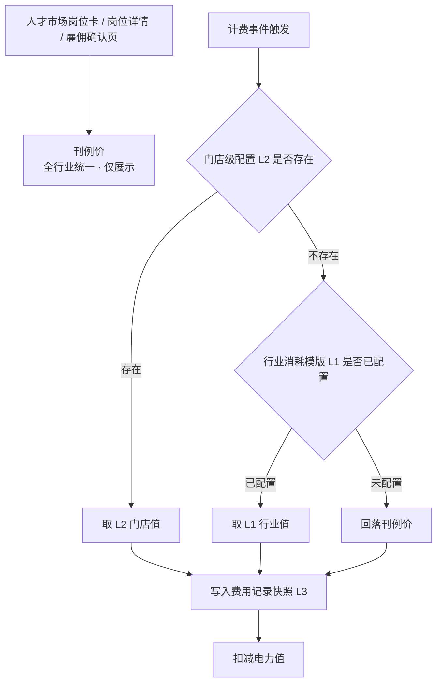
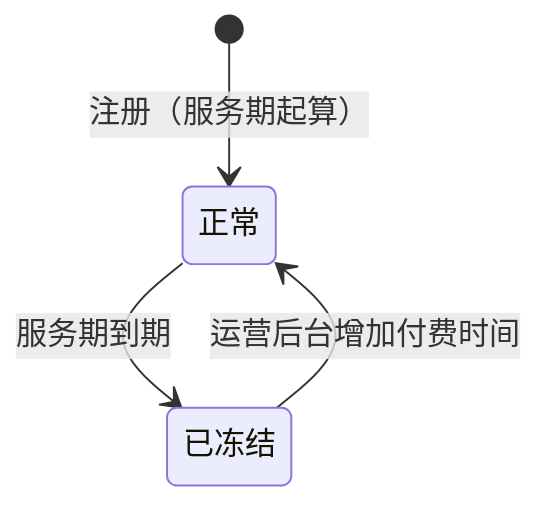

# AI数班 V1.4 · 计费规则 PRD

> 版本：V1.4（当前 V1.4.0）
> 更新日期：2026-10-08
> 状态：设计已定稿，待评审
> 适用范围：全行业数字员工计费、电力账户、充值与运营后台

---

## 版本管理

> 本表记录本文档的历次变更，包含**变更位置**（章节，缩进表示从属子节）与**变更内容**。变更内容按 `① ② ③` 分条、`·` 列具体规则。**本表按模块一行**：同一模块被多次调整时只保留最新结论，**直接改该模块所在行**，不在表末追加新行；**只有新模块才在表末新增一行**。每次调整同步更新头部"更新日期"与"版本"。

| 版本 | 日期 | 变更位置 | 变更内容 |
|------|------|----------|----------|
| V1.4.0 | 2026-09-23 | **2 计费与账务模型（新增）**<br>　2.1 两个独立维度<br>　2.2 四层价格体系（原三层）<br>　2.3 刊例价（对外展示价）<br>　2.4 行业消耗模版（L1）<br>　2.5 门店级消耗配置（L2）<br>　2.6 费用记录<br>　2.7 充值记录<br>**3 各岗位计费规则（新增）**<br>　3.2 主号获客专家（基础结算 / 高级结算）<br>　3.3 副号获客专家<br>**4 月度最低消耗（新增）**<br>**5 电力账户（新增）**<br>**6 充值与优惠（新增）**<br>**7 告警（新增）**<br>**8 人才市场与雇佣流程改造（新增）**<br>**9 消耗明细（新增）**<br>**10 运营后台（新增）**<br>　10.3 行业消耗模版配置（L1）<br>　10.4 员工消耗配置（L2）<br>　10.5 运营后台查询视图（新增）<br>**11 存量文档改写清单（新增）**<br>**12 验收标准（新增）**<br>**13 待确认事项（新增）** | **① 建立四层价格体系**：刊例价（全行业统一，仅展示）→ 行业消耗模版（L1 计费基准）→ 门店级配置（L2 覆盖值）→ 费用快照<br>　· 取值优先级 **L2 > L1 > 刊例价**，逐级回落<br>　· 覆盖语义为绝对值覆盖，非差额<br>　· **展示层与计费层解耦**：前台恒展示刊例价，与实际计费价可能不一致<br>　· L2 改价即时生效，只影响之后发生的计费<br>**② 电力值与服务期解耦为两个独立维度**<br>　· 电力值＝消耗维度：充值获得、消耗扣减、可为负、冻结时保留不归零<br>　· 服务期＝时间维度：注册日 + 365 天，由运营后台增减天数<br>　· 充值不等于续期，两者是运营后台的两个独立动作<br>**③ 电力:现金 = 1:1 全面覆盖**（原 v1.3 定稿的 10:1 作废）<br>　· ¥2/次发布 → 2 电力值，原"20 电力值"口径作废<br>**④ 四个岗位的计费口径定稿**：主号获客专家 50 电力/有效线索、副号获客专家 50 电力/条、客服专员 10 电力/转化线索、矩阵视频发布专员 2 电力/次发布（该组数值为**全行业统一的刊例价**，实际计费价由行业模版与门店配置决定，见 ⑭）<br>**⑤ 月度最低消耗按账户级结算**：31 天周期、与员工数量及是否有人服务完全无关、无条件扣满<br>**⑥ 透支规则**：余额可为负，负余额不阻断计费、也不阻断业务执行；充值先抵扣负值<br>**⑦ 冻结与解冻**：服务期到期 → 账户冻结、电力冻结、停止低消结算、界面阻断；运营后台增加付费时间后解冻并重新起算 31 天周期<br>**⑧ 充值全部走运营后台线下**，用户端删除充值表单，仅保留余额展示与联系运营提示<br>**⑨ 岗位更名**：短视频运营专员 → **矩阵视频发布专员**<br>**⑩ 存量改写**：v1.0 §6.4 客服专员按日计费作废、§7.11.2 线上充值面板作废；v1.1 §5.3 告警取消暂停联动、§5.4 有效期起点改注册日；v1.3 §2.4.2 余额阻断项删除、§2.5 余额不足条作废、§2.5.2 电力值列改写<br>**⑪ 服务期统一 365 天（定稿）**：不分行业、不分客户类型，L1 / L2 不设服务期配置项；差异化续期只走运营后台按门店账号增减天数<br>**⑫ 低消周期起点双向展示**：§4.1 新增展示要求，§6.4 客户产品页面展示"本周期起始日 + 剩余天数 + 已消耗电力值 + 本账户月低消"，§10.2 运营后台门店账号详情页同口径展示，两处数值必须一致；§10.2 明确服务期不在 L1 / L2 配置<br>**⑬ 存量改写执行记录（2026-09-23）**：v1.1 已改写并升版为 v1.2（§5.3 / §5.4 重写 + 8 处次生引用 + 岗位更名）；v1.3 已改写（文件更名 + 全文岗位更名 + §1.2 / §2.1 / §2.4 / §2.4.1 / §2.4.2 / §2.4.4 / §2.4.5 / §2.5~§2.5.3 / §4.12.7 计费口径改写，版本管理表按模块行就地更新）<br>**⑭ 价格体系重构：展示层与计费层解耦（2026-09-23 二次定稿）**<br>　· **刊例价全行业统一**（主号 50 / 副号 50 / 客服 10 / 矩阵 2 电力），只对外展示、不参与计费；人才市场不再按行业差异化展示<br>　· §2.2 由三层改为**四层**：刊例价（展示）→ L1 行业消耗模版 → L2 门店级消耗配置 → 费用快照，取价 **L2 > L1 > 刊例价**<br>　· §2.3 刊例价改为平台内置常量、后台只读；**不含月最低消耗**<br>　· §2.4 原「刊例价模版」改为「**行业消耗模版**」，新增「结算方式」配置项；**未配置时回落刊例价、可正常雇佣**（原「展示待上线」作废）<br>　· §2.5 门店配置新增「结算方式」覆盖；明确可针对同一门店的不同数字人分别配价<br>　· §3.2 / §3.3 主号、副号获客专家新增**基础结算 / 高级结算**：高级结算口径为"同系统原有获客结算配置"，本 PRD 不展开；两岗位结算方式分别配置<br>　· §6.4 / §8.1 / §8.2 / §8.3 前台展示口径全部改为**只出刊例价、不出月低消、不出差异说明**；低消只在电力账户页展示实际值<br>　· §9.1 / §9.2 消耗明细**不展示单价与取价来源**；扣费备注枚举增加"获客结算扣费"<br>　· §10.3 / §10.4 后台配置项改为行业消耗模版与三项覆盖（单价 / 低消 / 结算方式）；新增 §10.5 运营后台查询视图（可展示单价与取价来源）<br>　· §2.6 费用记录新增「结算方式」「取价来源」快照<br>　· 连带：§2.3 低消未配置时**不进入低消周期、不结算**；§12 验收标准重排为 36 条；§13 新增待确认事项 6 / 7 / 8<br>**⑮ 文档表述改为业务语言（2026-09-23 三次定稿）**<br>　· **全文去掉技术字段名**：原以英文字段名（`industry` / `positionCode` / `effectiveFrom` / `minMonthly` / `unitPrice` / `settleMode` / `priceSource` / `power` / `remark` 等）描述的位置，一律改为业务名称（行业 / 岗位 / 生效时间 / 月最低消耗 / 实际消耗单价 / 结算方式 / 取价来源 / 扣减电力值 / 扣费备注等）；§2.4 / §2.5 / §2.6 / §5.1 的表头由「字段」改为「配置项 / 记录项 / 账户项」，§9.2 表头由「字段列」改为「展示列」并删除其中的英文字段列<br>　· **删除行业整体停用逻辑**：原 §2.4「行业可整体停用」、§8.1「停用行业下的岗位展示为待上线」、§10.3「支持行业整体停用」全部作废。系统**不设行业级上下架开关**，唯一的开关是"是否配置模版"——不配置即按刊例价计费、不结算低消、岗位仍可雇佣；§2.4 待配置清单中房地产的「前期停用」标注取消；§13 待确认 2 改为"房地产本期是否纳入"并说明无行业级停用能力<br>　· 连带：§2.4「状态」明确为单条配置的启用/停用，停用后等同于该行业下该岗位未配置；§13 待确认表按 1~8 重新排序<br>**⑯ L2 门店级配置大幅简化（2026-09-23 四次定稿）**<br>　· **入口固定**：运营后台 → 账号管理 → 选中门店账号 → 菜单【员工消耗配置】；§2.5 与 §10.4 同步改写，章节名由「门店级价格配置」「门店配置」统一为「**门店级消耗配置（L2）**」「**员工消耗配置（L2）**」<br>　· **只留两项配置**：消耗数值、结算方式（仅主号/副号获客专家可改）。**月最低消耗、生效时间、配置人、备注四项配置项全部取消**<br>　· **默认带出行业模版值**：打开菜单按岗位列出消耗数值并预填 L1 值；未改动的岗位不产生门店级覆盖，计费仍回落 L1<br>　· **改价改为就地覆盖**：取消生效时间后不再追加生效版本，改价即时生效；配置表不留改价历史，审计以费用记录的单价快照 + 系统自动记录的变更日志为准<br>　· **低消降为单层取值**：月最低消耗不设门店级覆盖，只按 L1 行业消耗模版取值。连带改写 §2.2 覆盖范围、§4.2 取值、§4.4 验收 7/8、§6.4 账户页、§7.2 告警档位与跨页一致性、§10.2 门店详情、§10.6 验收 7/8、§12 验收 4/20、§13 待确认 6<br>　· **结算方式叫法统一**：菜单内单选与计费章节统一使用「基础结算 / 高级结算」，不另起「基础配置 / 高级配置」的说法<br>**⑰ 新增充值记录（2026-09-23 五次定稿）**<br>　· 原文档三处引用"充值流水"但从未定义。新增 **§2.7 充值记录**，与 §2.6 费用记录构成账户的**两本账**（费用记录记出账、充值记录记入账），第二章标题由「计费模型」改为「**计费与账务模型**」<br>　· 记录项含：充值记录标识 / 门店账号 / 实收金额 / 到账电力值 / 优惠电力值 / 抵扣负值 / 计入可用余额 / 充值前后可用电力值 / 到账时间 / 登记时间 / 操作人 / 转账凭证号 / 备注 / 状态（正常 / 已冲正）；回答"谁在什么时候充了多少电力值"<br>　· 明确 **账户可用电力值 = 全部充值记录到账电力值合计 − 全部费用记录扣减电力值合计**；**第一条充值记录的到账时间即低消周期起点**<br>　· §10.1 表头由「字段」改为「登记项」，补充"登记即生成充值记录、可按门店账号查询与导出、登记页展示历史充值记录"；§5.2 / §6.1 / §6.3 的"充值流水"统一改为"充值记录"并回指 §2.7<br>　· 验收：§6.5 新增 11 / 12 条，§10.6 新增 14 / 15 条，§12.5 第 29 条补充充值记录口径<br>**⑱ 删除幂等等技术实现描述（2026-09-23 六次定稿）**<br>　· **整节删除 §3.6「计费幂等与快照」**（含 mermaid 流程图"业务事件发生 → 构造幂等键 → 幂等键是否已存在"）。该图描述的是工程实现步骤而非业务逻辑，且取价链路已在 §2.2 有图、快照规则已在 §2.6、余额可为负已在 §5.2、高级结算取价已在 §3.2.2，无信息丢失<br>　· **全文去掉"幂等键"概念**：§2.6 记录项删除"幂等键"一行及其说明；§3.1 总表删除"幂等键"列（触发点列改名"计费时点"）；§4.3 章节名由「幂等与记录」改为「记录规则」<br>　· **改用业务语言表达同一件事**：统一表述为"**同一业务对象只计费一次**"——同一条线索、同一个留资结果、同一次作品发布，重复回收到业务结果时不重复扣费；低消补差为"一个周期只生成一条补差记录"<br>　· 连带改写 §3.2.2「幂等口径」→「不重复计费」、§3.5 失败重试与费用记录、§12.2 第 15 条、§13 待确认 7「高级结算的幂等口径」→「高级结算的重复计费风险」<br>**⑲ 消耗明细统一列骨架、充值记录开放给客户（2026-09-23 七次定稿）**<br>　· **§9.2 由"固定 6 列"改为"公共列 6 项 + 各岗位业务列"**：原口径与原型冲突（原型获客专家视图实际有 10 列，含客户信息 / 城市 / 车型 / 预算）。现明确公共列固定 6 项、任何视图不得删减或调序，各岗位视图只能在公共列之后追加业务列<br>　· **统一机制**：各岗位的差异字段本质都是**计费对象的业务属性**，由「计费对象」列以主行（对象标识）+ 副行（业务属性）承载；获客专家追加客户信息 / 联系方式 / 留资时间 / 城市 / 车型 / 预算 / 客户意向，客服专员与矩阵视频发布专员无追加列<br>　· **§9.1 新增两个层级的视图**：「全部」视图只用公共 6 列、跨岗位可比；各岗位视图为公共列 + 业务列。**低消补差是账户级费用，只在「全部」视图出现，不进任何岗位视图**（这是此前低消补差"在原型中无处安放"的解法）<br>　· **§2.7 充值记录开放给客户侧**：原只写"运营后台可按门店账号查询"，现明确**客户侧 + 运营后台两侧都可见**；§6.4 补充客户侧充值记录视图（只读，无编辑或补录入口）<br>　· **§6.4 新增补差预告**：周期内实际消耗低于月低消时，周期卡片展示"本周期已消耗 X / 月低消 Y，周期末预计补扣 Z"，避免周期末突然扣费引发争议<br>　· 连带：§9.3 补充岗位视图的筛选范围，§9.4 新增验收 9 / 10 / 11，§6.5 新增验收 13 / 14，§12.6 新增验收 37 / 38（验收标准合计 **38 条**）<br>**⑳ 「全部」视图去掉计费对象列、低消名称改为 31 天口径（2026-09-24 八次定稿）**<br>　· **§9.2 公共列拆成两套**：公共列（6 项）仅**各岗位视图**使用；**「全部」视图固定为 5 项**——扣费时间 / 数字员工 / 扣费账号 / 电力值 / 扣费备注，去掉「计费对象」<br>　· **去掉的原因**：「计费对象」承载的是线索标识与作品标题，属**岗位内部**的业务对象细节，不同岗位的行之间不可比；「全部」视图的用途是**跨岗位横向对比**，只保留账户级的可比信息。岗位视图内该列完整保留<br>　· **低消名称统一为「31天最低消耗补扣」**：§2.6 费用类型、§4.3 记录规则、§9.1 费用类型枚举、§9.2 扣费备注枚举、§9.4 验收 1 全部改名，原「月度低消补差」与「月度最低消耗补差」两个旧称作废。名称带「31天」是为了让客户在消耗明细里直接看出这是 31 天周期的低消结算，而不是一笔业务消耗<br>　· **§9.1 / §9.4 / §12.6 连带改写**：§9.1 两个层级视图的列数口径、§9.4 验收 5 / 9 / 10、§12.6 验收 37 按 5 列口径重写<br>　· **计费规则不变**：低消仍为 31 天周期、账户级结算、只在「全部」视图出现；本次只改**名称**与**「全部」视图列数**，不改扣费口径与金额算法<br>**㉑ 充值记录删除 5 个记录项、备注改为固定规则（2026-09-24 九次定稿）**<br>　· **§2.7 记录项由 15 项收敛为 10 项**：删除实收金额 / 优惠电力值 / 抵扣负值 / 计入可用余额 / 状态五项，保留充值记录标识 / 门店账号 / 到账电力值 / 充值前后可用电力值 / 到账时间 / 登记时间 / 操作人 / 转账凭证号 / 备注<br>　· **删除原因**：充值记录对客户侧的用途是"到了多少电力值"，现金口径（收了多少、让利多少、抵了多少负值）属商务侧信息，留在客户可见的表里既增加理解成本、又暴露优惠力度。状态列删除后由"记录不可改、错误走冲正"承接<br>　· **备注改为系统按固定规则自动生成**：正常充值固定为"补充电力值"；本次到账电力值中有抵扣账户负值的，写作"**补充电力值，抵扣 N 电力值**"（N 为本次抵扣掉的负值，如"补充电力值，抵扣1000电力值"）。§10.1 登记项中备注由「人工填写、非必填」改为「系统自动生成」<br>　· **两侧列口径统一为 4 列**：到账时间 / 到账电力值 / 操作人 / 备注。§6.4 客户侧原含实收金额、§10.6 验收 14 后台侧原含实收金额，一并改写；§2.7 到账电力值说明去掉"可大于实收金额"<br>　· **§6.3 由「优惠实现」重写为「优惠的实现口径」**：原节以"实收金额 / 优惠电力值 / 优惠率 `powerAmount ÷ payAmount`"为骨架，实收金额删除后该算法失去输入。新口径为——优惠体现为**到账电力值高于 1:1 基准**，系统不单独记录优惠额度、不计算优惠率，凭证由线下合同、转账凭证号与备注留存<br>　· **§6.1 / §5.4 连带改写**：§6.1 去掉"优惠充值时到账电力值可以大于实收金额"，改为"只登记到账电力值、不记录实收金额与优惠额度"；§5.4 验收 4 由"抵扣过程逐笔可追溯"改为"抵扣金额写入充值记录备注"<br>　· **状态删除后冲正改口径**：原"错误登记通过冲正记录修正、原记录状态置为已冲正"改为"**充值记录不可删除、不可修改**，错误登记由运营在后台发起冲正处理，原记录保留"（§2.7 / §10.1 / §10.6 验收 15 三处）<br>　· **§9.3 导出删除实收金额口径列**：导出字段与当前视图的列一致，不再补充实收金额列<br>　· **§13 待确认 5 定稿关闭**（消耗明细导出是否补充实收金额口径 → **不补充**）；**新增待确认 9**：删除实收金额后，运营侧如何核对"客户交了多少现金、给了多少优惠"——当前只能依赖线下合同与转账凭证号，若确需该口径须恢复"实收金额"登记项<br>　· **验收连带**：§6.5 验收 2 / 4 / 11 / 13 改写并新增 15，§10.6 验收 1 / 2 / 14 / 15 改写，§12.5 验收 29 与 §12.6 验收 38 改写（验收标准合计 **39 条**）<br>**㉒ 电力账户看板改版：冻结退出客户侧、服务期改一行文案、低消改进度条（2026-09-24 十次定稿）**<br>　· **删除「冻结电力值」卡片**：§6.4 用户端展示口径删掉冻结电力值。理由是账户被冻结时系统以弹窗阻断使用，客户根本进不到本页面，展示冻结值没有受众。**§5.1 账户项保留「冻结电力值」字段**——账户仍有该属性，只是客户侧不展示；§5.3 冻结阻断逻辑不变<br>　· **服务期改为一行文案**：§6.4 客户侧不再展示「服务期截止日」卡片与「剩余天数」，只以「**有效期至 YYYY-MM-DD**」一行轻量呈现，且**不提示到期后冻结**。§6.4 展示口径改写，§6.5 验收 5 连带改写，新增验收 16<br>　· **低消由四格周期模块改为进度条**：删除原「月度最低消耗周期」整块（本周期起始日 / 剩余天数 / 已消耗电力值 / 月低消四格 + 补差预告条），改为月低消卡片内的一条**进度条**，按「本周期已消耗电力值 ÷ 月低消」填充，下方标注「本周期已消耗 X · 还差 Y」，已达月低消时转完成态并标注「已达月最低消耗」。§6.4 原「低消周期口径必须展示周期起点」「补差要提前预告」两条改写为「低消以进度条呈现」「缺口金额在进度条上直接可读」，§6.5 验收 5 / 7 / 9 / 14 改写<br>　· **进度条口径与客户侧一致化**：§4.1「周期起点必须对客户与运营双向可见」改为「**对运营可见**」——客户侧退出周期日期展示，运营后台保留完整四项作为对客解释依据；§4.4 验收 11、§10.2、§10.6 验收 9 的「两处数值必须一致」收窄为「本周期已消耗电力值」与「月低消」两项<br>　· **连带**：§11 存量改写清单中 v1.0 §4.x 对话电力值查询改为不展示周期起始日与剩余天数，与客户页口径对齐；**§7.2 服务期到期提醒（告警）与 §10.2 后台展示本次不变**——本次只改客户侧电力账户看板<br>　· **纯视觉项**：可用电力值卡片删除「账户余额，可为负、可透支」副文案（§5.1 / §5.2 的透支规则本身不变）；§6.5 新增验收 17（客户侧不展示冻结电力值）（验收标准合计 **41 条**）<br>**㉓ 充值记录客户侧删「操作人」列、明确两侧列口径不同（2026-09-24 十一次定稿）**<br>　· **客户侧充值记录由 4 列收敛为 3 列**：到账时间 / 到账电力值 / 备注。删除「操作人」——登记人属运营内部信息，客户只需看到"到了多少"<br>　· **两侧列口径正式分开**：§2.7 原只写"两侧都可见"，现明确**客户侧 3 列、运营后台展示完整记录项（含操作人与转账凭证号）**。§6.4、§6.5 验收 13、§12.6 验收 38 连带改写；**§10.1 登记项与 §10.6 验收 14 不变**——操作人仍是登记项、后台仍展示<br>　· **抵扣案例口径自洽性**：§2.7 备注规则（正常充值"补充电力值"，有抵扣时写"补充电力值，抵扣 N 电力值"）与 §5.2 透支规则（充值先抵扣负值）配套成立的前提是账户确实会出现负值。本次在演示数据中补入该链路：周期末补扣使账户转负，下次充值先抵扣再计入余额。PRD 侧无新增规则，仅验证既有口径可闭环<br>**㉔ 低消卡片主次对调：主数字改为动态消耗量、去掉「还差」补扣预告（2026-09-24 十二次定稿）**<br>　· **主次对调**：§6.4 低消卡片原以「本账户月最低消耗」为主数字（固定值 1,200），动态读数反而在小字与进度条上，主次颠倒——客户最关心的是"本周期消耗到哪了"。现改为**主数字展示本周期已消耗电力值**（随消耗明细数据动态变化），**小字标注本期最低消耗 X**（本账户实际生效值）。§6.4 展示口径、§6.5 验收 5 与 14 连带改写<br>　· **去掉「还差 Y」补扣预告**：原进度条下方标注"本周期已消耗 X · 还差 Y"，其中"还差 Y"即周期末将被补扣的金额——实质是一句补扣预告，与 §6.4"不设补差预告"的立场相抵。本次一并删除，§6.4 原「缺口金额在进度条上直接可读」一条改写为「**不预告补扣金额**」：低消卡片只回答"消耗到哪了"与"目标是多少"，缺口由进度条未填满的部分直接可读；周期末的补扣仍以一条"31天最低消耗补扣"费用记录出现在消耗明细中<br>　· **运营后台不受影响**：§4.1 / §4.4 验收 11 / §10.2 / §10.6 验收 9 的"本周期已消耗电力值"与"月低消"两处一致口径不变——客户页两个数字都在，只是位置对调<br>　· **连带修一处编号缺陷**：§6.5 验收原按追加顺序排成 14 / 16 / 17 / 15，本次把「充值记录备注规则」一条移到 14 之后，编号回归 15 / 16 / 17 顺序（语义不变，与版本管理表 ㉑ ㉒ 的记载一致） <br>**㉕ 低消卡片补出完成百分比（2026-09-24 十三次定稿）**<br>　· **进度值直接可读**：原低消卡片只有一条进度条，填充比例只能靠目测，客户读不出具体进度。现于**进度条下方一行右端标出"已完成 N%"**，与该行左端的"本期最低消耗 X"构成"目标—完成度"的对照。§6.4 展示口径、§6.5 验收 5 与 14 连带改写<br>　· **与进度条同源**：N 由"本周期已消耗电力值 ÷ 本期最低消耗"算出，与进度条填充比例取自同一次计算，两者不会出现读数打架；**超额消耗时一并截断为 100%**（进度条已填满，读数不再超过 100%）<br>　· **空态一并隐藏**：行业消耗模版未配置月最低消耗时，进度条与百分比同时隐藏，卡片只留"本账户未设置月最低消耗"提示<br>**㉖ 校对修正：验收编号与陈旧引用（2026-10-08 十四次定稿）**<br>　· **§5.4 验收标准编号重排**：原 1~10 之后重复排了一遍 9、10（⑪ 插入「服务期统一 365 天」时未重排旧条目），现整理为 1~11，并删除与第 9 条语义重复的一条解冻验收<br>　· **§13 待确认 4 陈述更新**：原「起点须在运营后台与客户产品页面双向展示」改为「完整周期信息只在运营后台展示，客户侧只以低消进度条呈现」，与 ㉒ 收窄后的口径对齐<br>　· **§12.6 验收 36 陈述更新**：原「展示本账户实际月低消与周期信息」改为「以低消进度条展示本周期已消耗电力值与本期最低消耗」，客户侧已不展示周期日期（㉒ 连带清单遗漏本条）<br>　· **§9.3 标点修正**：导出条目句末多余的「，。」改为「。」<br>　· **口径不变**：四项均为编号与陈述的校对，不改任何计费规则、取值链路与展示要求<br>**㉗ 删除「低消未配置」兜底：月最低消耗改为必配项（2026-10-08 十五次定稿）**<br>　· **删除 §2.4 的「低消未配置不结算」**：原口径为"行业模版未配置月最低消耗时，该账户不进入低消周期、不产生补差记录"（保守，避免按未确认数值扣费），现**作废**——月最低消耗由运营随行业消耗模版**一并提供**，是模版的**必配项**，不存在未配置的账户，系统不设兜底分支<br>　· **连带改写**：§2.4 待配置清单注去掉"且不结算低消"（回落只适用于单价）；§4.2 低消金额取值、§4.4 验收 8、§6.5 验收 9、§10.6 验收 12、§12.3 验收 20 一并改为"必配项"口径；删除 §6.4 电力账户页的"未设置月最低消耗"空态段，以及 §7.1 / §7.2 的"未配置低消不触发缺口档位"两条；§10.3 留空说明去掉"且不结算低消"；§10.3「不提供行业整体停用」条与 §13 待确认 2（房地产本期是否纳入）中"按刊例价计费、**不结算低消**"的并列口径一并改写——单价可回落刊例价，**月最低消耗不随之免除**<br>　· **§13 待确认 6 定稿关闭**：原问"低消未配置时的兜底是否为不结算"，现定稿为必配项、不设兜底、不设平台默认值；§13 待确认 1 补注月最低消耗为必配<br>　· **刊例价与单价兜底不变**：刊例价仍为全行业统一的内置常量、后台只读；单价仍保留"未配置回落刊例价"的取值链，低消**不回落刊例价**（刊例价不含低消）<br>　· **原型连带**：删除电力账户页的低消空态（`monthlyMinimum` 为空时隐藏进度条与完成百分比、展示"本账户未设置月最低消耗"）及对应断言，变更说明文档同步 |

---

## 一、概述

### 1.1 定位

本文档定义 AI数班全行业数字员工的**计费规则、电力账户体系、充值路径与运营后台价格配置能力**。计费规则是横跨人才市场、数字办公室、实时工作、成果中心与运营后台的公共能力，不归属单一数字员工。

本文档不重复定义各数字员工的业务能力与工作流程，相关口径见对应岗位 PRD（主号/副号获客专家、客服专员见 PRD-v1.0；矩阵视频发布专员见 PRD-v1.3）。

### 1.2 本期目标

- 建立**全行业统一的刊例价**，作为人才市场对外展示的唯一价格口径。
- 建立**行业 × 岗位的实际消耗模版**，由运营后台提前预置，承载行业差异化定价。
- 建立**门店级消耗配置**能力：在运营后台账号管理的【员工消耗配置】中，按门店账号为每个岗位设置消耗数值，供商务差异化定价。
- 为**主号、副号获客专家**引入**基础结算 / 高级结算**两种结算方式，高级结算直接沿用系统原有获客结算配置。
- 建立**月度最低消耗**机制，防止客户占用 RPA / 云电脑资源闲置。
- 建立**电力账户**体系，支持透支、冻结与解冻。
- 充值能力收敛到**运营后台**，全部走线下，用户端只读。
- 改造人才市场、雇佣流程与消耗明细：**展示层只出刊例价，计费层走 L2 > L1 > 刊例价**，两层解耦。

### 1.3 与既有版本的关系

| 既有文档 | 关系 |
|---|---|
| PRD-v1.0 | 客服专员按日扣费规则（§6.4）被本文档取代；线上充值面板（§7.11.2 / §7.11.2.1）被本文档取代；余额作为雇佣阻断项的口径被本文档取代。其余内容继续有效。 |
| PRD-v1.1 | 电力值告警档位（§5.3）保留档位数值、取消暂停联动；电力值有效期（§5.4）起点与到期处理被本文档取代。 |
| PRD-v1.3 | 矩阵视频发布专员（原"短视频运营专员"）的按次发布计费口径延续，电力值换算比例改写；余额不足条作废；雇佣依赖检查改造；人才市场展示口径由"实际生效价"改为"刊例价"。 |

> **PRD-v1.0 为只读文档**，本文档只引用其口径与行号，不修改其内容。本文档第十一章列出需要在 v1.0 / v1.1 / v1.3 上执行的改写项，作为独立动作排期。

### 1.4 版本规划

| 版本 | 交付能力 |
|------|----------|
| 本期 V1.4 | 四层价格体系（刊例价 + L1 行业模版 + L2 门店级消耗配置 + 快照）、四岗位计费（含获客专家基础/高级结算）、月度最低消耗、电力账户与透支、冻结解冻、运营后台充值与价格配置、人才市场与消耗明细改造 |
| 后续版本 | 套餐（季卡/年卡）、自动开票与线上打款、对公账户对接 |

---

## 二、计费与账务模型

### 2.1 两个独立维度

AI数班的计费由**两个互相独立的维度**组成，两者解耦、互不换算：

```
电力值（消耗维度）              服务期（时间维度）
  充值获得                        注册日 + 365 天
  消耗扣减                        运营后台增减天数
  可为负、可透支                  到期冻结账户
  冻结时保留、不归零              阻断产品使用流程
```

- **电力值**回答"客户用了多少"，按业务结果或按次扣减，余额不足时可透支。
- **服务期**回答"客户能用到什么时候"，是时间维度的卡点，防止客户占用资源闲置。
- **充值不等于续期**：充值只增加电力值，不延长服务期；延长服务期只在运营后台单独操作。运营后台支持在一次线下合同录入中同时完成两个动作。

### 2.2 四层价格体系

**展示价与计费价是两条独立的链路**：人才市场对外展示的是全行业统一的**刊例价**，实际扣费走**行业消耗模版 → 门店级配置**。两者可能不一致，这是商务差异化定价的前提。



| 层级 | 名称 | 配置位置 | 是否参与计费 |
|------|------|----------|--------------|
| — | **刊例价** | 平台内置常量，运营后台只读 | **否**，仅对外展示 |
| L1 | **行业消耗模版** | 运营后台 · 行业模版 | 是，实际计费基准 |
| L2 | **门店级消耗配置** | 运营后台 · 账号管理 →【员工消耗配置】 | 是，优先于 L1 |
| L3 | 费用快照 | 系统自动写入 | 计费发生时写死实际生效值，**永不回溯** |

**取值规则**

- 计费取价优先级 **L2 > L1 > 刊例价**：门店已配置取门店值；未配置取行业模版值；行业模版也未配置则**回落刊例价**。
- **前台展示恒为刊例价**：客户在人才市场岗位卡、岗位详情、雇佣确认页看到的单价是全行业统一的刊例价，与实际计费价可能不一致；**页面不展示差异说明，也不展示月最低消耗**（业务裁定，见 §8.1）。
- L2 的覆盖语义是**绝对值覆盖**，不是差额。商务谈定"该客户主号 30 电力/条"即填 30，直观且可核对。
- L2 改价**即时生效、就地覆盖**，只影响改价之后发生的计费；已写入的费用记录保留原单价快照。
- 门店级配置可覆盖**消耗数值**与**结算方式**两项。**月最低消耗不设门店级覆盖**，只按行业消耗模版取值（见 §4.2）。

### 2.3 刊例价（对外展示价）

刊例价是平台对外报价口径，**全行业统一，不参与计费**。

| 岗位 | 刊例价 | 计费方式 |
|------|--------|----------|
| 主号获客专家 | 50 电力 / 有效线索 | 按有效线索 |
| 副号获客专家 | 50 电力 / 条 | 按有效线索 |
| 客服专员 | 10 电力 / 转化线索 | 按转化线索 |
| 矩阵视频发布专员 | 2 电力 / 次发布 | 按次发布 |

- **不随行业变化**：四个行业在人才市场看到的岗位卡单价完全相同。
- 刊例价为平台内置常量，运营后台**只读展示、不提供修改入口**；调整刊例价需走版本发布。
- 人才市场岗位卡、岗位详情、雇佣确认页只展示刊例价；**不展示月最低消耗、不展示行业或门店的实际计费价**。
- 刊例价**不包含月最低消耗**——月低消属于行业消耗模版，不在对外展示口径内（见 §2.4）。

### 2.4 行业消耗模版（L1）

行业消耗模版是实际计费的基准层，由运营在后台按**行业 × 岗位**提前预置。

| 配置项 | 说明 |
|--------|------|
| 行业 | 二手车 / 新车 / 家居 / 房地产 |
| 岗位 | 主号获客专家 / 副号获客专家 / 客服专员 / 矩阵视频发布专员 |
| 计费方式 | 按有效线索 / 按转化线索 / 按次发布 |
| 结算方式 | **基础结算 / 高级结算**；仅主号获客专家、副号获客专家适用，其余岗位固定为基础结算 |
| 实际消耗单价 | 单位电力值 |
| 月最低消耗 | 单位电力值 |
| 生效时间 | 该配置开始生效的日期 |
| 状态 | 启用 / 停用；针对单条配置，停用后等同于该行业下的该岗位未配置 |

- **同一「行业 + 岗位 + 生效时间」只有一条配置**，同一组合同一时间只有一个生效版本。
- **改价 = 追加一条生效时间更新的配置**，旧配置自动转为历史版本，不修改原配置。
- **未配置兜底**：某行业下的某岗位未配置模版时，实际计费**回落刊例价**（见 §2.3），岗位可正常雇佣。家居、房地产在数值确认前按此处理。
- **月最低消耗为必配项**：月最低消耗由运营随行业消耗模版**一并提供**，**不存在未配置月最低消耗的账户**。所有账户一律进入低消周期并按所属行业的模版值结算，系统不设「未配置低消」的兜底分支。
- **实际消耗单价与低消数值由运营确认后录入**，本 PRD 不预设行业数值；下表为待配置清单。

**行业消耗模版待配置清单**

| 行业 | 主号获客专家 | 副号获客专家 | 客服专员 | 矩阵视频发布专员 | 月低消 |
|------|-------------|-------------|----------|------------------|--------|
| 二手车 | 待运营配置 | 待运营配置 | 待运营配置 | 待运营配置 | 待运营配置 |
| 新车 | 待运营配置 | 待运营配置 | 待运营配置 | 待运营配置 | 待运营配置 |
| 家居 | 待定 | 待定 | 待定 | 待定 | 待定 |
| 房地产 | 待定 | 待定 | 待定 | 待定 | 待定 |

> 数值确认前，四个行业的**实际计费单价**均回落刊例价（50 / 50 / 10 / 2 电力）；**月最低消耗为必配项**，由运营随模版一并提供，不适用回落。

### 2.5 门店级消耗配置（L2）

门店级配置用于承载商务差异化定价，按门店账号为**每个岗位**设置具体的消耗数值。

**入口**：运营后台 → 账号管理 → 选中门店账号 → 菜单【员工消耗配置】。

| 配置项 | 说明 |
|--------|------|
| 门店账号 | 付费主体，配置按此粒度生效 |
| 岗位 | 逐个岗位设置，同一门店下不同岗位互不影响 |
| 消耗数值 | 该岗位的实际消耗单价，单位电力值；**默认带出该岗位的行业消耗模版值** |
| 结算方式 | 仅主号获客专家、副号获客专家可改（基础结算 / 高级结算）；其余两个岗位固定为基础结算、置灰不可改；同样默认带出行业消耗模版值 |

- **默认值即行业模版值**：打开菜单按岗位列出消耗数值，默认填入该岗位的行业消耗模版值；只改需要差异化的岗位，**未改动的岗位保持回落 L1**，不产生门店级覆盖。
- 覆盖语义为**绝对值覆盖**，不是差额。商务谈定"该客户主号 30 电力/条"即填 30，直观且可核对。
- 改价**即时生效、就地覆盖**，只影响改价之后发生的计费；已写入的费用记录保留原单价快照，不受影响。
- **配置表本身不保留改价历史**；系统自动记录每次变更的操作人与时间，供事后核对。
- **月最低消耗不在此配置**：低消只按行业消耗模版取值，不设门店级覆盖（见 §4.2）。
- 与充值返电力的分工：

| 机制 | 作用侧 | 适用场景 |
|------|--------|----------|
| L2 门店级消耗配置 | 消耗侧（改消耗数值） | 长期协议价，商务谈定的客户级价格 |
| 充值返电力 | 充值侧（到账 > 实收） | 一次性让利、活动、补偿 |

- 两者可叠加。运营后台的充值页需提示"该门店已配置协议价"，避免商务重复让利。
- 门店级配置**不影响人才市场展示**：客户在人才市场始终看到刊例价。

### 2.6 费用记录

费用记录是全部扣费的唯一凭证，业务消耗与低消补差共用同一张表；与充值记录（见 §2.7）构成账户的**两本账**。低消补差在费用记录中统一以「**31天最低消耗补扣**」的名称对外展示（见 §4.3）。

| 记录项 | 说明 |
|--------|------|
| 费用记录标识 | 每条费用记录的唯一编号 |
| 费用类型 | 业务消耗 / 31天最低消耗补扣 |
| 门店账号 | 付费主体 |
| 数字员工 | 产生该笔费用的数字员工（低消补差为空） |
| 岗位 | 该数字员工所属岗位（低消补差为空） |
| 行业 | 该门店账号所属行业 |
| 抖音账号 | 产生该笔费用的账号（低消补差为空） |
| 计费对象 | 该笔费用对应的业务对象：线索 / 转化线索 / 作品（低消补差为空） |
| 计费方式快照 | 计费方式：按有效线索 / 按转化线索 / 按次发布 |
| 结算方式快照 | 基础结算 / 高级结算（仅主号、副号获客专家有值） |
| 取价来源快照 | L2 门店级消耗配置 / L1 行业模版 / 刊例价兜底 |
| 单价快照 | 实际生效单价，单位电力值 |
| 扣减电力值 | 以负数展示 |
| 扣费时间 | 该笔费用的实际扣减时间 |
| 扣费备注 | 见 §9.2 固定枚举 |

- **同一业务对象只产生一条费用记录**：同一条线索、同一个留资结果、同一次作品发布，重复回收到业务结果时**不重复扣费**。
- **低消补差一个周期只产生一条**：同一门店账号在同一低消周期内只生成一条补差记录，重复执行周期结算不重复扣费。
- **单价快照**：费用记录写入时固化当时的实际生效单价与取价来源，后续 L1 / L2 / 刊例价变更均不影响历史记录。
- **单价快照不对外展示**：客户侧消耗明细只展示扣减电力值，不展示单价列与取价来源，避免暴露行业/门店差异化定价（见第九章）。
- 费用记录不可由前端删除或修改；退款、冲正等状态由账务结果更新并保留原始记录。

### 2.7 充值记录

充值记录是全部充值的唯一凭证。与费用记录构成账户的**两本账**：**费用记录记出账，充值记录记入账**。

| 记录项 | 说明 |
|--------|------|
| 充值记录标识 | 每条充值记录的唯一编号 |
| 门店账号 | 充值的付费主体 |
| 到账电力值 | 本次到账的电力值 |
| 充值前可用电力值 | 本次充值前的账户可用电力值，**可为负** |
| 充值后可用电力值 | 本次充值后的账户可用电力值 |
| 到账时间 | 电力值实际生效的时间 |
| 登记时间 | 运营提交登记的时间 |
| 操作人 | 执行登记的运营人员 |
| 转账凭证号 | 线下转账或合同的凭证标识 |
| 备注 | 本次充值的说明，**按固定规则自动生成**：正常充值固定为"**补充电力值**"；若本次到账电力值中有部分用于抵扣账户负值，则在后面追加抵扣金额，写作"**补充电力值，抵扣 N 电力值**"（N 为本次抵扣掉的负值，如"补充电力值，抵扣1000电力值"） |

- **充值记录回答"谁在什么时候充了多少电力值"**，**两侧都可见，但列口径不同**：
  - **客户侧**：电力账户页的「充值记录」视图，展示**到账时间 / 到账电力值 / 备注**三列，只读，供客户自行核对"到了多少"（见 §6.4）。
  - **运营后台**：展示完整记录项（含操作人与转账凭证号），可按门店账号查询与导出，用于向客户对账（见 §10.1 / §10.6）。
- **两本账互不混用**：账户可用电力值 = 全部充值记录的到账电力值合计 − 全部费用记录的扣减电力值合计。
- **首次充值到账日决定低消周期起点**：门店账号的**第一条**充值记录的到账时间即低消周期起点（见 §4.1）；服务期到期冻结后解冻的，起点改为解冻日。
- **到账即抵扣负值**：到账电力值先抵扣账户负值，剩余部分计入可用余额。抵扣金额**不单独设列**，而是写入备注（见上表），客户在充值记录里即可看出本次有多少用于还负值（见 §5.2）。
- **充值记录不可删除、不可修改**：错误登记由运营在后台发起冲正处理，原记录保留不删除。
- 充值记录**不修改刊例价与门店级消耗配置**：充值只增加电力值，不影响任何费用记录的单价快照。

---

## 三、各岗位计费规则

### 3.1 计费口径总表

| 岗位 | 计费方式 | 结算方式 | 刊例价（展示） | 计费时点 |
|------|----------|----------|----------------|----------|
| 主号获客专家 | 按有效线索 | **基础结算 / 高级结算**（可配） | 50 电力/有效线索 | 线索判定为"有效线索"时 |
| 副号获客专家 | 按有效线索 | **基础结算 / 高级结算**（可配） | 50 电力/条 | 同上（副号口径） |
| 客服专员 | 按转化线索 | 基础结算（固定） | 10 电力/转化线索 | 转化线索（留资结果）产生时 |
| 矩阵视频发布专员 | 按次发布 | 基础结算（固定） | 2 电力/次发布 | 作品发布完成时 |

- 表中单价为**对外展示的刊例价**（全行业统一），**不是实际计费价**。
- 实际扣费单价按 **L2 门店级消耗配置 > L1 行业模版 > 刊例价** 取值；L1 行业模版数值由运营后台提前预置，本 PRD 不预设。
- 电力值与现金的换算比例为 **1:1**。
- **同一业务对象只计费一次**：同一条线索、同一个留资结果、同一次作品发布，重复回收到业务结果时**不重复扣费**。

### 3.2 主号获客专家

主号获客专家支持**两种结算方式**，同一门店账号在同一时间只用其中一种。结算方式由 L1 行业消耗模版预置，可按 L2 门店账号覆盖（见 §2.4 / §2.5）。

#### 3.2.1 基础结算

- **计费单位**：一条有效线索计 1 次。
- **有效线索口径**：沿用 PRD-v1.0 §8.2——近 7 天内被主号获客专家触达且已留资的线索。
- **触发时点**：线索满足有效线索条件时即时扣费，扣费时间等于判定时间。
- **不回溯**：线索判定为有效后即计费，后续不再因线索状态变化回滚或冲正。
- **不计费**：未触达、未留资、被判定为无效的线索不产生费用。
- **单价取值**：按 L2 > L1 > 刊例价取值；L1 未配置时回落刊例价 50 电力/有效线索。

#### 3.2.2 高级结算

- **结算口径**：**同系统原有获客结算配置**。高级结算的结算规则、触发条件与单价全部沿用系统既有的获客结算配置，本 PRD 不重新定义、不改写该配置的内容。
- **本 PRD 的范围**：只定义「结算方式」这一配置开关（取值为高级结算时）的落位、覆盖与快照规则。结算方式置为高级结算后，计费由原有获客结算配置接管。
- **配置位置**：行业消耗模版的「结算方式」配置项，可按门店账号覆盖。
- **实际消耗单价不生效**：结算方式为高级结算时，行业模版与门店配置的单价均不参与计费，实际单价由原有获客结算配置决定。
- **费用记录**：仍写入统一费用记录，结算方式快照为"高级结算"，取价来源快照为"高级结算配置"，扣减电力值取原有获客结算配置的实际扣减结果。
- **月最低消耗**：仍按账户级 31 天周期执行，与结算方式无关（见第四章）。
- **不重复计费**：沿用原有获客结算配置的去重口径；接入时需确认与本 PRD"同一业务对象只计费一次"的规则一致，避免同一笔线索被两套规则重复计费，见第十三章待确认事项。

### 3.3 副号获客专家

- 计费单位、口径、触发规则与结算方式**同主号获客专家**（含 §3.2.1 基础结算与 §3.2.2 高级结算），按副号获客专家的触达与留资记录独立统计。
- 主号与副号的有效线索**分别统计、分别计费**，同一线索若同时满足两个岗位的口径，按各自岗位分别产生费用记录。
- 主号与副号的结算方式**分别配置**：同一门店可主号用基础结算、副号用高级结算，互不影响。

### 3.4 客服专员

> 本节取代 PRD-v1.0 §6.4「客服专员按日扣费规则」。原按日 50 元/天的口径作废。

- **计费单位**：一条转化线索计 1 次。
- **转化线索口径**：客服专员接待的会话产生留资结果，即计 1 条转化线索。
- **触发时点**：留资结果产生时即时扣费。
- **与功能开关解耦**：客服专员的功能开关只控制接待能力，**不再作为计费开关**；不产生转化线索则不产生费用。
- **与授权解耦**：平台账号未授权或授权失效时，客服专员按既有规则进入"待处理"、无法实际接待，因此不产生转化线索、不产生费用；授权恢复后正常计费。
- **费用记录**：记录数字员工、抖音账号、线索、扣费时间、实际单价、取价来源、应扣电力值与扣费状态；重复回收同一留资结果不重复扣费。
- **结算方式**：固定为基础结算，不支持高级结算。

### 3.5 矩阵视频发布专员

> 本节延续 PRD-v1.3 §2.5 的按发布结果计费口径，改写电力值换算比例与价格取值链路（前台展示刊例价、实际结算按 L2 > L1 > 刊例价）。

- **计费单位**：一次发布 = **一个账号成功发布一条作品**。n 个账号发布同一个作品计 n 次，一个账号发布 m 条作品计 m 次。
- **计费依据**：作品的**发布结果**；作品状态变为"发布完成"即产生一次费用。
- **触发时点**：作品发布完成时**即时扣减**，扣费时间等于该作品的发布完成时间。不设 T+1 次日结算。
- **不计费**：待发布、发布中、发布失败、取消发布四种状态均不产生费用。
- **失败与重试**：发布失败不产生费用；单条重试成功后计 1 次；同一作品重复回收发布结果时**不重复计费**。
- **停止计费**：账号在 Agent 设置中关闭、或员工解雇后，不再参与新的发布任务，因此不再产生新费用；关闭与解雇动作本身不产生费用。
- **费用记录**：按数字员工、抖音账号与作品标识（任务内作品 ID / 抖音作品 ID）记录实际结算单价与取价来源。
- **结算方式**：固定为基础结算，不支持高级结算。

---

## 四、月度最低消耗

### 4.1 周期规则

- **周期长度**：31 天。
- **周期起点**：**首次充值到账日**。首次充值到账后起算第 1 个周期，此后每 31 天滚动。
- **未充值不进入周期**：注册后从未充值的账户不进入低消周期，不产生低消欠款。
- **结算粒度**：**账户级**（付费主体）。周期内全账户所有数字员工的业务消耗合计，与低消比较。
- **与员工无关**：低消与员工数量、是否有人服务**完全无关**——只要账户处于低消周期内，周期末无条件扣满低消，哪怕周期内没有任何员工处于服务中。
- **周期起点必须对运营可见**：低消周期的起点不随充值或服务期变更而改写，**运营后台必须展示**本周期起始日、剩余天数与本周期已消耗电力值，用于向客户解释周期末补差金额的构成。客户侧**不展示周期日期**，只以进度条呈现本周期消耗相对月低消的完成情况（见 §6.4）。
  - **客户产品页面**：展示在电力账户卡片与消耗明细页（口径见 §6.4）。
  - **运营后台**：展示在门店账号详情页（口径见 §10.2）。
- **冻结期间周期暂停**：账户冻结期间不结算、周期不推进；解冻后**重新起算 31 天周期**，起点变为解冻日（见 §5.3）。

### 4.2 结算规则

- **结算时点**：每个周期结束后的次日 00:00 执行结算。
- **补差金额**：`月低消 − 周期内实际消耗合计`。
  - 周期内实际消耗合计 ≥ 月低消 → 不产生补差记录。
  - 周期内实际消耗合计 < 月低消 → 生成一条补差记录，扣减差额。
- **低消金额取值**：按 **L1 行业消耗模版**取值（**不设门店级覆盖**，见 §2.5）。月最低消耗为模版必配项、由运营提供，**不回落刊例价**（刊例价不含低消，见 §2.3）。
- **允许透支**：余额不足时补差记录照常写入，余额可为负。
- **冻结时停止结算**：账户处于冻结状态时，不执行低消结算（见第五章）。

### 4.3 记录规则

- 一个门店账号在**一个周期内只生成一条**低消补差记录；重复执行周期结算**不重复扣费**。
- 补差记录写入费用记录，费用类型为"**31天最低消耗补扣**"，扣减电力值为负数，扣费备注固定为"31天最低消耗补扣"。名称中带"31天"是为了让客户在消耗明细里直接看出这是一次 31 天周期的低消结算，而不是一笔业务消耗。
- 补差记录不关联抖音账号与计费对象，两列均为空。
- 周期结算后，周期内消耗计数归零，开始下一个 31 天周期。

### 4.4 验收标准

1. 周期长度为 31 天，起点为首次充值到账日，此后每 31 天滚动一次。
2. 从未充值的账户不进入低消周期，不产生任何低消补差记录。
3. 周期内全账户业务消耗合计 ≥ 月低消时，周期末不产生补差记录。
4. 周期内业务消耗合计 < 月低消时，周期末生成一条补差记录，扣减金额等于差额。
5. 周期内没有任何员工处于服务中时，周期末**仍然**生成补差记录，扣满月低消。
6. 一个门店账号在一个周期内只生成一条补差记录，重复执行结算任务不重复扣费。
7. 补差金额取该门店账号所属行业的行业消耗模版值；门店级配置不提供低消覆盖入口。
8. 月最低消耗为行业消耗模版的必配项、由运营配置；不存在未配置低消的账户，也不存在因此不结算的分支。
9. 补差记录写入时余额不足，记录照常生成，账户余额可为负。
10. 账户处于冻结状态时，不产生新的低消补差记录。
11. 运营后台展示本周期起始日、剩余天数与本周期已消耗电力值；客户产品页面以进度条展示本周期已消耗电力值相对月低消的完成情况。两处"本周期已消耗电力值"与"月低消"数值一致。
12. 服务期到期冻结后解冻的账户，低消周期起点更新为解冻日，重新起算 31 天。
13. 结算方式为高级结算的岗位，其业务消耗照常计入周期内消耗合计，低消补差规则不变。

---

## 五、电力账户

### 5.1 账户结构

| 账户项 | 说明 |
|--------|------|
| 门店账号 | 付费主体 |
| 行业 | 决定取哪一套 L1 行业消耗模版 |
| 可用电力值 | **可为负** |
| 冻结电力值 | 服务期到期后冻结的电力值，保留不归零 |
| 服务期截止日 | 注册日 + 365 天 |
| 状态 | 正常 / 已冻结 |
| 本周期起始日 | 当前低消周期的起始日 |
| 本周期已消耗电力值 | 当前周期内累计消耗电力值 |
| 首次充值到账日 | 决定低消周期起点 |

### 5.2 透支规则

- 电力值与现金的换算比例为 **1:1**。
- **余额可为负**：业务消耗与低消补差均可在余额不足时照常扣减，余额无下限。
- **负余额不阻断计费**：系统不因余额为负而拒绝写入费用记录。
- **负余额不阻断业务执行**：数字员工的业务动作（发布、触达、接待）**不因余额为负而暂停**，即纯信用透支。
- **充值先抵扣负值**：再次充值时，到账电力值先抵扣账户负值，抵扣后的剩余部分才计入可用余额。
  - 例：账户余额 −300，充值到账 1000，抵扣后可用余额为 700。

### 5.3 冻结与解冻



| 环节 | 规则 |
|------|------|
| 服务期起算 | **注册日**，无论是否充值 |
| 默认服务期 | 注册日 + 365 天 |
| 调整方式 | 运营后台按**任意天数**增加或减少服务期截止日 |
| 冻结触发 | 当前时间到达服务期截止日 |
| 冻结动作 | ① 账户状态置为"已冻结"；② **电力值冻结（余额保留，不归零）**；③ **停止低消结算** |
| 界面表现 | **阻断式弹窗**，直接中断客户使用产品的流程，引导客户联系运营进行服务期续费 |
| 解冻方式 | 运营后台**增加付费时间**后自动解冻 |
| 解冻后处理 | **重新起算 31 天低消周期**，不论解冻后余额为正数还是负数 |
| 欠款处理 | 冻结前产生的负值**保留**，解冻后通过充值抵扣 |

- 冻结期间不产生新的业务消耗，也不产生新的低消补差。
- 冻结前已经生成的费用记录保持原样，不因冻结而修改或冲销。
- 冻结与解冻动作需记录操作人、操作时间、变更前后的服务期截止日。
- 服务期到期造成的阻断**不替代**电力值告警：前者是产品使用流程的中断，后者是通知（见第七章）。

### 5.4 验收标准

1. 电力值与现金按 1:1 换算。
2. 账户余额可为负，业务消耗与低消补差在余额不足时照常扣减，不产生"扣费失败"状态。
3. 余额为负时，数字员工的业务动作继续执行，不进入"待处理"、不暂停。
4. 充值时先抵扣账户负值，剩余部分计入可用余额；本次抵扣金额写入充值记录的备注（见 §2.7）。
5. 服务期从**注册日**起算 365 天，未充值账户同样起算。
6. 服务期到期后账户冻结，电力值余额保留不归零。
7. 冻结期间不产生新的业务消耗与低消补差记录。
8. 冻结状态下客户使用产品时展示阻断式弹窗，引导联系运营续费。
9. 运营后台增加付费时间后账户自动解冻，低消周期**重新起算 31 天**，不论解冻后余额为正数还是负数。
10. 服务期统一为 365 天，不分行业、不分客户类型；如需差异化只能通过运营后台按门店账号增减天数实现，不在 L1 / L2 增加配置项。
11. 冻结前产生的负值在解冻后保留，充值后按第 4 条抵扣。

---

## 六、充值与优惠

### 6.1 换算基准

- **标准换算比例：1 元 = 1 电力值**。这是定价与账单的换算基准。
- 该比例是**定价与账单的换算基准**。充值登记时只登记**到账电力值**，系统不单独记录实收金额与优惠额度。
- 充值**不修改刊例价与门店级消耗配置**。

### 6.2 运营后台充值

- **充值入口仅在运营后台**，全部走线下（对公转账、合同结算等），用户端不提供任何充值表单或支付流程。
- 运营人员在线下收到款项后，在后台登记充值，系统按登记结果增加电力值。
- 充值登记字段见第十章 10.1。

### 6.3 优惠的实现口径

- **优惠体现为"到账电力值高于 1:1 基准"**：运营与客户在线下谈定的让利，直接在登记时体现为更高的到账电力值。
- **系统不单独记录优惠额度**：登记项只有到账电力值，不登记实收金额，因此系统内不产生"实收金额"与"优惠电力值"这两个数据，也不计算优惠率。
- **优惠凭证由线下留存**：商务合同、转账凭证与后台登记的转账凭证号是优惠的唯一凭证，充值记录备注可作辅助说明。
- 优惠不影响费用记录中的单价快照；客户侧不展示单价，只展示实际扣减的电力值。

### 6.4 用户端展示

- 用户端**只读**：展示当前可用电力值、低消进度、有效期与**消费明细**、**充值记录**两本账。**不展示冻结电力值**——账户被冻结时系统以弹窗阻断使用，客户根本进不到本页面（见 §5.3）。
- 不提供充值金额输入、支付方式选择、支付状态流转与充值凭证上传。
- 余额不足或服务期临近到期时，展示"请联系运营人员进行充值 / 续费"提示。
- **低消以进度条呈现，主数字是本周期已消耗**：客户侧不展示周期起始日与剩余天数。低消卡片内，**主数字展示本周期已消耗电力值**——随消耗明细数据动态变化，客户一眼看到的是"本周期消耗到哪了"；下方一条进度条按"本周期已消耗电力值 ÷ 本期最低消耗"填充，**进度条下方一行左端标注"本期最低消耗 X"**（本账户实际生效值，按行业消耗模版取值）、**右端直接标出完成百分比"已完成 N%"**。已达本期最低消耗时进度条转为完成态，百分比显示 100%。周期起点仍为首次充值到账日（解冻后为解冻日），完整周期信息只在运营后台展示。
- **不预告补扣金额**：原口径为在进度条下方标注"还差 Y"（即周期末将被补扣的金额），本质是一句**补扣预告**，与本节"不设补差预告"的立场相抵，本次一并删除。低消卡片只回答两个问题——"本周期消耗到哪了"（主数字）与"目标是多少"（小字），缺口由进度条未填满的部分直接可读。周期末的补扣仍会以一条"31天最低消耗补扣"费用记录出现在消耗明细中，客户届时可见。不单独设"补差预告"模块。
- **低消只在账户页展示**：人才市场岗位卡、岗位详情与雇佣确认页**不出现月最低消耗**（见 §8.1 / §8.3）；低消数字只出现在电力账户页，且展示的是**本账户实际生效值**（按行业消耗模版取值）。
- **充值记录对客户可见**：客户可查看本门店账号的历次充值——到账时间、到账电力值、备注，用于自行核对"到了多少"（见 §2.7）。**不展示操作人**——登记人属运营内部信息，客户只需看到"到了多少"；操作人保留在运营后台（见 §10.1 / §10.6）。充值记录为只读，不提供任何编辑或补录入口。
- 展示口径：可用电力值、**本周期已消耗电力值**（低消卡片主数字）、**本期最低消耗**（低消卡片小字）、低消进度条、**完成百分比（"已完成 N%"，与进度条同源）**、**有效期至（YYYY-MM-DD）**。服务期在客户侧只以"有效期至 X"一行文案轻量呈现，**不展示剩余天数，也不提示到期后冻结**。
- **不展示单价**：账户页与消耗明细页均不展示单价列与取价来源，只展示扣减电力值。

### 6.5 验收标准

1. 用户端不存在任何充值表单、支付流程或充值按钮。
2. 运营后台可登记充值，录入到账电力值与到账时间。
3. 充值登记成功后电力值即时到账，到账值等于登记的到账电力值。
4. 充值不影响任何费用记录中的单价快照。
5. 用户端展示可用电力值、本周期已消耗电力值（低消卡片主数字）、本期最低消耗（卡片小字）、低消进度条与完成百分比；**不展示**周期起始日、周期剩余天数、补扣预告与冻结电力值。
6. 用户端在余额不足或服务期临近到期时展示联系运营的提示。
7. 用户端进度条展示的本周期已消耗电力值与月低消，与运营后台同一门店账号的数值完全一致。
8. 人才市场岗位卡、岗位详情与雇佣确认页均不出现月最低消耗数字。
9. 月最低消耗为行业消耗模版的必配项；电力账户页始终展示低消进度条，不存在「本账户未设置月最低消耗」的空态。
10. 账户页与消耗明细页均不出现单价列与取价来源。
11. 每次充值登记生成一条**充值记录**，包含到账电力值、到账时间、操作人与备注。
12. 账户可用电力值恒等于"全部充值记录到账电力值合计 − 全部费用记录扣减电力值合计"。
13. 客户可查看本门店账号的**充值记录**，展示到账时间、到账电力值与备注，且为只读、无编辑或补录入口。
14. 低消卡片的主数字为本周期已消耗电力值（随消耗明细数据变化），小字为本期最低消耗；进度条按"本周期已消耗电力值 ÷ 本期最低消耗"填充，**并在进度条下方右端标出"已完成 N%"**，已达时转为完成态、N 显示 100%。**不出现"还差 Y"一类的补扣预告文案**。
15. 充值记录的备注按固定规则自动生成：正常充值为"补充电力值"；本次到账电力值中有抵扣账户负值的，写作"补充电力值，抵扣 N 电力值"。
16. 客户侧服务期只以"有效期至 YYYY-MM-DD"一行文案展示，不展示剩余天数，也不提示到期后冻结。
17. 客户侧不展示冻结电力值；账户被冻结时以弹窗阻断使用，客户无法进入电力账户页。

---

## 七、告警

### 7.1 电力值告警

> 本节改写 PRD-v1.1 §5.3。档位数值保持不变，**取消与暂停状态的联动**。

电力值档位按可用电力值区间计算，同一付费主体同一自然日只发送一次告警。

| 档位 | 区间 | 触发动作 |
|------|------|----------|
| 低消缺口档位 | 可用电力值 > 0 且 ≤ **本账户实际月低消**（按行业消耗模版取值） | 发送低消缺口提醒 |
| 0 元档位 | 可用电力值 ≤ 0 | 发送电力值告警 |

- **告警保留为纯通知**：任何档位均**不再联动暂停**数字员工，不再将受影响岗位群置为待处理或暂停状态。
- 余额为负时数字员工继续工作（见 5.2），告警只承担告知义务。
- 一次扣费从低消缺口档位直接降至 0 元档位时，发送当前电力值对应的最低已命中档位。
- 次日重置当日发送记录；充值成功后按新电力值重新计算。

**告警文案**

| 档位 | 文案 |
|------|------|
| 低消缺口 | **电力值提醒**：当前账户可用电力值为 **实际电力值**，低于本账户月最低消耗 **月低消** 电力值。本周期结束时将补扣至最低消耗，为避免后续服务受到影响，请联系运营人员进行充值。 |
| 0 元 | **电力值告警**：当前账户电力值已为 **实际电力值**，数字员工仍可继续工作，但账户已产生欠款。请联系运营人员进行充值，充值金额将优先抵扣欠款。 |

### 7.2 低消缺口告警与低消模块的合流

- 低消缺口档位与月度最低消耗共用同一个阈值（本账户实际月低消），两个模块口径一致。
- 客户在**电力账户页、数字办公室顶部余额入口与对话告警**中看到的低消数值，均取同一来源（行业消耗模版）。**人才市场与雇佣确认页不展示低消**（见 §8.1 / §8.3）。
- 周期内已消耗电力值可在用户端查看，用于客户自行判断距离低消的缺口。

### 7.3 服务期到期告警与阻断

服务期是**时间维度的硬卡点**，与电力值告警（软通知）性质不同。

| 时点 | 表现 |
|------|------|
| 到期前第 7 至第 1 天（每天） | **服务期到期提醒**：当前账户服务期将于 **服务期截止日** 到期，距离到期还有 **剩余天数** 天。到期后账户将冻结、数字员工将停止工作，请联系运营人员进行续费。 |
| 到期当天 | **阻断式弹窗**，直接中断产品使用流程，引导客户联系运营续费；弹窗不可通过刷新或返回绕过。 |

- 到期当天电力值**不归零**，余额保留。
- 到期当天停止低消结算。
- 运营后台增加付费时间后，弹窗解除、账户解冻、低消周期重新起算。
- 同一服务期周期内每天只发送一次到期提醒；到期当天的阻断弹窗单独处理。

### 7.4 验收标准

1. 可用电力值首次进入低消缺口档位时发送提醒，文案包含实际电力值与月低消值。
2. 可用电力值降至 0 或以下时发送告警，文案说明数字员工仍可继续工作、账户已产生欠款。
3. 任一档位的告警均**不触发**数字员工暂停或进入待处理状态。
4. 同一付费主体同一自然日只发送一次电力值告警。
5. 服务期到期前第 7 至第 1 天每天发送一次到期提醒。
6. 服务期到期当天展示阻断式弹窗，无法通过刷新或返回绕过。
7. 到期当天电力值不归零，低消结算停止。
8. 运营后台增加付费时间后，阻断弹窗解除、账户解冻、低消周期重新起算。

---

## 八、人才市场与雇佣流程改造

### 8.1 岗位卡与岗位详情

> 改造 PRD-v1.0 §7.4.2 / §7.4.3 与 PRD-v1.3 §2.5.1。

- 岗位卡、岗位详情展示的单价是**全行业统一的刊例价**（见 §2.3），**不读取 L1 / L2 的实际计费价**。
- 展示内容包含：计费方式、刊例价。
- **不展示月最低消耗**：人才市场不出现低消数字，也不出现"周期结束时消耗不足将补扣"的提示；低消只在电力账户页展示（见 §6.4）。
- **不展示差异说明**：页面不提示"实际结算价可能与展示价不同"（业务裁定）。
- 计费提示需说明：按业务结果计费、刊例价单价、以及"实际结算以平台配置为准"。
- **价格配置不再是雇佣门禁**：原"某行业 × 岗位未配置模版即展示为待上线、不可雇佣"的口径作废。某行业下的某岗位未配置 L1 行业消耗模版时，实际计费**回落刊例价**、岗位**可正常雇佣**（见 §2.4）。
- **与"岗位是否已开发上线"是两回事**：岗位本身尚未交付时仍按既有规则展示为待上线、不可雇佣；该门禁只取决于岗位交付状态，与价格配置无关。
- **不设行业级上下架开关**：不存在"停用某行业"的能力，某行业下的岗位是否可雇佣与该行业是否已配置消耗模版无关。
- 授权提示与计费提示**分开呈现**，避免"未授权即不产生费用"的误解。

### 8.2 雇佣依赖检查

> 改造 PRD-v1.3 §2.4.2。

| 检查项 | 类型 | 通过条件 | 未通过处理 |
|--------|------|----------|-----------|
| 抖音营销授权 | **阻断项** | 至少一个已绑定抖音账号的营销授权有效，可参与发布/接待 | 状态标记"待授权"，展示受影响账号，提供"去账号绑定/授权"入口；授权有效后进入确认状态 |
| 余额 | **非阻断提示** | 不阻断雇佣 | 展示当前可用电力值，并提示"请联系运营人员充值"；**不展示月最低消耗** |

- **删除余额作为雇佣阻断项**：原 PRD-v1.3 §2.4.2 中"余额足以覆盖至少 1 次发布的费用"的阻断口径作废。
- 余额不足时**不阻断**雇佣流程，客户可在余额为负的情况下正常雇佣并开始工作。
- 余额提示为纯告知，不提供"去充值"跳转（充值走运营后台线下），文案改为"请联系运营人员充值"。
- 抖音营销授权是雇佣的**唯一阻断项**。

### 8.3 雇佣确认页

- 展示岗位头像、岗位名称、抖音营销授权状态、账号启用列表与确认按钮。
- 展示本岗位的**刊例价**（全行业统一），不展示 L1 / L2 实际计费价，**不展示月最低消耗**。
- **不展示"雇佣当日预计费用"**：费用取决于雇佣后的实际业务结果，页面只展示刊例价与计费规则。
- 雇佣动作本身**不产生费用**，也不作为任何计费周期的起点（低消周期起点为首次充值到账日）。

### 8.4 验收标准

1. 岗位卡、岗位详情与雇佣确认页展示的单价为**全行业统一的刊例价**，四个行业展示值完全相同。
2. 门店已配置 L2 价格或行业已配置 L1 模版时，前台展示值**仍为刊例价**，不随 L1 / L2 变化。
3. 岗位卡、岗位详情与雇佣确认页均不出现月最低消耗数字。
4. 某行业下的某岗位未配置 L1 行业模版时，该岗位可正常雇佣，实际按刊例价计费；不存在按行业整体下架岗位的入口。
   - 未配置模版**不再**导致"待上线"；岗位本身未交付时才展示为待上线，两者判定互不影响。
5. 雇佣依赖检查中**不存在余额阻断项**，余额不足时雇佣流程可正常完成。
6. 抖音营销授权未通过时，雇佣流程被阻断并提供授权处理入口。
7. 雇佣确认页不展示"雇佣当日预计费用"。
8. 前台不出现"实际结算价可能与展示价不同"的说明文案。

---

## 九、消耗明细

### 9.1 展示口径

> 改造 PRD-v1.3 §2.5.2。费用类型从"仅作品发布"扩展为覆盖全部四个岗位与低消补差。

- 消耗明细汇总**全部费用类型**：有效线索计费、转化线索计费、作品发布扣费、31天最低消耗补扣。
- 每条费用记录生成一条明细，按扣费时间倒序展示。
- 明细归属付费主体（门店账号），不按员工拆分页面，但支持按员工筛选。
- **两个层级的视图**：
  - **「全部」视图**：汇总该门店账号的**全部**费用记录，**只用 5 列**——扣费时间 / 数字员工 / 扣费账号 / 电力值 / 扣费备注（即公共列去掉「计费对象」，见 §9.2），跨岗位可直接比对。
  - **各岗位视图**：在公共 6 列之后追加该岗位的业务信息列，保留原有的信息密度。
- **低消补差只在「全部」视图出现**：它是**账户级**费用，不属于任何一个岗位，因此不进任何岗位视图；其扣费备注固定展示为"31天最低消耗补扣"。
- **不展示单价与取价来源**：明细只展示扣减电力值，不展示单价列、不展示 L2 / L1 / 刊例价兜底中的哪一种，避免暴露行业与门店的差异化定价。

### 9.2 展示列

**公共列**——各岗位视图使用，**顺序固定**：

| 序号 | 列名 | 展示口径 |
|------|------|----------|
| 1 | 扣费时间 | 该笔费用的实际扣减时间，精确到秒 |
| 2 | 数字员工 | 产生该笔费用的岗位名称；低消补差展示"—" |
| 3 | 扣费账号 | 产生该笔费用的抖音账号名称；低消补差展示"—" |
| 4 | 计费对象 | 该笔费用对应的业务对象：线索（展示线索标识）、转化线索（展示线索标识）、作品（主行展示作品标题，副行展示所属任务「任务 · MM/DD HH:mm」）；低消补差展示"—"；**「全部」视图不展示本列** |
| 5 | 电力值 | 该笔费用的扣减电力值，以负数展示（刊例价 2 电力/次发布 → -2） |
| 6 | 扣费备注 | 固定枚举：有效线索计费 / 转化线索计费 / 作品发布扣费 / 31天最低消耗补扣；主号、副号获客专家为高级结算时展示"获客结算扣费" |

**「全部」视图列**——公共列去掉第 4 列「计费对象」，**固定 5 项、顺序固定**：

| 序号 | 列名 | 展示口径 |
|------|------|----------|
| 1 | 扣费时间 | 同公共列 |
| 2 | 数字员工 | 同公共列 |
| 3 | 扣费账号 | 同公共列 |
| 4 | 电力值 | 同公共列 |
| 5 | 扣费备注 | 同公共列 |

- **「全部」视图去掉「计费对象」的原因**：该列承载的是线索标识与作品标题，属于**岗位内部**的业务对象细节，且不同岗位的行之间不可比；「全部」视图的用途是**跨岗位横向对比**，只保留账户级的可比信息。岗位视图内该列完整保留。

**各岗位业务列**——仅在对应岗位视图的公共列**之后**追加：

| 岗位 | 追加的业务列 |
|------|-------------|
| 主号获客专家 / 副号获客专家 | 客户信息、联系方式、留资时间、城市、车型、预算、客户意向 |
| 客服专员 | 无（公共 6 列已覆盖其全部信息） |
| 矩阵视频发布专员 | 无（作品标题与所属任务已在「计费对象」列内展示） |

- **统一机制**：各岗位的差异字段本质都是**计费对象的业务属性**，因此由「计费对象」列承载——主行放对象标识，副行放该对象的业务属性（作品所属任务即按此展示）。这是公共骨架能覆盖全部岗位的原因；「全部」视图不承载岗位内部细节，因此去掉该列。
- **列数口径**：各岗位视图的公共列**固定为 6 项**，「全部」视图**固定为 5 项**（公共列去掉「计费对象」）；两个层级都不得增删列或调整顺序，各岗位视图只能在其后追加业务列。
- **「全部」视图只用 5 列**，不出现「计费对象」与任何岗位业务列，保证跨岗位可比。
- 明细默认按扣费时间倒序排列，超过一页时提供翻页。
- **电力值列按 1:1 换算**：原 PRD-v1.3 §2.5.2 中"¥2/次 → -20"的口径作废，改为 -2。
- **任何视图都不得出现单价列与取价来源列**；运营后台的查询视图可另行展示单价与来源（见 §10.5）。
- 表格列的进一步拓展性设计不入本期。

### 9.3 筛选与导出

- 支持按**时间范围、数字员工、扣费账号、费用类型**筛选，两个层级的视图通用。
- **各岗位视图的筛选范围限于该岗位**：进入某岗位视图即已按岗位过滤，费用类型筛选在该视图内只覆盖该岗位产生的费用类型；低消补差不在岗位视图内，因此不会被筛出。
- 支持**导出**，导出范围为当前筛选条件下的全部记录，覆盖全部分页。
- 导出文件使用 `.xlsx` 格式，字段与**当前视图的列**一致（「全部」视图导 5 列，岗位视图导公共 6 列 + 业务列）。
- 导出文件名格式：`消耗明细_开始日期-结束日期_门店名称.xlsx`。

### 9.4 验收标准

1. 消耗明细覆盖有效线索计费、转化线索计费、作品发布扣费与31天最低消耗补扣四类记录。
2. 明细按扣费时间倒序排列，每条费用记录对应一条明细。
3. 电力值列以负数展示，按 1:1 换算（刊例价 2 电力/次发布展示为 -2）。
4. 扣费备注为固定枚举，不拼接账号、日期等其他信息；高级结算记录展示"获客结算扣费"。
5. 岗位视图中计费对象列按费用类型展示对应业务对象；低消补差记录的数字员工、扣费账号、计费对象三列均无值（数字员工与扣费账号在「全部」视图展示"—"），且低消补差记录不出现于任何岗位视图。
6. 支持按时间范围、数字员工、扣费账号与费用类型组合筛选。
7. 导出覆盖当前筛选条件下的全部记录，字段与列表一致。
8. 任何视图都**不出现单价列与取价来源列**。
9. 「全部」视图只用 5 列（扣费时间 / 数字员工 / 扣费账号 / 电力值 / 扣费备注），包含低消补差记录，且不出现「计费对象」与任何岗位业务列。
10. 四个岗位视图的公共 6 列（含「计费对象」）列名与顺序完全一致，业务列只追加在公共列之后。
11. 低消补差**不出现**在任何岗位视图中，只在「全部」视图可见。

---

## 十、运营后台

### 10.1 充值登记

| 登记项 | 说明 | 必填 |
|--------|------|------|
| 门店账号 | 充值的付费主体 | 是 |
| 到账电力值 | 本次到账的电力值 | 是 |
| 到账时间 | 电力值生效时间 | 是 |
| 转账凭证号 | 线下转账或合同的凭证标识 | 是 |
| 操作人 | 登记人 | 自动记录 |
| 备注 | 系统按固定规则自动生成（见 §2.7），无需人工填写 | 自动 |

- 到账电力值**先抵扣账户负值**，剩余部分计入可用余额。
- 登记成功后即时到账，展示抵扣明细（原负值、抵扣金额、剩余可用）。
- 登记页需提示"该门店已配置协议价"（若存在 L2 配置），避免重复让利。
- **登记即生成充值记录**（见 §2.7），记录"谁在什么时候充了多少电力值"，运营后台可按门店账号查询与导出。
- 充值记录不可删除、不可修改；错误登记由运营在后台发起冲正处理，保留原始记录。
- 登记页同时展示该门店的**历史充值记录**，避免重复登记同一笔款项。

### 10.2 服务期管理

| 功能 | 说明 |
|------|------|
| 查看服务期 | 展示当前服务期截止日、剩余天数、账户状态 |
| **查看低消周期** | 展示本周期起始日、剩余天数、本周期已消耗电力值、本账户月低消（行业消耗模版值）；客户侧只展示进度条，后台保留完整四项作为对客解释依据 |
| 增加付费时间 | 按**任意天数**延长服务期截止日 |
| 减少付费时间 | 按**任意天数**缩短服务期截止日 |
| 解冻 | 增加付费时间后自动解冻，并重新起算 31 天低消周期 |

- 服务期变更需记录操作人、操作时间、变更天数与变更前后截止日。
- 减少付费时间导致截止日早于当前时间时，账户立即冻结。
- 解冻后低消周期重新起算，不论解冻后余额为正数还是负数；周期起始日同步更新为解冻日。
- **低消周期起点在后台必须可见**：运营在门店账号详情页可查看本周期起始日、剩余天数与本周期已消耗电力值，用于向客户解释周期末补差金额的构成。客户侧已不展示周期日期（只展示进度条），后台保留完整四项作为对客解释依据；两处"本周期已消耗电力值"与"月低消"必须一致。
- **服务期统一 365 天**：不在 L1 行业消耗模版或 L2 门店级消耗配置中增加服务期配置项；差异化续期只能通过本模块按门店账号增减天数实现。

### 10.3 行业消耗模版配置（L1）

- 按 **行业 × 岗位** 维护**实际消耗模版**：计费方式、**结算方式**、实际消耗单价、月最低消耗。
- **结算方式**字段仅主号获客专家、副号获客专家可编辑（基础结算 / 高级结算）；其余两个岗位固定为基础结算、置灰不可改。
- 支持新增、修改、停用**单条配置**；修改采用**追加生效版本**方式，不修改历史记录。停用单条配置后，该行业下的该岗位按未配置处理。
- **不提供行业整体停用**：某行业若本期不推，通过不配置模版处理，此时该行业门店按刊例价计费；**月最低消耗仍为必配项**（见 §2.4），不因单价留空而免于低消结算。
- 支持留空（家居、房地产数值待定）；**留空不阻断雇佣**，实际计费回落刊例价（见 §2.4）。**月最低消耗为必配项**，由运营一并提供，不随单价留空。
- 配置页需展示当前刊例价作为参照，便于运营判断实际价与展示价的差幅。
- 变更需记录操作人、变更时间、变更前后值与生效时间。

### 10.4 员工消耗配置（L2）

**入口**：账号管理 → 选中门店账号 → 菜单【员工消耗配置】。

- 进入后按**岗位**逐行列出该门店的消耗数值，**默认填入该岗位的行业消耗模版值**；运营只改需要差异化的岗位。
- **未改动的岗位不产生门店级覆盖**，计费时仍回落 L1 行业消耗模版值。
- **主号获客专家、副号获客专家**在消耗数值之外，可另设**结算方式**（基础结算 / 高级结算）；其余两个岗位固定为基础结算、置灰不可改。
- 消耗数值为**绝对值**，填多少即多少；改价**就地覆盖、即时生效**，不设生效时间。
- **不提供月最低消耗配置入口**：低消只按行业消耗模版取值（见 §4.2）。
- 页面同时展示该岗位的 **刊例价 / 行业模版值 / 本店生效值** 三列，便于商务核对差幅。
- 系统自动记录每次变更的操作人与时间；配置表本身不保留改价历史，历史以费用记录的单价快照为准。
- 支持按门店账号搜索与批量查看当前生效价。

### 10.5 运营后台查询视图

- 运营后台的费用记录查询视图**可展示单价与取价来源**（L2 门店级消耗配置 / L1 行业模版 / 刊例价兜底），用于商务对账与定价核对。
- 该视图为客户侧消耗明细之外的后台视图，字段不受 §9.2 六列口径限制。
- 支持按门店账号、行业、岗位、取价来源筛选。

### 10.6 验收标准

1. 充值登记录入到账电力值与到账时间，登记成功后电力值即时到账。
2. 充值登记后电力值即时到账，负值优先抵扣，抵扣金额写入充值记录备注。
3. 存在 L2 配置的门店在充值页展示"已配置协议价"提示。
4. 服务期支持按任意天数增加或减少，变更记录可追溯。
5. 减少付费时间导致截止日早于当前时间时账户立即冻结。
6. L1 行业消耗模版修改采用追加生效版本方式，历史记录不被修改。
7. 【员工消耗配置】按岗位列出消耗数值并默认带出行业消耗模版值；未改动的岗位不产生门店级覆盖，计费仍回落 L1。
8. 【员工消耗配置】页展示 **刊例价 / 行业模版值 / 本店生效值** 三列对比，且**不提供月最低消耗配置入口**。
9. 运营后台门店账号详情页展示本周期起始日、剩余天数、本周期已消耗电力值与月低消；其中"本周期已消耗电力值"与"月低消"与客户产品页面数值一致。
10. 服务期统一为 365 天，L1 / L2 配置项中不存在服务期字段。
11. 结算方式字段仅主号、副号获客专家可编辑，客服专员与矩阵视频发布专员该字段置灰。
12. L1 模版留空的 **行业 × 岗位** 可正常雇佣，实际按刊例价计费；月最低消耗为必配项、由运营提供，不随单价留空。
13. 运营后台费用记录查询视图可展示单价与取价来源，并支持按取价来源筛选。
14. 运营后台可按门店账号查询**充值记录**，展示每次充值的操作人、到账时间、到账电力值与备注，并支持导出。
15. 充值记录不可删除、不可修改；冲正后原记录保留。

---

## 十一、存量文档改写清单

> 本节列出需要在既有 PRD 上执行的改写项。**PRD-v1.0 为只读文档**，其改写项需单独排期并另行确认；v1.1 与 v1.3 的改写项按本清单执行。

### 11.1 PRD-v1.0

| 位置 | 处理 |
|------|------|
| §6.4 客服专员按日扣费规则 | **整节作废**，替换为本文档 §3.4 按转化线索计费口径 |
| §6.3.5 第 6 条（客服专员自动解雇后停止日服务费） | 连带改写为按转化线索口径 |
| §7.4.3 客服专员岗位详情展示"按日服务费" | 改写为按转化线索计费 |
| §7.4.5 客服专员准备项中的"余额" | 删除余额作为准备项/阻断项 |
| §7.11.1 首次引导清单中的"充值" | 改写为"联系运营人员充值" |
| §7.11.2 充值和消费明细 | **线上充值面板作废**，改为用户端只读展示 |
| §7.11.2.1 充值交互和余额状态 | **整节作废** |
| §5.3 准备项规则中的"余额"行 | 阻断口径作废，改为非阻断提示 |

### 11.2 PRD-v1.1

| 位置 | 处理 |
|------|------|
| §5.3 电力值告警 | 档位数值保留（500 档 / 0 档）；**取消与暂停状态的联动**；500 档重定义为"低消缺口告警" |
| §5.4 电力值有效期告警 | 起点由"最后一次充值时间"改为**注册日**；到期处理由"电力值归零"改为**电力值冻结（保留不归零）**；恢复方式由"充值"改为**运营后台增加付费时间**；补充"重新起算 31 天低消周期" |
| §5.4 文案 | 到期当天文案中的"电力值已归 0"改为"账户已冻结、电力值已保留" |
| §4.x 对话中的电力值查询 | 补充低消、本周期已消耗电力值、有效期至字段；**不展示**周期起始日与周期剩余天数，与客户产品页面口径一致（见 §6.4） |

> **执行状态**：已于 2026-09-23 执行完毕，文档升版为 **v1.2**。实际改写范围除上表外，另含 8 处次生引用（§1.x、§4.x、§5.4 文案表、强提醒条件、主动服务触发、示例二 / 示例四），以及岗位更名 1 处。

### 11.3 PRD-v1.3

| 位置 | 处理 |
|------|------|
| §2.5 开头"客服专员沿用按自然日计费，两者口径相互独立、互不换算" | **整句作废**，改为按本文档 §3.4 口径 |
| §2.5 计费单价"默认 ¥2/次发布" | 改写为"**刊例价 2 电力值/次发布**"（全行业统一、仅对外展示），实际结算价按 L2 > L1 > 刊例价取值；补充"电力值:现金 = 1:1" |
| §2.5 "余额不足"条 | **整条作废**（余额为负不再阻断发布） |
| §2.5 "停止计费"条 | 保留；补充"解雇与关闭动作本身不产生费用" |
| §2.4.2 核心依赖检查中的"余额" | **删除阻断项**，降级为非阻断提示（见本文档 §8.2） |
| §2.5.1 人才广场扣费透出 | 展示刊例价；**删除"月最低消耗"展示**；明确前台不展示 L1 / L2 实际计费价 |
| §2.5.2 消耗展示 | 改写为本文档第九章口径；"发布作品"列泛化为"计费对象"；电力值列改为 -2；补充低消补差类型 |
| §2.5.3 计费与消耗验收标准 | 第 9 条（余额不足进入待处理）**作废**；补充 L2 > L1 取价与低消相关验收 |
| §2.1 人物设定（计费行） | 由"¥2 / 次发布"改为"**刊例价 2 电力值 / 次发布**"，补充实际结算价取值链路 L2 > L1 > 刊例价 |
| §4.12.7 第 16 条计费联动 | 电力值口径改为 1:1；补充"余额为负不影响计费与状态流转" |
| §1.2 本期目标、§2.4 概述、§2.4.1、§2.4.4、§2.4.5 | 雇佣依赖口径同步为"阻断项仅抖音营销授权，余额为非阻断提示"（次生引用） |
| 版本管理表 | 按本表"按模块一行、就地更新、不追加新行"的既有规则，在 V1.3.1 / V1.3.2 两行内就地改写并追加 `（V1.4.0 改）` 条目 |

> **执行状态**：已于 2026-09-23 执行完毕。文件已由 `PRD-v1.3-短视频运营专员.md` 更名为 `PRD-v1.3-矩阵视频发布专员.md`，全文岗位更名完成（0 处残留），计费口径改写完成。

### 11.4 岗位更名

**短视频运营专员 → 矩阵视频发布专员**，全量替换。

| 文件 | 出现次数 | 处理 |
|------|----------|------|
| `docs/prd/PRD-v1.3-短视频运营专员.md` | 24（含文件名） | **全文替换**，文件名同步改为 `PRD-v1.3-矩阵视频发布专员.md` |
| `docs/prd/PRD-v1.1-对话逻辑设计方案.md` | 1 | 替换 |
| `docs/prd/PRD-v1.0.md` | 1 | 只读文档，列入改写清单待确认 |
| `app/AI数班-AI军团原型.html` | 26 | 替换（需同步原型版本号） |
| `docs/reviews/20260910-*`（3 个文件） | 6 | **历史评审记录，不修改** |
| `docs/reviews/20260918-数班进展同步-会议纪要.md` | 1 | **会议原始记录，不修改** |

> 历史文档（评审记录、会议纪要）保留原名，以维持记录的原始性。
>
> **执行状态（2026-09-23）**：v1.3 与 v1.1 两处已完成（v1.3 含文件名更名，共 24 处；v1.1 共 1 处）；v1.0 与原型 HTML 待执行——v1.0 为只读文档，原型 HTML 的 26 处替换需同步原型版本号，两项均未在本轮改动范围内。

---

## 十二、验收标准

### 12.1 价格体系

1. **刊例价全行业统一**：四个行业在人才市场看到的岗位卡单价完全相同（主号 50 / 副号 50 / 客服 10 / 矩阵 2 电力），不随行业变化。
2. 刊例价在运营后台只读，无修改入口。
3. 行业消耗模版按 **行业 × 岗位** 配置，四个行业各自独立；家居与房地产可留空。
4. 门店级配置按**门店账号 × 岗位**设置消耗数值与结算方式；月最低消耗不设门店级覆盖，只按行业消耗模版取值。
5. 计费时取价优先级为 **L2 > L1 > 刊例价**；门店未配置回落 L1，L1 也未配置则回落刊例价。
6. 费用记录写入时固化单价快照与取价来源，后续任何改价不影响历史记录。
7. **前台展示的价格恒为刊例价**，与实际生效价可能不一致；页面不出现差异说明。

### 12.2 计费

8. 主号获客专家基础结算按有效线索计费；副号获客专家基础结算按有效线索计费。
9. 主号、副号获客专家支持**高级结算**，口径为"同系统原有获客结算配置"；结算方式由 L1 模版预置、可按 L2 门店覆盖，两岗位分别配置。
10. 结算方式为高级结算时，L1 / L2 的单价不参与计费，费用记录的结算方式与取价来源快照为对应值。
11. 客服专员按转化线索计费；不再按日计费。
12. 矩阵视频发布专员按次发布计费；仅"发布完成"产生费用。
13. 客服专员与矩阵视频发布专员的结算方式固定为基础结算，后台该字段置灰。
14. 电力值与现金按 1:1 换算。
15. 同一业务对象只计费一次，重复回收到业务结果时不重复扣费。

### 12.3 月度最低消耗

16. 周期 31 天，起点为首次充值到账日；未充值账户不进入周期。
17. 周期末按账户级汇总业务消耗，不足月低消时补差至月低消。
18. 周期内没有任何员工服务时，仍然扣满月低消。
19. 一个门店一个周期只生成一条补差记录。
20. 低消按行业消耗模版取值；月最低消耗为必配项，不存在未配置低消而不进入周期、不产生补差的账户。
21. 高级结算岗位的业务消耗照常计入周期内消耗合计，低消规则不变。

### 12.4 电力账户

22. 余额可为负，负余额不阻断计费、也不阻断业务执行。
23. 充值先抵扣负值，剩余部分计入可用余额。
24. 服务期从注册日起算 365 天，未充值账户同样起算。
25. 服务期到期后账户冻结、电力值保留不归零、停止低消结算。
26. 冻结时展示阻断式弹窗，引导联系运营续费。
27. 运营后台增加付费时间后解冻，并重新起算 31 天低消周期。

### 12.5 充值与告警

28. 用户端不存在任何充值表单或支付流程。
29. 运营后台登记到账电力值；每次登记生成一条充值记录，后台可查操作人、到账时间、到账电力值与备注（客户侧只展示到账时间 / 到账电力值 / 备注三列）。
30. 电力值告警保留为纯通知，任一档位均不联动暂停数字员工。
31. 低消缺口档位与月低消共用同一阈值。

### 12.6 前台改造

32. 人才市场岗位卡、岗位详情与雇佣确认页展示**刊例价**，不展示月最低消耗，也不展示 L1 / L2 实际计费价。
33. 雇佣依赖检查中不存在余额阻断项，唯一阻断项为抖音营销授权。
34. 消耗明细覆盖四类费用记录，电力值列按 1:1 以负数展示，且不含单价列与取价来源列。
35. 消耗明细支持按时间、员工、账号、费用类型筛选与导出。
36. 电力账户页以低消进度条展示本周期已消耗电力值与本期最低消耗，两个数值均与运营后台一致；客户侧不展示周期起始日与剩余天数。
37. 消耗明细分「全部」视图与各岗位视图：各岗位视图为公共 6 列 + 业务列，「全部」视图固定 5 列（公共列去掉「计费对象」）且包含低消补差，低消补差不出现于任何岗位视图。
38. 客户侧可查看充值记录（到账时间 / 到账电力值 / 备注），只读；低消进度条展示本周期消耗相对月低消的完成情况。

---

## 十三、待确认事项

| # | 事项 | 影响 |
|---|------|------|
| 1 | **四个行业的实际消耗模版数值（单价 + 月低消）** | L1 行业消耗模版配置。当前四个行业均未配置，实际计费回落刊例价（50/50/10/2）；数值（含**必配的月最低消耗**）确认后录入即生效，无需发版 |
| 2 | **房地产本期是否纳入** | **系统不设行业级停用能力**，唯一的开关是"是否配置模版"。若房地产本期不推，只能不配置模版——此时房地产门店仍可按刊例价正常雇佣与计费，**月最低消耗仍为必配项**（见 §2.4）。若需要真正"本期不卖"，需另立行业准入规则 |
| 3 | ~~服务期默认时长是否统一为 365 天~~ **已定稿：统一 365 天** | 不分行业、不分客户类型；差异化只能通过运营后台按门店账号增减天数实现，L1 / L2 不设服务期配置项 |
| 4 | **低消周期起点是否允许运营后台调整** | 当前口径固定为首次充值到账日（解冻后为解冻日），**不允许后台调整**；完整周期信息只在运营后台展示，客户侧只以低消进度条呈现（见 §6.4）。若商务需要按合同周期对齐，需增加调整入口 |
| 5 | ~~消耗明细导出是否需要补充实收金额口径~~ **已定稿：不补充**（实收金额记录项已删除，见 ㉑） | 导出只按电力值口径 |
| 6 | ~~低消未配置时的兜底是否为"不结算"~~ **已定稿：月最低消耗为必配项**（见 ㉗） | 原口径（未配置则不进入低消周期、不产生补差）**作废**——月最低消耗由运营随行业消耗模版一并提供，系统不设未配置分支，也不设平台默认值 |
| 7 | **高级结算的重复计费风险** | 高级结算沿用系统原有获客结算配置，其去重口径可能与本文档"同一业务对象只计费一次"的规则不一致；接入时需确认，否则同一笔线索可能被两套规则重复计费 |
| 8 | **刊例价是否长期保持后台不可改** | 当前口径为平台内置常量、后台只读。若运营需要随时调价，需增加刊例价配置入口并明确其与 L1 模版的关系 |
| 9 | **删除实收金额后，运营侧如何核对"客户交了多少现金、给了多少优惠"** | 实收金额与优惠电力值两个记录项已删除（见 ㉑），系统内不再留存现金口径。当前只能依赖线下合同、转账凭证号与备注。若运营对账确需该口径，需恢复"实收金额"登记项 |

---

## 附：与其他文档的关系

| 文档 | 关系 |
|------|------|
| PRD-v1.0 | 本文档引用其 §8.2 有效线索口径；其 §6.4、§7.11.2 等章节的改写项见第十一章 |
| PRD-v1.1 | 本文档改写其 §5.3、§5.4 的告警与服务期口径；**已于 2026-09-23 执行完毕，该文档升版为 v1.2** |
| PRD-v1.2 | 无冲突，成果中心口径不受影响 |
| PRD-v1.3 | 本文档改写其 §2.4.2、§2.5、§2.5.1~2.5.3；岗位更名见 §11.4 |
| 0918 会议纪要 | 本文档**采纳**其"月度低消、年度有效期、透支逻辑、后台价格与优惠配置"的方向；其"不按行业做差异化价格展示"的结论在**展示层成立**（刊例价全行业统一），差异化只落在实际计费层（L1 行业模版 + L2 门店级消耗配置） |
