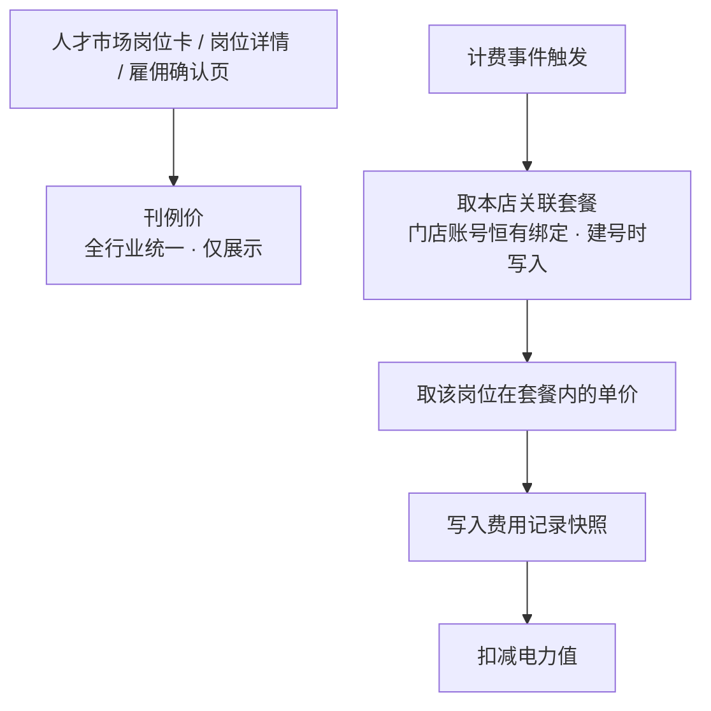
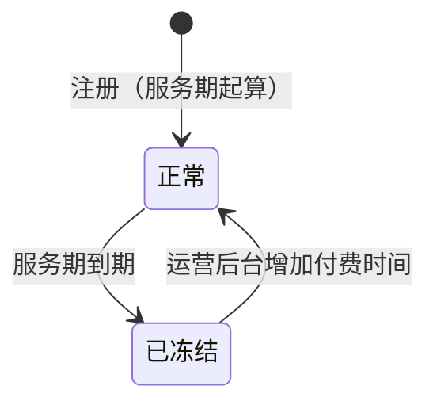

# AI数班 V1.4 · 计费规则 PRD

> 版本：V1.4（当前 V1.4.0）
> 更新日期：2026-10-10
> 状态：设计已定稿，待评审
> 适用范围：全行业数字员工计费、电力账户、充值与运营后台

---

## 版本管理

> 本表记录本文档的历次变更，包含**变更位置**（章节，缩进表示从属子节）与**变更内容**。变更内容按 `① ② ③` 分条、`·` 列具体规则。**本表按模块一行**：同一模块被多次调整时只保留最新结论，**直接改该模块所在行**，不在表末追加新行；**只有新模块才在表末新增一行**。每次调整同步更新头部"更新日期"与"版本"。

| 版本 | 日期 | 变更位置 | 变更内容 |
|------|------|----------|----------|
| V1.4.0 | 2026-09-23 | **2 计费与账务模型（新增）**<br>　2.1 两个独立维度<br>　2.2 价格体系（原四层价格体系）<br>　2.3 刊例价（对外展示价）<br>　2.4 行业默认套餐（原行业消耗模版 L1）<br>　2.5 员工消耗套餐包（原门店级消耗配置 L2）<br>　2.6 费用记录<br>　2.7 充值记录<br>**3 各岗位计费规则（新增）**<br>　3.2 主号获客专家（基础结算 / 高级结算）<br>　3.3 副号获客专家<br>　3.4 客服专员（转化线索分两档 · 90 天再度计费）<br>**4 月度最低消耗（新增）**<br>**5 电力账户（新增）**<br>**6 充值与优惠（新增）**<br>**7 人才市场与雇佣流程改造（新增）**<br>**8 消耗明细（新增）**<br>**9 运营后台（新增）**<br>　9.1 VIP 编辑（原充值登记）<br>　9.2 服务期管理<br>　9.3 套餐包管理（原行业消耗模版配置 L1）<br>　9.4 员工消耗套餐包（原员工消耗配置 L2）<br>　9.5 运营后台查询视图（新增，㉜ 删除）<br>**10 存量文档改写清单（新增）**<br>　10.3 PRD-v1.3<br>**11 验收标准（新增）**<br>**12 待确认事项（新增）** | **① 建立四层价格体系**：刊例价（全行业统一，仅展示）→ 行业消耗模版（L1 计费基准）→ 门店级配置（L2 覆盖值）→ 费用快照<br>　· 取值优先级 **L2 > L1 > 刊例价**，逐级回落<br>　· 覆盖语义为绝对值覆盖，非差额<br>　· **展示层与计费层解耦**：前台恒展示刊例价，与实际计费价可能不一致<br>　· L2 改价即时生效，只影响之后发生的计费<br>**② 电力值与服务期解耦为两个独立维度**<br>　· 电力值＝消耗维度：充值获得、消耗扣减、可为负、冻结时保留不归零<br>　· 服务期＝时间维度：注册日 + 365 天，由运营后台增减天数<br>　· 充值不等于续期，两者是运营后台的两个独立动作<br>**③ 电力:现金 = 1:1 全面覆盖**（原 v1.3 定稿的 10:1 作废）<br>　· ¥2/次发布 → 2 电力值，原"20 电力值"口径作废<br>**④ 四个岗位的计费口径定稿**：主号获客专家 50 电力/有效线索、副号获客专家 50 电力/条、客服专员 10 电力/转化线索、矩阵视频发布专员 2 电力/次发布（该组数值为**全行业统一的刊例价**，实际计费价由行业模版与门店配置决定，见 ⑭）<br>**⑤ 月度最低消耗按账户级结算**：31 天周期、与员工数量及是否有人服务完全无关、无条件扣满<br>**⑥ 透支规则**：余额可为负，负余额不阻断计费、也不阻断业务执行；充值先抵扣负值<br>**⑦ 冻结与解冻**：服务期到期 → 账户冻结、电力冻结、停止低消结算、界面阻断；运营后台增加付费时间后解冻并重新起算 31 天周期<br>**⑧ 充值全部走运营后台线下**，用户端删除充值表单，仅保留余额展示与联系运营提示<br>**⑨ 岗位更名**：短视频运营专员 → **矩阵视频发布专员**<br>**⑩ 存量改写**：v1.0 §6.4 客服专员按日计费作废、§7.11.2 线上充值面板作废；v1.1 §5.3 告警取消暂停联动、§5.4 有效期起点改注册日；v1.3 §2.4.2 余额阻断项删除、§2.5 余额不足条作废、§2.5.2 电力值列改写<br>**⑪ 服务期统一 365 天（定稿）**：不分行业、不分客户类型，L1 / L2 不设服务期配置项；差异化续期只走运营后台按门店账号增减天数<br>**⑫ 低消周期起点双向展示**：§4.1 新增展示要求，§6.4 客户产品页面展示"本周期起始日 + 剩余天数 + 已消耗电力值 + 本账户月低消"，§10.2 运营后台门店账号详情页同口径展示，两处数值必须一致；§10.2 明确服务期不在 L1 / L2 配置<br>**⑬ 存量改写执行记录（2026-09-23）**：v1.1 已改写并升版为 v1.2（§5.3 / §5.4 重写 + 8 处次生引用 + 岗位更名）；v1.3 已改写（文件更名 + 全文岗位更名 + §1.2 / §2.1 / §2.4 / §2.4.1 / §2.4.2 / §2.4.4 / §2.4.5 / §2.5~§2.5.3 / §4.12.7 计费口径改写，版本管理表按模块行就地更新）<br>**⑭ 价格体系重构：展示层与计费层解耦（2026-09-23 二次定稿）**<br>　· **刊例价全行业统一**（主号 50 / 副号 50 / 客服 10 / 矩阵 2 电力），只对外展示、不参与计费；人才市场不再按行业差异化展示<br>　· §2.2 由三层改为**四层**：刊例价（展示）→ L1 行业消耗模版 → L2 门店级消耗配置 → 费用快照，取价 **L2 > L1 > 刊例价**<br>　· §2.3 刊例价改为平台内置常量、后台只读；**不含月最低消耗**<br>　· §2.4 原「刊例价模版」改为「**行业消耗模版**」，新增「结算方式」配置项；**未配置时回落刊例价、可正常雇佣**（原「展示待上线」作废）<br>　· §2.5 门店配置新增「结算方式」覆盖；明确可针对同一门店的不同数字人分别配价<br>　· §3.2 / §3.3 主号、副号获客专家新增**基础结算 / 高级结算**：高级结算口径为"同系统原有获客结算配置"，本 PRD 不展开；两岗位结算方式分别配置<br>　· §6.4 / §8.1 / §8.2 / §8.3 前台展示口径全部改为**只出刊例价、不出月低消、不出差异说明**；低消只在电力账户页展示实际值<br>　· §9.1 / §9.2 消耗明细**不展示单价与取价来源**；扣费备注枚举增加"获客结算扣费"<br>　· §10.3 / §10.4 后台配置项改为行业消耗模版与三项覆盖（单价 / 低消 / 结算方式）；新增 §10.5 运营后台查询视图（可展示单价与取价来源）<br>　· §2.6 费用记录新增「结算方式」「取价来源」快照<br>　· 连带：§2.3 低消未配置时**不进入低消周期、不结算**；§12 验收标准重排为 36 条；§13 新增待确认事项 6 / 7 / 8<br>**⑮ 文档表述改为业务语言（2026-09-23 三次定稿）**<br>　· **全文去掉技术字段名**：原以英文字段名（`industry` / `positionCode` / `effectiveFrom` / `minMonthly` / `unitPrice` / `settleMode` / `priceSource` / `power` / `remark` 等）描述的位置，一律改为业务名称（行业 / 岗位 / 生效时间 / 月最低消耗 / 实际消耗单价 / 结算方式 / 取价来源 / 扣减电力值 / 扣费备注等）；§2.4 / §2.5 / §2.6 / §5.1 的表头由「字段」改为「配置项 / 记录项 / 账户项」，§9.2 表头由「字段列」改为「展示列」并删除其中的英文字段列<br>　· **删除行业整体停用逻辑**：原 §2.4「行业可整体停用」、§8.1「停用行业下的岗位展示为待上线」、§10.3「支持行业整体停用」全部作废。系统**不设行业级上下架开关**，唯一的开关是"是否配置模版"——不配置即按刊例价计费、不结算低消、岗位仍可雇佣；§2.4 待配置清单中房地产的「前期停用」标注取消；§12 待确认 2 改为"房地产本期是否纳入"并说明无行业级停用能力<br>　· 连带：§2.4「状态」明确为单条配置的启用/停用，停用后等同于该行业下该岗位未配置；§12 待确认表按 1~8 重新排序<br>**⑯ L2 门店级配置大幅简化（2026-09-23 四次定稿）**<br>　· **入口固定**：运营后台 → 账号管理 → 选中门店账号 → 菜单【员工消耗配置】；§2.5 与 §10.4 同步改写，章节名由「门店级价格配置」「门店配置」统一为「**门店级消耗配置（L2）**」「**员工消耗配置（L2）**」<br>　· **只留两项配置**：消耗数值、结算方式（仅主号/副号获客专家可改）。**月最低消耗、生效时间、配置人、备注四项配置项全部取消**<br>　· **默认带出行业模版值**：打开菜单按岗位列出消耗数值并预填 L1 值；未改动的岗位不产生门店级覆盖，计费仍回落 L1<br>　· **改价改为就地覆盖**：取消生效时间后不再追加生效版本，改价即时生效；配置表不留改价历史，审计以费用记录的单价快照 + 系统自动记录的变更日志为准<br>　· **低消降为单层取值**：月最低消耗不设门店级覆盖，只按 L1 行业消耗模版取值。连带改写 §2.2 覆盖范围、§4.2 取值、§4.4 验收 7/8、§6.4 账户页、§7.2 告警档位与跨页一致性、§10.2 门店详情、§9.6 验收 7/8、§12 验收 4/20、§12 待确认 6<br>　· **结算方式叫法统一**：菜单内单选与计费章节统一使用「基础结算 / 高级结算」，不另起「基础配置 / 高级配置」的说法<br>**⑰ 新增充值记录（2026-09-23 五次定稿）**<br>　· 原文档三处引用"充值流水"但从未定义。新增 **§2.7 充值记录**，与 §2.6 费用记录构成账户的**两本账**（费用记录记出账、充值记录记入账），第二章标题由「计费模型」改为「**计费与账务模型**」<br>　· 记录项含：充值记录标识 / 门店账号 / 实收金额 / 到账电力值 / 优惠电力值 / 抵扣负值 / 计入可用余额 / 充值前后可用电力值 / 到账时间 / 登记时间 / 操作人 / 转账凭证号 / 备注 / 状态（正常 / 已冲正）；回答"谁在什么时候充了多少电力值"<br>　· 明确 **账户可用电力值 = 全部充值记录到账电力值合计 − 全部费用记录扣减电力值合计**；**第一条充值记录的到账时间即低消周期起点**<br>　· §10.1 表头由「字段」改为「登记项」，补充"登记即生成充值记录、可按门店账号查询与导出、登记页展示历史充值记录"；§5.2 / §6.1 / §6.3 的"充值流水"统一改为"充值记录"并回指 §2.7<br>　· 验收：§6.5 新增 11 / 12 条，§10.6 新增 14 / 15 条，§12.5 第 29 条补充充值记录口径<br>**⑱ 删除幂等等技术实现描述（2026-09-23 六次定稿）**<br>　· **整节删除 §3.6「计费幂等与快照」**（含 mermaid 流程图"业务事件发生 → 构造幂等键 → 幂等键是否已存在"）。该图描述的是工程实现步骤而非业务逻辑，且取价链路已在 §2.2 有图、快照规则已在 §2.6、余额可为负已在 §5.2、高级结算取价已在 §3.2.2，无信息丢失<br>　· **全文去掉"幂等键"概念**：§2.6 记录项删除"幂等键"一行及其说明；§3.1 总表删除"幂等键"列（触发点列改名"计费时点"）；§4.3 章节名由「幂等与记录」改为「记录规则」<br>　· **改用业务语言表达同一件事**：统一表述为"**同一业务对象只计费一次**"——同一条线索、同一个留资结果、同一次作品发布，重复回收到业务结果时不重复扣费；低消补差为"一个周期只生成一条补差记录"<br>　· 连带改写 §3.2.2「幂等口径」→「不重复计费」、§3.5 失败重试与费用记录、§12.2 第 15 条、§12 待确认 7「高级结算的幂等口径」→「高级结算的重复计费风险」<br>**⑲ 消耗明细统一列骨架、充值记录开放给客户（2026-09-23 七次定稿）**<br>　· **§9.2 由"固定 6 列"改为"公共列 6 项 + 各岗位业务列"**：原口径与原型冲突（原型获客专家视图实际有 10 列，含客户信息 / 城市 / 车型 / 预算）。现明确公共列固定 6 项、任何视图不得删减或调序，各岗位视图只能在公共列之后追加业务列<br>　· **统一机制**：各岗位的差异字段本质都是**计费对象的业务属性**，由「计费对象」列以主行（对象标识）+ 副行（业务属性）承载；获客专家追加客户信息 / 联系方式 / 留资时间 / 城市 / 车型 / 预算 / 客户意向，客服专员与矩阵视频发布专员无追加列<br>　· **§9.1 新增两个层级的视图**：「全部」视图只用公共 6 列、跨岗位可比；各岗位视图为公共列 + 业务列。**低消补差是账户级费用，只在「全部」视图出现，不进任何岗位视图**（这是此前低消补差"在原型中无处安放"的解法）<br>　· **§2.7 充值记录开放给客户侧**：原只写"运营后台可按门店账号查询"，现明确**客户侧 + 运营后台两侧都可见**；§6.4 补充客户侧充值记录视图（只读，无编辑或补录入口）<br>　· **§6.4 新增补差预告**：周期内实际消耗低于月低消时，周期卡片展示"本周期已消耗 X / 月低消 Y，周期末预计补扣 Z"，避免周期末突然扣费引发争议<br>　· 连带：§9.3 补充岗位视图的筛选范围，§9.4 新增验收 9 / 10 / 11，§6.5 新增验收 13 / 14，§12.6 新增验收 37 / 38（验收标准合计 **38 条**）<br>**⑳ 「全部」视图去掉计费对象列、低消名称改为 31 天口径（2026-09-24 八次定稿）**<br>　· **§9.2 公共列拆成两套**：公共列（6 项）仅**各岗位视图**使用；**「全部」视图固定为 5 项**——扣费时间 / 数字员工 / 扣费账号 / 电力值 / 扣费备注，去掉「计费对象」<br>　· **去掉的原因**：「计费对象」承载的是线索标识与作品标题，属**岗位内部**的业务对象细节，不同岗位的行之间不可比；「全部」视图的用途是**跨岗位横向对比**，只保留账户级的可比信息。岗位视图内该列完整保留<br>　· **低消名称统一为「31天最低消耗补扣」**：§2.6 费用类型、§4.3 记录规则、§9.1 费用类型枚举、§9.2 扣费备注枚举、§9.4 验收 1 全部改名，原「月度低消补差」与「月度最低消耗补差」两个旧称作废。名称带「31天」是为了让客户在消耗明细里直接看出这是 31 天周期的低消结算，而不是一笔业务消耗<br>　· **§9.1 / §9.4 / §12.6 连带改写**：§9.1 两个层级视图的列数口径、§9.4 验收 5 / 9 / 10、§12.6 验收 37 按 5 列口径重写<br>　· **计费规则不变**：低消仍为 31 天周期、账户级结算、只在「全部」视图出现；本次只改**名称**与**「全部」视图列数**，不改扣费口径与金额算法<br>**㉑ 充值记录删除 5 个记录项、备注改为固定规则（2026-09-24 九次定稿）**<br>　· **§2.7 记录项由 15 项收敛为 10 项**：删除实收金额 / 优惠电力值 / 抵扣负值 / 计入可用余额 / 状态五项，保留充值记录标识 / 门店账号 / 到账电力值 / 充值前后可用电力值 / 到账时间 / 登记时间 / 操作人 / 转账凭证号 / 备注<br>　· **删除原因**：充值记录对客户侧的用途是"到了多少电力值"，现金口径（收了多少、让利多少、抵了多少负值）属商务侧信息，留在客户可见的表里既增加理解成本、又暴露优惠力度。状态列删除后由"记录不可改、错误走冲正"承接<br>　· **备注改为系统按固定规则自动生成**：正常充值固定为"补充电力值"；本次到账电力值中有抵扣账户负值的，写作"**补充电力值，抵扣 N 电力值**"（N 为本次抵扣掉的负值，如"补充电力值，抵扣1000电力值"）。§10.1 登记项中备注由「人工填写、非必填」改为「系统自动生成」<br>　· **两侧列口径统一为 4 列**：到账时间 / 到账电力值 / 操作人 / 备注。§6.4 客户侧原含实收金额、§9.6 验收 14 后台侧原含实收金额，一并改写；§2.7 到账电力值说明去掉"可大于实收金额"<br>　· **§6.3 由「优惠实现」重写为「优惠的实现口径」**：原节以"实收金额 / 优惠电力值 / 优惠率 `powerAmount ÷ payAmount`"为骨架，实收金额删除后该算法失去输入。新口径为——优惠体现为**到账电力值高于 1:1 基准**，系统不单独记录优惠额度、不计算优惠率，凭证由线下合同、转账凭证号与备注留存<br>　· **§6.1 / §5.4 连带改写**：§6.1 去掉"优惠充值时到账电力值可以大于实收金额"，改为"只登记到账电力值、不记录实收金额与优惠额度"；§5.4 验收 4 由"抵扣过程逐笔可追溯"改为"抵扣金额写入充值记录备注"<br>　· **状态删除后冲正改口径**：原"错误登记通过冲正记录修正、原记录状态置为已冲正"改为"**充值记录不可删除、不可修改**，错误登记由运营在后台发起冲正处理，原记录保留"（§2.7 / §10.1 / §9.6 验收 15 三处）<br>　· **§9.3 导出删除实收金额口径列**：导出字段与当前视图的列一致，不再补充实收金额列<br>　· **§12 待确认 5 定稿关闭**（消耗明细导出是否补充实收金额口径 → **不补充**）；**新增待确认 9**：删除实收金额后，运营侧如何核对"客户交了多少现金、给了多少优惠"——当前只能依赖线下合同与转账凭证号，若确需该口径须恢复"实收金额"登记项<br>　· **验收连带**：§6.5 验收 2 / 4 / 11 / 13 改写并新增 15，§9.6 验收 1 / 2 / 14 / 15 改写，§12.5 验收 29 与 §12.6 验收 38 改写（验收标准合计 **39 条**）<br>**㉒ 电力账户看板改版：冻结退出客户侧、服务期改一行文案、低消改进度条（2026-09-24 十次定稿）**<br>　· **删除「冻结电力值」卡片**：§6.4 用户端展示口径删掉冻结电力值。理由是账户被冻结时系统以弹窗阻断使用，客户根本进不到本页面，展示冻结值没有受众。**§5.1 账户项保留「冻结电力值」字段**——账户仍有该属性，只是客户侧不展示；§5.3 冻结阻断逻辑不变<br>　· **服务期改为一行文案**：§6.4 客户侧不再展示「服务期截止日」卡片与「剩余天数」，只以「**有效期至 YYYY-MM-DD**」一行轻量呈现，且**不提示到期后冻结**。§6.4 展示口径改写，§6.5 验收 5 连带改写，新增验收 16<br>　· **低消由四格周期模块改为进度条**：删除原「月度最低消耗周期」整块（本周期起始日 / 剩余天数 / 已消耗电力值 / 月低消四格 + 补差预告条），改为月低消卡片内的一条**进度条**，按「本周期已消耗电力值 ÷ 月低消」填充，下方标注「本周期已消耗 X · 还差 Y」，已达月低消时转完成态并标注「已达月最低消耗」。§6.4 原「低消周期口径必须展示周期起点」「补差要提前预告」两条改写为「低消以进度条呈现」「缺口金额在进度条上直接可读」，§6.5 验收 5 / 7 / 9 / 14 改写<br>　· **进度条口径与客户侧一致化**：§4.1「周期起点必须对客户与运营双向可见」改为「**对运营可见**」——客户侧退出周期日期展示，运营后台保留完整四项作为对客解释依据；§4.4 验收 11、§10.2、§9.6 验收 9 的「两处数值必须一致」收窄为「本周期已消耗电力值」与「月低消」两项<br>　· **连带**：§11 存量改写清单中 v1.0 §4.x 对话电力值查询改为不展示周期起始日与剩余天数，与客户页口径对齐；**§7.2 服务期到期提醒（告警）与 §10.2 后台展示本次不变**——本次只改客户侧电力账户看板<br>　· **纯视觉项**：可用电力值卡片删除「账户余额，可为负、可透支」副文案（§5.1 / §5.2 的透支规则本身不变）；§6.5 新增验收 17（客户侧不展示冻结电力值）（验收标准合计 **41 条**）<br>**㉓ 充值记录客户侧删「操作人」列、明确两侧列口径不同（2026-09-24 十一次定稿）**<br>　· **客户侧充值记录由 4 列收敛为 3 列**：到账时间 / 到账电力值 / 备注。删除「操作人」——登记人属运营内部信息，客户只需看到"到了多少"<br>　· **两侧列口径正式分开**：§2.7 原只写"两侧都可见"，现明确**客户侧 3 列、运营后台展示完整记录项（含操作人与转账凭证号）**。§6.4、§6.5 验收 13、§12.6 验收 38 连带改写；**§10.1 登记项与 §9.6 验收 14 不变**——操作人仍是登记项、后台仍展示<br>　· **抵扣案例口径自洽性**：§2.7 备注规则（正常充值"补充电力值"，有抵扣时写"补充电力值，抵扣 N 电力值"）与 §5.2 透支规则（充值先抵扣负值）配套成立的前提是账户确实会出现负值。本次在演示数据中补入该链路：周期末补扣使账户转负，下次充值先抵扣再计入余额。PRD 侧无新增规则，仅验证既有口径可闭环<br>**㉔ 低消卡片主次对调：主数字改为动态消耗量、去掉「还差」补扣预告（2026-09-24 十二次定稿）**<br>　· **主次对调**：§6.4 低消卡片原以「本账户月最低消耗」为主数字（固定值 1,200），动态读数反而在小字与进度条上，主次颠倒——客户最关心的是"本周期消耗到哪了"。现改为**主数字展示本周期已消耗电力值**（随消耗明细数据动态变化），**小字标注本期最低消耗 X**（本账户实际生效值）。§6.4 展示口径、§6.5 验收 5 与 14 连带改写<br>　· **去掉「还差 Y」补扣预告**：原进度条下方标注"本周期已消耗 X · 还差 Y"，其中"还差 Y"即周期末将被补扣的金额——实质是一句补扣预告，与 §6.4"不设补差预告"的立场相抵。本次一并删除，§6.4 原「缺口金额在进度条上直接可读」一条改写为「**不预告补扣金额**」：低消卡片只回答"消耗到哪了"与"目标是多少"，缺口由进度条未填满的部分直接可读；周期末的补扣仍以一条"31天最低消耗补扣"费用记录出现在消耗明细中<br>　· **运营后台不受影响**：§4.1 / §4.4 验收 11 / §10.2 / §9.6 验收 9 的"本周期已消耗电力值"与"月低消"两处一致口径不变——客户页两个数字都在，只是位置对调<br>　· **连带修一处编号缺陷**：§6.5 验收原按追加顺序排成 14 / 16 / 17 / 15，本次把「充值记录备注规则」一条移到 14 之后，编号回归 15 / 16 / 17 顺序（语义不变，与版本管理表 ㉑ ㉒ 的记载一致） <br>**㉕ 低消卡片补出完成百分比（2026-09-24 十三次定稿）**<br>　· **进度值直接可读**：原低消卡片只有一条进度条，填充比例只能靠目测，客户读不出具体进度。现于**进度条下方一行右端标出"已完成 N%"**，与该行左端的"本期最低消耗 X"构成"目标—完成度"的对照。§6.4 展示口径、§6.5 验收 5 与 14 连带改写<br>　· **与进度条同源**：N 由"本周期已消耗电力值 ÷ 本期最低消耗"算出，与进度条填充比例取自同一次计算，两者不会出现读数打架；**超额消耗时一并截断为 100%**（进度条已填满，读数不再超过 100%）<br>　· **空态一并隐藏**：行业消耗模版未配置月最低消耗时，进度条与百分比同时隐藏，卡片只留"本账户未设置月最低消耗"提示<br>**㉖ 校对修正：验收编号与陈旧引用（2026-10-08 十四次定稿）**<br>　· **§5.4 验收标准编号重排**：原 1~10 之后重复排了一遍 9、10（⑪ 插入「服务期统一 365 天」时未重排旧条目），现整理为 1~11，并删除与第 9 条语义重复的一条解冻验收<br>　· **§12 待确认 4 陈述更新**：原「起点须在运营后台与客户产品页面双向展示」改为「完整周期信息只在运营后台展示，客户侧只以低消进度条呈现」，与 ㉒ 收窄后的口径对齐<br>　· **§12.6 验收 36 陈述更新**：原「展示本账户实际月低消与周期信息」改为「以低消进度条展示本周期已消耗电力值与本期最低消耗」，客户侧已不展示周期日期（㉒ 连带清单遗漏本条）<br>　· **§9.3 标点修正**：导出条目句末多余的「，。」改为「。」<br>　· **口径不变**：四项均为编号与陈述的校对，不改任何计费规则、取值链路与展示要求<br>**㉗ 删除「低消未配置」兜底：月最低消耗改为必配项（2026-10-08 十五次定稿）**<br>　· **删除 §2.4 的「低消未配置不结算」**：原口径为"行业模版未配置月最低消耗时，该账户不进入低消周期、不产生补差记录"（保守，避免按未确认数值扣费），现**作废**——月最低消耗由运营随行业消耗模版**一并提供**，是模版的**必配项**，不存在未配置的账户，系统不设兜底分支<br>　· **连带改写**：§2.4 待配置清单注去掉"且不结算低消"（回落只适用于单价）；§4.2 低消金额取值、§4.4 验收 8、§6.5 验收 9、§9.6 验收 12、§12.3 验收 20 一并改为"必配项"口径；删除 §6.4 电力账户页的"未设置月最低消耗"空态段，以及 §7.1 / §7.2 的"未配置低消不触发缺口档位"两条；§10.3 留空说明去掉"且不结算低消"；§10.3「不提供行业整体停用」条与 §12 待确认 2（房地产本期是否纳入）中"按刊例价计费、**不结算低消**"的并列口径一并改写——单价可回落刊例价，**月最低消耗不随之免除**<br>　· **§12 待确认 6 定稿关闭**：原问"低消未配置时的兜底是否为不结算"，现定稿为必配项、不设兜底、不设平台默认值；§12 待确认 1 补注月最低消耗为必配<br>　· **刊例价与单价兜底不变**：刊例价仍为全行业统一的内置常量、后台只读；单价仍保留"未配置回落刊例价"的取值链，低消**不回落刊例价**（刊例价不含低消）<br>　· **原型连带**：删除电力账户页的低消空态（`monthlyMinimum` 为空时隐藏进度条与完成百分比、展示"本账户未设置月最低消耗"）及对应断言，变更说明文档同步<br>**㉘ 充值记录删除「转账凭证号」（2026-10-08 十六次定稿）**<br>　· **§2.7 记录项删除「转账凭证号」**：该记录项原为"线下转账或合同的凭证标识"。删除后充值记录保留 9 项——充值记录标识 / 门店账号 / 到账电力值 / 充值前可用电力值 / 充值后可用电力值 / 到账时间 / 登记时间 / 操作人 / 备注<br>　· **§10.1 登记项同步删除**：登记表单不再收集该字段，运营登记时只填「到账电力值 + 到账时间」，操作人自动记录<br>　· **§6.3 优惠凭证收窄**：原"商务合同、转账凭证与后台登记的转账凭证号"改为"**商务合同与线下转账凭证**"——系统内不再留存该标识，凭证只在系统外留存<br>　· **备注保留不变**：本次**不动备注**。备注继续承担"本次到账电力值中有多少用于抵扣账户负值"的留痕（见 ㉑），§2.7 / §5.4 验收 4 / §9.6 验收 2 的抵扣口径不变<br>　· **§12 待确认 9 改写**：运营侧核对现金口径的依据由"线下合同、转账凭证号与备注"收窄为"**线下合同与充值记录备注**"，系统内已无任何现金或凭证锚点<br>　· **原型连带**：演示数据删除 3 条充值记录中未被渲染的 `voucher` 字段（客户侧只展示到账时间 / 到账电力值 / 备注三列，该字段本就未上屏）<br>**㉙ §3.4 / §3.5 去掉冗余与防御性表述（2026-10-08 十七次定稿）**<br>　· **§3.4 客服专员 7 条 → 5 条**：删除「结算方式」条（§2.4 / §2.5 / §3.1 总表 / §10.3 / §10.4 / §10.6 / §12.2 共 7 处已载明）与「费用记录」条（记录项由 §2.6 统一定义，"重复回收不重复扣费"由 §2.6 / §3.1 全局声明）；「与功能开关解耦」「与授权解耦」改写为正向陈述——「**功能开关不参与计费**」「**未授权时不计费**」，去掉"不再作为计费开关"与因果链推导<br>　· **§3.5 矩阵视频发布专员 8 条 → 5 条**：删除「结算方式」「费用记录」；「失败与重试」并入「不计费」（发布失败本就在不计费枚举内，重试成功按一次发布计费）；去掉"不设 T+1 次日结算""关闭与解雇动作本身不产生费用""同一作品重复回收发布结果时不重复计费"三处防御性说明<br>　· **仅措辞，口径不变**：计费单位、计费依据、触发时点、不计费状态枚举、停止计费五类规则一条未改；§12.2 验收 11 / 12 / 13 的支撑改由 §2.4 / §3.1 总表 / §9.6 验收 11 承接<br>　· **连带核查**：被删两条中提到的"扣费状态""作品标识（任务内作品 ID / 抖音作品 ID）"在全文无其他引用，删除后不留孤儿；§2.6 记录项本就未定义这两个字段，口径反而更一致<br>　· **原型不受影响**：本次为 PRD 文案精简，不涉及计费逻辑与展示口径，原型无需改动<br>**㉚ 客户侧低消卡片补回周期起止与剩余天数（2026-10-08 十八次定稿）**<br>　· **反转 ㉒ 的收窄**：㉒ 曾把 §4.1「周期起点对客户与运营**双向**可见」收窄为「对运营可见」、客户侧退出周期日期。本次加回——**客户侧也要展示明确的低消周期起始时间与周期**，客户据此自行判断"周期还剩多久"，而不必等到周期末被补扣才知道周期边界<br>　· **展示形态为低消卡片底部一行文案**：不恢复 ㉒ 删掉的四格周期模块，㉔ 的主数字对调（主数字＝本周期已消耗电力值）与 ㉕ 的完成百分比**全部保留不变**；仅在卡片底部加一行「本周期 YYYY-MM-DD ~ YYYY-MM-DD · 剩余 N 天」，含**周期起始日 / 周期结束日 / 剩余天数**三项<br>　· **连带改写**：§4.1 父条与「客户产品页面」子条、§4.4 验收 11、§6.4「低消以进度条呈现」条与展示口径条、§6.5 验收 5 与 14、§10.2 查询视图表的「查看低消周期」行与「低消周期起点在后台必须可见」条、§12.6 验收 36、§12 待确认 4、§11 存量改写清单中 v1.0 §4.x 对话电力值查询<br>　· **§10.2 两处系收尾扫描时补出**：㉒ 收窄时只改了 §4.1 / §6.4 / §6.5 主阵地，§10.2 的「客户侧只展示进度条，后台保留完整四项作为对客解释依据」与「客户侧已不展示周期日期（只展示进度条）」两句被漏下，本次以「正文残留全扫」逐条揪出后一并改写<br>　· **顺带修一处自相矛盾**：§4.1 父条被 ㉒ 改成"客户侧不展示周期日期"后，其下「**客户产品页面**：展示在电力账户卡片与消耗明细页」子条却未同步删除，父子两条互相打架；本次改写父条并重写该子条，矛盾消除。同时把展示位从"电力账户卡片与消耗明细页"收窄为**电力账户卡片**——消耗明细是流水列表，页头塞周期日期易与筛选条件混淆，且低消本身是账户级口径<br>　· **顺带消歧**：§6.4 展示口径条中"不展示剩余天数"原指**服务期**，现明确写作"不展示**服务期**剩余天数"，避免与本次新增的低消周期剩余天数打架<br>　· **运营后台口径不变**：§10.2 / §9.6 验收 9 仍为起始日 / 剩余天数 / 已消耗电力值，本次只把客户侧补齐到同一口径，两处数值必须一致<br>　· **原型连带**：电力账户页低消卡片底部新增一行周期文案（`cycleStartAt` / `cycleEndAt` / `cycleRemainingDays` 三个字段一直保留在演示数据中，此前只是未渲染）；演示周期前滚为一个进行中的窗口，避免上屏显示"剩余 0 天"<br>**㉛ VIP 编辑合并充值登记、低消开放门店级覆盖（2026-10-09 十九次定稿）**<br>　· **§10.1 由「充值登记」整节重写为「VIP 编辑」**：原【充值登记】与【VIP编辑】两个入口在"增加电力值 + 改到期时间"上功能重叠，只保留 VIP 编辑。一个弹窗同时承载**到期天数调整、电力值调整、月最低消耗覆盖**三件事；编辑项为当前到期时间 / 当前剩余电力值（只读核对）、到期天数调整、电力值调整、月最低消耗，**三项至少填一项**才可保存，保存前展示变更预览（调整后到期时间 / 剩余电力值 / 低消取门店值还是行业值）<br>　· **到账时间与登记时间改为系统记录**：原充值登记的「到账时间」为运营必填项，改由系统在保存时记录、与登记时间同源；表单删除该输入项，避免运营手填一个与账本重放对不上的时间<br>　· **§2.7 备注规则补第三分支**：原只覆盖"补充电力值"与"补充电力值，抵扣 N 电力值"两种正向情形，新增「**VIP 调整，扣减电力值**」承接负数调整；同时明确**负余额下的负数调整不产生"抵扣"**——抵扣只在增加电力值时出现，负数调整是让负值更深<br>　· **§4.2 低消取值反转 ⑯**：⑯ 曾把低消降为"只按 L1 行业消耗模版取值、不设门店级覆盖"。本次加回门店级覆盖，取值 **门店覆盖值 > 行业模版值**，**覆盖入口在 VIP 编辑、不在【员工消耗配置】**——低消是账户级参数，与 L2 的岗位级配价不同粒度，**不并入 `L2 > L1 > 刊例价` 链路**。覆盖语义与 L2 一致（绝对值覆盖、留空即撤），且**按周期结算时点取值**、不追溯周期内的配置变更历史（周期内消耗是累计值，无法像单价那样按变更时点切分）<br>　· **连带改写**：§2.2 覆盖范围、§2.5（L2 边界 + "已配置协议价"提示改挂 VIP 编辑）、§2.7（记录项 + 备注固定规则表）、§4.2 / §4.4 验收 7、§6.1 / §6.2 / §6.4（低消"本账户实际生效值"口径 3 处）、§6.5 验收 2 / 3 / 11 / 15、§7.1 低消缺口档位、§10.2 操作入口指向、§10.3（模版值为行业默认值）、§10.4（不提供低消入口的理由）、§9.6 验收由 15 条扩为 17 条、§11.1 验收 4、§12.3 验收 20、§12.5 验收 29<br>　· **原型连带**：删除充值登记抽屉及其保存分支、门店行菜单由 5 项减为 4 项、电力账户抽屉底部收敛为单个【VIP 编辑】按钮、抽屉月最低消耗后追加"· 门店自定义"标记、`monthlyMinimumOf()` 引入门店覆盖并接进补差计算<br>　· **顺带修两处原型缺陷**：① VIP 编辑的负数电力值在充值记录里渲染成 `+-500`，备注也误写为"补充电力值"，一并修正为带符号数值与"VIP 调整，扣减电力值"；② 充值记录「抵扣 N 电力值」的高亮正则不收千分位，N ≥ 1000 时高亮丢失<br>　· **修 `addDays()` 时区缺陷**：原实现以 `new Date(s+'T00:00:00')` 本地解析、却用 `toISOString()` 按 UTC 输出日期，UTC+8 下每加一次天数少一天（+90 天得 89 天、往返丢两天）。改为按本地年月日拼串。影响面为 VIP 编辑的到期天数调整、弹窗预览与解冻后的 31 天周期重算<br>**㉜ 员工消耗配置改为套餐包、月低消并入套餐（2026-10-09 二十次定稿）**<br>　· **§2.5 门店级消耗配置（L2）整节改为「员工消耗套餐包」**：取消按门店逐岗位改价，改为**门店账号关联一个套餐包**，套餐**整包生效**——关联后四个岗位一起按该套餐取值，不提供逐岗位改价。门店关联套餐后**不再回看行业默认套餐**；套餐内留空的岗位直接回落刊例价，也**不会**再去取行业默认套餐的岗位单价<br>　· **§2.4 行业消耗模版（L1）整节改为「行业默认套餐」**：行业层只做"关联哪一个套餐"的选择，**每个行业至多关联一个**，不单独配置数值；原【行业消耗模版】菜单与页面取消，行业关联收进套餐包管理页的【行业默认配置】表<br>　· **新增【套餐包管理】一级菜单（§10.3 整节重写）**：与【用户管理】【云电脑管理】【注册审核】同级，取代原【行业消耗模版】。套餐包是岗位实际消耗单价与月最低消耗的**唯一配置载体**，支持新增、编辑、删除；**改价就地覆盖、保存即对全部关联方立即生效**，保存前提示影响面（已关联哪些行业、多少家门店），不设生效时间、不追加生效版本<br>　· **删除保护**：**已经关联行业、或者关联过门店的套餐包不可以删除**，删除入口只给"请先解除关联"的提示、不放行；未被任何行业与门店关联的套餐可正常删除<br>　· **§2.2 四层价格体系改为套餐链路**：取价优先级 **门店关联套餐 > 行业默认套餐 > 刊例价**，套餐内留空的岗位回落刊例价；"整包生效"意味着门店关联套餐后行业默认套餐对本店完全失效，不做按岗位的逐级回看<br>　· **反转 ㉛ 的低消覆盖口径**：㉛ 曾把月最低消耗的门店级覆盖放进 VIP 编辑（取值「门店覆盖值 > 行业模版值」）。本次**取消 VIP 编辑的低消覆盖入口**，月最低消耗**并入套餐包**、与岗位单价走**同一条链路**——取门店生效套餐的月最低消耗；门店关联套餐后，行业默认套餐的月最低消耗一并失效。相应地，月最低消耗由"行业模版的必配项"改为"**套餐包的必配项**"，并**收窄 ㉗**：账户未生效任何套餐时（门店未单独关联、所属行业也未关联默认套餐）**没有月最低消耗、周期末不做补差**，这是 ㉗"不存在未配置月最低消耗的账户"的唯一例外<br>　· **结算方式移出配置链路**：原 §2.5 / §10.4 称门店级可覆盖结算方式，与实现不符。正确口径是**平台账号（抖音账号）级**——基础结算为默认态、按套餐单价计费；高级结算在该账号上单独开启并配置，**开启后优先、套餐单价不参与计费**，关闭后回落套餐价。§2.2 / §3.2 / §3.3 / §9.6 验收 14 / §12.2 验收 9、10、13 同步改写<br>　· **删除【运营后台费用记录查询视图】（原 §10.5 整节删除）**：不再提供后台的费用记录查询页面；商务对账以套餐包配置页、门店账号详情页与充值记录为准。**费用记录的单价快照与取价来源快照保留不变**（§2.6）——它是账本重放与历史核对的依据，只是不再单独成页<br>　· **取价来源快照枚举改写**（§2.6）：`L2 门店级消耗配置 / L1 行业模版 / 刊例价兜底` → **门店关联套餐 / 行业默认套餐 / 刊例价兜底**（高级结算记录仍为"高级结算配置"）<br>　· **连带改写**：§1.2 本期目标（2 条）、§1.4 版本规划、§2.3、§2.4 待确认清单、§2.6、§2.7、§3.1、§3.2 引言与 §3.2.1 / §3.2.2、§3.3、§3.5、§4.2（取值三条全部重写）、§4.4 验收 7 / 8、§5.1、§5.4 验收 10、§6.2、§6.4（低消实际生效值 2 处）、§6.5 验收 9、§7.1 档位、§7.2、§8.1（3 处）、§8.3、§8.4 验收 2 / 4、§9.1、§9.2（删 §10.5 引用）、§10.1（删低消编辑项、三项改两项）、§10.2（2 处）、§10.6（整节重写，17 条 → 18 条）、§11.3（4 处）、§11.1 验收 3 / 4 / 5、§12.2 验收 9 / 10 / 13、§12.3 验收 20、§12.6 验收 32、§12 待确认 1 / 2 / 3 / 6 / 8、附：与其他文档的关系<br>　· **原型连带**：`templates` 常量改为 `packages`（六个套餐）并新增 `industryPackage` 行业关联表；`fallbackPriceOf` / `hasL2Override` / `renderTemplates` / `renderFeeRecords` 删除，改为 `packageById` / `effectivePackage` / `basePriceOf` / `usageOf` / `renderPackages`；门店行菜单【员工消耗配置】改名【员工消耗套餐包】并改为关联抽屉；VIP 编辑删除月最低消耗输入项、增加生效套餐只读行；导航删除【费用记录】，新增【套餐包管理】（与用户管理 / 云电脑管理 / 注册审核同级）<br>　· **改动后复核**：44 条费用快照逐条比对（门店 / 岗位 / 时间 / 是否低消 / 单价）**无一变化**；五家门店的可用电力值、周期消耗、冻结电力值全部与改动前一致。演示数据按"新旧生效价逐店等价"设计——四个行业各一个默认套餐 + 骏驰专属套餐，使每店的实际单价与月低消在改动前后 byte 级相同<br>**㉝ 行业关联收进套餐包列表、关联行业的套餐单价必配（2026-10-09 二十一次定稿）**<br>　· **删除【行业默认配置】板块**：§10.3 页内的行业默认配置表整块删除，行业与套餐的关联改由**套餐包列表每一行的【关联行业】**指定，不再单独出一个模块。§2.2 价格体系表的配置位置、§12 待确认 1 的入口指引同步改写<br>　· **一个套餐可以关联多个行业**：行业与套餐为**多对一**关系——每个行业至多关联一个套餐（原口径不变），但**一个套餐可以同时是多个行业的默认套餐**（如同一个标准套餐同时服务二手车与新车）。关联弹窗逐行标注该行业当前的默认套餐「本套餐 / X，勾选后切换 / 未关联」；某行业已被别的套餐占用时，勾选本套餐即改选，原套餐在该行业上自动失效<br>　· **套餐包列表取消「关联门店」列**：列表按行展示套餐名称、四个岗位单价、月最低消耗、关联行业与操作入口。**关联门店仍是删除保护的判据**（已关联门店的套餐仍不可删除），只是不再上屏；门店关联关系在【员工消耗套餐包】里查看<br>　· **可以关联、或已关联行业的套餐，四个岗位单价一定不能为空**：留空＝该岗位按刊例价计费，只是**未关联行业的草稿套餐**才允许的状态。新增两道校验——关联行业弹窗在套餐存在留空岗位时给出"尚未配置单价，补齐后方可关联行业"的提示并**不提供保存入口**；**已关联行业的套餐**在编辑保存时四个岗位单价未配全则**拒绝保存**，原配置不变。§2.4 行业默认套餐同步补上该前置条件<br>　· **编辑弹窗把月最低消耗与岗位单价拆成两个分组**：原弹窗把月最低消耗作为岗位单价表下的一行，容易被读成"第五个岗位的单价"。现改为**两个独立分组**——「岗位实际消耗单价」（四个岗位单价 + 刊例价参照）与「月最低消耗」（账户级参数，与岗位单价相互独立），§10.3 配置项表按同样三组（基本信息 / 岗位实际消耗单价 / 月最低消耗）重排<br>　· **连带改写**：§2.2 价格体系表（行业默认套餐的配置位置）、§2.4（关联入口、多对一关系、行业关联的单价必配前置条件）、§10.3（列表列口径、关联行业操作、两处校验、配置项表分组）、§9.6 验收 7 / 8 改写并**新增 19 / 20**（不重排 1~18，避免打乱历史引用）、§11.1 验收 3 / 4、§12 待确认 1<br>　· **原型连带**：删除行业默认配置卡片与 `data-pkg-industry` 下拉分支；列表去掉关联门店列、新增【关联行业】链接；新增关联行业弹窗（四个行业多选 + 当前默认套餐标注 + 留空岗位拦截）与 `pkg-ind-save` 分支；`pkg-save` 增加"已关联行业的套餐单价必须配全"的前置校验；编辑弹窗拆为两个 `form-block`；演示数据把 p2 新车标准套餐、p3 家居标准套餐、p4 房地产标准套餐留空的岗位单价按刊例价补齐（留空时本就在按刊例价计费，补齐后单价不变），使"可以关联、或已关联行业的套餐单价不能为空"在数据上自洽<br>　· **改动后复核**：五家门店的可用电力值、周期消耗、冻结电力值、月最低消耗、低消周期窗口与 44 条费用快照的**单价**逐条比对，**无一变化**；账本恒等式「可用电力值 ≡ 到账合计 − 扣减合计」五店全部成立。唯一变化是 s3 星耀家居 4 条费用记录的**取价来源**由「刊例价兜底」变为「行业默认套餐」——家居标准套餐四个岗位的单价即刊例价 50 / 50 / 10 / 2，单价数值不变，只是取价链路从"无套餐回落"变为"命中行业默认套餐"<br>**㉞ 计费链路反转：行业默认套餐成为计费起点、岗位单价与月低消全面必配（2026-10-09 二十二次定稿）**<br>　· **反转 ㉝ 的"留空草稿态"，并反转 ㉜ 对 ㉗ 的收窄**：㉝ 允许"未关联行业的草稿套餐"留空岗位单价、留空即回落刊例价；本批次取消这一状态——**套餐内四个岗位单价与月最低消耗全面必配，任一留空即不予保存**，计费链路上**不再存在"回落刊例价"这条分支**。与之连带，㉜ 的"账户未生效任何套餐时没有月最低消耗"作废：行业默认套餐必然存在，**每个账户都有生效套餐与月最低消耗**<br>　· **计费顺序改为"行业默认套餐 → 门店关联套餐"**：§2.2 流程图重画——计费事件触发后**先取门店所属行业的默认套餐**作为起点，再判断门店是否单独关联套餐：未关联则生效套餐＝行业默认套餐，已关联则生效套餐**直接改为门店关联套餐**（整包覆盖）；原文"先判断门店是否关联 → 再判断行业是否关联 → 都没有则回落刊例价"的判定链作废。价格体系表的层级序号同步互换（1＝行业默认套餐，2＝门店关联套餐），刊例价行的"是否参与计费"改为**否，仅对外展示，不参与任何计费**<br>　· **行业必然有默认套餐、不允许为空**：系统为四个行业（二手车 / 新车 / 家居 / 房地产）**各预置一个默认套餐包**，§2.4 的「行业默认套餐关联清单」由"待运营关联"改为"系统预置"，口径由"每个行业**至多**关联一个"改为"每个行业**恰好**一个"。§10.3【关联行业】弹窗相应调整：**已在用本套餐的行业行锁定勾选态、不可取消**（取消勾选＝把行业置为没有默认套餐，不合法），运营能做的只有"改选成哪一个套餐"；要换走某行业，去目标套餐的弹窗里勾选该行业。§12 待确认 2 同步改写：**不能再靠"不配默认套餐"实现行业停售**，确需停售须另立行业准入规则<br>　· **刊例价彻底退出计费链路**：§2.3 补"刊例价不参与计费"；§2.6 取价来源枚举保留「刊例价兜底」但标注为**数据异常时的兜底值、正常不应出现**（保留枚举值以免历史费用记录与快照字段失配）。岗位"可雇佣性"与价格配置彻底解耦：§8.1 / §8.4 的原"未生效任何套餐或套餐内岗位留空时按刊例价计费"改写为"不存在配置缺失的岗位，四个岗位始终可正常雇佣"<br>　· **连带改写**：§2.1（两级落位的表述）、§2.2（流程图、层级表、取值规则、月低消链路）、§2.3、§2.4（导语、配置项表、四条规则、预置清单、结语）、§2.5（整包生效、月低消随套餐）、§2.6（取价来源枚举）、§3.2.1（主号获客专家单价取值）、§4.2（低消金额取值）、§4.4 验收 7、§6.5 验收 9、§8.1（雇佣门禁、行业开关）、§8.4 验收 2 / 4、§10.3（岗位单价配置项表、必配校验、列表说明、关联行业四条）、§10.4（整包生效）、§9.6 验收 4 / 7 / 11 / 16 / 19、§11.1 验收 3 / 4 / 5、§12.3 验收 20、§12 待确认 1 / 2 / 6。验收项**不重排编号**，避免打乱历史引用<br>　· **原型连带**：`packages` 六个套餐的四个岗位单价全部按刊例价补齐、`monthlyMinimum` 全部有值（㉝ 已完成）；删除 `blankPricesOf` 兜底助手，`pkg-save` 把"留空"从"允许"改为"拒绝保存"并提示岗位名；`openPkgIndustries` 重写为**锁定本套餐行业行**的多选弹窗（`checked disabled` + 锁定样式 + "如需更换请在目标套餐上勾选本行业"说明）；`pkg-ind-save` 由"可增可减"改为**只增不减**；`industryPackage` 注释与套餐页头注改为"行业默认套餐是计费起点、系统预置、必然存在"；`basePriceOf` / `effectivePackage` 的刊例价分支保留为**数据异常兜底**并注明"正常不应出现"<br>　· **改动后复核**：五家门店的可用电力值（6800 / 3640 / −300 / 5000 / 2000）、周期消耗（1000 / 360 / 160 / 0 / 0）、冻结电力值、月最低消耗（1200 / 1200 / 800 / 600 / 1500）与 44 条费用快照的单价逐条比对，**与 ㉝ 后的状态 byte 级相同，无一变化**；账本恒等式五店全部成立。因本轮只改判定顺序与校验强度、未改任何生效套餐的取值，故账本零漂移<br>**㉟ 客服专员转化线索拆两档（自然 / AI）**：　· **§3.4.1（新增）**：转化线索按 AI 是否参与承接分「自然转化线索」（会话全程无 AI 回复）与「AI转化线索」（会话里 AI 有回复）两档，判定只看 AI **有没有回复过至少一次**，不按条数、不按是否由 AI 促成留资加权；两档在套餐包内是**两个独立计价项**、各自配价；**刊例价不随档位拆分**——人才市场仍报单一价 10 电力 / 转化线索（§2.3 同步补注）<br>　· **§3.4.2（新增）**：同一条线索**留资满 90 天**后线索状态更新，该用户**再次留资**时重新判定档位并**再度计费一次**；90 天窗口与线索状态更新**沿用系统既有 CPQL 口径**（本 PRD 不另立阈值）；该规则**只作用于客服专员**，其余岗位"同一业务对象只计费一次"不变——§3.1 脚注、§12.2 第 11.1 / 15 条同步补上这条例外<br>　· **§2.6**：费用记录新增「**转化类型快照**」（自然转化线索 / AI转化线索，仅客服专员有值）<br>　· **§9**：费用类型由 4 类扩为 **5 类**（原「转化线索计费」拆为「自然转化线索计费」「AI转化线索计费」），§9.1 / §9.2 扣费备注枚举 / §9.3 筛选下拉 / §9.4 验收第 1 条同步；**客服专员视图在公共 6 列之后追加「线索转化类型」列**（6 → 7 列），该列只在客服视图出现，「全部」视图与其余岗位视图都不追加（§9.4 补第 12 条）<br>　· **§10.3**：岗位单价分组由"四个岗位各一格"改为**五个计价项**（三个常规岗位 + 客服专员自然 / AI 两档），弹窗内**一行仍是一个数字员工**——客服专员那一行内并排两个输入框，档位名做输入框前缀（新增 `.input-group` / `.input-group__addon`），两档共用一条刊例价参照，**不把两档拆成上下两行**；套餐页列表要横向比价，两档各占一列、表头客服专员跨两列；本店生效单价表同样一行一个岗位，客服专员那格按"数字在上、档位名在下"并排（`.tier-pair`）；必配项措辞由"四个岗位"改为"四个数字员工"、计价项表述保留"五个"<br>　· **§12.1 / §12.2**：验收第 3 条的必配项口径改为五个计价项；第 11 条补两档与"刊例价不分档"、新增 11.1 条写 90 天再度计费；第 15 条补 90 天例外<br>　· **§1 / §3.1 / §3.5 / §11（连带订正）**：㉞ 已把计费链路定为「生效套餐（门店关联 > 行业默认）」，但 §1 概述、§3.1 脚注、§3.5 引言、§11 存量改写清单（矩阵 §2.5 与 §2.1 两条）共四处仍写着旧的三段式「门店关联套餐 > 行业默认套餐 > 刊例价」。本轮一并订正——**这是对 ㉞ 遗漏处的补写，不是口径反转**（版本表 ① 分条里的同名表述属历史记录，按规则不改写）<br>　· **§13**：新增待确认第 10 条——系统内 CPQL 的窗口起点、状态流转与去重规则**未见于任何一版 PRD**，开发接入时需向原实现确认后回填 §3.4.2<br>　· **原型（运营后台）**：新增 `LEAD_TYPES` / `PRICE_KEYS`（五个计价项）/ `priceKeyOf()`；六个套餐的 `prices` 改为复合键（`客服专员·自然转化线索` / `客服专员·AI转化线索`）；费用元组位次 [14] 新增转化类型，`pushFee` 落 `leadType`；`basePriceOf(store, position, leadType)` 与 `priceOfFee` 改按计价项取价；s1 的 9 条客服费用改为 **3 条自然 + 6 条 AI**（75 电力，原 90）；套餐页表头改**两行分组**（客服专员 colspan=2）并改走 `PRICE_KEYS`，编辑弹窗客服专员拆两行，本店生效单价表由 4 行变 5 行；新增 `.th-group` / `.th-sub` / `.form-row.is-sub` 样式<br>　· **原型（客户侧）**：新增 `serviceUnitPower`（自然 5 / AI 10）、`serviceTypeLabels` 与 `consumptionUnitPowerOf()` / `consumptionTypeLabelOf()`；9 条客服消耗行去掉写死的 `power` / `remark`、改带 `leadType`；客服视图追加「线索转化类型」列（6 → 7 列）；费用类型下拉拆两条；低消补扣行 200 → 215、周期已消耗 1,000 → 985、进度 83% → 82%。**人才市场刊例价（`10 电力值 / 转化线索`、`¥10 / 转化线索`）与计费方式文案一字未动**<br>　· **改动后复核**：本轮只有 s1 与 s3 有客服费用，s3 那一条本就是 AI 档、单价不变，**实际账本变化只发生在 s1**——周期消耗 1000 → **985**，周期末补差 200 → **215**；因补差是"找齐到月低消"而非消耗，**两段加起来恒等于月低消 1200，故可用电力值仍是 6800，与 ㉞ 后完全一致**。五店余额（6800 / 3640 / −300 / 5000 / 2000）、s2 ~ s5 的周期消耗（360 / 160 / 0 / 0）与 44 条费用中除 3 条客服外的快照均未变动；客户侧同步改低消补扣 200 → 215，其周期末余额仍是 −200、可用 6800<br>**㊱ 套餐包归属模型反转：一个套餐只属一个行业、每行业指定一个默认套餐（2026-10-10 二十三次定稿）**<br>　· **取消【关联行业】多选，改为【所属行业】单选**：原口径为多对一——一个套餐可同时是多个行业的默认套餐（㉝ 定）。现反转为**一对多**：**一个套餐有且仅有一个所属行业**（必填），**一个行业可以拥有多个套餐包**。§2.4 原「一个套餐可以同时是多个行业的默认套餐」整条作废<br>　· **所属行业在新增 / 编辑套餐包时选择**，是套餐包的基本信息之一；已有引用的套餐**禁止改所属行业**（见下）<br>　· **每个行业从本行业的套餐包里指定一个默认套餐**：「行业默认」不再是"套餐挂了哪些行业"的勾选结果，而是**行业侧的单选位**——每个行业恰好一个默认套餐，取值范围限定在该行业的套餐包内。入口由套餐包列表行的【关联行业】改为【**设为默认**】，列表新增独立的「行业默认」列标记当前默认套餐（已是默认的行入口置灰不可点）<br>　· **新建门店账号自动关联本行业默认套餐**：创建门店账号时若行业为 XX，系统直接把该行业的默认套餐写为该门店的**关联套餐**（取价来源为**门店关联套餐**）。这是**一次性写入**——此后该行业改选默认套餐，这家已建门店**不跟随变化**；需要跟随时由运营在【员工消耗套餐包】里解除关联<br>　· **门店关联套餐的下拉只列本行业的套餐包**：其他行业的套餐不再出现在关联列表里；「未关联（跟随行业默认套餐）」选项保留<br>　· **锁定与删除保护共用两条判据**：套餐**是本行业的默认套餐**、或**已关联门店**，则不可删除、也不可修改所属行业；界面给出"请先把「XX」行业的默认套餐改选为其他套餐，并解除与门店的关联"的处置指引<br>　· **备注在列表中独立成列**：原备注与套餐名称同格展示，现改为列表上单独一列（套餐名称 / 备注 / 五个计价项 / 月最低消耗 / 所属行业 / 行业默认 / 操作）<br>　· **连带改写**：§1.2 本期目标、§2.2 价格体系表（行业默认套餐的配置位置）与取值规则、§2.4（整节重写：关系反转、所属行业必填且唯一、默认套餐的指定方式、新建门店的默认关联、锁定与删除保护）、§2.5（门店关联下拉限本行业）、§9.3（基本信息新增所属行业、列表列口径、【设为默认】弹窗取代【关联行业】弹窗、校验与影响面文案）、§9.4（下拉限本行业、新建门店默认关联）、§9.6 验收 4 / 5 / 6 / 7 / 8 / 9 / 19 改写并**新增 21 / 22 / 23**（不重排 1~20）、§11.1 验收 4 / 5、§12 待确认 1 / 2 改写并**新增 11**（门店所属行业的可变性）<br>　· **原型连带**：`packages` 每个套餐新增 `industry` 字段、备注从名称格拆出独立列；`industryPackage` 更名为 `industryDefault`（行业 → 套餐 ID 的单选位）；新增 `usageOf` / `usageReasons` 统一承接"是否本行业默认 / 已关联门店"两条判据，删除保护、行业锁定、列表标记三处共用；`openPkgIndustries`（多选弹窗）删除，新增 `openPkgSetDefault`（单行业确认弹窗，写明当前默认套餐与受影响门店）；`pkg-save` 增加所属行业必填校验与"已有引用不可改行业"守卫；门店关联下拉按所属行业过滤；列表新增「备注」「所属行业」「行业默认」三列，操作列的【关联行业】改为【设为默认】；删除 `.pick-list` 系列样式，新增 `.link.is-disabled`<br>　· **改动后复核**：演示数据按"新旧归属等价"设计——p1~p4 各自归回本行业并成为该行业默认套餐，p5（骏驰专属，已关联 s2）与 p6（高配）都归入二手车，`industryDefault` 仍为 p1~p4；五家门店的生效套餐、单价、月最低消耗与 44 条费用快照**逐条比对无一变化**。五店可用电力值（6800 / 3640 / −300 / 5000 / 2000）、周期消耗（985 / 360 / 160 / 0 / 0）、冻结值与账本恒等式全部与 ㉟ 后一致，**零漂移**<br>**㊲ 删除「告警」章、精简人才市场章、章号整体前移**：　· **§7 告警（原第七章）整章删除**：v1.4 不再有电力值告警、低消缺口提醒与服务期到期前的每日提醒，告警档位表与文案表一并删除。服务期到期造成的**阻断式弹窗保留**——其口径原本就写在 §5.3 冻结与解冻的「界面表现」行，未随本章消失<br>　· **连带订正**：§1.3 与 §10.2 中 v1.1 §5.3 的处理由"档位数值保留、取消暂停联动"改为**整节作废**；§5.3 中原「服务期到期阻断不替代电力值告警」一条删除；附表中 PRD-v1.1 的关系行同步改写<br>　· **§11.5**：标题由「充值与告警」改为「充值与账务」，删掉原第 30、31 条（告警为纯通知、低消缺口与月低消共用阈值），其后第 32~38 条顺延为**第 30~36 条**<br>　· **§7 人才市场与雇佣流程改造（原第八章）整体精简**：只留「**刊例价与实际计费价分离**」一条主线——岗位卡 / 岗位详情 / 雇佣确认页只展示全行业统一刊例价、不读取生效套餐价、不出现月最低消耗，配一张页面展示对照表与 5 条验收。删除原 §8.1 的「不展示差异说明」「价格配置不再是雇佣门禁」「不设行业级上下架开关」「与岗位交付状态是两回事」等防御性表述；原 §8.2 雇佣依赖检查收缩为一条「**抖音营销授权是唯一阻断项**」；原 §8.4 验收由 8 条压到 5 条。**§2.3 与 §11.1 第 7 条**同步去掉「页面不出现差异说明」<br>　· **章号整体前移一位**：八→七、九→八、十→九、十一→十、十二→十一、十三→十二。正文自引用（§8.x / §9.x / §10.x / §11.x / §12.x）与「第X章」提法一并订正；原 §10.5 留出的空档随之成为 **§9.5**<br>　· **历史分条不回溯订正**：①~㉟ 中的旧编号（如「§10.3 套餐包管理」「§12.1 价格体系」）保持原样，自本分条起以新编号为准。§10 存量改写清单里指向 PRD-v1.0 / v1.1 / v1.3 的章号（如 v1.0 §7.4.3、v1.3 §2.4.2）属**外部引用，未动**<br>　· **运营后台原型与客户侧原型**：两者均无告警相关 UI，本轮不改页面；客户侧原型注释里的 `PRD-v1.4 §8.2 / §9.2 / §9.3` 引用同步改为新编号<br>　· **改动后复核**：两章删除与精简**未触及任何计费口径**，四岗位单价、月最低消耗、计费链路取价规则、账本数值全部不变 <br>**㊳ 运营后台原型文案自审：删 PRD 式说明文案（2026-10-10 二十四次定稿）**　· **原型层面**：运营后台原型删除全部"讲规则"的辅助文案——套餐包列表标题后缀「单位：电力值」、列表表尾的整段归属/必配/分档说明、表头「按转化线索类型分档」、弹窗两个分块副标题（「四个数字员工均为必配项；客服专员按线索类型分两档」「账户级参数，与岗位单价相互独立」）、四个计价项旁的「刊例价 N」参照、高级结算开关旁的状态说明、VIP 编辑的充值记录生成说明、低消周期卡副标题「31 天 · 账户级结算」、店铺行「下拉只出本行业套餐」提示；冻结提示去掉"增加付费时间后自动解冻"；套餐备注由复述规格（如"预置默认套餐，主号与副号按刊例价"）收敛为业务词（"商务协议价""高配备选"，四个行业默认套餐留空）<br>　· **§9.3 反转 ㉞ 的一条 UI 要求**：删除「配置时给出可比对的参照——编辑弹窗内每个计价项输入框旁展示对应岗位的刊例价」，并删去 §9.3 行内并排一条里"两档共用一条刊例价参照"的尾句。**计费口径不受影响**：§9.3 的"五个计价项均为必配项"规则、§2.2 的取价链路、§2.3 刊例价口径全部不变，删除的只是弹窗内的展示参照<br>　· **未改的**：§9.3 描述的表头两行分组、客服专员跨两列、所属行业锁定提示、改价影响面提示、删除保护提示均为功能性反馈，保留<br>　· **改动后复核**：无头套件 483 项全通过（新增 G17「文案自审」负向扫描：14 个页面/弹层 × 14 条禁用短语），五店余额 6800 / 3640 / −300 / 5000 / 2000 与月低消 1200 / 1200 / 800 / 600 / 1500 零漂移<br>**㊴ VIP 编辑新增「付费状态 / 充值类型」，低消周期刷新收口到充值（2026-10-10）**<br>　· **§9.1 新增两个编辑项**，置于「到期天数调整」上方：**付费状态**（试用 / 付费，默认试用）与**充值类型**（付费充值 / 试用充值 / 赠送 / 延期付费，默认付费充值），两组均为单选、始终有值。付费状态同步进 §5.1 账户结构表与 §9.2 门店账号详情页，与账户「状态（正常 / 已冻结）」是两个独立字段<br>　· **触发条件由「充值类型」定，与电力值无关**（2026-10-10 按评审意见修正）：选了付费充值 / 试用充值 / 延期付费就是一次续约充值，**电力值留空也照常触发**（弹窗默认就是「付费充值」，所以一开弹窗就带上 365）；唯一被排除在充值之外的是**负数的电力值调整**——那是扣减，充值记录里类型记「—」<br>　· **两条连带规则**：① 低消周期**重新起算 31 天**；②「到期天数调整」**前端自动填写 365**，运营可手改、手改后自动值不再回填。顺延基准按**付费状态是否被切换**区分：**未切换**按**当前到期时间**往后顺延，**切换了**按**当前日期**往后顺延；两种差异先落在弹窗的**预期到期时间**上，保存前即可核对<br>　· **「赠送」是这两条的例外**：赠送是纯电力值赠与、不是付费续约行为，**不重置低消周期、也不自动填写 365 天**，只入账；切到「赠送」会把自动填进去的 365 收回。它同时是当前**纯调服务期的唯一逃生口**（见 §12 待确认 15）<br>　· **预览只出日期、不写规则**：低消一侧由「低消周期重新起算 31 天 / 不重置」一类说明，改为直接展示**低消周期起始日**（触发时出当日，不触发时出当前值）；弹窗另加一行只读的「当前低消周期起始日」供对照<br>　· **§4.1 周期起点改写**：原「此后每 31 天滚动」改为「**此后周期的重新起算由 VIP 编辑里选定的充值类型驱动**」，并新增一条——冻结期间不结算、**解冻既不改写周期起点、也不重新起算**；已走满 31 天的周期停留在"已结束、待结转"，直到下一次重置型充值<br>　· **反转 ⑦ 及同族条款中的解冻口径**：原「运营后台增加付费时间后解冻并**重新起算 31 天低消周期**」作废，改为「**解冻只解冻，所有低消周期刷新都在充值发生时进行**」。连带改写 §4.1、§4.4 验收 12、§5.3「解冻后处理」行、§5.4 验收 9、§9.2「解冻」行与低消周期条、§9.6 新增验收 28、§11.4 验收 27、§12 待确认 4 的陈述<br>　· **§2.7 充值记录新增「充值类型」记录项**；客户侧可见列由三列扩为**四列**（到账时间 / 到账电力值 / 充值类型 / 备注）。连带改写 §6.2、§6.4 客户侧列口径、§6.5 验收 11 / 13 / 17、§11.5 验收 29 / 36<br>　· **§9.6 验收标准**：改写第 1、17 条，**新增 24~28**（不重排既有的 1~23）：24 充值类型触发周期重置、25 重置与电力值无关（负数相反）、26 自动填写 365 与顺延基准、27 赠送不自动顺延、28 解冻不改写周期<br>　· **§12 新增待确认 12 / 13 / 14 / 15**：付费状态与充值类型是否需组合校验；【付费充值】与【延期付费】当前行为完全一致、是否需要在业务上区分；「赠送」电力值是否应计入低消补差的抵扣（现值口径下赠送会冲抵周期末补差金额）；纯调服务期会连带重置低消周期、是否需要一个「不充值 / 仅调整」类型<br>　· **原型连带（两个原型均已同步并验证）**：运营后台 VIP 编辑弹窗新增两组卡片式单选、自动填写与实时预览联动（预期到期时间 / 预期剩余电力值 / 预期低消周期起始日 / 预期月最低消耗）、充值记录表新增「充值类型」列（同时把"到账时间 / 登记时间"两列合并为一列以容纳抽屉宽度）、账户抽屉的状态项旁展示付费状态；客户端原型充值记录表由三列扩为四列<br>　· **改动后复核**：运营后台无头套件 **553 项全通过、0 失败**（新增 G18 共 70 项，覆盖枚举与默认值、开弹窗即填 365、切「赠送」收回、手改后不覆盖、顺延基准切换、只改天数也重置周期、赠送与负数不重置、保存后账本恒等式、解冻不再重置周期、七列表头与标签渲染、缩短服务期立即冻结，另含"预览区不出现规则式文案"的负向断言）；客户端原型 **11 项全通过**（剥掉 41MB 内联 base64 后跑无头 Chrome，校验四列表头与顺序、每条记录都带充值类型、取值落在同一枚举内、无 `undefined` 泄漏）。五店余额 6800 / 3640 / −300 / 5000 / 2000、周期消耗 985 / 360 / 160 / 0 / 0、月低消 1200 / 1200 / 800 / 600 / 1500、费用记录 44 条——与 ㊱ 完全一致，**零漂移**<br>**㊵ 门店恒关联套餐包：行业默认套餐退出计费链路，【员工消耗套餐包】去噪（2026-10-10）**<br>　· **绑定不可为空**：门店账号**恒关联一个套餐包**（建号时由系统把本行业的默认套餐写为**初始关联**），**不存在"未关联"态**。【员工消耗套餐包】的下拉**移除「未关联（跟随行业默认套餐）」选项**、只列本行业的套餐包，**保存即改选**——"解除关联"这个动作连同它的入口一并取消<br>　· **计费取值收为单源**：原「生效套餐 ＝ 门店关联套餐 ‖ 行业默认套餐」的两级取值**作废**，计费只有一个来源——**本店关联套餐**（整包取用）。§2.2 的取值流程图中"门店是否单独关联了套餐包"的判断分支删除<br>　· **行业默认套餐的两项残余职责**：① 建号那一刻写入初始关联；② 【设为默认】的归属标记。它因此**退出计费链路**（§2.2 层级表"是否参与计费"由「是，计费的起点」改为「**否**」），改选默认套餐的影响面收窄为**只影响本行业新建门店**，已建门店各按本店关联套餐计费、不跟随<br>　· **删除的三处界面元素**（按评审指定）：【员工消耗套餐包】抽屉里的**「平台账号结算」跳转入口**、**「本店生效单价」表的取价来源列**（改为「岗位 / 生效单价（电力值）」两列）、以及抽屉底部**已无对应动作的【重置】按钮**；同时删掉下拉下方"本行业默认套餐是 X"一类的**辅助文案**（沿用"界面不讲规则"的既有口径）<br>　· **连带删除 VIP 编辑的让利告警块**：原"该门店已关联「套餐名」，调整电力值时注意避免重复让利"的警示——门店恒有绑定后它成了**恒亮噪声**，改为只读展示套餐包名称，电力值调整与价格档位**互不校验**<br>　· **连带改写**：§1.2 本期目标、§2.2 取值规则与流程、§2.4 全文（含生效范围与"改选即时生效"）、§2.5 全文（含配置表两行与全部条目）、§2.6 取价来源快照枚举、§3.2 单价取值、§3.4 / §4.2 低消金额取值、§5.1 账户结构的「行业」行、§6.4 / §6.5 低消表述、§7 计费口径、§8 展示口径、§9.1 与 §9.3 / §9.4 全文、§9.6 验收 3 / 6 / 7 / 9 / 10 / 11 / 16 / 23、§11.1 验收 5、§11.2 验收 5 / 7、§11.3 验收 20、§12 待确认 6 / 11<br>　· **原型连带与复核**：运营后台无头套件 **569 项全通过、0 失败**（新增 G19 共 15 项：绑定恒存在、生效单价表为两列、四行各两格、下拉不含"未关联"、改绑后单价随之变化、界面无「取价来源 / 平台账号结算 / 行业默认套餐 / 重置」残留字样）；客户端原型 **11 项全通过**。五店账本**零漂移**（余额 6800 / 3640 / −300 / 5000 / 2000，周期消耗 985 / 360 / 160 / 0 / 0，月低消 1200 / 1200 / 800 / 600 / 1500，费用记录 44 条）——唯一变化是账本里原本显示 `—` 的**关联套餐列**改显套餐 id<br>　· **㊶ 单笔上限、负余额半阻断、低消周期计日口径、两种阻断弹窗（2026-10-10）**<br>　· **单笔上限 100,000 电力值**：VIP 编辑的「电力值调整」——单笔充值、单笔扣减——**不得超过 100,000 电力值，正负双向都受限（取绝对值）**，超过即拒绝保存并提示上限；防的是误输多一个零，不是业务额度控制（§6.2 / §9.1）。「到期天数调整」不受此限<br>　· **负余额从「纯信用透支」改为半阻断（反转 ⑥、并反转 ⑩ 对 v1.3 的改写）**：余额为负时**停止一切新的计费动作**——新雇佣数字员工、下发新任务、发布新作品、开启新的会话承接，一律发起不了；**未结算的在途业务照常跑完并结算扣费，余额可以继续变负**。负数被明确为**合法中间态**（获客专家等岗位 **T+1 结算**的产物）。余额为负**不是账户「状态」字段的取值**，而是由「可用电力值 < 0」**派生**出的条件，**不改状态字段、不冻结**（§5.1 / §5.2）<br>　· **连带反转存量改写**：§7 雇佣依赖的阻断项由「仅抖音营销授权」改为**抖音营销授权 + 账户余额为负**、性质为**半阻断**；§10.1 / §10.3 里「余额阻断项作废」的两行标注 **㊶ 反转**，**v1.3 已执行的首轮存量改写需要二次执行**（挂账见 §10.3 执行状态）<br>　· **低消周期计日口径（反转 ⑤ 与 §4.1 原文）**：**到账当天不计入周期**——**起算日 = 到账日 + 1 天**、**末日 = 到账日 + 31 天**运行到 23:59:59、**等价于「到账日 + 32 天」的 00:00 结束**；结算在周期结束的瞬间执行，账本时间戳记**末日 23:59:59**。例：07-27 到账 → 07-28 起算第 1 天、末日 08-27，08-28 00:00 结束（§4.1 / §4.2）<br>　· **冻结期间周期不推进**：冻结期**不结算、不产生新的补差，周期也不推进**，冻结时长不计入这 31 天；解冻本身仍不改写周期——**充值解冻按充值类型重新起算**（充值类型默认「**付费充值**」，保存即重新起算；只有切到「**赠送**」才只解冻、不动周期），维持 ㊴ 口径（§4.1 / §5.3）<br>　· **新增阻断弹窗一节**（§5.3 由「冻结与解冻」改名「**冻结、解冻与阻断弹窗**」）：**两种原因——服务期到期、余额为负**，任一满足即弹，**两种弹窗都必须写明原因与「在途消耗继续结算」**；**服务期到期不可关闭**，即整个系统停用；**余额为负可以关闭**，关掉之后账户页与两本账照常能看，但**业务无法运行**（新的计费动作一律发起不了）。**两个条件同时满足时按服务期到期处理**（更重的那个说了算）<br>　· **「在途消耗继续结算」与「冻结期间不结算」不冲突**：前者指**已经下发的在途业务跑完并照常扣费**，后者指**低消周期结算暂停**——停的是「发起」，不是「收尾」<br>　· **连带改写**：§4.1 周期长度与周期起点、§4.2 结算时点、§4.4 验收 1 / 10、§5.1 账户结构（余额为负一行、状态行只由服务期决定）、§5.2 透支规则全文、§5.3 全文、§5.4 验收 2 / 3 / 7 / 8 与新增 12 / 13、§6.2 单笔上限、§6.4 只读口径与周期表述、§6.5 验收 17 与新增 18 / 19 / 20、§7 雇佣依赖、§7.1 验收 4、§9.1 表格与连带规则、§9.6 验收 24 / 28 与新增 29 / 30、§10.1 / §10.3 反转标注、§11.3 验收 16、§11.4 验收 22 / 26 / 27、§11.5 验收 29、§11.6 验收 31 与新增 37 / 38、§12 待确认 4 改写<br>　· **新增两条待确认**：**16 负余额阻断的判定时点与 T+1 结算天然错位**——现值按「发起时刻的可用电力值」判定，为正即放行，之后结算把余额打成负数也照常结算、并阻断**后续**的新业务；若业务上要求「发起时即按预计消耗预占额度」，需另立一套预占机制，本 PRD 不做。**17「在途」的边界需要逐岗位定义**——现值按**最宽口径**：只要动作已经下发，就跑到自然结束、照常结算；若某类岗位需要在余额转负时「立即掐断」，需要逐岗位补一份中断规则<br>　· **原型连带与复核**：运营后台 `vip-save` 增加单笔上限校验（正负都卡，超限不落账、弹窗不关）、周期重置改为「起算日 = 当日 + 1、末日 = 当日 + 31」、VIP 预览的「预计低消周期起始日」改为**次日**；两台原型的**首充锚点各前移一天**（07-28 → 07-27、07-26 → 07-25、08-21 → 08-20、2024-03-11 → 2024-03-10），使**已展示的周期窗口一天不差地保留**下来——否则 s1 的周期 1 会因末日后移而落在 TODAY 之后、补差不再触发（这是本次唯一需要动演示数据的地方）。客户端新增阻断弹窗模块（`powerBlockReason` / `syncPowerBlock` / `powerBlockNotice`）、余额需求项由非阻断提示**改为阻断项**、任务下发加阻断守卫；**电力账户页加「演示状态」开关**（正常 / 服务期到期 / 余额为负，纯演示入口、不属于产品功能），服务期到期弹窗自带同一开关，否则评审切进去出不来。运营后台无头套件 **585 项全通过、0 失败**（新增 G18.44f–u 共 16 项：上限常量、正负超限被拒且弹窗不关、提示点明上限、恰好 100,000 双向放行、负向调整记「—」且不重置周期），客户端 **60 项全通过**（新增 D / E 共 33 项：两种弹窗的原因与标题、可关闭性、服务期优先、条件消失后复位、周期计日口径、演示开关）；五店账本**零漂移**（余额 6800 / 3640 / −300 / 5000 / 2000、周期消耗 985 / 360 / 160 / 0 / 0、月低消 1200 / 1200 / 800 / 600 / 1500、补差 215 / 960 / 640 / 600 / 1500） |

---

## 一、概述

### 1.1 定位

本文档定义 AI数班全行业数字员工的**计费规则、电力账户体系、充值路径与运营后台价格配置能力**。计费规则是横跨人才市场、数字办公室、实时工作、成果中心与运营后台的公共能力，不归属单一数字员工。

本文档不重复定义各数字员工的业务能力与工作流程，相关口径见对应岗位 PRD（主号/副号获客专家、客服专员见 PRD-v1.0；矩阵视频发布专员见 PRD-v1.3）。

### 1.2 本期目标

- 建立**全行业统一的刊例价**，作为人才市场对外展示的唯一价格口径。
- 建立**套餐包**体系：套餐包统一承载四个岗位的实际消耗单价与月最低消耗，由运营后台提前预置，是商务差异化定价的唯一载体。
- 建立**门店关联套餐**的单源落位：计费事件触发时取该门店**当前关联的套餐**（整包取用），以此决定本店数字员工的实际消耗。门店账号**恒有关联套餐**——新建门店时由系统把所属行业的**行业默认套餐**写为初始关联，此后只能改选、不能置空。**套餐包按行业归属、归属唯一**（一个套餐只属一个行业，一个行业可有多个套餐），行业默认套餐由运营在该行业的套餐包内**指定一个**、只作用于新建门店的初始关联，门店改选时也只能选择本行业的套餐包。
- 为**主号、副号获客专家**引入**基础结算 / 高级结算**两种结算方式，高级结算直接沿用系统原有获客结算配置。
- 建立**月度最低消耗**机制，防止客户占用 RPA / 云电脑资源闲置。
- 建立**电力账户**体系，支持透支、冻结与解冻。
- 充值能力收敛到**运营后台**，全部走线下，用户端只读。
- 改造人才市场、雇佣流程与消耗明细：**展示层只出刊例价，计费层走门店的生效套餐（＝ 门店关联套餐）**，两层解耦。

### 1.3 与既有版本的关系

| 既有文档 | 关系 |
|---|---|
| PRD-v1.0 | 客服专员按日扣费规则（§6.4）被本文档取代；线上充值面板（§7.11.2 / §7.11.2.1）被本文档取代；余额作为雇佣阻断项的口径被本文档取代。其余内容继续有效。 |
| PRD-v1.1 | 电力值告警（§5.3）**整节作废**，v1.4 不再有告警通知；电力值有效期（§5.4）起点与到期处理被本文档取代。 |
| PRD-v1.3 | 矩阵视频发布专员（原"短视频运营专员"）的按次发布计费口径延续，电力值换算比例改写；余额不足条作废；雇佣依赖检查改造；人才市场展示口径由"实际生效价"改为"刊例价"。 |

> **PRD-v1.0 为只读文档**，本文档只引用其口径与行号，不修改其内容。本文档第十章列出需要在 v1.0 / v1.1 / v1.3 上执行的改写项，作为独立动作排期。

### 1.4 版本规划

| 版本 | 交付能力 |
|------|----------|
| 本期 V1.4 | 套餐包价格体系（刊例价 + 行业默认套餐 + 门店关联套餐 + 快照）、四岗位计费（含获客专家基础/高级结算）、月度最低消耗、电力账户与透支、冻结解冻、运营后台充值与套餐包配置、人才市场与消耗明细改造 |
| 后续版本 | 套餐（季卡/年卡）、自动开票与线上打款、对公账户对接 |

---

## 二、计费与账务模型

### 2.1 两个独立维度

AI数班的计费由**两个互相独立的维度**组成，两者解耦、互不换算：

```
电力值（消耗维度）              服务期（时间维度）
  充值获得                        注册日 + 365 天
  消耗扣减                        运营后台增减天数
  可为负、可透支                  到期冻结账户
  冻结时保留、不归零              阻断产品使用流程
```

- **电力值**回答"客户用了多少"，按业务结果或按次扣减，余额不足时可透支。
- **服务期**回答"客户能用到什么时候"，是时间维度的卡点，防止客户占用资源闲置。
- **充值不等于续期**：充值只增加电力值，不延长服务期；延长服务期只在运营后台单独操作。运营后台支持在一次线下合同录入中同时完成两个动作。

### 2.2 价格体系

**展示价与计费价是两条独立的链路**：人才市场对外展示的是全行业统一的**刊例价**，实际扣费走**套餐包**——门店账号关联的套餐决定本店四个岗位的实际消耗单价与月最低消耗。两者可能不一致，这是商务差异化定价的前提。



| 层级 | 名称 | 配置位置 | 是否参与计费 |
|------|------|----------|--------------|
| — | **刊例价** | 平台内置常量，运营后台只读 | **否**，仅对外展示，不参与任何计费 |
| 1 | **行业默认套餐** | 运营后台 · 套餐包管理 → 列表行【设为默认】 | **否**（㊵ 起）：只决定本行业**新建门店**建号时写入哪个套餐，不参与已建门店计费 |
| 2 | **门店关联套餐** | 运营后台 · 账号管理 →【员工消耗套餐包】 | 是，**唯一的计费依据**；门店账号恒有绑定，**整包生效** |
| 3 | 费用快照 | 系统自动写入 | 计费发生时写死实际生效值，**永不回溯** |

**取值规则**

- **取值只有一个来源：门店关联套餐**：计费事件触发时取该门店**当前关联的套餐**（整包取用，不做逐岗位混合）；门店账号**恒有绑定**，不存在"未关联 → 跟随行业默认套餐"的分支。
- **门店关联套餐就是本店生效套餐**：门店建号时由系统按本行业的默认套餐写入初始关联，此后由运营在【员工消耗套餐包】改选（见 §2.5）。
- **套餐包的行业归属是唯一的**：一个套餐包**有且仅有一个所属行业**（新增 / 编辑时选择、必填），**一个行业可以有多个套餐包**；行业与套餐包是**一对多**关系。行业默认套餐只能从本行业的套餐包中指定（见 §2.4）。
- **门店只能关联本行业的套餐包**：门店的所属行业决定了可选项，其他行业的套餐包**不出现在**关联列表里（见 §2.5）。
- **没有"回落刊例价"这条计费分支**：套餐内的岗位单价与月最低消耗都是**必配项**，留空则套餐包不予保存（见 §9.3），因此不存在"该岗位在套餐内没配单价"的情况；门店恒有关联套餐，也不存在"没有生效套餐"的账户。刊例价只做对外展示。
- **前台展示恒为刊例价**：客户在人才市场岗位卡、岗位详情、雇佣确认页看到的单价是全行业统一的刊例价，与实际计费价可能不一致；**这三个页面不展示月最低消耗**（见第七章）。
- 套餐内的岗位单价是**绝对值**，不是差额。商务谈定"该客户主号 30 电力/条"即在套餐内填 30，直观且可核对。
- 套餐改价**即时生效、就地覆盖**，只影响改价之后发生的计费；已写入的费用记录保留原单价快照（见 §9.3）。
- **月最低消耗与岗位单价走同一条链路**：低消同样取门店**关联套餐**的月最低消耗，不另立取值层。门店恒有关联套餐，因此**每个账户都有月最低消耗**，不存在"无低消账户"（见 §4.2）。
- **结算方式不在这条链路里**：基础结算 / 高级结算是**平台账号（抖音账号）级**的配置，与套餐包无关——高级结算开启并配置后优先，该账号的套餐单价不参与计费（见 §3.2）。

### 2.3 刊例价（对外展示价）

刊例价是平台对外报价口径，**全行业统一，不参与计费**。

| 岗位 | 刊例价 | 计费方式 |
|------|--------|----------|
| 主号获客专家 | 50 电力 / 有效线索 | 按有效线索 |
| 副号获客专家 | 50 电力 / 条 | 按有效线索 |
| 客服专员 | 10 电力 / 转化线索 | 按转化线索 |
| 矩阵视频发布专员 | 2 电力 / 次发布 | 按次发布 |

- **不随行业变化**：四个行业在人才市场看到的岗位卡单价完全相同。
- 刊例价为平台内置常量，运营后台**只读展示、不提供修改入口**；调整刊例价需走版本发布。
- 人才市场岗位卡、岗位详情、雇佣确认页只展示刊例价；**不展示月最低消耗、不展示行业或门店的实际计费价**。
- 刊例价**不包含月最低消耗**——月低消属于套餐包，不在对外展示口径内（见 §2.4）。
- 刊例价**不参与计费**：计费始终走门店的生效套餐（见 §2.2），刊例价只在人才市场对外展示。
- **客服专员的刊例价不随转化类型分档**：客服专员的转化线索在实际计费中分「自然转化线索 / AI转化线索」两档、两档单价不同（见 §3.4.1），但对外只报**一个**刊例价（10 电力 / 转化线索）——不拆档展示、不展示两档价差。

### 2.4 行业默认套餐

行业默认套餐是**新建门店账号时的初始关联值**：**每个行业恰好指定一个默认套餐**，由系统预置，**不存在没有默认套餐的行业**。门店账号**恒关联一个套餐包、不存在"未关联"态**，所以行业默认套餐**不参与已建门店的计费**——它只决定"这个行业新开的店默认用哪个套餐包"。

| 配置项 | 说明 |
|--------|------|
| 行业 | 二手车 / 新车 / 家居 / 房地产，四个行业各自独立 |
| 默认套餐 | 从**本行业的套餐包**中指定一个；**系统预置**，运营可在【套餐包管理】的列表行上点【设为默认】改选，但**每个行业必须有一个**，不允许置空 |
| 生效范围 | **本行业新建的门店账号**（建号时写入为该店的关联套餐）；**已建门店不跟随** |

- **套餐包按行业归属、归属唯一**：一个套餐包**有且仅有一个所属行业**（新增 / 编辑套餐包时选择、必填），**一个行业可以拥有多个套餐包**；行业与套餐包因此是**一对多**关系。原"一个套餐可以同时是多个行业的默认套餐"的**多对一**口径作废。
- **默认套餐从本行业的套餐包里挑**：本层不新建套餐、不配置数值，只做"用本行业的哪一个套餐包作为默认"的选择；数值统一在套餐包里维护（见 §9.3）。
- **入口是【套餐包管理】列表行的【设为默认】**：列表的「行业默认」列标出该行业的当前默认套餐；对某个套餐点【设为默认】，即把**它所属的那个行业**的默认位改挂到它（见 §9.3）。
- **系统预置、不允许为空**：系统初始化时为四个行业各预置一个默认套餐包；新增行业时须先在该行业下建一个套餐包并指定为默认。运营能改的只有"换成哪一个套餐包"，不能把某个行业置为没有默认套餐。
- **改选只影响新建门店**：切换后，本行业**新建**的门店账号默认关联新套餐；**已建门店各按本店关联套餐计费，完全不受影响**（见 §2.5）。
- **新建门店账号按本行业默认套餐自动关联**：创建门店账号时，若行业为 XX，系统直接把该行业的默认套餐写为该门店的**关联套餐**。这是建号时的**一次性写入**——此后该行业改选默认套餐，这家门店**不跟随变化**；需要跟随时由运营在【员工消耗套餐包】里**改选那个新默认套餐**（见 §9.4）。
- **门店关联套餐就是本店生效套餐**：门店恒有绑定（建号即写入），套餐整包生效、不按岗位回看行业值（见 §2.5）。因此行业默认套餐**只出现在建号那一刻**，不在计费链路上。
- **数值只在套餐包里维护**：本层只做"用哪一个套餐包作默认"的选择，不单独配置单价或月低消；调整数值请编辑套餐包（见 §9.3）。
- **套餐包内的四个岗位单价与月最低消耗都是必配项**：留空则套餐包不予保存，行业默认套餐也不例外（见 §9.3）。因此不存在"该岗位未配置、按刊例价计费"的套餐，计费链路上也没有回落刊例价的分支。
- **月最低消耗是套餐包的必配项**：不存在"套餐没有月低消"的情况；门店恒有关联套餐，因此**每个账户都有月最低消耗**（见 §4.2）。

**行业默认套餐预置清单**

| 行业 | 默认套餐 |
|------|----------|
| 二手车 | 系统预置 |
| 新车 | 系统预置 |
| 家居 | 系统预置 |
| 房地产 | 系统预置 |

> 四个行业各一个默认套餐，由系统预置；**套餐名称、所属行业、四个岗位单价与月最低消耗**在【套餐包管理】内确认与调整，录入即生效、无需发版。预置数值在运营确认前按刊例价建包（50 / 50 / 10 / 2 电力），月最低消耗随套餐包一并提供，不设平台默认值。改选默认套餐的入口是套餐包列表行的【设为默认】，候选范围**限本行业的套餐包**。

### 2.5 员工消耗套餐包

门店账号**恒关联一个套餐包**（不存在"未关联"态），由它决定本店四个数字员工的实际消耗单价与月最低消耗。套餐包**整包生效**——四个岗位一起按该套餐取值，不提供逐岗位改价。

**入口**：运营后台 → 账号管理 → 选中门店账号 → 菜单【员工消耗套餐包】。

| 配置项 | 说明 |
|--------|------|
| 门店账号 | 付费主体，关联关系按此粒度生效 |
| 关联套餐 | 从【套餐包管理】已建的**本行业**套餐中选择一个（其他行业的套餐包不出现在下拉里）；**必选、下拉里没有"未关联"这一项**，保存后本店生效套餐即为此套餐 |
| 本店生效单价 | 按四个岗位列出关联后的实际消耗单价，只读展示，供商务核对 |
| 本店月最低消耗 | 取关联套餐的月最低消耗，只读展示 |

- **只能关联本行业的套餐包**：门店所属行业决定了可选项，**其他行业的套餐包不出现在关联列表里**；要改用其他行业的套餐，须先调整套餐包的所属行业（该套餐没有任何门店关联、也不是本行业默认套餐时才允许改，见 §9.3）。
- **新建门店账号时系统自动关联本行业的默认套餐**：建号后本店的关联套餐即写为该行业当时的默认套餐；此后行业改选默认套餐，**这家门店不跟随变化**，需要跟随时在本页改选那个新默认套餐（见 §2.4）。
- **整包生效**：四个岗位全部按关联套餐取值。套餐内四个岗位单价均为必配项，不存在按岗位回落刊例价的情况（见 §9.3）。
- **改价在【套餐包管理】里做**：本页只做"关联哪一个套餐"的选择，不承载任何数值配置。调整单价或月低消请编辑套餐包（见 §9.3），保存后立即生效——已关联本套餐的门店改按新价计费。
- 改选**即时生效**，只影响操作之后发生的计费；已写入的费用记录保留原单价快照，不受影响。
- 关联关系本身不保留变更历史；系统自动记录每次变更的操作人与时间，供事后核对。
- **月最低消耗随关联套餐取值**，与岗位单价走同一条链路（见 §4.2）。门店恒有关联套餐，因此本店**始终有生效套餐与月最低消耗**。
- **结算方式不在此配置**：基础结算 / 高级结算是平台账号（抖音账号）级的配置，见 §3.2。
- 与充值返电力的分工：

| 机制 | 作用侧 | 适用场景 |
|------|--------|----------|
| 门店关联套餐 | 消耗侧（改消耗单价与月低消） | 长期协议价，商务谈定的客户级价格 |
| 充值返电力 | 充值侧（到账 > 实收） | 一次性让利、活动、补偿 |

- 两者可叠加：同一门店可以既有协议价（关联套餐）、又拿到充值返电力，系统不做互斥校验。
- 关联套餐**不影响人才市场展示**：客户在人才市场始终看到刊例价。

### 2.6 费用记录

费用记录是全部扣费的唯一凭证，业务消耗与低消补差共用同一张表；与充值记录（见 §2.7）构成账户的**两本账**。低消补差在费用记录中统一以「**31天最低消耗补扣**」的名称对外展示（见 §4.3）。

| 记录项 | 说明 |
|--------|------|
| 费用记录标识 | 每条费用记录的唯一编号 |
| 费用类型 | 业务消耗 / 31天最低消耗补扣 |
| 门店账号 | 付费主体 |
| 数字员工 | 产生该笔费用的数字员工（低消补差为空） |
| 岗位 | 该数字员工所属岗位（低消补差为空） |
| 行业 | 该门店账号所属行业 |
| 抖音账号 | 产生该笔费用的账号（低消补差为空） |
| 计费对象 | 该笔费用对应的业务对象：线索 / 转化线索 / 作品（低消补差为空） |
| 计费方式快照 | 计费方式：按有效线索 / 按转化线索 / 按次发布 |
| 转化类型快照 | **仅客服专员有值**：自然转化线索 / AI转化线索（见 §3.4.1）；其他岗位与低消补差为空 |
| 结算方式快照 | 基础结算 / 高级结算（仅主号、副号获客专家有值） |
| 取价来源快照 | 门店关联套餐 / 高级结算配置；**「刊例价兜底」为数据异常时的兜底值，正常不应出现**（见 §2.2）。㊵ 之前的存量记录中可能留存「行业默认套餐」 |
| 单价快照 | 实际生效单价，单位电力值 |
| 扣减电力值 | 以负数展示 |
| 扣费时间 | 该笔费用的实际扣减时间 |
| 扣费备注 | 见 §8.2 固定枚举 |

- **同一业务对象只产生一条费用记录**：同一条线索、同一个留资结果、同一次作品发布，重复回收到业务结果时**不重复扣费**。
- **低消补差一个周期只产生一条**：同一门店账号在同一低消周期内只生成一条补差记录，重复执行周期结算不重复扣费。
- **单价快照**：费用记录写入时固化当时的实际生效单价与取价来源，后续套餐包或刊例价变更均不影响历史记录。
- **单价快照不对外展示**：客户侧消耗明细只展示扣减电力值，不展示单价列与取价来源，避免暴露行业/门店差异化定价（见第八章）。
- 费用记录不可由前端删除或修改；退款、冲正等状态由账务结果更新并保留原始记录。

### 2.7 充值记录

充值记录是全部充值的唯一凭证。与费用记录构成账户的**两本账**：**费用记录记出账，充值记录记入账**。

| 记录项 | 说明 |
|--------|------|
| 充值记录标识 | 每条充值记录的唯一编号 |
| 门店账号 | 充值的付费主体 |
| 到账电力值 | 本次到账的电力值 |
| 充值类型 | 本次入账的性质：**付费充值 / 试用充值 / 赠送 / 延期付费**，在 VIP 编辑里选定（见 §9.1）。**负数调整不是充值，本项记「—」**。除「赠送」外的三类触发低消周期重新起算（见 §4.1） |
| 充值前可用电力值 | 本次充值前的账户可用电力值，**可为负** |
| 充值后可用电力值 | 本次充值后的账户可用电力值 |
| 到账时间 | 电力值实际生效的时间。**由系统在保存时记录**，运营不填 |
| 登记时间 | 运营提交的时间。**由系统在保存时记录**，与到账时间同源 |
| 操作人 | 执行本次电力值调整的运营人员，系统自动记录 |
| 备注 | 本次充值的说明，**按固定规则自动生成**，见下表 |

**备注的固定生成规则**

| 本次调整 | 备注 |
|----------|------|
| 增加电力值，未抵扣负值 | **补充电力值** |
| 增加电力值，且其中有部分用于抵扣账户负值 | **补充电力值，抵扣 N 电力值**（N 为本次抵扣掉的负值，如"补充电力值，抵扣1000电力值"） |
| 减少电力值（VIP 编辑的负数调整） | **VIP 调整，扣减电力值** |

- 减少电力值的调整**不产生"抵扣"**：抵扣是"入账电力值先还负值"的动作，只在**增加**电力值时才可能出现。账户余额为负时再做负数调整，是让负值变得更深，备注只写扣减。

- **充值记录回答"谁在什么时候充了多少电力值"**，**两侧都可见，但列口径不同**：
  - **客户侧**：电力账户页的「充值记录」视图，展示**到账时间 / 到账电力值 / 充值类型 / 备注**四列，只读，供客户自行核对"到了多少"（见 §6.4）。
  - **运营后台**：展示完整记录项（含操作人），可按门店账号查询与导出，用于向客户对账（见 §9.1 / §9.6）。
- **两本账互不混用**：账户可用电力值 = 全部充值记录的到账电力值合计 − 全部费用记录的扣减电力值合计。
- **VIP 编辑中的电力值调整同样生成充值记录**：电力值调整的唯一入口是 VIP 编辑（见 §9.1），调整即入账。记录标识带 **VIP 标识**，便于与历史充值记录区分。
- **首次充值到账日决定低消周期起点**：门店账号的**第一条**充值记录的到账时间即低消周期起点；此后周期的重新起算**只由触发重置的充值**驱动（见 §4.1），**解冻本身不改写周期**。
- **到账即抵扣负值**：到账电力值先抵扣账户负值，剩余部分计入可用余额。抵扣金额**不单独设列**，而是写入备注（见上表），客户在充值记录里即可看出本次有多少用于还负值（见 §5.2）。
- **充值记录不可删除、不可修改**：错误登记由运营在后台发起冲正处理，原记录保留不删除。
- 充值记录**不修改刊例价与套餐包**：充值只增加电力值，不影响任何费用记录的单价快照。

---

## 三、各岗位计费规则

### 3.1 计费口径总表

| 岗位 | 计费方式 | 结算方式 | 刊例价（展示） | 计费时点 |
|------|----------|----------|----------------|----------|
| 主号获客专家 | 按有效线索 | **基础结算 / 高级结算**（可配） | 50 电力/有效线索 | 线索判定为"有效线索"时 |
| 副号获客专家 | 按有效线索 | **基础结算 / 高级结算**（可配） | 50 电力/条 | 同上（副号口径） |
| 客服专员 | 按转化线索（**分自然 / AI 两档**，见 §3.4.1） | 基础结算（固定） | 10 电力/转化线索（不分档） | 转化线索（留资结果）产生时 |
| 矩阵视频发布专员 | 按次发布 | 基础结算（固定） | 2 电力/次发布 | 作品发布完成时 |

- 表中单价为**对外展示的刊例价**（全行业统一），**不是实际计费价**。
- 实际扣费单价按**本店关联套餐**取值（门店恒有绑定，见 §2.5）；套餐包数值由运营后台维护，本 PRD 不预设。
- 电力值与现金的换算比例为 **1:1**。
- **同一业务对象只计费一次**：同一条线索、同一个留资结果、同一次作品发布，重复回收到业务结果时**不重复扣费**；**唯一例外**是客服专员的转化线索——留资满 90 天后该用户再次留资的可按新档位再度计费一次（见 §3.4.2）。

### 3.2 主号获客专家

主号获客专家支持**两种结算方式**，同一个平台账号在同一时间只用其中一种。结算方式配置在**平台账号（抖音账号）**上——基础结算是默认态、按套餐包的岗位单价计费；高级结算需要在该账号上单独开启并配置，**开启后优先，该账号的套餐单价不参与计费**。

#### 3.2.1 基础结算

- **计费单位**：一条有效线索计 1 次。
- **有效线索口径**：沿用 PRD-v1.0 §8.2——近 7 天内被主号获客专家触达且已留资的线索。
- **触发时点**：线索满足有效线索条件时即时扣费，扣费时间等于判定时间。
- **不回溯**：线索判定为有效后即计费，后续不再因线索状态变化回滚或冲正。
- **不计费**：未触达、未留资、被判定为无效的线索不产生费用。
- **单价取值**：取门店**本店关联套餐**的主号获客专家单价（见 §2.2）；门店恒有绑定、套餐内单价为必配项，因此**不会回落刊例价**。

#### 3.2.2 高级结算

- **结算口径**：**同系统原有获客结算配置**。高级结算的结算规则、触发条件与单价全部沿用系统既有的获客结算配置，本 PRD 不重新定义、不改写该配置的内容。
- **本 PRD 的范围**：只定义「结算方式」这一配置开关（取值为高级结算时）的落位、覆盖与快照规则。结算方式置为高级结算后，计费由原有获客结算配置接管。
- **配置位置**：**平台账号（抖音账号）**的「结算方式」配置项，与套餐包无关；开启高级结算时需一并配置该账号的高级结算参数。
- **实际消耗单价不生效**：结算方式为高级结算时，套餐包内的岗位单价不参与计费，实际单价由原有获客结算配置决定。
- **关闭高级结算即回落套餐价**：关掉该账号的高级结算并清空其配置后，该账号恢复基础结算、按套餐链路取价。
- **费用记录**：仍写入统一费用记录，结算方式快照为"高级结算"，取价来源快照为"高级结算配置"，扣减电力值取原有获客结算配置的实际扣减结果。
- **月最低消耗**：仍按账户级 31 天周期执行，与结算方式无关（见第四章）。
- **不重复计费**：沿用原有获客结算配置的去重口径；接入时需确认与本 PRD"同一业务对象只计费一次"的规则一致，避免同一笔线索被两套规则重复计费，见第十二章待确认事项。

### 3.3 副号获客专家

- 计费单位、口径、触发规则与结算方式**同主号获客专家**（含 §3.2.1 基础结算与 §3.2.2 高级结算），按副号获客专家的触达与留资记录独立统计。
- 主号与副号的有效线索**分别统计、分别计费**，同一线索若同时满足两个岗位的口径，按各自岗位分别产生费用记录。
- 主号与副号的结算方式**按平台账号分别配置**：同一门店下，主号账号可用基础结算、副号账号可用高级结算，互不影响。

### 3.4 客服专员

> 本节取代 PRD-v1.0 §6.4「客服专员按日扣费规则」。原按日 50 元/天的口径作废。

- **计费单位**：一条转化线索计 1 次。
- **转化线索口径**：客服专员接待的会话产生留资结果，即计 1 条转化线索。
- **触发时点**：留资结果产生时即时扣费。
- **功能开关不参与计费**：功能开关只控制接待能力。
- **未授权时不计费**：平台账号未授权或授权失效时进入"待处理"、无法实际接待，因此不产生费用。

#### 3.4.1 转化线索分两档

转化线索按 **AI 是否参与承接**分两档，两档在套餐包内是**两个独立的计价项**、各自配价。

| 档位 | 判定 | 含义 |
|------|------|------|
| 自然转化线索 | 会话**全程无 AI 回复** | 客户上来直接留手机号，未经 AI 任何承接 |
| AI转化线索 | 会话里 **AI 有回复** | AI 参与了承接与转化 |

- **判定只看 AI 有没有回复**：会话里 AI 回复过**至少一次**即判 AI转化线索；全程没有 AI 回复判自然转化线索。不按回复条数、不按是否由 AI 促成留资加权。
- **为什么分档**：自然转化线索没有消耗 AI 的承接能力，按同一价格收费不合理；AI转化线索有 AI 参与承接，可以定得更高一档。
- **单价两档分开配置**：两档单价都在套餐包内配（见 §9.3），与其他岗位单价一样是**必配项**，留空即不予保存；系统内不存在"只配了一档"的套餐。
- **刊例价不分档**：人才市场的对外展示价仍是**一个**数（10 电力 / 转化线索），不展示两档价差（见 §2.3）。
- **费用记录留痕**：每条客服专员的费用记录写入**转化类型快照**（自然转化线索 / AI转化线索），单价快照据此确定（见 §2.6）。
- **扣费备注分档**：消耗明细的扣费备注相应拆为「自然转化线索计费」「AI转化线索计费」两条枚举（见 §8.2）。
- **客户侧展示转化类型**：客服专员的消耗明细在公共列之后追加「线索转化类型」列（见 §8.2）。

#### 3.4.2 同一用户 90 天后再次留资可再度计费

- **口径**：同一条线索**留资满 90 天**后线索状态更新，该用户**再次留资**时重新判定转化线索档位，并按新档位单价**再度计费一次**。
- **沿用系统原有 CPQL 口径**：90 天窗口与线索状态更新的判定**沿用系统既有 CPQL 规则**，本 PRD 不另立阈值、不重新定义窗口起点与判定条件。
- **只作用于客服专员**：该规则**仅适用于客服专员的转化线索**；主号、副号获客专家的有效线索与矩阵视频发布专员的按次发布均不适用，"同一业务对象只计费一次"的口径不变（见 §3.1）。
- **两档可互换**：同一用户的两次计费各自独立判定档位——首次判为 AI转化线索、90 天后这次全程无 AI 回复即为自然转化线索，反之亦然。

### 3.5 矩阵视频发布专员

> 本节延续 PRD-v1.3 §2.5 的按发布结果计费口径，改写电力值换算比例与价格取值链路（前台展示刊例价、实际结算按门店的生效套餐取值，见 §2.2）。

- **计费单位**：一次发布 = **一个账号成功发布一条作品**。n 个账号发布同一个作品计 n 次，一个账号发布 m 条作品计 m 次。
- **计费依据**：作品的**发布结果**；作品状态变为"发布完成"即产生一次费用。
- **触发时点**：作品发布完成时**即时扣减**，扣费时间等于该作品的发布完成时间。
- **不计费**：待发布、发布中、发布失败、取消发布四种状态均不产生费用；发布失败后单条重试成功的，按一次发布计费。
- **停止计费**：账号在 Agent 设置中关闭、或员工解雇后，不再参与新的发布任务。

---

## 四、月度最低消耗

### 4.1 周期规则

- **周期长度**：31 天。**到账当天不计入周期**——**起算日是到账日的次日**，末日（第 31 天）运行到 23:59:59 结束，**等价于「到账日 + 32 天」的 00:00 结束**。
  - 例：08-27 到账 → 08-28 00:00 起算第 1 天，末日 09-27 运行到 23:59:59，即 09-28 00:00 结束。
  - 因此**周期起始日 = 到账日 + 1 天**、**周期结束日 = 到账日 + 31 天**（当日 23:59:59），周期结束的瞬间即结算时点（见 §4.2）。
- **周期起点**：**首次充值到账日的次日**。首次充值到账后，次日 00:00 起算第 1 个周期；**此后周期的重新起算由 VIP 编辑里选定的充值类型驱动**（付费充值 / 试用充值 / 延期付费，见 §9.1），其余动作（改套餐、解冻、选「赠送」）一律不改写周期。
- **未充值不进入周期**：注册后从未充值的账户不进入低消周期，不产生低消欠款。
- **结算粒度**：**账户级**（付费主体）。周期内全账户所有数字员工的业务消耗合计，与低消比较。
- **与员工无关**：低消与员工数量、是否有人服务**完全无关**——只要账户处于低消周期内，周期末无条件扣满低消，哪怕周期内没有任何员工处于服务中。
- **周期信息对客户与运营双向可见**：低消周期的起点**只随三类续约型充值改写**，不随解冻、改套餐或赠送而变，**客户产品页面与运营后台都必须展示**本周期起始日、剩余天数与本周期已消耗电力值——运营侧用于向客户解释周期末补差金额的构成，客户侧用于判断"周期还剩多久、消耗到哪了"。
  - **客户产品页面**：展示在电力账户页的低消卡片内，含**周期起始日、周期结束日与剩余天数**（口径见 §6.4）。
  - **运营后台**：展示在门店账号详情页（口径见 §9.2）。
- **冻结期间周期暂停**：账户冻结期间**不结算、不产生新的补差，周期也不推进**——冻结的时长不计入周期，解冻后既不会因此补算，也不会因此提前结束。
- **解冻不改写周期，充值解冻按充值类型重新起算**：**解冻这个动作本身既不改写周期起点、也不重新起算 31 天**。解冻后周期从原起点继续，若在原起点上早已走满 31 天，则该周期停留在"**已结束、待结转**"状态，直到下一次**触发重置的充值**（付费充值 / 试用充值 / 延期付费）把周期重新起算。实务上解冻与充值多半是同一个动作——VIP 编辑的充值类型默认就是「**付费充值**」，保存即按上一条重新起算 31 天；只有把类型切到「**赠送**」才只解冻、不动周期（见 §5.3、§9.1）。

### 4.2 结算规则

- **结算时点**：每个周期**结束的瞬间**执行结算——按 §4.1 的计日口径就是**到账日 + 32 天**的 00:00，也就是**末日的最后一刻**。两个说法是同一个瞬间，账本里落库的时间戳用**末日 23:59:59**（与「末日运行到 23:59:59」同一口径）。
- **补差金额**：`月低消 − 周期内实际消耗合计`。
  - 周期内实际消耗合计 ≥ 月低消 → 不产生补差记录。
  - 周期内实际消耗合计 < 月低消 → 生成一条补差记录，扣减差额。
- **低消金额取值**：取该门店**本店关联套餐**的月最低消耗（门店恒有绑定，见 §2.5）。月最低消耗是**套餐包的必配项**，由运营建套餐时一并提供，**不回落刊例价**（刊例价不含低消，见 §2.3），也不设平台默认值；**每个账户都有月最低消耗**，不存在无低消的账户。
- **低消与岗位单价同源**：月最低消耗不再有独立的覆盖入口，随套餐包一并确定；本店月最低消耗恒取关联套餐的值。
- **低消按周期结算时点取值**：低消是账户级参数、周期内消耗是累计值，无法像单价那样按变更时点切分"改价只影响之后发生的计费"。补差金额一律按**周期结算时点**的生效套餐月最低消耗计算，不追溯周期内的配置变更历史。
- **允许透支**：余额不足时补差记录照常写入，余额可为负——**补差属于"未结算的照常结算"**，不因余额为负而跳过（见 §5.2）。
- **冻结时停止结算**：账户处于冻结状态时，不执行低消结算，**周期也不推进**（见第五章）。

### 4.3 记录规则

- 一个门店账号在**一个周期内只生成一条**低消补差记录；重复执行周期结算**不重复扣费**。
- 补差记录写入费用记录，费用类型为"**31天最低消耗补扣**"，扣减电力值为负数，扣费备注固定为"31天最低消耗补扣"。名称中带"31天"是为了让客户在消耗明细里直接看出这是一次 31 天周期的低消结算，而不是一笔业务消耗。
- 补差记录不关联抖音账号与计费对象，两列均为空。
- 周期结算后，周期内消耗计数归零，开始下一个 31 天周期。

### 4.4 验收标准

1. 周期长度为 31 天，**到账当天不计入**：08-27 到账的周期从 08-28 00:00 起算，末日 09-27 运行到 23:59:59（等价于 09-28 00:00）结束；周期起始日 = 到账日 + 1 天、周期结束日 = 到账日 + 31 天。结算在周期结束的瞬间执行，账本时间戳记 **09-27 23:59:59**。
2. 从未充值的账户不进入低消周期，不产生任何低消补差记录。
3. 周期内全账户业务消耗合计 ≥ 月低消时，周期末不产生补差记录。
4. 周期内业务消耗合计 < 月低消时，周期末生成一条补差记录，扣减金额等于差额。
5. 周期内没有任何员工处于服务中时，周期末**仍然**生成补差记录，扣满月低消。
6. 一个门店账号在一个周期内只生成一条补差记录，重复执行结算任务不重复扣费。
7. 补差金额取该门店账号**本店关联套餐**的月最低消耗；不涉及刊例价。门店恒有关联套餐、套餐包月低消为必配项，因此**不存在不设低消的账户**。
8. 月最低消耗为**套餐包的必配项**、由运营随套餐一并配置；不设平台默认值，也不回落刊例价。
9. 补差记录写入时余额不足，记录照常生成，账户余额可为负。
10. 账户处于冻结状态时，不产生新的低消补差记录，**周期也不推进**；冻结时长不计入周期，解冻后既不补算、也不提前结束。
11. 客户产品页面与运营后台都展示本周期起始日、剩余天数与本周期已消耗电力值，客户侧的低消卡片底部另展示周期结束日；客户侧同时以进度条展示本周期已消耗电力值相对本期最低消耗的完成情况。两处"本周期已消耗电力值"与"本期最低消耗"数值一致。
12. 服务期到期冻结后解冻的账户，低消周期起点**不更新**、不重新起算 31 天；解冻本身不改变周期起止日与已消耗电力值。
13. 结算方式为高级结算的岗位，其业务消耗照常计入周期内消耗合计，低消补差规则不变。

---

## 五、电力账户

### 5.1 账户结构

| 账户项 | 说明 |
|--------|------|
| 门店账号 | 付费主体 |
| 行业 | 建号时决定写入哪一套行业默认套餐作为初始关联；建号后可关联的套餐包范围限本行业 |
| 可用电力值 | **可为负**——负数是**合法中间态**（T+1 结算的产物），不是异常值（见 §5.2） |
| 余额为负 | **不是"状态"字段的取值**，而是由「可用电力值 < 0」**派生**出的条件：为真时打断新业务的发起，并在客户侧弹阻断弹窗（见 §5.2 / §5.3） |
| 冻结电力值 | 服务期到期后冻结的电力值，保留不归零 |
| 服务期截止日 | 注册日 + 365 天 |
| 状态 | 正常 / 已冻结。**只由服务期决定**，与余额正负无关 |
| 付费状态 | **试用 / 付费**，默认"试用"。账户性质的标记，与 §5.3 的"状态（正常 / 已冻结）"是两个独立字段；在 VIP 编辑里切换（见 §9.1） |
| 本周期起始日 | 当前低消周期的起始日 |
| 本周期已消耗电力值 | 当前周期内累计消耗电力值 |
| 首次充值到账日 | 决定低消周期起点 |

### 5.2 透支规则

- 电力值与现金的换算比例为 **1:1**。
- **余额可为负，负数是合法中间态**：业务消耗与低消补差均可在余额不足时照常扣减，余额无下限，不产生"扣费失败"一类的异常态。
  - **为什么会自然出现负数**：获客专家等岗位为 **T+1 结算**——业务当天发生、次日才写入费用记录。因此"此刻的余额"与"此刻已发生但尚未结算的业务"本就不同步，余额在结算落下前短暂为负是正常现象，不代表账户欠费失控。
- **余额为负 → 停止一切新的计费动作**：账户余额为负时，**发起新业务的动作全部被拒绝**——新雇佣数字员工、下发新任务、发布新作品、开启新的会话承接，一律不能发起（见 §5.3 弹窗与 §7 雇佣依赖）。
- **未结算的照常结算扣费**：已经发起、尚未结算的在途业务**照常跑完并按 T+1 写入费用记录、照常扣减**，余额因此**可以继续变负**。"停新业务"停的是**发起**，不是收尾——这也是负数必须是合法中间态的原因：否则在途业务会在结算时无处落下。
- **充值先抵扣负值**：再次充值时，到账电力值先抵扣账户负值，抵扣后的剩余部分才计入可用余额。
  - 例：账户余额 −300，充值到账 1000，抵扣后可用余额为 700。

> **与 v1.3 的关系**：本节反转了 v1.4 早期"负余额不阻断业务执行、纯信用透支"的口径，也反转了 ⑩ 对 v1.3「余额」阻断项的删除。现行口径是**半阻断**：**新业务阻断、在途不阻断**。余额为负**不影响账户状态字段**（仍是"正常"），账户不因此冻结、也不需要运营解冻。

### 5.3 冻结、解冻与阻断弹窗



| 环节 | 规则 |
|------|------|
| 服务期起算 | **注册日**，无论是否充值 |
| 默认服务期 | 注册日 + 365 天 |
| 调整方式 | 运营后台按**任意天数**增加或减少服务期截止日 |
| 冻结触发 | 当前时间到达服务期截止日 |
| 冻结动作 | ① 账户状态置为"已冻结"；② **电力值冻结（余额保留，不归零）**；③ **停止低消结算** |
| 界面表现 | **阻断式弹窗**，直接中断客户使用产品的流程，引导客户联系运营进行服务期续费（见下「阻断弹窗」） |
| 解冻方式 | 运营后台**增加付费时间**后自动解冻 |
| 解冻后处理 | **只解冻，不改写低消周期**：周期起止日与已消耗电力值原样保留，不论解冻后余额为正数还是负数 |
| 欠款处理 | 冻结前产生的负值**保留**，解冻后通过充值抵扣 |

- 冻结期间不产生新的业务消耗，也不产生新的低消补差。
- 冻结前已经生成的费用记录保持原样，不因冻结而修改或冲销。
- 冻结与解冻动作需记录操作人、操作时间、变更前后的服务期截止日。
- **低消周期的刷新与冻结/解冻完全解耦**：刷新只发生在**触发重置的充值**（付费充值 / 试用充值 / 延期付费，见 §9.1）时。解冻时若原周期已走满 31 天，周期停留在"已结束、待结转"，等下一次重置型充值重新起算，期间不重复结算、不产生补差。

**阻断弹窗（两种原因）**

客户侧有**两种**情形会弹阻断弹窗，**任一满足即弹**；两种弹窗的**可否关闭**与后果不同：

| 原因 | 弹出时机 | 可否关闭 | 关闭后能做什么 | 弹窗必须写明 |
|------|----------|----------|----------------|--------------|
| **服务期到期**（账户已冻结） | 进入产品即弹 | **不可关闭** | 什么都做不了——**完全阻断系统使用**，客户只能离开去联系运营续费 | 服务期已到期；**在途消耗继续结算** |
| **余额为负** | 进入产品即弹；余额转正后不再弹 | **可关闭** | 可继续进入并查看账户页、消耗明细与充值记录，但**业务无法运行**——一切新的计费动作（新雇佣、新任务下发、新作品发布、新会话承接）都被拒绝（见 §5.2 / §7） | 账户余额为负；**在途消耗继续结算** |

- **两个条件同时满足时，以服务期到期为准**——呈现不可关闭的那一个。
- **「在途消耗继续结算」是必写项**：客户在弹窗里就该知道被停的是**发起新业务**，已经发出去的业务照常跑完、照常扣费，余额可能继续变负（见 §5.2）。
- **余额为负弹窗之所以可关闭**：它不是冻结态，账户状态仍是"正常"，客户仍需要能进去核对"钱花到哪了"、也仍需要一条联系运营充值的路径。**服务期到期弹窗之所以不可关闭**：账户已冻结、产品整体不可用，留一个"继续使用"的口子只会让客户误以为还能干活。
- 弹窗**只在条件为真时出现**：充值把余额抵扣转正后，余额弹窗不再弹；运营延长服务期解冻后，服务期弹窗不再弹。

### 5.4 验收标准

1. 电力值与现金按 1:1 换算。
2. 账户余额可为负，业务消耗与低消补差在余额不足时照常扣减，不产生"扣费失败"状态；负数由 T+1 结算自然产生，是合法中间态。
3. **余额为负时停止一切新的计费动作**：新雇佣、新任务下发、新作品发布、新会话承接均无法发起；**已经发起的在途业务照常跑完并按 T+1 结算扣费**，余额可继续变负。余额为负**不改变账户状态字段**，账户仍是"正常"、不冻结。
4. 充值时先抵扣账户负值，剩余部分计入可用余额；本次抵扣金额写入充值记录的备注（见 §2.7）。
5. 服务期从**注册日**起算 365 天，未充值账户同样起算。
6. 服务期到期后账户冻结，电力值余额保留不归零。
7. 冻结期间不产生新的业务消耗与低消补差记录，**周期也不推进**；冻结时长不计入周期。
8. **服务期到期的阻断弹窗不可关闭**：客户进入产品即弹，写明"服务期已到期"与"在途消耗继续结算"，**完全阻断系统使用**，客户只能联系运营续费。
9. 运营后台增加付费时间后账户自动解冻；解冻**不重新起算**低消周期，周期起止日与已消耗电力值保持解冻前的值，不论解冻后余额为正数还是负数。
10. 服务期统一为 365 天，不分行业、不分客户类型；如需差异化只能通过运营后台按门店账号增减天数实现，不在套餐包与行业默认套餐中增加配置项。
11. 冻结前产生的负值在解冻后保留，充值后按第 4 条抵扣。
12. **余额为负的阻断弹窗可以关闭**：写明"账户余额为负"与"在途消耗继续结算"，关闭后客户仍可进入账户页、消耗明细与充值记录，但**业务无法运行**——新的计费动作全部被拒绝（见第 3 条）。
13. **两个条件同时满足时以服务期到期为准**：账户既冻结、余额又为负时，呈现不可关闭的服务期弹窗；充值与延长服务期分别使对应的弹窗不再出现。

---

## 六、充值与优惠

### 6.1 换算基准

- **标准换算比例：1 元 = 1 电力值**。这是定价与账单的换算基准。
- 该比例是**定价与账单的换算基准**。调整电力值时只登记**到账电力值**，系统不单独记录实收金额与优惠额度。
- 充值**不修改刊例价与套餐包**。

### 6.2 运营后台充值

- **充值入口仅在运营后台**，全部走线下（对公转账、合同结算等），用户端不提供任何充值表单或支付流程。
- 运营人员在线下收到款项后，在后台登记充值，系统按登记结果增加电力值。
- 充值（电力值调整）的编辑项与规则见 §9.1——登记时需一并选定**付费状态（试用 / 付费）**与**充值类型（付费充值 / 试用充值 / 赠送 / 延期付费）**，这两项决定本次入账是否重置低消周期、是否自动顺延 365 天服务期。
- **单笔上限 100,000 电力值**：单笔充值（＝单笔电力值调整）不得超过 **100,000 电力值**，**正负方向都受限（取绝对值）**；超过则拒绝保存并提示上限。防的是误输多一个零，不是业务额度控制——需要更大金额时分多笔登记（见 §9.1）。

### 6.3 优惠的实现口径

- **优惠体现为"到账电力值高于 1:1 基准"**：运营与客户在线下谈定的让利，直接在登记时体现为更高的到账电力值。
- **系统不单独记录优惠额度**：登记项只有到账电力值，不登记实收金额，因此系统内不产生"实收金额"与"优惠电力值"这两个数据，也不计算优惠率。
- **优惠凭证由线下留存**：商务合同与线下转账凭证是优惠的唯一凭证，充值记录备注可作辅助说明。
- 优惠不影响费用记录中的单价快照；客户侧不展示单价，只展示实际扣减的电力值。

### 6.4 用户端展示

- 用户端**只读**：展示当前可用电力值、低消进度、有效期与**消费明细**、**充值记录**两本账。**不展示冻结电力值**——账户被冻结时系统以**不可关闭**的弹窗完全阻断使用，客户根本进不到本页面（见 §5.3）。
- **余额为负时本页面仍可进入**：账户余额为负会先弹一个**可关闭**的阻断弹窗（写明"账户余额为负"与"在途消耗继续结算"），关掉之后客户照常看到本页面的全部读数——余额、低消卡片、两本账都可见，只是**发起不了新业务**（见 §5.2 / §5.3）。
- 不提供充值金额输入、支付方式选择、支付状态流转与充值凭证上传。
- 余额不足或服务期临近到期时，展示"请联系运营人员进行充值 / 续费"提示。
- **低消卡片：主数字是本周期已消耗，底部标注周期起止**：低消卡片内，**主数字展示本周期已消耗电力值**——随消耗明细数据动态变化，客户一眼看到的是"本周期消耗到哪了"；下方一条进度条按"本周期已消耗电力值 ÷ 本期最低消耗"填充，**进度条下方一行左端标注"本期最低消耗 X"**（本账户实际生效值：取本店生效套餐的月最低消耗）、**右端直接标出完成百分比"已完成 N%"**。已达本期最低消耗时进度条转为完成态，百分比显示 100%。**卡片底部另有一行周期文案**，按"本周期 YYYY-MM-DD ~ YYYY-MM-DD · 剩余 N 天"展示本周期起止与剩余天数，客户据此自行判断周期还剩多久。周期起点为首次充值到账日的**次日**（到账当天不计入，见 §4.1）；此后的重新起算**由 VIP 编辑里选定的充值类型驱动**（付费充值 / 试用充值 / 延期付费，见 §9.1），改套餐、解冻与赠送电力值均不改写（见 §4.1）。
- **不预告补扣金额**：原口径为在进度条下方标注"还差 Y"（即周期末将被补扣的金额），本质是一句**补扣预告**，与本节"不设补差预告"的立场相抵，本次一并删除。低消卡片只回答两个问题——"本周期消耗到哪了"（主数字）与"目标是多少"（小字），缺口由进度条未填满的部分直接可读。周期末的补扣仍会以一条"31天最低消耗补扣"费用记录出现在消耗明细中，客户届时可见。不单独设"补差预告"模块。
- **低消只在账户页展示**：人才市场岗位卡、岗位详情与雇佣确认页**不出现月最低消耗**（见第七章）；低消数字只出现在电力账户页，且展示的是**本账户实际生效值**（取本店生效套餐的月最低消耗）。
- **充值记录对客户可见**：客户可查看本门店账号的历次充值——**到账时间、到账电力值、充值类型、备注**四列，用于自行核对"到了多少、是什么性质的入账"（见 §2.7）。**不展示操作人**——登记人属运营内部信息，客户只需看到"到了多少"；操作人保留在运营后台（见 §9.1 / §9.6）。充值记录为只读，不提供任何编辑或补录入口。
- 展示口径：可用电力值、**本周期已消耗电力值**（低消卡片主数字）、**本期最低消耗**（低消卡片小字）、低消进度条、**完成百分比（"已完成 N%"，与进度条同源）**、**本周期起始日 / 周期结束日 / 剩余天数（低消卡片底部一行）**、**有效期至（YYYY-MM-DD）**。服务期在客户侧只以"有效期至 X"一行文案轻量呈现，**不展示服务期剩余天数，也不提示到期后冻结**（低消周期的剩余天数不受此限）。
- **不展示单价**：账户页与消耗明细页均不展示单价列与取价来源，只展示扣减电力值。

### 6.5 验收标准

1. 用户端不存在任何充值表单、支付流程或充值按钮。
2. 运营后台在 VIP 编辑中调整电力值；到账时间、登记时间与操作人由系统记录，运营不填。
3. 电力值调整成功后即时到账，到账值等于本次调整的电力值。
4. 充值不影响任何费用记录中的单价快照。
5. 用户端展示可用电力值、本周期已消耗电力值（低消卡片主数字）、本期最低消耗（卡片小字）、低消进度条与完成百分比，以及**本周期起始日、周期结束日与剩余天数**；**不展示**补扣预告与冻结电力值。
6. 用户端在余额不足或服务期临近到期时展示联系运营的提示。
7. 用户端进度条展示的本周期已消耗电力值与月低消，与运营后台同一门店账号的数值完全一致。
8. 人才市场岗位卡、岗位详情与雇佣确认页均不出现月最低消耗数字。
9. 月最低消耗为套餐包的必配项；门店恒有关联套餐，每个账户都有生效套餐，电力账户页**始终展示低消进度条与月低消金额**。
10. 账户页与消耗明细页均不出现单价列与取价来源。
11. 每次电力值调整（含 VIP 编辑的正数与负数调整）生成一条**充值记录**，包含到账电力值、到账时间、充值类型、操作人与备注；正数入账按本次选定的充值类型记录，**负数调整不是充值，充值类型记"—"**。
12. 账户可用电力值恒等于"全部充值记录到账电力值合计 − 全部费用记录扣减电力值合计"。
13. 客户可查看本门店账号的**充值记录**，展示到账时间、到账电力值、**充值类型**与备注，且为只读、无编辑或补录入口；客户侧展示的充值类型与运营后台同一条记录的类型一致。
14. 低消卡片的主数字为本周期已消耗电力值（随消耗明细数据变化），小字为本期最低消耗；进度条按"本周期已消耗电力值 ÷ 本期最低消耗"填充，**并在进度条下方右端标出"已完成 N%"**，已达时转为完成态、N 显示 100%；**卡片底部另有一行周期文案**，按"本周期 YYYY-MM-DD ~ YYYY-MM-DD · 剩余 N 天"展示，与运营后台展示的周期起止与剩余天数一致。**不出现"还差 Y"一类的补扣预告文案**。
15. 充值记录的备注按固定规则自动生成：增加电力值且未抵扣负值为"补充电力值"；本次到账电力值中有抵扣账户负值的，写作"补充电力值，抵扣 N 电力值"；减少电力值的写作"VIP 调整，扣减电力值"。
16. 客户侧服务期只以"有效期至 YYYY-MM-DD"一行文案展示，不展示剩余天数，也不提示到期后冻结。
17. 客户侧不展示冻结电力值；账户被冻结时以**不可关闭**的弹窗完全阻断使用，客户无法进入电力账户页。
18. **单笔上限**：单笔电力值调整（含正负，取绝对值）超过 **100,000 电力值**时拒绝保存并提示上限；到期天数调整不受此限。
19. **余额为负时客户侧弹可关闭的阻断弹窗**，写明"账户余额为负"与"在途消耗继续结算"；关闭后可进入电力账户页、消耗明细与充值记录，但发起新业务（新雇佣、新任务、新作品发布、新会话承接）一律被拒绝。
20. 账户既冻结又余额为负时，客户侧呈现**不可关闭的服务期弹窗**（服务期到期优先）。

---

## 七、人才市场与雇佣流程改造

> 改造 PRD-v1.0 §7.4.2 / §7.4.3 与 PRD-v1.3 §2.5.1。

**一句话口径：人才市场只报刊例价，实际扣费走门店的生效套餐，两层数字不要求一致。**

| 页面 | 展示单价 | 不展示 |
|------|----------|--------|
| 岗位卡 / 岗位详情 | 全行业统一的**刊例价**（见 §2.3） | 套餐包的实际计费价、月最低消耗 |
| 雇佣确认页 | 同上 | 同上，以及"雇佣当日预计费用" |

- 四个行业的刊例价**完全相同**（主号 50 / 副号 50 / 客服 10 / 矩阵 2 电力）；门店是否关联了套餐都不改变前台展示值。
- 计费提示只说明两件事：按业务结果计费、单价为刊例价。
- 雇佣动作本身**不产生费用**，也不作为任何计费周期的起点（低消周期起点为首次充值到账日，见 §4.1）。
- 雇佣依赖检查有**两个阻断项**：**抖音营销授权**、**账户余额为负**。余额为负时不能雇佣新数字员工——这是 §5.2「停止一切新的计费动作」在雇佣环节的落点，属**半阻断**：被拦的只是"雇佣"这个发起动作，已雇佣员工的在途业务照常跑完、照常结算（见 §5.2 / §5.3）。
  - 账户**冻结**时产品整体不可用，雇佣自然也无法进行（见 §5.3）。

### 7.1 验收标准

1. 岗位卡、岗位详情与雇佣确认页展示的单价为全行业统一的**刊例价**，四个行业展示值完全相同。
2. 门店已关联套餐时，前台展示值**仍为刊例价**，不随生效套餐变化。
3. 三个页面均**不出现月最低消耗数字**。
4. 雇佣依赖检查的阻断项为**抖音营销授权**与**账户余额为负**；余额为负时雇佣流程被拒绝并提示联系运营充值。已雇佣员工的在途业务不受影响，照常跑完并按 T+1 结算。
5. 雇佣确认页不展示"雇佣当日预计费用"。

---


## 八、消耗明细

### 8.1 展示口径

> 改造 PRD-v1.3 §2.5.2。费用类型从"仅作品发布"扩展为覆盖全部四个岗位与低消补差。

- 消耗明细汇总**全部费用类型**：有效线索计费、自然转化线索计费、AI转化线索计费、作品发布扣费、31天最低消耗补扣。
- 每条费用记录生成一条明细，按扣费时间倒序展示。
- 明细归属付费主体（门店账号），不按员工拆分页面，但支持按员工筛选。
- **两个层级的视图**：
  - **「全部」视图**：汇总该门店账号的**全部**费用记录，**只用 5 列**——扣费时间 / 数字员工 / 扣费账号 / 电力值 / 扣费备注（即公共列去掉「计费对象」，见 §8.2），跨岗位可直接比对。
  - **各岗位视图**：在公共 6 列之后追加该岗位的业务信息列，保留原有的信息密度。
- **低消补差只在「全部」视图出现**：它是**账户级**费用，不属于任何一个岗位，因此不进任何岗位视图；其扣费备注固定展示为"31天最低消耗补扣"。
- **不展示单价与取价来源**：明细只展示扣减电力值，不展示单价列、不展示 门店关联套餐 / 高级结算配置 / 刊例价兜底 中的哪一种，避免暴露行业与门店的差异化定价。

### 8.2 展示列

**公共列**——各岗位视图使用，**顺序固定**：

| 序号 | 列名 | 展示口径 |
|------|------|----------|
| 1 | 扣费时间 | 该笔费用的实际扣减时间，精确到秒 |
| 2 | 数字员工 | 产生该笔费用的岗位名称；低消补差展示"—" |
| 3 | 扣费账号 | 产生该笔费用的抖音账号名称；低消补差展示"—" |
| 4 | 计费对象 | 该笔费用对应的业务对象：线索（展示线索标识）、转化线索（展示线索标识）、作品（主行展示作品标题，副行展示所属任务「任务 · MM/DD HH:mm」）；低消补差展示"—"；**「全部」视图不展示本列** |
| 5 | 电力值 | 该笔费用的扣减电力值，以负数展示（刊例价 2 电力/次发布 → -2） |
| 6 | 扣费备注 | 固定枚举：有效线索计费 / **自然转化线索计费 / AI转化线索计费** / 作品发布扣费 / 31天最低消耗补扣；主号、副号获客专家为高级结算时展示"获客结算扣费" |

**「全部」视图列**——公共列去掉第 4 列「计费对象」，**固定 5 项、顺序固定**：

| 序号 | 列名 | 展示口径 |
|------|------|----------|
| 1 | 扣费时间 | 同公共列 |
| 2 | 数字员工 | 同公共列 |
| 3 | 扣费账号 | 同公共列 |
| 4 | 电力值 | 同公共列 |
| 5 | 扣费备注 | 同公共列 |

- **「全部」视图去掉「计费对象」的原因**：该列承载的是线索标识与作品标题，属于**岗位内部**的业务对象细节，且不同岗位的行之间不可比；「全部」视图的用途是**跨岗位横向对比**，只保留账户级的可比信息。岗位视图内该列完整保留。

**各岗位业务列**——仅在对应岗位视图的公共列**之后**追加：

| 岗位 | 追加的业务列 |
|------|-------------|
| 主号获客专家 / 副号获客专家 | 客户信息、联系方式、留资时间、城市、车型、预算、客户意向 |
| 客服专员 | 线索转化类型（自然转化线索 / AI转化线索，见 §3.4.1） |
| 矩阵视频发布专员 | 无（作品标题与所属任务已在「计费对象」列内展示） |

- **统一机制**：各岗位的差异字段本质都是**计费对象的业务属性**，因此由「计费对象」列承载——主行放对象标识，副行放该对象的业务属性（作品所属任务即按此展示）。这是公共骨架能覆盖全部岗位的原因；「全部」视图不承载岗位内部细节，因此去掉该列。
- **列数口径**：各岗位视图的公共列**固定为 6 项**，「全部」视图**固定为 5 项**（公共列去掉「计费对象」）；两个层级都不得增删列或调整顺序，各岗位视图只能在其后追加业务列。
- **「全部」视图只用 5 列**，不出现「计费对象」与任何岗位业务列，保证跨岗位可比。
- 明细默认按扣费时间倒序排列，超过一页时提供翻页。
- **电力值列按 1:1 换算**：原 PRD-v1.3 §2.5.2 中"¥2/次 → -20"的口径作废，改为 -2。
- **任何视图都不得出现单价列与取价来源列**；单价与取价来源只在费用记录的单价快照中留存，不对外展示（见 §2.6）。
- 表格列的进一步拓展性设计不入本期。

### 8.3 筛选与导出

- 支持按**时间范围、数字员工、扣费账号、费用类型**筛选，两个层级的视图通用。
- **各岗位视图的筛选范围限于该岗位**：进入某岗位视图即已按岗位过滤，费用类型筛选在该视图内只覆盖该岗位产生的费用类型；低消补差不在岗位视图内，因此不会被筛出。
- **客服专员视图的费用类型可选两档**：客服专员视图的费用类型筛选项为「自然转化线索计费 / AI转化线索计费」两条，「全部」视图的费用类型下拉同时包含这两条（见 §3.4.1）。
- 支持**导出**，导出范围为当前筛选条件下的全部记录，覆盖全部分页。
- 导出文件使用 `.xlsx` 格式，字段与**当前视图的列**一致（「全部」视图导 5 列，岗位视图导公共 6 列 + 业务列）。
- 导出文件名格式：`消耗明细_开始日期-结束日期_门店名称.xlsx`。

### 8.4 验收标准

1. 消耗明细覆盖有效线索计费、自然转化线索计费、AI转化线索计费、作品发布扣费与31天最低消耗补扣五类记录。
2. 明细按扣费时间倒序排列，每条费用记录对应一条明细。
3. 电力值列以负数展示，按 1:1 换算（刊例价 2 电力/次发布展示为 -2）。
4. 扣费备注为固定枚举，不拼接账号、日期等其他信息；高级结算记录展示"获客结算扣费"。
5. 岗位视图中计费对象列按费用类型展示对应业务对象；低消补差记录的数字员工、扣费账号、计费对象三列均无值（数字员工与扣费账号在「全部」视图展示"—"），且低消补差记录不出现于任何岗位视图。
6. 支持按时间范围、数字员工、扣费账号与费用类型组合筛选。
7. 导出覆盖当前筛选条件下的全部记录，字段与列表一致。
8. 任何视图都**不出现单价列与取价来源列**。
9. 「全部」视图只用 5 列（扣费时间 / 数字员工 / 扣费账号 / 电力值 / 扣费备注），包含低消补差记录，且不出现「计费对象」与任何岗位业务列。
10. 四个岗位视图的公共 6 列（含「计费对象」）列名与顺序完全一致，业务列只追加在公共列之后。
11. 低消补差**不出现**在任何岗位视图中，只在「全部」视图可见。
12. 客服专员的消耗明细在公共 6 列之后追加「线索转化类型」列，每条记录标明该笔费用按自然档还是 AI 档计费；该列**只在客服专员视图出现**，「全部」视图与其余岗位视图都不追加。

---

## 九、运营后台

> 本章原 §9.5「运营后台查询视图」已在 ㉜ 中删除。章节编号不回收，故本章编号自 §9.4 直接跳至 §9.6。

### 9.1 VIP 编辑

**入口**：账号管理 → 选中门店账号 → 菜单【VIP编辑】。

一个弹窗同时承载四件事：**账户付费状态与本次充值的类型标记、服务期到期日增减天数、电力值增减**。前两项是 ㊴ 新增的单选字段，它们不改变弹窗的定位——仍然是"改天数 + 改电力值"的唯一入口，但每次改动都会被标记性质，并据此决定是否重置低消周期、是否自动顺延 365 天。

| 编辑项 | 说明 | 必填 |
|--------|------|------|
| 当前到期时间 | 只读展示，供改前核对 | 只读 |
| 当前剩余电力值 | 只读展示，供改前核对 | 只读 |
| 当前低消周期起始日 | 只读展示，与预览里的周期起始日对照 | 只读 |
| **付费状态** | 单选：**试用 / 付费**，默认"试用"。账户性质的标记（见 §5.1），与账户"状态（正常 / 已冻结）"无关 | 是（默认已选） |
| **充值类型** | 单选：**付费充值 / 试用充值 / 赠送 / 延期付费**，默认"付费充值"。本次这笔入账的性质，**两条连带规则由它决定** | 是（默认已选） |
| 到期天数调整 | 正数延长、负数缩短，按**任意天数**；充值类型为三类续约型时**前端自动填写 365**（见下） | 否 |
| 电力值调整 | 正数增加、负数扣减；**单笔上限 100,000 电力值（含负向，取绝对值）** | 否 |

- **两项至少填一项**才可保存；全部留空则拒绝保存，全部为 0 视同留空。
- 保存前展示**变更预览**：调整后的到期时间（含顺延基准日的说明）、剩余电力值、**低消周期起始日**与月最低消耗。周期一侧只出日期，不写"是否重置"一类的说明。
- 到账时间、登记时间与操作人**均由系统记录**，运营不填（见 §2.7）。
- 电力值调整**先抵扣账户负值**，剩余部分计入可用余额；保存后即时到账。负余额被抵平后剩余部分转入可用电力值。
- **单笔上限 100,000 电力值**：一次保存里的电力值调整额，**正负方向都不得超过 100,000（取绝对值）**——填 100,001 或 −100,001 都拒绝保存并提示上限。这是一道误输防线（防多打一个零），不是业务额度控制；需要更大金额时分多次登记。**到期天数调整不受此限**，增减天数仍按任意天数执行。
- **调整即生成充值记录**（见 §2.7），记录"谁在什么时候调整了多少电力值"，并**记录本次选定的充值类型**。正数调整备注为"补充电力值"（有抵扣时追加"抵扣 N 电力值"），负数调整为"VIP 调整，扣减电力值"。
  - **负数调整不是充值**：充值类型记"—"，不触发下列任何一条连带规则。

**充值类型的两条连带规则**

> 触发前提：**充值类型为三类续约型**（付费充值 / 试用充值 / 延期付费）。**与电力值是否填写无关**——运营选了这三类就是宣告本次是一次续约充值，哪怕电力值留空也照常触发；「赠送」与负数的电力值调整（扣减）不触发。

1. **重置 31 天低消周期**：三类续约型充值下，低消周期在保存后**重新起算 31 天**——**到账当天不计入**，周期起始日取**次日**，末日为起始日 + 30 天（＝ 到账日 + 31 天）运行到 23:59:59，本周期已消耗电力值按新窗口内的消耗重新累计（见 §4.1）。
   - **「赠送」不重置**：赠送是纯电力值赠与，不是付费续约行为，低消周期的刷新只认充值。
2. **自动顺延 365 天服务期**：三类续约型充值下，「到期天数调整」**由前端自动填写 365**（**弹窗打开时默认就是「付费充值」，因此一开弹窗即带上 365**），运营可再手改；一旦手改，自动值不再回填。顺延基准日按**付费状态是否被切换**分两种：
   - **未切换付费状态** → 按**当前到期时间**往后顺延 N 天；
   - **切换了付费状态**（试用 ⇄ 付费）→ 按**当前日期**往后顺延 N 天。
   - 两种基准的差异必须体现在弹窗的**预期到期时间**上，保存前即可核对。
   - 若运营把天数改小或清空，按实际填写值执行；天数为空则服务期不变。
- **赠送不触发第二条**：赠送电力值不自动填写天数；自动填进去的值在切到「赠送」时**收回**，运营手改过的不动。
- **纯调天数的逃生口**：把充值类型切到「赠送」，两条规则都不触发，可以只增减天数而不动周期、不顺延。这是当前唯一不触发续约的走法（见 §12 待确认 15）。
- 付费状态与充值类型**互不校验**：两者独立取值，不做"试用账户只能用试用充值"一类的组合限制，运营可按实际业务自行组合。
- 弹窗内只读展示该门店的**员工消耗套餐包**名称（门店恒有绑定），供运营核对价格档位，与电力值调整**互不校验**。
- 充值记录不可删除、不可修改；错误登记由运营在后台发起冲正处理，保留原始记录。
- 电力账户抽屉内展示该门店的**历史充值记录**（含导出），避免重复登记同一笔款项。

### 9.2 服务期管理

| 功能 | 说明 |
|------|------|
| 查看服务期 | 展示当前服务期截止日、剩余天数、账户状态与**付费状态**（试用 / 付费） |
| **查看低消周期** | 展示本周期起始日、剩余天数、本周期已消耗电力值、本账户月低消（取本店生效套餐的月最低消耗）；客户侧同口径展示周期起始日、周期结束日与剩余天数（见 §4.1 / §6.4） |
| 增加付费时间 | 按**任意天数**延长服务期截止日（操作入口见 §9.1） |
| 减少付费时间 | 按**任意天数**缩短服务期截止日（操作入口见 §9.1） |
| 解冻 | 增加付费时间后自动解冻；**解冻本身不改写低消周期**（见下） |

- 服务期变更需记录操作人、操作时间、变更天数与变更前后截止日。
- 减少付费时间导致截止日早于当前时间时，账户立即冻结。
- **解冻只解冻**：解冻不改写低消周期的起止日与已消耗电力值，不论解冻后余额为正数还是负数。低消周期只由**触发重置的充值**（付费充值 / 试用充值 / 延期付费）重新起算（见 §4.1 / §9.1）；解冻时若原周期已走满 31 天，周期停留在"已结束、待结转"，等下一次重置型充值重新起算，期间不重复结算、不产生补差。
- **低消周期信息对客户与运营双向可见**：运营在门店账号详情页可查看本周期起始日、剩余天数与本周期已消耗电力值，用于向客户解释周期末补差金额的构成；客户侧同步展示周期起始日、周期结束日与剩余天数（见 §4.1 / §6.4）。两处"本周期已消耗电力值"与"本期最低消耗"必须一致。
- **服务期统一 365 天**：不在套餐包与行业默认套餐中增加服务期配置项；差异化续期只能通过本模块按门店账号增减天数实现。

### 9.3 套餐包管理

套餐包是岗位实际消耗单价与月最低消耗的**唯一配置载体**，与【用户管理】【云电脑管理】【注册审核】同级，是运营后台的一级菜单。

**新增 / 编辑套餐包**

**基本信息**

| 配置项 | 说明 | 必填 |
|--------|------|------|
| 套餐名称 | 套餐的识别名，同一后台内不重名 | 是 |
| 所属行业 | 二手车 / 新车 / 家居 / 房地产，**四选一**；套餐包的归属行业，决定它**能被哪个行业的门店关联**、**能成为哪个行业的默认套餐**（见 §2.4）。**已被门店关联、或已是本行业默认套餐的套餐，所属行业锁定为只读**（见下） | **是** |
| 备注 | 用途说明，例如"商务协议价""高配版"；在套餐包列表中**独立成列**展示，不与套餐名称同格 | 否 |

**岗位实际消耗单价**（弹窗内的独立分组）

| 配置项 | 说明 | 必填 |
|--------|------|------|
| 主号获客专家 / 副号获客专家 / 矩阵视频发布专员 | 三个常规岗位各一格，单位电力值 | **是**，须为大于 0 的整数 |
| 客服专员 | **一行内并排两个单价**：自然转化线索档与 AI转化线索档，单位电力值（见 §3.4.1） | **是**，两档都须为大于 0 的整数 |

**月最低消耗**（弹窗内的独立分组，不属于岗位实际消耗单价）

| 配置项 | 说明 | 必填 |
|--------|------|------|
| 月最低消耗 | 单位电力值，账户级结算（见 §4.2）。**与岗位单价相互独立**：它不是某个岗位的价格，不按岗位数量分摊，也不参与单次扣费 | **是**，须为大于 0 的整数 |

- **弹窗内两块分列**：岗位实际消耗单价与月最低消耗**各自成组、各带标题**，月最低消耗不排在岗位单价表内，避免被读成"第五个岗位的单价"。
- **一行一个数字员工，客服专员的两档在同一行内并排**：表单里只有四行（主号 / 副号 / 客服专员 / 矩阵），客服专员那一行内并排两个输入框，档位名（自然转化线索 / AI转化线索）做输入框的前缀。**不把两档拆成上下两行**——那会让"客服专员"这个数字员工在表单里出现两次，读起来像两个岗位。套餐包内因此是**五个计价项**，但表单只有四行。
- **五个计价项都是必配项**：任一计价项留空或不是大于 0 的整数，保存时一律拒绝，并提示未通过校验的计价项名。系统内不存在"某个计价项没有单价"的套餐——否则该计价项在计费时会落进兜底分支，价格在无人察觉的情况下变了。

**套餐包列表与保存**

- **支持新增、编辑、删除**：列表按行展示**套餐名称 / 备注 / 五个计价项单价 / 月最低消耗 / 所属行业 / 行业默认 / 操作**；表头分两行，客服专员**跨两列**、其下分列自然转化线索与 AI转化线索。列表要横向比价，所以两档**各占一列**，不并成一格。**备注独立成列**，与套餐名称不同格；**列表不展示关联门店**——门店关联关系在【员工消耗套餐包】里查看与维护（见 §9.4），套餐包页只做价格与行业归属。
- **「行业默认」列标出当前默认套餐**：是该行业默认套餐的行显示「默认套餐」标记，其余行显示「—」；运营扫一眼即可知道四个行业分别用哪个套餐（见 §2.4）。
- **本店生效单价表同样一行一个数字员工**：客服专员那一格的生效单价按「数字在上、档位名在下」并排展示两档（如 `5 自然转化线索 · 10 AI转化线索`），不拆成两行。
- **改价即时生效、就地覆盖**：套餐保存后对该套餐已关联的门店**立即生效**，不设生效时间、不追加生效版本。保存前弹窗提示影响面——「该套餐是「二手车」行业的默认套餐，另有 3 家门店已关联，保存后立即生效」。
- **所属行业的修改限制**：**已被门店关联、或已是本行业默认套餐的套餐，编辑时「所属行业」锁定为只读**，并提示该套餐为何不可改（是「XX」行业的默认套餐 / 已关联 N 家门店）；**只有没有任何引用的套餐才允许改所属行业**。如需改归属，请先把本行业的默认套餐改选为其他套餐，并把这些门店改绑到其他套餐。
- **删除保护**：**已是本行业默认套餐、或者已被门店关联的套餐包不可以删除**。删除入口对这类套餐只给提示、不放行——「「套餐名」是「二手车」行业的默认套餐，已关联 3 家门店，不可删除。如需删除，请先把「二手车」行业的默认套餐改选为其他套餐，并把这些门店改绑到其他套餐」；没有任何引用的套餐可正常删除。
- 系统自动记录每次新增、编辑、删除的操作人与时间。

**行业默认套餐**

- 指定默认套餐的入口是**套餐包列表每一行的【设为默认】**，本页不再单独出一张"行业默认配置"表，也不再有按行业勾选的多选弹窗（见 §2.4）。
- **候选范围是该套餐所属行业的套餐包**：点【设为默认】即把**它所属的那个行业**的默认位改挂到本套餐，一次只影响一个行业；要给另一个行业换默认套餐，去那个行业的套餐包上点【设为默认】。
- **弹窗写明改动后果**：当前该行业的默认套餐是谁、设为默认后**只影响本行业新建的门店账号**（建号时默认关联本套餐）、**已建门店各按本店关联套餐计费、不受影响**；**原默认套餐不会被删除**，只是默认位改挂（原套餐本身不受影响）。
- **已是默认套餐的行**：入口置灰、不可点击；每个行业**恰好一个**默认套餐（见 §2.4），因此本操作只有"改选"、没有"解除"。
- **套餐单价必然配全**：四个岗位单价与月最低消耗是保存的前置条件（见上），因此能被设为默认或关联门店的套餐必然配齐，无需再做未配置校验；未配全的套餐也保存不下来。
- 本页**只做归属与默认位选择、不配置数值**：单价与月低消统一在套餐包里维护，避免同一份价格出现两个入口。
- **原【行业消耗模版】菜单与页面取消**，行业与套餐的关系收进本页（见 §2.4）。

### 9.4 员工消耗套餐包

**入口**：账号管理 → 选中门店账号 → 菜单【员工消耗套餐包】。

抽屉内分两块：**关联套餐**与**本店生效单价**。

- **关联套餐**：下拉列出**该门店所属行业**的全部套餐包，**其他行业的套餐不出现在列表里**；**门店恒有绑定，下拉里没有"未关联"这一项**，当前关联项默认选中。选中后保存即完成改选。
- **新建门店账号时系统自动关联本行业的默认套餐**：建号后本店的关联套餐即写为该行业当时的默认套餐。这是建号时的**一次性写入**——此后该行业改选默认套餐，**这家门店不跟随变化**，需要跟随时在本页改选为新默认套餐（见 §2.4）。
- 保存后就本次动作给出结论——改选成功提示"已关联「套餐名」"；若原本关联的是另一个套餐，追加提示"原「套餐名」不再生效"。
- **本店生效单价为只读表**：按「岗位 / 生效单价（电力值）」两列展示关联后的实际消耗单价，并展示本店月最低消耗。**本页不提供任何数值输入**——单价与月低消统一在【套餐包管理】里维护（见 §9.3）。
- **整包生效**：四个岗位一起按关联套餐取值，不提供逐岗位改价；套餐内四个岗位单价均为必配项，不存在按岗位回落刊例价的情况（见 §2.5 / §9.3）。
- **不提供月最低消耗配置入口**：月低消随关联套餐一并确定，与岗位单价同源。
- 系统自动记录每次改选的操作人与时间；关联关系本身不保留变更历史，历史以费用记录的单价快照为准。

### 9.6 验收标准

1. 【VIP编辑】提供**付费状态（试用 / 付费）**、**充值类型（付费充值 / 试用充值 / 赠送 / 延期付费）**、到期天数调整、电力值调整四项；付费状态默认"试用"、充值类型默认"付费充值"，两组均为单选、始终有值；**到期天数与电力值至少填一项**才可保存，全部留空则拒绝保存。
2. 电力值调整后即时到账，负值优先抵扣，抵扣金额写入充值记录备注；负数调整为扣减，不产生"抵扣"。
3. VIP 编辑弹窗内只读展示该门店的**员工消耗套餐包**名称（门店恒有绑定），调整电力值时不强制提示重复让利。
4. 【套餐包管理】支持新增、编辑、删除套餐包；套餐名称与**所属行业**必填，**四个岗位单价与月最低消耗均为必填**、须为大于 0 的整数，任一岗位单价留空则拒绝保存并提示岗位名。
5. 【套餐包管理】保存后对该套餐已关联的门店立即生效；保存前展示影响面提示，写明是否为本行业默认套餐、多少家门店已关联。
6. **删除保护**：**已是本行业默认套餐、或已被门店关联**的套餐包不可删除，页面给出处置指引（先把本行业的默认套餐改选为其他套餐、并把这些门店改绑到其他套餐）且不提供删除入口；没有任何引用的套餐可正常删除。
7. 【套餐包管理】的**列表按「套餐名称 / 备注 / 五个计价项单价 / 月最低消耗 / 所属行业 / 行业默认 / 操作」展示，备注独立成列、列表不展示关联门店**；每个行业**恰好一个**默认套餐，由该行业的套餐包担任。点某一行的【设为默认】即把**该套餐所属行业**的默认位改挂到它，弹窗写明当前默认套餐与影响面（只影响本行业**新建**门店，已建门店各按本店关联套餐计费）；**已是默认套餐的行该入口置灰**，行业不会被置为没有默认套餐。
8. 【套餐包管理】在岗位单价输入处展示对应刊例价作为参照；【设为默认】弹窗只做归属确认，不提供数值配置入口。
9. 【员工消耗套餐包】按门店账号关联套餐；抽屉的下拉**只列该门店所属行业的套餐包**（其他行业的套餐不出现），**不提供「未关联」选项**——门店恒有绑定，运营若要换价直接把关联改选为目标套餐。
10. 【员工消耗套餐包】的**本店生效单价为只读**，按「岗位 / 生效单价（电力值）」两列展示，并展示本店月最低消耗；页面不提供任何数值输入。
11. 门店关联套餐的四个岗位**整包生效**；套餐内四个岗位单价均为必配项，不存在按岗位回落刊例价的情况。
12. 服务期支持按任意天数增加或减少，变更记录可追溯。
13. 减少付费时间导致截止日早于当前时间时账户立即冻结。
14. 结算方式配置在**平台账号（抖音账号）**上，不随套餐包配置；仅主号、副号获客专家的账号可选用高级结算，客服专员与矩阵视频发布专员固定基础结算。
15. 运营后台门店账号详情页展示本周期起始日、剩余天数、本周期已消耗电力值与月低消；其中"本周期已消耗电力值"与"月低消"与客户产品页面数值一致。
16. 门店四个岗位恒按**本店关联套餐**计费；门店建号即写入初始关联、此后只能改选不能置空，因此任何账户都有生效套餐与月最低消耗，计费链路上不存在回落刊例价、也不存在回落行业默认套餐的分支。
17. 运营后台可按门店账号查询**充值记录**，展示每次充值的操作人、到账时间、到账电力值与**充值类型**、备注，并支持导出；VIP 编辑产生的调整记录一并入账、按同一口径展示，负数调整的充值类型记"—"。
18. 充值记录不可删除、不可修改；冲正后原记录保留。
19. **岗位单价的必填校验**：套餐存在留空的岗位单价时**不予保存**，原配置不变；因此能被设为行业默认或关联门店的套餐必然四个岗位单价齐全，无需再做未配置校验。
20. 【套餐包管理】的编辑弹窗把「岗位实际消耗单价」与「月最低消耗」分为**两个独立分组**，月最低消耗不列在岗位单价表内。
21. **所属行业的唯一性与必填**：一个套餐包**有且仅有一个所属行业**（新增 / 编辑时四选一、必填），**一个行业可以有多个套餐包**；行业默认套餐只能从本行业的套餐包中指定，门店只能关联本行业的套餐包。
22. **所属行业的修改限制**：已是本行业默认套餐、或已被门店关联的套餐，编辑时「所属行业」锁定为只读并提示原因；只有没有任何引用的套餐才允许改所属行业。
23. **新建门店账号的默认关联**：创建门店账号时，系统自动把该行业的默认套餐写为该门店的关联套餐；此后该行业改选默认套餐，**这家门店不跟随变化**，需要跟随时在本页把关联改选为新默认套餐。
24. **充值类型触发低消周期重置**：充值类型为付费充值 / 试用充值 / 延期付费时，保存后低消周期重新起算 31 天（**到账当天不计入**：起始日为**次日**、末日在起始日 + 30 天＝到账日 + 31 天运行到 23:59:59、本周期已消耗电力值按新窗口重新累计）；充值类型为**赠送**时不重置。
25. **重置与电力值无关**：只填到期天数调整、电力值完全留空时，仍按充值类型重置低消周期并顺延服务期；电力值调整为**负数**时相反——不重置周期、不自动填写天数，且该条充值记录的充值类型记"—"。
26. **自动填写 365 与顺延基准**：充值类型为三类续约型时，「到期天数调整」自动填写 365，**弹窗打开即带上（默认类型就是付费充值）**；运营手改后天数不再被自动值覆盖，切到「赠送」时自动值被收回。顺延基准按付费状态是否切换区分——**未切换**按当前到期时间往后顺延，**切换了**按当前日期往后顺延，两种结果都先体现在弹窗的预期到期时间上。
27. **赠送不自动顺延**：充值类型为「赠送」时，到期天数调整不被自动填写，服务期保持不变；赠送的电力值照常到账并入账充值记录。
28. **解冻不改写低消周期**：服务期到期冻结后，运营在 VIP 编辑里增加付费时间使账户解冻，低消周期的起止日与已消耗电力值保持解冻前的值，不重新起算 31 天；此时若原周期已走满 31 天，周期停留在"已结束、待结转"，直到下一次触发重置的充值才重新起算。**解冻与充值同时发生时（充值类型为默认的付费充值）按第 24 条重新起算 31 天**——重置由充值类型驱动，不由"解冻"这个动作驱动。
29. **单笔上限 100,000**：单笔电力值调整（含正负，取绝对值）超过 100,000 电力值时拒绝保存并提示上限；**到期天数调整不受此限**，仍可按任意天数增减。
30. **余额为负不阻断运营侧操作**：账户余额为负时，运营仍可正常使用 VIP 编辑登记充值把余额抵平，也可正常配置套餐包；被阻断的只有客户侧发起新业务。

---

## 十、存量文档改写清单

> 本节列出需要在既有 PRD 上执行的改写项。**PRD-v1.0 为只读文档**，其改写项需单独排期并另行确认；v1.1 与 v1.3 的改写项按本清单执行。

### 10.1 PRD-v1.0

| 位置 | 处理 |
|------|------|
| §6.4 客服专员按日扣费规则 | **整节作废**，替换为本文档 §3.4 按转化线索计费口径 |
| §6.3.5 第 6 条（客服专员自动解雇后停止日服务费） | 连带改写为按转化线索口径 |
| §7.4.3 客服专员岗位详情展示"按日服务费" | 改写为按转化线索计费 |
| §7.4.5 客服专员准备项中的"余额" | 删除余额作为准备项/阻断项 |
| §7.11.1 首次引导清单中的"充值" | 改写为"联系运营人员充值" |
| §7.11.2 充值和消费明细 | **线上充值面板作废**，改为用户端只读展示 |
| §7.11.2.1 充值交互和余额状态 | **整节作废** |
| §5.3 准备项规则中的"余额"行 | ~~阻断口径作废，改为非阻断提示~~ **㊶ 反转：恢复为阻断项**——余额为负阻断新雇佣（见本文档 §5.2 / §7） |

### 10.2 PRD-v1.1

| 位置 | 处理 |
|------|------|
| §5.3 电力值告警 | **整节作废**，v1.4 不再有告警通知；原"低消缺口档位 / 0 元档位"的阈值口径一并取消 |
| §5.4 电力值有效期 | 起点由"最后一次充值时间"改为**注册日**；到期处理由"电力值归零"改为**电力值冻结（保留不归零）**；恢复方式由"充值"改为**运营后台增加付费时间**；低消周期的重新起算由**触发重置的充值**驱动，**解冻本身不重置周期**（㊴ 修正，见 §4.1） |
| §5.4 文案 | 到期当天文案中的"电力值已归 0"改为"账户已冻结、电力值已保留"；到期前的每日提醒文案**取消** |
| §4.x 对话中的电力值查询 | 补充低消、本周期已消耗电力值、**本周期起始日 / 周期结束日 / 剩余天数**、有效期至字段，与客户产品页面口径一致（见 §6.4） |

> **执行状态**：已于 2026-09-23 执行完毕，文档升版为 **v1.2**。实际改写范围除上表外，另含 8 处次生引用（§1.x、§4.x、§5.4 文案表、强提醒条件、主动服务触发、示例二 / 示例四），以及岗位更名 1 处。

### 10.3 PRD-v1.3

| 位置 | 处理 |
|------|------|
| §2.5 开头"客服专员沿用按自然日计费，两者口径相互独立、互不换算" | **整句作废**，改为按本文档 §3.4 口径 |
| §2.5 计费单价"默认 ¥2/次发布" | 改写为"**刊例价 2 电力值/次发布**"（全行业统一、仅对外展示），实际结算价按门店的生效套餐取值（见本文档 §2.2）；补充"电力值:现金 = 1:1" |
| §2.5 "余额不足"条 | **整条作废**（余额为负不再阻断发布） |
| §2.5 "停止计费"条 | 保留；补充"解雇与关闭动作本身不产生费用" |
| §2.4.2 核心依赖检查中的"余额" | ~~**删除阻断项**，降级为非阻断提示~~ **㊶ 反转：恢复为阻断项**，与抖音营销授权并列（见本文档 §5.2 / §7） |
| §2.5.1 人才广场扣费透出 | 展示刊例价；**删除"月最低消耗"展示**；明确前台不展示套餐包的实际计费价 |
| §2.5.2 消耗展示 | 改写为本文档第八章口径；"发布作品"列泛化为"计费对象"；电力值列改为 -2；补充低消补差类型 |
| §2.5.3 计费与消耗验收标准 | 第 9 条（余额不足进入待处理）**作废**；补充套餐包取价与低消相关验收 |
| §2.1 人物设定（计费行） | 由"¥2 / 次发布"改为"**刊例价 2 电力值 / 次发布**"，补充实际结算价取值链路为门店的生效套餐（见本文档 §2.2） |
| §4.12.7 第 16 条计费联动 | 电力值口径改为 1:1；补充"余额为负不影响计费与状态流转" |
| §1.2 本期目标、§2.4 概述、§2.4.1、§2.4.4、§2.4.5 | ~~雇佣依赖口径同步为"阻断项仅抖音营销授权，余额为非阻断提示"~~ **㊶ 反转：阻断项为抖音营销授权 + 账户余额为负**（次生引用） |
| 版本管理表 | 按本表"按模块一行、就地更新、不追加新行"的既有规则，在 V1.3.1 / V1.3.2 两行内就地改写并追加 `（V1.4.0 改）` 条目 |

> **执行状态**：已于 2026-09-23 执行完毕。文件已由 `PRD-v1.3-短视频运营专员.md` 更名为 `PRD-v1.3-矩阵视频发布专员.md`，全文岗位更名完成（0 处残留），计费口径改写完成。
>
> **㊶ 二次改写待执行**：上表三处"余额"口径已被 ㊶ 反转（删除阻断项 → 恢复阻断项），**v1.3 已执行的首轮改写结果需要按新口径再走一遍**，涉及 §2.4.2 与 §1.2 / §2.4 / §2.4.1 / §2.4.4 / §2.4.5 五处次生引用；同时 v1.3 §4.12.7 第 16 条已补的"余额为负不影响计费与状态流转"需改为"余额为负阻断新业务、在途照常结算"。**v1.0 侧的对应项（§5.3 准备项规则、§7.4.5）随 10.1 一并排期**。

### 10.4 岗位更名

**短视频运营专员 → 矩阵视频发布专员**，全量替换。

| 文件 | 出现次数 | 处理 |
|------|----------|------|
| `docs/prd/PRD-v1.3-短视频运营专员.md` | 24（含文件名） | **全文替换**，文件名同步改为 `PRD-v1.3-矩阵视频发布专员.md` |
| `docs/prd/PRD-v1.1-对话逻辑设计方案.md` | 1 | 替换 |
| `docs/prd/PRD-v1.0.md` | 1 | 只读文档，列入改写清单待确认 |
| `app/AI数班-AI军团原型.html` | 26 | 替换（需同步原型版本号） |
| `docs/reviews/20260910-*`（3 个文件） | 6 | **历史评审记录，不修改** |
| `docs/reviews/20260918-数班进展同步-会议纪要.md` | 1 | **会议原始记录，不修改** |

> 历史文档（评审记录、会议纪要）保留原名，以维持记录的原始性。
>
> **执行状态（2026-09-23）**：v1.3 与 v1.1 两处已完成（v1.3 含文件名更名，共 24 处；v1.1 共 1 处）；v1.0 与原型 HTML 待执行——v1.0 为只读文档，原型 HTML 的 26 处替换需同步原型版本号，两项均未在本轮改动范围内。

---

## 十一、验收标准

### 11.1 价格体系

1. **刊例价全行业统一**：四个行业在人才市场看到的岗位卡单价完全相同（主号 50 / 副号 50 / 客服 10 / 矩阵 2 电力），不随行业变化。
2. 刊例价在运营后台只读，无修改入口。
3. **套餐包**是岗位实际消耗单价与月最低消耗的唯一配置载体（入口：【套餐包管理】），支持新增、编辑、删除；**五个计价项（三个常规岗位 + 客服专员的自然/AI 两档转化线索）与月最低消耗均为必配项**，任一留空则不予保存，系统内不存在"某个计价项没有单价"的套餐。
4. 门店账号通过**关联一个套餐包**决定本店的实际消耗单价与月最低消耗（入口：【员工消耗套餐包】），**整包生效**、不提供逐岗位改价；**套餐包归属唯一一个行业、一个行业可有多个套餐包**，关联套餐时**只列本行业的套餐包**；行业默认套餐由【套餐包管理】列表行的【设为默认】在本行业的套餐包中指定，**每个行业恰好一个**（系统预置，可改选、不可为空）。已是本行业默认套餐或已关联门店的套餐不可删除、不可改所属行业。
5. 计费事件触发时取门店**本店关联套餐**（整包取用）。岗位单价与月最低消耗同源，均取本店关联套餐的值。门店恒有绑定、套餐内数值均为必配项，因此**不存在回落刊例价的计费分支**。新建门店账号时系统自动把该行业的默认套餐写为该门店的关联套餐，此后由运营在【员工消耗套餐包】改选。
6. 费用记录写入时固化单价快照与取价来源，后续任何改价不影响历史记录。
7. **前台展示的价格恒为刊例价**，不随门店生效套餐变化。

### 11.2 计费

8. 主号获客专家基础结算按有效线索计费；副号获客专家基础结算按有效线索计费。
9. 主号、副号获客专家支持**高级结算**，口径为"同系统原有获客结算配置"；结算方式配置在**平台账号（抖音账号）**上，主号账号与副号账号分别配置，套餐包不承载结算方式。
10. 结算方式为高级结算时，套餐包内的岗位单价不参与计费；费用记录的结算方式与取价来源快照为对应值。关闭高级结算后，该账号恢复按套餐链路取价。
11. 客服专员按转化线索计费；不再按日计费。转化线索按 AI 是否参与承接分**自然 / AI 两档**、两档单价在套餐包内分开配置（见 §3.4.1）；刊例价仍是单一价、不分档。
11.1 客服专员的转化线索**留资满 90 天后该用户再次留资**时，重新判定档位并再度计费一次；该规则沿用系统原有 CPQL 口径，且**只作用于客服专员**（见 §3.4.2）。
12. 矩阵视频发布专员按次发布计费；仅"发布完成"产生费用。
13. 高级结算只在主号、副号获客专家的平台账号上开放；客服专员与矩阵视频发布专员固定为基础结算，不提供结算方式配置入口。
14. 电力值与现金按 1:1 换算。
15. 同一业务对象只计费一次，重复回收到业务结果时不重复扣费；**例外**是客服专员的转化线索在留资满 90 天后该用户再次留资的可再度计费（见 §11.2 第 11.1 条）。

### 11.3 月度最低消耗

16. 周期 31 天，**到账当天不计入**——起点为首次充值到账日的**次日**（起始日 = 到账日 + 1 天、结束日 = 到账日 + 31 天运行到 23:59:59、等价于到账日 + 32 天 00:00 结束）；未充值账户不进入周期。此后周期的重新起算**由 VIP 编辑里选定的充值类型驱动**（付费充值 / 试用充值 / 延期付费），改套餐、解冻与赠送均不改写周期；冻结期间周期不推进，冻结时长不计入周期。
17. 周期末按账户级汇总业务消耗，不足月低消时补差至月低消。
18. 周期内没有任何员工服务时，仍然扣满月低消。
19. 一个门店一个周期只生成一条补差记录。
20. 低消取该门店**本店关联套餐**的月最低消耗；月最低消耗为套餐包的必配项、门店又恒有绑定，因此**每个账户都有月最低消耗**，不存在不设低消的账户。
21. 高级结算岗位的业务消耗照常计入周期内消耗合计，低消规则不变。

### 11.4 电力账户

22. 余额可为负，负数是合法中间态（T+1 结算的产物）；**结算不因余额为负而跳过**，但**新的计费动作被拒绝**——新雇佣、新任务下发、新作品发布、新会话承接均无法发起，在途业务照常跑完并结算。
23. 充值先抵扣负值，剩余部分计入可用余额。
24. 服务期从注册日起算 365 天，未充值账户同样起算。
25. 服务期到期后账户冻结、电力值保留不归零、停止低消结算。
26. 服务期到期时展示**不可关闭**的阻断弹窗，完全阻断系统使用，写明"服务期已到期"与"在途消耗继续结算"，引导联系运营续费。
27. 运营后台增加付费时间后解冻；**解冻本身不改写低消周期**，周期起止日与已消耗电力值保持解冻前的值，直到下一次触发重置的充值才重新起算 31 天；冻结期间周期不推进。

### 11.5 充值与账务

28. 用户端不存在任何充值表单或支付流程。
29. 运营后台在 VIP 编辑中调整电力值；每次调整生成一条充值记录，后台可查操作人、到账时间、到账电力值、**充值类型**与备注（客户侧展示到账时间 / 到账电力值 / 充值类型 / 备注**四列**，两侧同一条记录的类型一致）。**单笔电力值调整（含正负，取绝对值）上限 100,000 电力值**，超过则拒绝保存并提示；到期天数调整不受此限。
### 11.6 前台改造

30. 人才市场岗位卡、岗位详情与雇佣确认页展示**刊例价**，不展示月最低消耗，也不展示套餐包的实际计费价。
31. 雇佣依赖检查的阻断项为**抖音营销授权**与**账户余额为负**两项；余额为负时雇佣流程被拒绝并提示联系运营充值，已雇佣员工的在途业务照常结算。
32. 消耗明细覆盖四类费用记录，电力值列按 1:1 以负数展示，且不含单价列与取价来源列。
33. 消耗明细支持按时间、员工、账号、费用类型筛选与导出。
34. 电力账户页以低消进度条展示本周期已消耗电力值与本期最低消耗，两个数值均与运营后台一致；低消卡片底部另展示本周期起始日、周期结束日与剩余天数，与运营后台展示的周期信息一致。
35. 消耗明细分「全部」视图与各岗位视图：各岗位视图为公共 6 列 + 业务列，「全部」视图固定 5 列（公共列去掉「计费对象」）且包含低消补差，低消补差不出现于任何岗位视图。
36. 客户侧可查看充值记录（到账时间 / 到账电力值 / 充值类型 / 备注**四列**），只读；低消进度条展示本周期消耗相对月低消的完成情况。
37. **余额为负时客户侧弹可关闭的阻断弹窗**，写明"账户余额为负"与"在途消耗继续结算"；关闭后可进入账户页与两本账，但发起新业务一律被拒绝。账户同时冻结时，以**不可关闭的服务期弹窗**为准。
38. 余额为负**不改变账户状态字段**（仍为"正常"、不冻结），运营侧照常可用 VIP 编辑登记充值把余额抵平。

---

## 十二、待确认事项

| # | 事项 | 影响 |
|---|------|------|
| 1 | **四个行业默认套餐的具体数值（单价 + 月低消）** | 系统已为四个行业各预置一个默认套餐（见 §2.4），**不存在没有默认套餐的行业**。预置数值暂按刊例价建包（50/50/10/2）；数值（含**必配的月最低消耗**）在【套餐包管理】内确认与调整，录入即生效，无需发版。改选默认套餐的入口是列表行的【设为默认】，**候选范围限该行业的套餐包** |
| 2 | **房地产本期是否纳入** | **系统不设行业级停用能力**：每个行业必然有默认套餐（见 §2.4），房地产门店始终按该默认套餐正常雇佣与计费、也始终有月最低消耗。若房地产本期不推，需要另立行业准入规则——不能靠"不配默认套餐"来实现停售。注意：房地产若建了多个套餐包，这些包**只服务于房地产门店**，不能拿给其他行业用（归属唯一，见 §2.4） |
| 3 | ~~服务期默认时长是否统一为 365 天~~ **已定稿：统一 365 天** | 不分行业、不分客户类型；差异化只能通过运营后台按门店账号增减天数实现，套餐包与行业默认套餐不设服务期配置项 |
| 4 | **低消周期起点是否允许运营后台调整** | 当前口径固定为**首次充值到账日的次日**（到账当天不计入，见 §4.1），此后只由触发重置的充值（付费充值 / 试用充值 / 延期付费）重新起算，解冻不再改写周期（见 §4.1 / §9.1），**不允许后台调整**；完整周期信息在运营后台与客户产品页面双向展示（见 §4.1 / §6.4）。若商务需要按合同周期对齐，需增加调整入口 |
| 5 | ~~消耗明细导出是否需要补充实收金额口径~~ **已定稿：不补充**（实收金额记录项已删除，见 ㉑） | 导出只按电力值口径 |
| 6 | ~~低消未配置时的兜底是否为"不结算"~~ **已定稿：月最低消耗为套餐包的必配项**（见 ㉗；㉜ 的收窄已被 ㉞ 反转） | 原口径（未配置则不进入低消周期、不产生补差）**作废**——月最低消耗由运营随套餐包一并提供，系统不设平台默认值。~~㉜ 收窄~~：**㉞ 反转**——**㊵ 收窄**（行业默认套餐不再兜底，改由门店绑定的套餐恒定承担）：门店账号恒有关联套餐（建号即写入），因此不存在"未生效任何套餐"的账户，**每个账户都有月最低消耗**（见 §2.4 / §2.5 / §4.2） |
| 7 | **高级结算的重复计费风险** | 高级结算沿用系统原有获客结算配置，其去重口径可能与本文档"同一业务对象只计费一次"的规则不一致；接入时需确认，否则同一笔线索可能被两套规则重复计费 |
| 8 | **刊例价是否长期保持后台不可改** | 当前口径为平台内置常量、后台只读。若运营需要随时调价，需增加刊例价配置入口并明确其与套餐包的关系 |
| 9 | **删除实收金额后，运营侧如何核对"客户交了多少现金、给了多少优惠"** | 实收金额与优惠电力值两个记录项已删除（见 ㉑），系统内不再留存现金口径，也不再留存转账凭证号（见 ㉘）。当前只能依赖线下合同与充值记录备注。若运营对账确需该口径，需恢复"实收金额"登记项 |
| 10 | **客服专员 90 天再度计费所沿用的 CPQL 口径尚无书面定义** | 本轮按 §3.4.2 定为"沿用系统原有 CPQL 口径"，只写明可观测效果（留资满 90 天、状态更新、再次留资则重新判档计费）。系统内 CPQL 的窗口起点、状态流转与去重规则**未见于任何一版 PRD**，开发接入时需向原实现确认，确认后回填至 §3.4.2，避免两套口径各写一半 |
| 11 | **门店账号的所属行业是否允许修改** | 当前未定义门店所属行业的变更入口。一旦可改，本店已关联的套餐包可能与其新行业不一致——**套餐包归属唯一一个行业，门店只能关联本行业的套餐包**（见 §2.4 / §2.5）。㊵ 起门店**恒有绑定**，因此行业一旦可改，会出现"本店关联套餐不属于本店行业"的破例状态——须一并规定：行业变更时是否**强制改绑到新行业的套餐包**（推荐）或改按新行业的默认套餐计费、以及已产生的费用记录是否保留原快照（快照不受影响，见 §2.6）。在明确之前，按"门店所属行业不可改"实现 |
| 12 | **付费状态与充值类型是否需要组合校验** | 当前两者**互不校验**（见 §9.1）：不限制"试用账户只能用试用充值"，也允许"付费状态为试用 + 充值类型为付费充值"。若业务上存在非法组合（例如试用账户不允许走付费充值、或付费充值必须伴随状态切换为付费），需要补一张组合校验表并明确拒绝话术。在明确之前，按"自由组合、不做校验"实现 |
| 13 | **【付费充值】与【延期付费】当前行为完全一致** | 两者在现值口径下触发同样的两条规则（重置 31 天低消周期、自动顺延 365 天），系统不区分。若两者在商务上代表不同含义（例如延期付费仅用于补偿性延长期限、不重置低消周期），需要分别定义各自的连带规则 |
| 14 | **「赠送」电力值是否计入低消补差的抵扣** | 当前口径是赠送只入账、不重置周期、不顺延服务期，但**赠送的电力值照常计入可用电力值**，因此会被周期内的业务消耗"用掉"，从而**降低周期末的补差金额**。若赠送电力值不应冲抵低消考核（即低消只看付费充值带来的消耗），需要把赠送到账单独记账、并在补差计算中剔除 |
| 15 | **纯调服务期会连带重置低消周期** | 本期的口径是"充值类型决定一切"：只要不是「赠送」也不是负数扣减，**哪怕电力值留空、只增减到期天数，也会重置 31 天低消周期**（见 §9.1）。对"客户投诉服务期少了几天、只想补几天"这类场景，运营必须先把充值类型切到「赠送」才能只动天数。若这类场景高频，建议**增加一个「不充值 / 仅调整」类型**，把"续约"与"改期"彻底分开 |
| 16 | **负余额阻断的判定时点，与 T+1 结算天然错位** | 余额为负由「可用电力值 < 0」派生（见 §5.2），而获客专家等岗位 **T+1 结算**——今天发起的业务要到明天才写费用记录。因此"此刻余额为正"并不等于"今天发起的业务付得起"：当前口径是**按发起时刻的可用电力值判定**，为正即放行，之后结算把余额打成负数也照常结算、并阻断**后续**的新业务。若业务上要求"发起时即按预计消耗校验/预占额度"，需要另立一套预占机制，本 PRD 不做 |
| 17 | **「在途」的边界需要逐岗位定义** | 现有口径是"**停发起、不停收尾**"（见 §5.2），但"在途"对每个岗位的含义不同：已开启的获客任务算不算在途、它的后续批次产出要不要继续结算；已发布的短视频后续自然流量带来的线索算不算。当前按**最宽口径**实现——**只要动作已经下发，就跑到自然结束、照常结算**。若某类岗位需要在余额转负时"立即掐断"，需要逐岗位补一份中断规则 |

---

## 附：与其他文档的关系

| 文档 | 关系 |
|------|------|
| PRD-v1.0 | 本文档引用其 §8.2 有效线索口径；其 §6.4、§7.11.2 等章节的改写项见第十章 |
| PRD-v1.1 | 本文档改写其 §5.3（整节作废）、§5.4 的服务期口径；**已于 2026-09-23 执行完毕，该文档升版为 v1.2** |
| PRD-v1.2 | 无冲突，成果中心口径不受影响 |
| PRD-v1.3 | 本文档改写其 §2.4.2、§2.5、§2.5.1~2.5.3；岗位更名见 §10.4 |
| 0918 会议纪要 | 本文档**采纳**其"月度低消、年度有效期、透支逻辑、后台价格与优惠配置"的方向；其"不按行业做差异化价格展示"的结论在**展示层成立**（刊例价全行业统一），差异化只落在实际计费层（门店关联套餐） |
