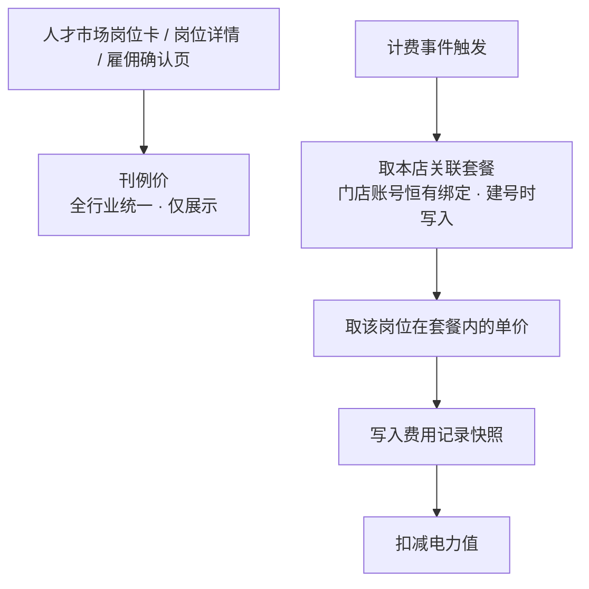
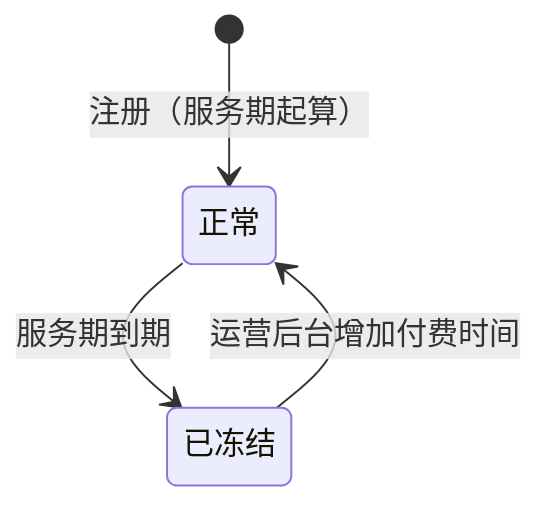

# AI数班 V1.4 · 计费规则 PRD

> 版本：V1.4（当前 V1.4.0）
> 更新日期：2026-10-12
> 状态：设计已定稿，待评审
> 适用范围：全行业数字员工计费、电力账户、充值与运营后台

---

## 一、概述

### 1.1 定位

本文档定义 AI数班全行业数字员工的**计费规则、电力账户体系、充值路径与运营后台价格配置能力**。计费规则是横跨人才市场、数字办公室、实时工作、成果中心与运营后台的公共能力，不归属单一数字员工。

本文档不重复定义各数字员工的业务能力与工作流程，相关口径见对应岗位 PRD（主号/副号获客专家、客服专员见 PRD-v1.0；矩阵视频发布专员见 PRD-v1.3）。

### 1.2 本期目标

- 建立**全行业统一的刊例价**，作为人才市场对外展示的唯一价格口径。
- 建立**套餐包**体系：套餐包统一承载四个岗位的实际消耗单价与月最低消耗，由运营后台提前预置，是商务差异化定价的唯一载体。
- 建立**门店关联套餐**的单源落位：计费事件触发时取该门店**当前关联的套餐**（整包取用），以此决定本店数字员工的实际消耗。门店账号**恒有关联套餐**——新建门店时由系统把所属行业的**行业默认套餐**写为初始关联，此后只能改选、不能置空。**套餐包按行业归属、归属唯一**（一个套餐只属一个行业，一个行业可有多个套餐），行业默认套餐由运营在该行业的套餐包内**指定一个**、只作用于新建门店的初始关联，门店改选时也只能选择本行业的套餐包。
- 为**主号、副号获客专家**引入**基础结算 / 高级结算**两种结算方式，高级结算直接沿用系统原有获客结算配置。
- 建立**月度最低消耗**机制，防止客户占用 RPA / 云电脑资源闲置。
- 建立**电力账户**体系，支持负余额运行、服务期冻结与解冻。
- 充值能力收敛到**运营后台**，全部走线下，用户端只读。
- 改造人才市场、雇佣流程与消耗明细：**展示层只出刊例价，计费层走门店的生效套餐（＝ 门店关联套餐）**，两层解耦。

### 1.3 与既有版本的关系

| 既有文档 | 关系 |
|---|---|
| PRD-v1.0 | 客服专员计费（§6.4）与线上充值（§7.11.2 / §7.11.2.1）由本文档接管；雇佣依赖中的余额阻断项以本文档 §5.2 / §7 的口径为准。其余内容继续有效。 |
| PRD-v1.1 | 电力值告警（§5.3）取消，v1.4 不设告警通知；电力值有效期（§5.4）的起点与到期处理以本文档为准。 |
| PRD-v1.3 | 矩阵视频发布专员（原"短视频运营专员"）的按次发布计费口径延续；电力值换算比例、余额与雇佣依赖、人才市场展示口径以本文档为准。 |

> **PRD-v1.0 为只读文档**，本文档只引用其口径与行号，不修改其内容。本文档第十章列出需要在 v1.0 / v1.1 / v1.3 上执行的改写项，作为独立动作排期。

### 1.4 版本规划

| 版本 | 交付能力 |
|------|----------|
| 本期 V1.4 | 套餐包价格体系（刊例价 + 行业默认套餐 + 门店关联套餐 + 快照）、四岗位计费（含获客专家基础/高级结算）、月度最低消耗、电力账户与负余额规则、冻结解冻、运营后台充值与套餐包配置、人才市场与消耗明细改造 |
| 后续版本 | 套餐（季卡/年卡）、自动开票与线上打款、对公账户对接 |

---

## 二、计费与账务模型

### 2.1 两个独立维度

AI数班的计费由**两个互相独立的维度**组成，两者解耦、互不换算：

```
电力值（消耗维度）              服务期（时间维度）
  充值获得                        注册日 + 365 天
  消耗扣减                        运营后台增减天数
  可为负、无下限                  到期冻结账户
  冻结时保留、不归零              阻断产品使用流程
```

- **电力值**回答"客户用了多少"，按业务结果或按次扣减，余额不足时照常扣减、可为负。
- **服务期**回答"客户能用到什么时候"，是时间维度的卡点，防止客户占用资源闲置。
- **充值不等于续期**：充值只增加电力值，不延长服务期；延长服务期只在运营后台单独操作。运营后台支持在一次线下合同录入中同时完成两个动作。

### 2.2 价格体系

**展示价与计费价是两条独立的链路**：人才市场对外展示的是全行业统一的**刊例价**，实际扣费走**套餐包**——门店账号关联的套餐决定本店四个岗位的实际消耗单价与月最低消耗。两者可能不一致，这是商务差异化定价的前提。



| 层级 | 名称 | 配置位置 | 是否参与计费 |
|------|------|----------|--------------|
| — | **刊例价** | 平台内置常量，运营后台只读 | **否**，仅对外展示，不参与任何计费 |
| 1 | **行业默认套餐** | 运营后台 · 套餐包管理 → 列表行【设为默认】 | **否**，只决定本行业**新建门店**建号时写入哪个套餐，不参与已建门店计费 |
| 2 | **门店关联套餐** | 运营后台 · 账号管理 →【员工消耗套餐包】 | 是，**唯一的计费依据**；门店账号恒有绑定，**整包生效** |
| 3 | 费用快照 | 系统自动写入 | 计费发生时写死实际生效值，**永不回溯** |

**取值规则**

- **取值只有一个来源：门店关联套餐**：计费事件触发时取该门店**当前关联的套餐**（整包取用，不做逐岗位混合）；门店账号**恒有绑定**，不存在"未关联 → 跟随行业默认套餐"的分支。
- **门店关联套餐就是本店生效套餐**：门店建号时由系统按本行业的默认套餐写入初始关联，此后由运营在【员工消耗套餐包】改选（见 §2.5）。
- **套餐包的行业归属是唯一的**：一个套餐包**有且仅有一个所属行业**（新增 / 编辑时选择、必填），**一个行业可以有多个套餐包**；行业与套餐包是**一对多**关系。行业默认套餐只能从本行业的套餐包中指定（见 §2.4）。
- **门店只能关联本行业的套餐包**：门店的所属行业决定了可选项，其他行业的套餐包**不出现在**关联列表里（见 §2.5）。
- **计费价恒取自门店关联套餐**：套餐内的五个计价项与月最低消耗都是**必配项**，留空则套餐包不予保存（见 §9.3）；门店账号恒有关联套餐。因此任何一笔计费都能取到套餐内的实际单价，刊例价只做对外展示。
- **前台展示恒为刊例价**：客户在人才市场岗位卡、岗位详情、雇佣确认页看到的单价是全行业统一的刊例价，与实际计费价可能不一致；**这三个页面不展示月最低消耗**（见第七章）。
- 套餐内的岗位单价是**绝对值**，不是差额。商务谈定"该客户主号 30 电力/条"即在套餐内填 30，直观且可核对。
- 套餐改价**即时生效、就地覆盖**，只影响改价之后发生的计费；已写入的费用记录保留原单价快照（见 §9.3）。
- **月最低消耗与岗位单价走同一条链路**：低消同样取门店**关联套餐**的月最低消耗，不另立取值层。门店恒有关联套餐，因此**每个账户都有月最低消耗**，不存在"无低消账户"（见 §4.2）。
- **结算方式不在这条链路里**：基础结算 / 高级结算是**平台账号（抖音账号）级**的配置，与套餐包无关——高级结算开启并配置后优先，该账号的套餐单价不参与计费（见 §3.2）。

### 2.3 刊例价（对外展示价）

刊例价是平台对外报价口径，**全行业统一，不参与计费**。

| 岗位 | 刊例价 | 计费方式 |
|------|--------|----------|
| 主号获客专家 | 50 电力 / 有效线索 | 按有效线索 |
| 副号获客专家 | 50 电力 / 条 | 按有效线索 |
| 客服专员 | 10 电力 / 转化线索 | 按转化线索 |
| 矩阵视频发布专员 | 2 电力 / 次发布 | 按次发布 |

- **不随行业变化**：四个行业在人才市场看到的岗位卡单价完全相同。
- 刊例价为平台内置常量，运营后台**只读展示、不提供修改入口**；调整刊例价需走版本发布。
- 人才市场岗位卡、岗位详情、雇佣确认页只展示刊例价；**不展示月最低消耗、不展示行业或门店的实际计费价**。
- 刊例价**不包含月最低消耗**——月低消属于套餐包，不在对外展示口径内（见 §2.4）。
- 刊例价**不参与计费**：计费始终走门店的生效套餐（见 §2.2），刊例价只在人才市场对外展示。
- **客服专员的刊例价不随转化类型分档**：客服专员的转化线索在实际计费中分「自然转化线索 / AI转化线索」两档、两档单价不同（见 §3.4.1），但对外只报**一个**刊例价（10 电力 / 转化线索）——不拆档展示、不展示两档价差。

### 2.4 行业默认套餐

行业默认套餐是**新建门店账号时的初始关联值**：**每个行业恰好指定一个默认套餐**，由系统预置，**不存在没有默认套餐的行业**。门店账号**恒关联一个套餐包、不存在"未关联"态**，所以行业默认套餐**不参与已建门店的计费**——它只决定"这个行业新开的店默认用哪个套餐包"。

| 配置项 | 说明 |
|--------|------|
| 行业 | 二手车 / 新车 / 家居 / 房地产，四个行业各自独立 |
| 默认套餐 | 从**本行业的套餐包**中指定一个；**系统预置**，运营可在【套餐包管理】的列表行上点【设为默认】改选，但**每个行业必须有一个**，不允许置空 |
| 生效范围 | **本行业新建的门店账号**（建号时写入为该店的关联套餐）；**已建门店不跟随** |

- **套餐包按行业归属、归属唯一**：一个套餐包**有且仅有一个所属行业**（新增 / 编辑套餐包时选择、必填），**一个行业可以拥有多个套餐包**；行业与套餐包是**一对多**关系。
- **默认套餐从本行业的套餐包里挑**：本层不新建套餐、不配置数值，只做"用本行业的哪一个套餐包作为默认"的选择；数值统一在套餐包里维护（见 §9.3）。
- **入口是【套餐包管理】列表行的【设为默认】**：列表的「行业默认」列标出该行业的当前默认套餐；对某个套餐点【设为默认】，即把**它所属的那个行业**的默认位改挂到它（见 §9.3）。
- **系统预置、不允许为空**：系统初始化时为四个行业各预置一个默认套餐包；新增行业时须先在该行业下建一个套餐包并指定为默认。运营能改的只有"换成哪一个套餐包"，不能把某个行业置为没有默认套餐。
- **改选只影响新建门店**：切换后，本行业**新建**的门店账号默认关联新套餐；**已建门店各按本店关联套餐计费，完全不受影响**（见 §2.5）。
- **新建门店账号按本行业默认套餐自动关联**：创建门店账号时，若行业为 XX，系统直接把该行业的默认套餐写为该门店的**关联套餐**。这是建号时的**一次性写入**——此后该行业改选默认套餐，这家门店**不跟随变化**；需要跟随时由运营在【员工消耗套餐包】里**改选那个新默认套餐**（见 §9.4）。
- **门店关联套餐就是本店生效套餐**：门店恒有绑定（建号即写入），套餐整包生效、不按岗位回看行业值（见 §2.5）。因此行业默认套餐**只出现在建号那一刻**，不在计费链路上。
- **数值只在套餐包里维护**：本层只做"用哪一个套餐包作默认"的选择，不单独配置单价或月低消；调整数值请编辑套餐包（见 §9.3）。
- **套餐包内的五个计价项与月最低消耗都是必配项**：留空则套餐包不予保存，行业默认套餐同样如此（见 §9.3）。能被设为默认或关联门店的套餐，其全部计价项必然配齐。
- **月最低消耗是套餐包的必配项**：不存在"套餐没有月低消"的情况；门店恒有关联套餐，因此**每个账户都有月最低消耗**（见 §4.2）。

> 二手车 / 新车 / 家居 / 房地产四个行业各预置一个默认套餐，由系统在建库时写入；**套餐名称、所属行业、五个计价项单价与月最低消耗**在【套餐包管理】内确认与调整，录入即生效、无需发版。预置包的五个计价项按刊例价建包（主号 50 / 副号 50 / 客服自然档 10 / 客服 AI 档 10 / 矩阵 2 电力），月最低消耗随套餐包一并提供，不设平台默认值。改选默认套餐的入口是套餐包列表行的【设为默认】，候选范围**限本行业的套餐包**。

### 2.5 员工消耗套餐包

门店账号**恒关联一个套餐包**（不存在"未关联"态），由它决定本店四个数字员工的实际消耗单价与月最低消耗。套餐包**整包生效**——四个岗位一起按该套餐取值，不提供逐岗位改价。

**入口**：运营后台 → 账号管理 → 选中门店账号 → 菜单【员工消耗套餐包】。

| 配置项 | 说明 |
|--------|------|
| 门店账号 | 付费主体，关联关系按此粒度生效 |
| 关联套餐 | 从【套餐包管理】已建的**本行业**套餐中选择一个（其他行业的套餐包不出现在下拉里）；**必选、下拉里没有"未关联"这一项**，保存后本店生效套餐即为此套餐 |
| 本店生效单价 | 按四个岗位列出关联后的实际消耗单价，只读展示，供商务核对 |
| 本店月最低消耗 | 取关联套餐的月最低消耗，只读展示 |

- **只能关联本行业的套餐包**：门店所属行业决定了可选项，**其他行业的套餐包不出现在关联列表里**；要改用其他行业的套餐，须先调整套餐包的所属行业（该套餐没有任何门店关联、也不是本行业默认套餐时才允许改，见 §9.3）。
- **新建门店账号时系统自动关联本行业的默认套餐**：建号后本店的关联套餐即写为该行业当时的默认套餐；此后行业改选默认套餐，**这家门店不跟随变化**，需要跟随时在本页改选那个新默认套餐（见 §2.4）。
- **整包生效**：四个岗位全部按关联套餐取值，套餐内五个计价项均为必配项（见 §9.3）。
- **改价在【套餐包管理】里做**：本页只做"关联哪一个套餐"的选择，不承载任何数值配置。调整单价或月低消请编辑套餐包（见 §9.3），保存后立即生效——已关联本套餐的门店改按新价计费。
- 改选**即时生效**，只影响操作之后发生的计费；已写入的费用记录保留原单价快照，不受影响。
- 关联关系本身不保留变更历史；系统自动记录每次变更的操作人与时间，供事后核对。
- **月最低消耗随关联套餐取值**，与岗位单价走同一条链路（见 §4.2）。门店恒有关联套餐，因此本店**始终有生效套餐与月最低消耗**。
- **结算方式不在此配置**：基础结算 / 高级结算是平台账号（抖音账号）级的配置，见 §3.2。
- 与充值返电力的分工：

| 机制 | 作用侧 | 适用场景 |
|------|--------|----------|
| 门店关联套餐 | 消耗侧（改消耗单价与月低消） | 长期协议价，商务谈定的客户级价格 |
| 充值返电力 | 充值侧（到账 > 实收） | 一次性让利、活动、补偿 |

- 两者可叠加：同一门店可以既有协议价（关联套餐）、又拿到充值返电力，系统不做互斥校验。
- 关联套餐**不影响人才市场展示**：客户在人才市场始终看到刊例价。

### 2.6 费用记录

费用记录是全部扣费的唯一凭证，业务消耗与低消补差共用同一张表；与充值记录（见 §2.7）构成账户的**两本账**。低消补差在费用记录中统一以「**31天最低消耗补扣**」的名称对外展示（见 §4.3）。

| 记录项 | 说明 |
|--------|------|
| 费用记录标识 | 每条费用记录的唯一编号 |
| 费用类型 | 业务消耗 / 31天最低消耗补扣 |
| 门店账号 | 付费主体 |
| 数字员工 | 产生该笔费用的数字员工（低消补差为空） |
| 岗位 | 该数字员工所属岗位（低消补差为空） |
| 行业 | 该门店账号所属行业 |
| 抖音账号 | 产生该笔费用的账号（低消补差为空） |
| 计费对象 | 该笔费用对应的业务对象：线索 / 转化线索 / 作品（低消补差为空） |
| 计费方式快照 | 计费方式：按有效线索 / 按转化线索 / 按次发布 |
| 转化类型快照 | **仅客服专员有值**：自然转化线索 / AI转化线索（见 §3.4.1）；其他岗位与低消补差为空 |
| 结算方式快照 | 基础结算 / 高级结算（仅主号、副号获客专家有值） |
| 取价来源快照 | 本次计费的取价链路：门店关联套餐 / 高级结算配置 |
| 单价快照 | 实际生效单价，单位电力值 |
| 扣减电力值 | 以负数展示 |
| 扣费时间 | 该笔费用的实际扣减时间 |
| 扣费备注 | 见 §8.2 固定枚举 |

- **同一业务对象只产生一条费用记录**：同一条线索、同一个留资结果、同一次作品发布，重复回收到业务结果时**不重复扣费**。
- **低消补差一个周期只产生一条**：同一门店账号在同一低消周期内只生成一条补差记录，重复执行周期结算不重复扣费。
- **单价快照**：费用记录写入时固化当时的实际生效单价与取价来源，后续套餐包或刊例价变更均不影响历史记录。
- **单价快照不对外展示**：客户侧消耗明细只展示扣减电力值，不展示单价列与取价来源，避免暴露行业/门店差异化定价（见第八章）。
- 费用记录不可由前端删除或修改；退款、冲正等状态由账务结果更新并保留原始记录。

### 2.7 充值记录

充值记录是全部充值的唯一凭证。与费用记录构成账户的**两本账**：**费用记录记出账，充值记录记入账**。

| 记录项 | 说明 |
|--------|------|
| 充值记录标识 | 每条充值记录的唯一编号 |
| 门店账号 | 充值的付费主体 |
| 到账电力值 | 本次到账的电力值 |
| 充值类型 | 本次入账的性质：**付费充值 / 试用充值 / 赠送 / 延期付费**，在 VIP 编辑里选定（见 §9.1）。**负数调整不是充值，本项记「—」**。除「赠送」外的三类触发低消周期重新起算（见 §4.1） |
| 充值前可用电力值 | 本次充值前的账户可用电力值，**可为负** |
| 充值后可用电力值 | 本次充值后的账户可用电力值 |
| 到账时间 | 电力值实际生效的时间。**由系统在保存时记录**，运营不填 |
| 登记时间 | 运营提交的时间。**由系统在保存时记录**，与到账时间同源 |
| 操作人 | 执行本次电力值调整的运营人员，系统自动记录 |
| 备注 | 本次充值的说明，**按固定规则自动生成**，见下表 |

**备注的固定生成规则**

| 本次调整 | 备注 |
|----------|------|
| 增加电力值，未抵扣负值 | **补充电力值** |
| 增加电力值，且其中有部分用于抵扣账户负值 | **补充电力值，抵扣 N 电力值**（N 为本次抵扣掉的负值，如"补充电力值，抵扣1000电力值"） |
| 减少电力值（VIP 编辑的负数调整） | **VIP 调整，扣减电力值** |

- 减少电力值的调整**不产生"抵扣"**：抵扣是"入账电力值先还负值"的动作，只在**增加**电力值时才可能出现。账户余额为负时再做负数调整，是让负值变得更深，备注只写扣减。

- **充值记录回答"谁在什么时候充了多少电力值"**，**两侧都可见，但列口径不同**：
  - **客户侧**：电力账户页的「充值记录」视图，展示**到账时间 / 到账电力值 / 充值类型 / 备注**四列，只读，供客户自行核对"到了多少"（见 §6.4）。
  - **运营后台**：展示完整记录项（含操作人），可按门店账号查询与导出，用于向客户对账（见 §9.1 / §9.5）。
- **两本账互不混用**：账户可用电力值 = 全部充值记录的到账电力值合计 − 全部费用记录的扣减电力值合计。
- **VIP 编辑中的电力值调整同样生成充值记录**：电力值调整的唯一入口是 VIP 编辑（见 §9.1），调整即入账。记录标识带 **VIP 标识**，便于与历史充值记录区分。
- **首次充值到账日决定低消周期起点**：门店账号的**第一条**充值记录决定低消周期起点——**到账当天不计入周期**，周期的第 1 天是到账日的**次日**（见 §4.1）。此后周期的重新起算**由触发重置的充值**驱动（见 §4.1）。
- **到账即抵扣负值**：到账电力值先抵扣账户负值，剩余部分计入可用余额。抵扣金额**不单独设列**，而是写入备注（见上表），客户在充值记录里即可看出本次有多少用于还负值（见 §5.2）。
- **充值记录不可删除、不可修改**：错误登记由运营在后台发起冲正处理，原记录保留不删除。
- 充值记录**不修改刊例价与套餐包**：充值只增加电力值，不影响任何费用记录的单价快照。

---

## 三、各岗位计费规则

### 3.1 计费口径总表

| 岗位 | 计费方式 | 结算方式 | 刊例价（展示） | 计费时点 |
|------|----------|----------|----------------|----------|
| 主号获客专家 | 按有效线索 | **基础结算 / 高级结算**（可配） | 50 电力/有效线索 | 线索判定为"有效线索"时 |
| 副号获客专家 | 按有效线索 | **基础结算 / 高级结算**（可配） | 50 电力/条 | 同上（副号口径） |
| 客服专员 | 按转化线索（**分自然 / AI 两档**，见 §3.4.1） | 基础结算（固定） | 10 电力/转化线索（不分档） | 转化线索（留资结果）产生时 |
| 矩阵视频发布专员 | 按次发布 | 基础结算（固定） | 2 电力/次发布 | 作品发布完成时 |

- 表中单价为**对外展示的刊例价**（全行业统一），**不是实际计费价**。
- 实际扣费单价按**本店关联套餐**取值（门店恒有绑定，见 §2.5）；套餐包数值由运营后台维护，本 PRD 不预设。
- 电力值与现金的换算比例为 **1:1**。
- **同一业务对象只计费一次**：同一条线索、同一个留资结果、同一次作品发布，重复回收到业务结果时**不重复扣费**；**唯一例外**是客服专员的转化线索——留资满 90 天后该用户再次留资的可按新档位再度计费一次（见 §3.4.2）。

### 3.2 主号获客专家

主号获客专家支持**两种结算方式**，同一个平台账号在同一时间只用其中一种。结算方式配置在**平台账号（抖音账号）**上——基础结算是默认态、按套餐包的岗位单价计费；高级结算需要在该账号上单独开启并配置，**开启后优先，该账号的套餐单价不参与计费**。

#### 3.2.1 基础结算

- **计费单位**：一条有效线索计 1 次。
- **有效线索口径**：沿用 PRD-v1.0 §8.2——近 7 天内被主号获客专家触达且已留资的线索。
- **触发时点**：线索满足有效线索条件时即时扣费，扣费时间等于判定时间。
- **不回溯**：线索判定为有效后即计费，后续不再因线索状态变化回滚或冲正。
- **不计费**：未触达、未留资、被判定为无效的线索不产生费用。
- **单价取值**：取门店**本店关联套餐**的主号获客专家单价（见 §2.2）；门店恒有绑定、套餐内单价为必配项，因此**不会回落刊例价**。

#### 3.2.2 高级结算

- **结算口径**：**同系统原有获客结算配置**。高级结算的结算规则、触发条件与单价全部沿用系统既有的获客结算配置，本 PRD 不重新定义、不改写该配置的内容。
- **本 PRD 的范围**：只定义「结算方式」这一配置开关（取值为高级结算时）的落位、覆盖与快照规则。结算方式置为高级结算后，计费由原有获客结算配置接管。
- **配置位置**：**平台账号（抖音账号）**的「结算方式」配置项，与套餐包无关；开启高级结算时需一并配置该账号的高级结算参数。
- **实际消耗单价不生效**：结算方式为高级结算时，套餐包内的岗位单价不参与计费，实际单价由原有获客结算配置决定。
- **关闭高级结算即回落套餐价**：关掉该账号的高级结算并清空其配置后，该账号恢复基础结算、按套餐链路取价。
- **费用记录**：仍写入统一费用记录，结算方式快照为"高级结算"，取价来源快照为"高级结算配置"，扣减电力值取原有获客结算配置的实际扣减结果。
- **月最低消耗**：仍按账户级 31 天周期执行，与结算方式无关（见第四章）。
- **不重复计费**：沿用原有获客结算配置的去重口径；接入时需确认与本 PRD"同一业务对象只计费一次"的规则一致，避免同一笔线索被两套规则重复计费，见第十二章待确认事项。

### 3.3 副号获客专家

- 计费单位、口径、触发规则与结算方式**同主号获客专家**（含 §3.2.1 基础结算与 §3.2.2 高级结算），按副号获客专家的触达与留资记录独立统计。
- 主号与副号的有效线索**分别统计、分别计费**，同一线索若同时满足两个岗位的口径，按各自岗位分别产生费用记录。
- 主号与副号的结算方式**按平台账号分别配置**：同一门店下，主号账号可用基础结算、副号账号可用高级结算，互不影响。

### 3.4 客服专员

> 客服专员按**转化线索**计费；PRD-v1.0 §6.4「按日扣费规则」的改写项见 §10.1。

- **计费单位**：一条转化线索计 1 次。
- **转化线索口径**：客服专员接待的会话产生留资结果，即计 1 条转化线索。
- **触发时点**：留资结果产生时即时扣费。
- **功能开关不参与计费**：功能开关只控制接待能力。
- **未授权时不计费**：平台账号未授权或授权失效时进入"待处理"、无法实际接待，因此不产生费用。

#### 3.4.1 转化线索分两档

转化线索按 **AI 是否参与承接**分两档，两档在套餐包内是**两个独立的计价项**、各自配价。

| 档位 | 判定 | 含义 |
|------|------|------|
| 自然转化线索 | 会话**全程无 AI 回复** | 客户上来直接留手机号，未经 AI 任何承接 |
| AI转化线索 | 会话里 **AI 有回复** | AI 参与了承接与转化 |

- **判定只看 AI 有没有回复**：会话里 AI 回复过**至少一次**即判 AI转化线索；全程没有 AI 回复判自然转化线索。不按回复条数、不按是否由 AI 促成留资加权。
- **为什么分档**：自然转化线索没有消耗 AI 的承接能力，按同一价格收费不合理；AI转化线索有 AI 参与承接，可以定得更高一档。
- **单价两档分开配置**：两档单价都在套餐包内配（见 §9.3），与其他岗位单价一样是**必配项**，留空即不予保存；系统内不存在"只配了一档"的套餐。
- **刊例价不分档**：人才市场的对外展示价仍是**一个**数（10 电力 / 转化线索），不展示两档价差（见 §2.3）。
- **费用记录留痕**：每条客服专员的费用记录写入**转化类型快照**（自然转化线索 / AI转化线索），单价快照据此确定（见 §2.6）。
- **扣费备注分档**：消耗明细的扣费备注相应拆为「自然转化线索计费」「AI转化线索计费」两条枚举（见 §8.2）。
- **客户侧展示转化类型**：客服专员的消耗明细在公共列之后追加「线索转化类型」列（见 §8.2）。

#### 3.4.2 同一用户 90 天后再次留资可再度计费

- **口径**：同一条线索**留资满 90 天**后线索状态更新，该用户**再次留资**时重新判定转化线索档位，并按新档位单价**再度计费一次**。
- **沿用系统原有 CPQL 口径**：90 天窗口与线索状态更新的判定**沿用系统既有 CPQL 规则**，本 PRD 不另立阈值、不重新定义窗口起点与判定条件。
- **只作用于客服专员**：该规则**仅适用于客服专员的转化线索**；主号、副号获客专家的有效线索与矩阵视频发布专员的按次发布均不适用，"同一业务对象只计费一次"的口径不变（见 §3.1）。
- **两档可互换**：同一用户的两次计费各自独立判定档位——首次判为 AI转化线索、90 天后这次全程无 AI 回复即为自然转化线索，反之亦然。

### 3.5 矩阵视频发布专员

> 矩阵视频发布专员按**发布结果**计费；价格取值走门店关联套餐、前台展示刊例价（见 §2.2）。PRD-v1.3 §2.5 的改写项见 §10.3。

- **计费单位**：一次发布 = **一个账号成功发布一条作品**。n 个账号发布同一个作品计 n 次，一个账号发布 m 条作品计 m 次。
- **计费依据**：作品的**发布结果**；作品状态变为"发布完成"即产生一次费用。
- **触发时点**：作品发布完成时**即时扣减**，扣费时间等于该作品的发布完成时间。
- **不计费**：待发布、发布中、发布失败、取消发布四种状态均不产生费用；发布失败后单条重试成功的，按一次发布计费。
- **停止计费**：账号在 Agent 设置中关闭、或员工解雇后，不再参与新的发布任务。

---

## 四、月度最低消耗

### 4.1 周期规则

- **周期长度**：31 天。**到账当天不计入周期**——**起算日是到账日的次日**，末日（第 31 天）运行到 23:59:59 结束，**等价于「到账日 + 32 天」的 00:00 结束**。
  - 例：08-27 到账 → 08-28 00:00 起算第 1 天，末日 09-27 运行到 23:59:59，即 09-28 00:00 结束。
  - 因此**周期起始日 = 到账日 + 1 天**、**周期结束日 = 到账日 + 31 天**（当日 23:59:59），周期结束的瞬间即结算时点（见 §4.2）。
- **周期起点**：**首次充值到账日的次日**。首次充值到账后，次日 00:00 起算第 1 个周期。
- **周期重新起算只有一条触发路径**：VIP 编辑里选定**三类续约型充值类型**（付费充值 / 试用充值 / 延期付费，见 §9.1）。改套餐、解冻、选「赠送」都不在这条路径上，周期照原样继续。
- **未充值不进入周期**：注册后从未充值的账户不进入低消周期，不产生低消欠款。
- **结算粒度**：**账户级**（付费主体）。周期内全账户所有数字员工的业务消耗合计，与低消比较。
- **与员工无关**：低消与员工数量、是否有人服务**完全无关**——只要账户处于低消周期内，周期末无条件扣满低消，哪怕周期内没有任何员工处于服务中。
- **周期信息对客户与运营双向可见**：**客户产品页面与运营后台都必须展示**本周期起始日、剩余天数与本周期已消耗电力值——运营侧用于向客户解释周期末补差金额的构成，客户侧用于判断"周期还剩多久、消耗到哪了"。
  - **客户产品页面**：展示在电力账户页的低消卡片内，含**周期起始日、周期结束日与剩余天数**（口径见 §6.4）。
  - **运营后台**：展示在门店账号详情页（口径见 §9.2）。
- **冻结期间周期暂停**：账户冻结期间周期停止推进——冻结时长不计入周期，期间不结算、不产生补差记录。解冻后周期从暂停处继续：**起始日与已消耗电力值原样保留，剩余天数照旧，结束日相应后移**。
- **解冻不重新起算周期**：解冻把账户状态恢复为"正常"，周期接着暂停前的进度走完；重新起算 31 天只由**三类续约型充值**（付费充值 / 试用充值 / 延期付费）驱动。实务上解冻与充值多半是同一个动作——VIP 编辑的充值类型默认就是「**付费充值**」，保存即在解冻的同时重新起算 31 天；要只解冻、不动周期，把充值类型切到「**赠送**」（见 §5.3、§9.1）。

### 4.2 结算规则

- **结算时点**：每个周期**结束的瞬间**执行结算——按 §4.1 的计日口径就是**到账日 + 32 天**的 00:00，也就是**末日的最后一刻**。两个说法是同一个瞬间，账本里落库的时间戳用**末日 23:59:59**（与「末日运行到 23:59:59」同一口径）。
- **补差金额**：`月低消 − 周期内实际消耗合计`。
  - 周期内实际消耗合计 ≥ 月低消 → 不产生补差记录。
  - 周期内实际消耗合计 < 月低消 → 生成一条补差记录，扣减差额。
- **低消金额取值**：取该门店**本店关联套餐**的月最低消耗（门店恒有绑定，见 §2.5）。月最低消耗是**套餐包的必配项**，由运营建套餐时一并提供，**不回落刊例价**（刊例价不含低消，见 §2.3），也不设平台默认值；**每个账户都有月最低消耗**，不存在无低消的账户。
- **低消与岗位单价同源**：月最低消耗随套餐包一并确定，唯一入口是【套餐包管理】；本店月最低消耗恒取关联套餐的值。
- **低消按周期结算时点取值**：低消是账户级参数、周期内消耗是累计值，无法像单价那样按变更时点切分"改价只影响之后发生的计费"。补差金额一律按**周期结算时点**的生效套餐月最低消耗计算，不追溯周期内的配置变更历史。
- **补差照常扣减**：余额不足时补差记录照常写入、照常扣减，余额随之转为负数——补差与在途业务同属"已经发生的消耗"，一律照常结算（见 §5.2）。
- **冻结时暂停结算**：账户处于冻结状态时暂停低消结算，周期同时停止推进（见第五章）。

### 4.3 记录规则

- 一个门店账号在**一个周期内只生成一条**低消补差记录；重复执行周期结算**不重复扣费**。
- 补差记录写入费用记录，费用类型为"**31天最低消耗补扣**"，扣减电力值为负数，扣费备注固定为"31天最低消耗补扣"。名称中带"31天"是为了让客户在消耗明细里直接看出这是一次 31 天周期的低消结算，而不是一笔业务消耗。
- 补差记录不关联抖音账号与计费对象，两列均为空。
- 周期结算后，周期内消耗计数归零，开始下一个 31 天周期。

### 4.4 验收标准

1. 周期长度为 31 天，**到账当天不计入**：08-27 到账的周期从 08-28 00:00 起算，末日 09-27 运行到 23:59:59（等价于 09-28 00:00）结束；周期起始日 = 到账日 + 1 天、周期结束日 = 到账日 + 31 天。结算在周期结束的瞬间执行，账本时间戳记 **09-27 23:59:59**。
2. 从未充值的账户不进入低消周期，不产生任何低消补差记录。
3. 周期内全账户业务消耗合计 ≥ 月低消时，周期末不产生补差记录。
4. 周期内业务消耗合计 < 月低消时，周期末生成一条补差记录，扣减金额等于差额。
5. 周期内没有任何员工处于服务中时，周期末**仍然**生成补差记录，扣满月低消。
6. 一个门店账号在一个周期内只生成一条补差记录，重复执行结算任务不重复扣费。
7. 补差金额取该门店账号**本店关联套餐**的月最低消耗；不涉及刊例价。门店恒有关联套餐、套餐包月低消为必配项，因此**不存在不设低消的账户**。
8. 月最低消耗为**套餐包的必配项**、由运营随套餐一并配置；不设平台默认值，也不回落刊例价。
9. 补差记录写入时余额不足，记录照常生成，账户余额可为负。
10. 账户处于冻结状态时暂停低消结算，周期停止推进、冻结时长不计入周期；解冻后周期从暂停处继续，起始日与已消耗电力值原样保留、结束日相应后移。
11. 客户产品页面与运营后台都展示本周期起始日、剩余天数与本周期已消耗电力值，客户侧的低消卡片底部另展示周期结束日；客户侧同时以进度条展示本周期已消耗电力值相对本期最低消耗的完成情况。两处"本周期已消耗电力值"与"本期最低消耗"数值一致。
12. 服务期到期冻结后解冻的账户，低消周期从暂停处继续——起始日与已消耗电力值保持解冻前的值、结束日相应后移冻结时长。
13. 结算方式为高级结算的岗位，其业务消耗照常计入周期内消耗合计，低消补差规则不变。

---

## 五、电力账户

### 5.1 账户结构

| 账户项 | 说明 |
|--------|------|
| 门店账号 | 付费主体 |
| 行业 | 建号时决定写入哪一套行业默认套餐作为初始关联；建号后可关联的套餐包范围限本行业 |
| 可用电力值 | 账户当前可用电力值，**可为负**——负数是**合法中间态**（T+1 结算的产物）（见 §5.2） |
| 余额为负 | 由「可用电力值 < 0」**派生**出的条件（账户状态字段仍是"正常"）：为真时打断新业务的发起，并在客户侧弹阻断弹窗（见 §5.2 / §5.3） |
| 冻结电力值 | 服务期到期后冻结的电力值，保留不归零 |
| 服务期截止日 | 注册日 + 365 天 |
| 状态 | 正常 / 已冻结。**只由服务期决定**，与余额正负无关 |
| 付费状态 | **试用 / 付费**，默认"试用"。账户性质的标记，与 §5.3 的"状态（正常 / 已冻结）"是两个独立字段；在 VIP 编辑里切换（见 §9.1） |
| 本周期起始日 | 当前低消周期的起始日 |
| 本周期已消耗电力值 | 当前周期内累计消耗电力值 |
| 首次充值到账日 | 决定低消周期起点 |

### 5.2 负余额规则

- 电力值与现金的换算比例为 **1:1**。
- **余额可为负，负数是合法中间态**：业务消耗与低消补差在余额不足时照常扣减，余额无下限，系统不产生"扣费失败"一类的异常态。
  - **负数为什么是常态**：获客专家等岗位为 **T+1 结算**——业务当天发生、次日才写入费用记录。因此"此刻的余额"与"此刻已发生但尚未结算的业务"本就不同步，余额在结算落下前短暂为负属正常。
- **余额为负 → 拒绝一切新的计费动作**：账户余额为负时，**发起新业务的动作全部被拒绝**——新雇佣数字员工、下发新任务、发布新作品、开启新的会话承接，一律不能发起（见 §5.3 弹窗与 §7 雇佣依赖）。
- **在途业务照常结算**：已经发起、尚未结算的在途业务**照常跑完并按 T+1 写入费用记录、照常扣减**，余额因此**可以继续变负**。停的是**发起**、不停**收尾**——这正是负数必须作为合法中间态的原因：否则在途业务结算时无处落下。
- **充值先抵扣负值**：再次充值时，到账电力值先抵扣账户负值，抵扣后的剩余部分才计入可用余额。
  - 例：账户余额 −300，充值到账 1000，抵扣后可用余额为 700。
- **余额为负不动账户状态**：账户状态字段仍是"正常"，账户照常可用、无需运营解冻；被拦下的只有客户侧新业务的发起，运营侧登记充值、配置套餐等操作照常进行。

### 5.3 冻结、解冻与阻断弹窗



| 环节 | 规则 |
|------|------|
| 服务期起算 | **注册日**，无论是否充值 |
| 默认服务期 | 注册日 + 365 天 |
| 调整方式 | 运营后台按**任意天数**增加或减少服务期截止日 |
| 冻结触发 | 当前时间到达服务期截止日 |
| 冻结动作 | ① 账户状态置为"已冻结"；② **电力值冻结（余额保留，不归零）**；③ **暂停低消结算** |
| 界面表现 | **阻断式弹窗**，直接中断客户使用产品的流程，引导客户联系运营进行服务期续费（见下「阻断弹窗」） |
| 解冻方式 | 运营后台**增加付费时间**后自动解冻 |
| 解冻后处理 | **只解冻**：周期从暂停处继续（起始日与已消耗电力值原样保留、结束日相应后移），余额的正负同样原样保留 |
| 余额处理 | 冻结前产生的负值**保留**，解冻后通过充值抵扣 |

- 冻结期间不产生新的业务消耗，也不产生新的低消补差。
- 冻结前已经生成的费用记录保持原样，不因冻结而修改或冲销。
- 冻结与解冻动作需记录操作人、操作时间、变更前后的服务期截止日。
- **解冻不重新起算周期**：周期的重新起算只发生在**三类续约型充值**（付费充值 / 试用充值 / 延期付费，见 §9.1）时；只解冻不充值（充值类型选「赠送」）时，周期接着暂停前的进度走完。

**阻断弹窗（两种原因）**

客户侧有**两种**情形会弹阻断弹窗，**任一满足即弹**；两种弹窗的**可否关闭**与后果不同：

| 原因 | 弹出时机 | 可否关闭 | 关闭后能做什么 | 弹窗必须写明 |
|------|----------|----------|----------------|--------------|
| **服务期到期**（账户已冻结） | 进入产品即弹 | **不可关闭** | 什么都做不了——**完全阻断系统使用**，客户只能离开去联系运营续费 | 服务期已到期；**在途消耗继续结算** |
| **余额为负** | 进入产品即弹；余额转正后不再弹 | **可关闭** | 可继续进入并查看账户页、消耗明细与充值记录，但**业务无法运行**——一切新的计费动作（新雇佣、新任务下发、新作品发布、新会话承接）都被拒绝（见 §5.2 / §7） | 账户余额为负；**在途消耗继续结算** |

- **两个条件同时满足时，以服务期到期为准**——呈现不可关闭的那一个。
- **「在途消耗继续结算」是必写项**：客户在弹窗里就该知道被停的是**发起新业务**，已经发出去的业务照常跑完、照常扣费，余额可能继续变负（见 §5.2）。
- **两种关闭行为对应两种账户处境**：余额为负时账户状态仍是"正常"，客户需要能进去核对"钱花到哪了"、也需要一条联系运营充值的路径，因此留关闭入口；服务期到期时账户已冻结、产品整体不可用，弹窗只给"联系运营续费"一条出路，客户便不会误以为还能继续干活。
- 弹窗**只在条件为真时出现**：充值把余额抵扣转正后，余额弹窗不再弹；运营延长服务期解冻后，服务期弹窗不再弹。

### 5.4 验收标准

1. 电力值与现金按 1:1 换算。
2. 账户余额可为负，业务消耗与低消补差在余额不足时照常扣减，不产生"扣费失败"状态；负数由 T+1 结算自然产生，是合法中间态。
3. **余额为负时拒绝一切新的计费动作**：新雇佣、新任务下发、新作品发布、新会话承接均无法发起；**已经发起的在途业务照常跑完并按 T+1 结算扣费**，余额可继续变负。账户状态字段仍为"正常"、不冻结。
4. 充值时先抵扣账户负值，剩余部分计入可用余额；本次抵扣金额写入充值记录的备注（见 §2.7）。
5. 服务期从**注册日**起算 365 天，未充值账户同样起算。
6. 服务期到期后账户冻结，电力值余额保留不归零。
7. 冻结期间周期停止推进、冻结时长不计入周期，期间不产生新的业务消耗与低消补差记录。
8. **服务期到期的阻断弹窗不可关闭**：客户进入产品即弹，写明"服务期已到期"与"在途消耗继续结算"，**完全阻断系统使用**，客户只能联系运营续费。
9. 运营后台增加付费时间后账户自动解冻；周期从暂停处继续，起始日与已消耗电力值保持解冻前的值、结束日相应后移冻结时长，余额的正负同样原样保留。
10. 服务期统一为 365 天，不分行业、不分客户类型；如需差异化只能通过运营后台按门店账号增减天数实现，不在套餐包与行业默认套餐中增加配置项。
11. 冻结前产生的负值在解冻后保留，充值后按第 4 条抵扣。
12. **余额为负的阻断弹窗可以关闭**：写明"账户余额为负"与"在途消耗继续结算"，关闭后客户仍可进入账户页、消耗明细与充值记录，但**业务无法运行**——新的计费动作全部被拒绝（见第 3 条）。
13. **两个条件同时满足时以服务期到期为准**：账户既冻结、余额又为负时，呈现不可关闭的服务期弹窗；充值与延长服务期分别使对应的弹窗不再出现。

---

## 六、充值与优惠

### 6.1 换算基准

- **标准换算比例：1 元 = 1 电力值**，作为定价与账单的换算基准。
- 调整电力值时只登记**到账电力值**，系统不单独记录实收金额与优惠额度。
- 充值**不修改刊例价与套餐包**。

### 6.2 运营后台充值

- **充值入口仅在运营后台**，全部走线下（对公转账、合同结算等），用户端不提供任何充值表单或支付流程。
- 运营人员在线下收到款项后，在后台登记充值，系统按登记结果增加电力值。
- 充值（电力值调整）的编辑项与规则见 §9.1——登记时需一并选定**付费状态（试用 / 付费）**与**充值类型（付费充值 / 试用充值 / 赠送 / 延期付费）**，这两项决定本次入账是否重置低消周期、是否自动顺延 365 天服务期。
- **单笔上限 100,000 电力值**：单笔充值（＝单笔电力值调整）不得超过 **100,000 电力值**，**正负方向都受限（取绝对值）**；超过则拒绝保存并提示上限。防的是误输多一个零，不是业务额度控制——需要更大金额时分多笔登记（见 §9.1）。

### 6.3 优惠的实现口径

- **优惠体现为"到账电力值高于 1:1 基准"**：运营与客户在线下谈定的让利，直接在登记时体现为更高的到账电力值。
- **系统不单独记录优惠额度**：登记项只有到账电力值，不登记实收金额，因此系统内不产生"实收金额"与"优惠电力值"这两个数据，也不计算优惠率。
- **优惠凭证由线下留存**：商务合同与线下转账凭证是优惠的唯一凭证，充值记录备注可作辅助说明。
- 优惠不影响费用记录中的单价快照；客户侧不展示单价，只展示实际扣减的电力值。

### 6.4 用户端展示

- 用户端**只读**：展示当前可用电力值、低消进度、有效期与**消费明细**、**充值记录**两本账。展示口径中**不含冻结电力值**——账户被冻结时系统以**不可关闭**的弹窗完全阻断使用，客户在进入本页面之前就已被拦下（见 §5.3）。
- **余额为负时本页面仍可进入**：账户余额为负会先弹一个**可关闭**的阻断弹窗（写明"账户余额为负"与"在途消耗继续结算"），关掉之后客户照常看到本页面的全部读数——余额、低消卡片、两本账都可见，只是**发起不了新业务**（见 §5.2 / §5.3）。
- 不提供充值金额输入、支付方式选择、支付状态流转与充值凭证上传。
- 余额不足或服务期临近到期时，展示"请联系运营人员进行充值 / 续费"提示。
- **低消卡片：主数字是本周期已消耗，底部标注周期起止**：低消卡片内，**主数字展示本周期已消耗电力值**——随消耗明细数据动态变化，客户一眼看到的是"本周期消耗到哪了"；下方一条进度条按"本周期已消耗电力值 ÷ 本期最低消耗"填充，**进度条下方一行左端标注"本期最低消耗 X"**（本账户实际生效值：取本店生效套餐的月最低消耗）、**右端直接标出完成百分比"已完成 N%"**。已达本期最低消耗时进度条转为完成态，百分比显示 100%。**卡片底部另有一行周期文案**，按"本周期 YYYY-MM-DD ~ YYYY-MM-DD · 剩余 N 天"展示本周期起止与剩余天数，客户据此自行判断周期还剩多久。周期起点为首次充值到账日的**次日**（到账当天不计入，见 §4.1）；此后的重新起算**由 VIP 编辑里选定的充值类型驱动**（付费充值 / 试用充值 / 延期付费，见 §9.1），改套餐、解冻与赠送电力值均不改写（见 §4.1）。
- **低消卡片不设补扣预告**：卡片只回答两个问题——"本周期消耗到哪了"（主数字）与"目标是多少"（小字），缺口由进度条未填满的部分直接可读。周期末的补扣以一条"31天最低消耗补扣"费用记录出现在消耗明细中，客户届时可见；卡片上不预先标出将被补扣的金额。
- **低消只在账户页展示**：人才市场岗位卡、岗位详情与雇佣确认页**不出现月最低消耗**（见第七章）；低消数字只出现在电力账户页，且展示的是**本账户实际生效值**（取本店生效套餐的月最低消耗）。
- **充值记录对客户可见**：客户可查看本门店账号的历次充值——**到账时间、到账电力值、充值类型、备注**四列，用于自行核对"到了多少、是什么性质的入账"（见 §2.7）。**不展示操作人**——登记人属运营内部信息，客户只需看到"到了多少"；操作人保留在运营后台（见 §9.1 / §9.5）。充值记录为只读，不提供任何编辑或补录入口。
- 展示口径：可用电力值、**本周期已消耗电力值**（低消卡片主数字）、**本期最低消耗**（低消卡片小字）、低消进度条、**完成百分比（"已完成 N%"，与进度条同源）**、**本周期起始日 / 周期结束日 / 剩余天数（低消卡片底部一行）**、**有效期至（YYYY-MM-DD）**。服务期在客户侧只以"有效期至 X"一行文案轻量呈现，**不展示服务期剩余天数，也不提示到期后冻结**（低消周期的剩余天数不受此限）。
- **不展示单价**：账户页与消耗明细页均不展示单价列与取价来源，只展示扣减电力值。

### 6.5 验收标准

1. 用户端不存在任何充值表单、支付流程或充值按钮。
2. 运营后台在 VIP 编辑中调整电力值；到账时间、登记时间与操作人由系统记录，运营不填。
3. 电力值调整成功后即时到账，到账值等于本次调整的电力值。
4. 充值不影响任何费用记录中的单价快照。
5. 用户端展示可用电力值、本周期已消耗电力值（低消卡片主数字）、本期最低消耗（卡片小字）、低消进度条与完成百分比，以及**本周期起始日、周期结束日与剩余天数**；**不展示**补扣预告与冻结电力值。
6. 用户端在余额不足或服务期临近到期时展示联系运营的提示。
7. 用户端进度条展示的本周期已消耗电力值与月低消，与运营后台同一门店账号的数值完全一致。
8. 人才市场岗位卡、岗位详情与雇佣确认页均不出现月最低消耗数字。
9. 月最低消耗为套餐包的必配项；门店恒有关联套餐，每个账户都有生效套餐，电力账户页**始终展示低消进度条与月低消金额**。
10. 账户页与消耗明细页均不出现单价列与取价来源。
11. 每次电力值调整（含 VIP 编辑的正数与负数调整）生成一条**充值记录**，包含到账电力值、到账时间、充值类型、操作人与备注；正数入账按本次选定的充值类型记录，**负数调整不是充值，充值类型记"—"**。
12. 账户可用电力值恒等于"全部充值记录到账电力值合计 − 全部费用记录扣减电力值合计"。
13. 客户可查看本门店账号的**充值记录**，展示到账时间、到账电力值、**充值类型**与备注，且为只读、无编辑或补录入口；客户侧展示的充值类型与运营后台同一条记录的类型一致。
14. 低消卡片的主数字为本周期已消耗电力值（随消耗明细数据变化），小字为本期最低消耗；进度条按"本周期已消耗电力值 ÷ 本期最低消耗"填充，**并在进度条下方右端标出"已完成 N%"**，已达时转为完成态、N 显示 100%；**卡片底部另有一行周期文案**，按"本周期 YYYY-MM-DD ~ YYYY-MM-DD · 剩余 N 天"展示，与运营后台展示的周期起止与剩余天数一致。**不出现"还差 Y"一类的补扣预告文案**。
15. 充值记录的备注按固定规则自动生成：增加电力值且未抵扣负值为"补充电力值"；本次到账电力值中有抵扣账户负值的，写作"补充电力值，抵扣 N 电力值"；减少电力值的写作"VIP 调整，扣减电力值"。
16. 客户侧服务期只以"有效期至 YYYY-MM-DD"一行文案展示，不展示剩余天数，也不提示到期后冻结。
17. 客户侧不展示冻结电力值；账户被冻结时以**不可关闭**的弹窗完全阻断使用，客户无法进入电力账户页。
18. **单笔上限**：单笔电力值调整（含正负，取绝对值）超过 **100,000 电力值**时拒绝保存并提示上限；到期天数调整不受此限。
19. **余额为负时客户侧弹可关闭的阻断弹窗**，写明"账户余额为负"与"在途消耗继续结算"；关闭后可进入电力账户页、消耗明细与充值记录，但发起新业务（新雇佣、新任务、新作品发布、新会话承接）一律被拒绝。
20. 账户既冻结又余额为负时，客户侧呈现**不可关闭的服务期弹窗**（服务期到期优先）。

---

## 七、人才市场与雇佣流程改造

> 改造 PRD-v1.0 §7.4.2 / §7.4.3 与 PRD-v1.3 §2.5.1。

**一句话口径：人才市场只报刊例价，实际扣费走门店的生效套餐，两层数字不要求一致。**

| 页面 | 展示单价 | 不展示 |
|------|----------|--------|
| 岗位卡 / 岗位详情 | 全行业统一的**刊例价**（见 §2.3） | 套餐包的实际计费价、月最低消耗 |
| 雇佣确认页 | 同上 | 同上，以及"雇佣当日预计费用" |

- 四个行业的刊例价**完全相同**（主号 50 / 副号 50 / 客服 10 / 矩阵 2 电力）；门店是否关联了套餐都不改变前台展示值。
- 计费提示只说明两件事：按业务结果计费、单价为刊例价。
- 雇佣动作本身**不产生费用**，也不作为任何计费周期的起点（低消周期起点为首次充值到账日，见 §4.1）。
- 雇佣依赖检查有**两个阻断项**：**抖音营销授权**、**账户余额为负**。余额为负时不能雇佣新数字员工——这是 §5.2「拒绝一切新的计费动作」在雇佣环节的落点：被拦的只是"雇佣"这个发起动作，已雇佣员工的在途业务照常跑完、照常结算（见 §5.2 / §5.3）。
  - 账户**冻结**时产品整体不可用，雇佣同样无法进行（见 §5.3）。

### 7.1 验收标准

1. 岗位卡、岗位详情与雇佣确认页展示的单价为全行业统一的**刊例价**，四个行业展示值完全相同。
2. 门店已关联套餐时，前台展示值**仍为刊例价**，不随生效套餐变化。
3. 三个页面均**不出现月最低消耗数字**。
4. 雇佣依赖检查的阻断项为**抖音营销授权**与**账户余额为负**；余额为负时雇佣流程被拒绝并提示联系运营充值。已雇佣员工的在途业务不受影响，照常跑完并按 T+1 结算。
5. 雇佣确认页不展示"雇佣当日预计费用"。

---


## 八、消耗明细

### 8.1 展示口径

> 改造 PRD-v1.3 §2.5.2。费用类型从"仅作品发布"扩展为覆盖全部四个岗位与低消补差。

- 消耗明细汇总**全部费用类型**：有效线索计费、自然转化线索计费、AI转化线索计费、作品发布扣费、31天最低消耗补扣。
- 每条费用记录生成一条明细，按扣费时间倒序展示。
- 明细归属付费主体（门店账号），不按员工拆分页面，但支持按员工筛选。
- **两个层级的视图**：
  - **「全部」视图**：汇总该门店账号的**全部**费用记录，**只用 5 列**——扣费时间 / 数字员工 / 扣费账号 / 电力值 / 扣费备注（即公共列去掉「计费对象」，见 §8.2），跨岗位可直接比对。
  - **各岗位视图**：在公共 6 列之后追加该岗位的业务信息列，保留原有的信息密度。
- **低消补差只在「全部」视图出现**：它是**账户级**费用，不属于任何一个岗位，因此不进任何岗位视图；其扣费备注固定展示为"31天最低消耗补扣"。
- **不展示单价与取价来源**：明细只展示扣减电力值，不展示单价列，也不标出本笔走的是门店关联套餐还是高级结算配置，避免暴露行业与门店的差异化定价。

### 8.2 展示列

**公共列**——各岗位视图使用，**顺序固定**：

| 序号 | 列名 | 展示口径 |
|------|------|----------|
| 1 | 扣费时间 | 该笔费用的实际扣减时间，精确到秒 |
| 2 | 数字员工 | 产生该笔费用的岗位名称；低消补差展示"—" |
| 3 | 扣费账号 | 产生该笔费用的抖音账号名称；低消补差展示"—" |
| 4 | 计费对象 | 该笔费用对应的业务对象：线索（展示线索标识）、转化线索（展示线索标识）、作品（主行展示作品标题，副行展示所属任务「任务 · MM/DD HH:mm」）；低消补差展示"—"；**「全部」视图不展示本列** |
| 5 | 电力值 | 该笔费用的扣减电力值，以负数展示（刊例价 2 电力/次发布 → -2） |
| 6 | 扣费备注 | 固定枚举：有效线索计费 / **自然转化线索计费 / AI转化线索计费** / 作品发布扣费 / 31天最低消耗补扣；主号、副号获客专家为高级结算时展示"获客结算扣费" |

**「全部」视图列**——公共列去掉第 4 列「计费对象」，**固定 5 项、顺序固定**：

| 序号 | 列名 | 展示口径 |
|------|------|----------|
| 1 | 扣费时间 | 同公共列 |
| 2 | 数字员工 | 同公共列 |
| 3 | 扣费账号 | 同公共列 |
| 4 | 电力值 | 同公共列 |
| 5 | 扣费备注 | 同公共列 |

- **「全部」视图去掉「计费对象」的原因**：该列承载的是线索标识与作品标题，属于**岗位内部**的业务对象细节，且不同岗位的行之间不可比；「全部」视图的用途是**跨岗位横向对比**，只保留账户级的可比信息。岗位视图内该列完整保留。

**各岗位业务列**——仅在对应岗位视图的公共列**之后**追加：

| 岗位 | 追加的业务列 |
|------|-------------|
| 主号获客专家 / 副号获客专家 | 客户信息、联系方式、留资时间、城市、车型、预算、客户意向 |
| 客服专员 | 线索转化类型（自然转化线索 / AI转化线索，见 §3.4.1） |
| 矩阵视频发布专员 | 无（作品标题与所属任务已在「计费对象」列内展示） |

- **统一机制**：各岗位的差异字段本质都是**计费对象的业务属性**，因此由「计费对象」列承载——主行放对象标识，副行放该对象的业务属性（作品所属任务即按此展示）。这是公共骨架能覆盖全部岗位的原因；「全部」视图不承载岗位内部细节，因此去掉该列。
- **列数口径**：各岗位视图的公共列**固定为 6 项**，「全部」视图**固定为 5 项**（公共列去掉「计费对象」）；两个层级都不得增删列或调整顺序，各岗位视图只能在其后追加业务列。
- **「全部」视图只用 5 列**，不出现「计费对象」与任何岗位业务列，保证跨岗位可比。
- 明细默认按扣费时间倒序排列，超过一页时提供翻页。
- **电力值列按 1:1 换算**：扣减额按套餐内单价直接以电力值展示（刊例价口径下即 -2）。
- **任何视图都不得出现单价列与取价来源列**；单价与取价来源只在费用记录的单价快照中留存，不对外展示（见 §2.6）。
- 表格列的进一步拓展性设计不入本期。

### 8.3 筛选与导出

- 支持按**时间范围、数字员工、扣费账号、费用类型**筛选，两个层级的视图通用。
- **各岗位视图的筛选范围限于该岗位**：进入某岗位视图即已按岗位过滤，费用类型筛选在该视图内只覆盖该岗位产生的费用类型；低消补差不在岗位视图内，因此不会被筛出。
- **客服专员视图的费用类型可选两档**：客服专员视图的费用类型筛选项为「自然转化线索计费 / AI转化线索计费」两条，「全部」视图的费用类型下拉同时包含这两条（见 §3.4.1）。
- 支持**导出**，导出范围为当前筛选条件下的全部记录，覆盖全部分页。
- 导出文件使用 `.xlsx` 格式，字段与**当前视图的列**一致（「全部」视图导 5 列，岗位视图导公共 6 列 + 业务列）。
- 导出文件名格式：`消耗明细_开始日期-结束日期_门店名称.xlsx`。

### 8.4 验收标准

1. 消耗明细覆盖有效线索计费、自然转化线索计费、AI转化线索计费、作品发布扣费与31天最低消耗补扣五类记录。
2. 明细按扣费时间倒序排列，每条费用记录对应一条明细。
3. 电力值列以负数展示，按 1:1 换算（刊例价 2 电力/次发布展示为 -2）。
4. 扣费备注为固定枚举，不拼接账号、日期等其他信息；高级结算记录展示"获客结算扣费"。
5. 岗位视图中计费对象列按费用类型展示对应业务对象；低消补差记录的数字员工、扣费账号、计费对象三列均无值（数字员工与扣费账号在「全部」视图展示"—"），且低消补差记录不出现于任何岗位视图。
6. 支持按时间范围、数字员工、扣费账号与费用类型组合筛选。
7. 导出覆盖当前筛选条件下的全部记录，字段与列表一致。
8. 任何视图都**不出现单价列与取价来源列**。
9. 「全部」视图只用 5 列（扣费时间 / 数字员工 / 扣费账号 / 电力值 / 扣费备注），包含低消补差记录，且不出现「计费对象」与任何岗位业务列。
10. 四个岗位视图的公共 6 列（含「计费对象」）列名与顺序完全一致，业务列只追加在公共列之后。
11. 低消补差**不出现**在任何岗位视图中，只在「全部」视图可见。
12. 客服专员的消耗明细在公共 6 列之后追加「线索转化类型」列，每条记录标明该笔费用按自然档还是 AI 档计费；该列**只在客服专员视图出现**，「全部」视图与其余岗位视图都不追加。

---

## 九、运营后台

### 9.1 VIP 编辑

**入口**：账号管理 → 选中门店账号 → 菜单【VIP编辑】。

一个弹窗同时承载四件事：**账户付费状态与本次充值的类型标记、服务期到期日增减天数、电力值增减**。这是"改天数 + 改电力值"的唯一入口；每次保存都带上付费状态与充值类型两个标记，系统据此决定本次是否重置低消周期、是否自动顺延 365 天。

| 编辑项 | 说明 | 必填 |
|--------|------|------|
| 当前到期时间 | 只读展示，供改前核对 | 只读 |
| 当前剩余电力值 | 只读展示，供改前核对 | 只读 |
| 当前低消周期起始日 | 只读展示，与预览里的周期起始日对照 | 只读 |
| **付费状态** | 单选：**试用 / 付费**，默认"试用"。账户性质的标记（见 §5.1），与账户"状态（正常 / 已冻结）"无关 | 是（默认已选） |
| **充值类型** | 单选：**付费充值 / 试用充值 / 赠送 / 延期付费**，默认"付费充值"。本次这笔入账的性质，**两条连带规则由它决定** | 是（默认已选） |
| 到期天数调整 | 正数延长、负数缩短，按**任意天数**；充值类型为三类续约型时**前端自动填写 365**（见下） | 否 |
| 电力值调整 | 正数增加、负数扣减；**单笔上限 100,000 电力值（含负向，取绝对值）** | 否 |

- **两项至少填一项**才可保存；全部留空则拒绝保存，全部为 0 视同留空。
- 保存前展示**变更预览**：调整后的到期时间（含顺延基准日的说明）、剩余电力值、**低消周期起始日**与月最低消耗。周期一侧只出日期，不写"是否重置"一类的说明。
- 到账时间、登记时间与操作人**均由系统记录**，运营不填（见 §2.7）。
- 电力值调整**先抵扣账户负值**，剩余部分计入可用余额；保存后即时到账。负余额被抵平后剩余部分转入可用电力值。
- **单笔上限 100,000 电力值**：一次保存里的电力值调整额，**正负方向都不得超过 100,000（取绝对值）**——填 100,001 或 −100,001 都拒绝保存并提示上限。这是一道误输防线（防多打一个零），不是业务额度控制；需要更大金额时分多次登记。**到期天数调整不受此限**，增减天数仍按任意天数执行。
- **调整即生成充值记录**（见 §2.7），记录"谁在什么时候调整了多少电力值"，并**记录本次选定的充值类型**。正数调整备注为"补充电力值"（有抵扣时追加"抵扣 N 电力值"），负数调整为"VIP 调整，扣减电力值"。
  - **负数调整不是充值**：充值类型记"—"，不触发下列任何一条连带规则。

**充值类型的两条连带规则**

> 触发前提：**充值类型为三类续约型**（付费充值 / 试用充值 / 延期付费）。**与电力值是否填写无关**——运营选了这三类就是宣告本次是一次续约充值，哪怕电力值留空也照常触发；「赠送」与负数的电力值调整（扣减）不触发。

1. **重置 31 天低消周期**：三类续约型充值下，低消周期在保存后**重新起算 31 天**——**到账当天不计入**，周期起始日取**次日**，末日为起始日 + 30 天（＝ 到账日 + 31 天）运行到 23:59:59，本周期已消耗电力值按新窗口内的消耗重新累计（见 §4.1）。
   - **「赠送」不重置**：赠送是纯电力值赠与，不是付费续约行为，低消周期的刷新只认充值。
2. **自动顺延 365 天服务期**：三类续约型充值下，「到期天数调整」**由前端自动填写 365**（**弹窗打开时默认就是「付费充值」，因此一开弹窗即带上 365**），运营可再手改；一旦手改，自动值不再回填。顺延基准日按**付费状态是否被切换**分两种：
   - **未切换付费状态** → 按**当前到期时间**往后顺延 N 天；
   - **切换了付费状态**（试用 ⇄ 付费）→ 按**当前日期**往后顺延 N 天。
   - 两种基准的差异必须体现在弹窗的**预期到期时间**上，保存前即可核对。
   - 若运营把天数改小或清空，按实际填写值执行；天数为空则服务期不变。
- **赠送不触发第二条**：赠送电力值不自动填写天数；自动填进去的值在切到「赠送」时**收回**，运营手改过的不动。
- **只调天数不改周期的走法**：把充值类型切到「赠送」，两条连带规则都不触发，可以只增减天数而不动周期、不顺延服务期（见 §12 待确认 15）。
- 付费状态与充值类型**互不校验**：两者独立取值，不做"试用账户只能用试用充值"一类的组合限制，运营可按实际业务自行组合。
- 弹窗内只读展示该门店的**员工消耗套餐包**名称（门店恒有绑定），供运营核对价格档位，与电力值调整**互不校验**。
- 充值记录不可删除、不可修改；错误登记由运营在后台发起冲正处理，保留原始记录。
- 电力账户抽屉内展示该门店的**历史充值记录**（含导出），避免重复登记同一笔款项。

### 9.2 服务期管理

| 功能 | 说明 |
|------|------|
| 查看服务期 | 展示当前服务期截止日、剩余天数、账户状态与**付费状态**（试用 / 付费） |
| **查看低消周期** | 展示本周期起始日、剩余天数、本周期已消耗电力值、本账户月低消（取本店生效套餐的月最低消耗）；客户侧同口径展示周期起始日、周期结束日与剩余天数（见 §4.1 / §6.4） |
| 增加付费时间 | 按**任意天数**延长服务期截止日（操作入口见 §9.1） |
| 减少付费时间 | 按**任意天数**缩短服务期截止日（操作入口见 §9.1） |
| 解冻 | 增加付费时间后自动解冻；周期从暂停处继续，起始日与已消耗电力值原样保留、结束日相应后移（见下） |

- 服务期变更需记录操作人、操作时间、变更天数与变更前后截止日。
- 减少付费时间导致截止日早于当前时间时，账户立即冻结。
- **解冻只解冻**：解冻时低消周期从暂停处继续——起始日与已消耗电力值原样保留、结束日相应后移，余额的正负同样原样保留。周期的重新起算只发生在**三类续约型充值**（付费充值 / 试用充值 / 延期付费）时（见 §4.1 / §9.1）。
- **低消周期信息对客户与运营双向可见**：运营在门店账号详情页可查看本周期起始日、剩余天数与本周期已消耗电力值，用于向客户解释周期末补差金额的构成；客户侧同步展示周期起始日、周期结束日与剩余天数（见 §4.1 / §6.4）。两处"本周期已消耗电力值"与"本期最低消耗"必须一致。
- **服务期统一 365 天**：不在套餐包与行业默认套餐中增加服务期配置项；差异化续期只能通过本模块按门店账号增减天数实现。

### 9.3 套餐包管理

套餐包是岗位实际消耗单价与月最低消耗的**唯一配置载体**，与【用户管理】【云电脑管理】【注册审核】同级，是运营后台的一级菜单。

**新增 / 编辑套餐包**

**基本信息**

| 配置项 | 说明 | 必填 |
|--------|------|------|
| 套餐名称 | 套餐的识别名，同一后台内不重名 | 是 |
| 所属行业 | 二手车 / 新车 / 家居 / 房地产，**四选一**；套餐包的归属行业，决定它**能被哪个行业的门店关联**、**能成为哪个行业的默认套餐**（见 §2.4）。**已被门店关联、或已是本行业默认套餐的套餐，所属行业锁定为只读**（见下） | **是** |
| 备注 | 用途说明，例如"商务协议价""高配版"；在套餐包列表中**独立成列**展示，不与套餐名称同格 | 否 |

**岗位实际消耗单价**（弹窗内的独立分组）

| 配置项 | 说明 | 必填 |
|--------|------|------|
| 主号获客专家 / 副号获客专家 / 矩阵视频发布专员 | 三个常规岗位各一格，单位电力值 | **是**，须为大于 0 的整数 |
| 客服专员 | **一行内并排两个单价**：自然转化线索档与 AI转化线索档，单位电力值（见 §3.4.1） | **是**，两档都须为大于 0 的整数 |

**月最低消耗**（弹窗内的独立分组，不属于岗位实际消耗单价）

| 配置项 | 说明 | 必填 |
|--------|------|------|
| 月最低消耗 | 单位电力值，账户级结算（见 §4.2）。**与岗位单价相互独立**：它不是某个岗位的价格，不按岗位数量分摊，也不参与单次扣费 | **是**，须为大于 0 的整数 |

- **弹窗内两块分列**：岗位实际消耗单价与月最低消耗**各自成组、各带标题**，月最低消耗不排在岗位单价表内，避免被读成"第五个岗位的单价"。
- **一行一个数字员工，客服专员的两档在同一行内并排**：表单里只有四行（主号 / 副号 / 客服专员 / 矩阵），客服专员那一行内并排两个输入框，档位名（自然转化线索 / AI转化线索）做输入框的前缀。**不把两档拆成上下两行**——那会让"客服专员"这个数字员工在表单里出现两次，读起来像两个岗位。套餐包内因此是**五个计价项**，但表单只有四行。
- **五个计价项都是必配项**：任一计价项留空或不是大于 0 的整数，保存时一律拒绝，并提示未通过校验的计价项名。保存下来的套餐必然五个计价项齐全，计费时每一笔都能直接取到价。

**套餐包列表与保存**

- **支持新增、编辑、删除**：列表按行展示**套餐名称 / 备注 / 五个计价项单价 / 月最低消耗 / 所属行业 / 行业默认 / 操作**；表头分两行，客服专员**跨两列**、其下分列自然转化线索与 AI转化线索。列表要横向比价，所以两档**各占一列**，不并成一格。**备注独立成列**，与套餐名称不同格；**列表不展示关联门店**——门店关联关系在【员工消耗套餐包】里查看与维护（见 §9.4），套餐包页只做价格与行业归属。
- **「行业默认」列标出当前默认套餐**：是该行业默认套餐的行显示「默认套餐」标记，其余行显示「—」；运营扫一眼即可知道四个行业分别用哪个套餐（见 §2.4）。
- **本店生效单价表同样一行一个数字员工**：客服专员那一格的生效单价按「数字在上、档位名在下」并排展示两档（如 `5 自然转化线索 · 10 AI转化线索`），不拆成两行。
- **改价即时生效、就地覆盖**：套餐保存后对该套餐已关联的门店**立即生效**，不设生效时间、不追加生效版本。保存前弹窗提示影响面——「该套餐是「二手车」行业的默认套餐，另有 3 家门店已关联，保存后立即生效」。
- **所属行业的修改限制**：**已被门店关联、或已是本行业默认套餐的套餐，编辑时「所属行业」锁定为只读**，并提示该套餐为何不可改（是「XX」行业的默认套餐 / 已关联 N 家门店）；**只有没有任何引用的套餐才允许改所属行业**。如需改归属，请先把本行业的默认套餐改选为其他套餐，并把这些门店改绑到其他套餐。
- **删除保护**：**已是本行业默认套餐、或者已被门店关联的套餐包不可以删除**。删除入口对这类套餐只给提示、不放行——「「套餐名」是「二手车」行业的默认套餐，已关联 3 家门店，不可删除。如需删除，请先把「二手车」行业的默认套餐改选为其他套餐，并把这些门店改绑到其他套餐」；没有任何引用的套餐可正常删除。
- 系统自动记录每次新增、编辑、删除的操作人与时间。

**行业默认套餐**

- 指定默认套餐的入口是**套餐包列表每一行的【设为默认】**，本页以列表行为单位承载默认位的选择（见 §2.4）。
- **候选范围是该套餐所属行业的套餐包**：点【设为默认】即把**它所属的那个行业**的默认位改挂到本套餐，一次只影响一个行业；要给另一个行业换默认套餐，去那个行业的套餐包上点【设为默认】。
- **弹窗写明改动后果**：当前该行业的默认套餐是谁、设为默认后**只影响本行业新建的门店账号**（建号时默认关联本套餐）、**已建门店各按本店关联套餐计费、不受影响**；原默认套餐本身保留，本次改动只把默认位改挂到新套餐。
- **已是默认套餐的行**：入口置灰、不可点击；每个行业**恰好一个**默认套餐（见 §2.4），因此本操作只有"改选"、没有"解除"。
- **套餐单价必然配全**：五个计价项与月最低消耗是保存的前置条件（见上），因此能被设为默认或关联门店的套餐必然配齐，无需再做未配置校验；未配全的套餐也保存不下来。
- 本页**只做归属与默认位选择、不配置数值**：单价与月低消统一在套餐包里维护，避免同一份价格出现两个入口。
- **行业与套餐的关系全部收在本页**：套餐包的所属行业在编辑弹窗内维护，行业默认位在列表行上改选（见 §2.4）。

### 9.4 员工消耗套餐包

**入口**：账号管理 → 选中门店账号 → 菜单【员工消耗套餐包】。

抽屉内分两块：**关联套餐**与**本店生效单价**。

- **关联套餐**：下拉列出**该门店所属行业**的全部套餐包，**其他行业的套餐不出现在列表里**；**门店恒有绑定，下拉里没有"未关联"这一项**，当前关联项默认选中。选中后保存即完成改选。
- **新建门店账号时系统自动关联本行业的默认套餐**：建号后本店的关联套餐即写为该行业当时的默认套餐。这是建号时的**一次性写入**——此后该行业改选默认套餐，**这家门店不跟随变化**，需要跟随时在本页改选为新默认套餐（见 §2.4）。
- 保存后就本次动作给出结论——改选成功提示"已关联「套餐名」"；若原本关联的是另一个套餐，追加提示"原「套餐名」不再生效"。
- **本店生效单价为只读表**：按「岗位 / 生效单价（电力值）」两列展示关联后的实际消耗单价，并展示本店月最低消耗。**本页不提供任何数值输入**——单价与月低消统一在【套餐包管理】里维护（见 §9.3）。
- **整包生效**：四个岗位一起按关联套餐取值，不提供逐岗位改价；套餐内五个计价项均为必配项（见 §2.5 / §9.3）。
- **不提供月最低消耗配置入口**：月低消随关联套餐一并确定，与岗位单价同源。
- 系统自动记录每次改选的操作人与时间；关联关系本身不保留变更历史，历史以费用记录的单价快照为准。

### 9.5 验收标准

1. 【VIP编辑】提供**付费状态（试用 / 付费）**、**充值类型（付费充值 / 试用充值 / 赠送 / 延期付费）**、到期天数调整、电力值调整四项；付费状态默认"试用"、充值类型默认"付费充值"，两组均为单选、始终有值；**到期天数与电力值至少填一项**才可保存，全部留空则拒绝保存。
2. 电力值调整后即时到账，负值优先抵扣，抵扣金额写入充值记录备注；负数调整为扣减，不产生"抵扣"。
3. VIP 编辑弹窗内只读展示该门店的**员工消耗套餐包**名称（门店恒有绑定），调整电力值时不强制提示重复让利。
4. 【套餐包管理】支持新增、编辑、删除套餐包；套餐名称与**所属行业**必填，**五个计价项与月最低消耗均为必填**、须为大于 0 的整数，任一计价项留空则拒绝保存并提示该计价项名。
5. 【套餐包管理】保存后对该套餐已关联的门店立即生效；保存前展示影响面提示，写明是否为本行业默认套餐、多少家门店已关联。
6. **删除保护**：**已是本行业默认套餐、或已被门店关联**的套餐包不可删除，页面给出处置指引（先把本行业的默认套餐改选为其他套餐、并把这些门店改绑到其他套餐）且不提供删除入口；没有任何引用的套餐可正常删除。
7. 【套餐包管理】的**列表按「套餐名称 / 备注 / 五个计价项单价 / 月最低消耗 / 所属行业 / 行业默认 / 操作」展示，备注独立成列、列表不展示关联门店**；每个行业**恰好一个**默认套餐，由该行业的套餐包担任。点某一行的【设为默认】即把**该套餐所属行业**的默认位改挂到它，弹窗写明当前默认套餐与影响面（只影响本行业**新建**门店，已建门店各按本店关联套餐计费）；**已是默认套餐的行该入口置灰**，行业不会被置为没有默认套餐。
8. 【套餐包管理】在岗位单价输入处展示对应刊例价作为参照；【设为默认】弹窗只做归属确认，不提供数值配置入口。
9. 【员工消耗套餐包】按门店账号关联套餐；抽屉的下拉**只列该门店所属行业的套餐包**（其他行业的套餐不出现），**不提供「未关联」选项**——门店恒有绑定，运营若要换价直接把关联改选为目标套餐。
10. 【员工消耗套餐包】的**本店生效单价为只读**，按「岗位 / 生效单价（电力值）」两列展示，并展示本店月最低消耗；页面不提供任何数值输入。
11. 门店关联套餐的四个岗位**整包生效**；套餐内五个计价项均为必配项。
12. 服务期支持按任意天数增加或减少，变更记录可追溯。
13. 减少付费时间导致截止日早于当前时间时账户立即冻结。
14. 结算方式配置在**平台账号（抖音账号）**上，不随套餐包配置；仅主号、副号获客专家的账号可选用高级结算，客服专员与矩阵视频发布专员固定基础结算。
15. 运营后台门店账号详情页展示本周期起始日、剩余天数、本周期已消耗电力值与月低消；其中"本周期已消耗电力值"与"月低消"与客户产品页面数值一致。
16. 门店四个岗位恒按**本店关联套餐**计费；门店建号即写入初始关联、此后只能改选不能置空，因此任何账户都有生效套餐与月最低消耗。
17. 运营后台可按门店账号查询**充值记录**，展示每次充值的操作人、到账时间、到账电力值与**充值类型**、备注，并支持导出；VIP 编辑产生的调整记录一并入账、按同一口径展示，负数调整的充值类型记"—"。
18. 充值记录不可删除、不可修改；冲正后原记录保留。
19. **计价项的必填校验**：套餐存在留空的计价项时**不予保存**，原配置不变；因此能被设为行业默认或关联门店的套餐必然五个计价项齐全，无需再做未配置校验。
20. 【套餐包管理】的编辑弹窗把「岗位实际消耗单价」与「月最低消耗」分为**两个独立分组**，月最低消耗不列在岗位单价表内。
21. **所属行业的唯一性与必填**：一个套餐包**有且仅有一个所属行业**（新增 / 编辑时四选一、必填），**一个行业可以有多个套餐包**；行业默认套餐只能从本行业的套餐包中指定，门店只能关联本行业的套餐包。
22. **所属行业的修改限制**：已是本行业默认套餐、或已被门店关联的套餐，编辑时「所属行业」锁定为只读并提示原因；只有没有任何引用的套餐才允许改所属行业。
23. **新建门店账号的默认关联**：创建门店账号时，系统自动把该行业的默认套餐写为该门店的关联套餐；此后该行业改选默认套餐，**这家门店不跟随变化**，需要跟随时在本页把关联改选为新默认套餐。
24. **充值类型触发低消周期重置**：充值类型为付费充值 / 试用充值 / 延期付费时，保存后低消周期重新起算 31 天（**到账当天不计入**：起始日为**次日**、末日在起始日 + 30 天＝到账日 + 31 天运行到 23:59:59、本周期已消耗电力值按新窗口重新累计）；充值类型为**赠送**时不重置。
25. **重置与电力值无关**：只填到期天数调整、电力值完全留空时，仍按充值类型重置低消周期并顺延服务期；电力值调整为**负数**时相反——不重置周期、不自动填写天数，且该条充值记录的充值类型记"—"。
26. **自动填写 365 与顺延基准**：充值类型为三类续约型时，「到期天数调整」自动填写 365，**弹窗打开即带上（默认类型就是付费充值）**；运营手改后天数不再被自动值覆盖，切到「赠送」时自动值被收回。顺延基准按付费状态是否切换区分——**未切换**按当前到期时间往后顺延，**切换了**按当前日期往后顺延，两种结果都先体现在弹窗的预期到期时间上。
27. **赠送不自动顺延**：充值类型为「赠送」时，到期天数调整不被自动填写，服务期保持不变；赠送的电力值照常到账并入账充值记录。
28. **解冻不重新起算周期**：服务期到期冻结后，运营在 VIP 编辑里增加付费时间使账户解冻，低消周期从暂停处继续——起始日与已消耗电力值保持解冻前的值、结束日相应后移冻结时长。**解冻与充值同时发生时（充值类型为默认的付费充值）按第 24 条重新起算 31 天**——周期起算由充值类型驱动。
29. **单笔上限 100,000**：单笔电力值调整（含正负，取绝对值）超过 100,000 电力值时拒绝保存并提示上限；**到期天数调整不受此限**，仍可按任意天数增减。
30. **余额为负不阻断运营侧操作**：账户余额为负时，运营仍可正常使用 VIP 编辑登记充值把余额抵平，也可正常配置套餐包；被阻断的只有客户侧发起新业务。

---

## 十、存量文档改写清单

> 本节列出需要在既有 PRD 上执行的改写项。**PRD-v1.0 为只读文档**，其改写项需单独排期并另行确认；v1.1 与 v1.3 的改写项按本清单执行。

### 10.1 PRD-v1.0

| 位置 | 处理 |
|------|------|
| §6.4 客服专员按日扣费规则 | 整节替换为本文档 §3.4 按转化线索计费口径 |
| §6.3.5 第 6 条（客服专员自动解雇后停止日服务费） | 连带改写为按转化线索口径 |
| §7.4.3 客服专员岗位详情展示"按日服务费" | 改写为按转化线索计费 |
| §7.4.5 客服专员准备项中的"余额" | 保留为阻断项，口径为"余额为负阻断新雇佣"（见本文档 §5.2 / §7） |
| §7.11.1 首次引导清单中的"充值" | 改写为"联系运营人员充值" |
| §7.11.2 充值和消费明细 | 线上充值面板替换为用户端只读展示（见本文档 §6.4） |
| §7.11.2.1 充值交互和余额状态 | 整节删除 |
| §5.3 准备项规则中的"余额"行 | 保留为阻断项——余额为负阻断新雇佣（见本文档 §5.2 / §7） |

### 10.2 PRD-v1.1

| 位置 | 处理 |
|------|------|
| §5.3 电力值告警 | 整节删除；v1.4 不设告警通知，低消缺口档位与 0 元档位的阈值口径一并取消 |
| §5.4 电力值有效期 | 起点改为**注册日**；到期处理改为**电力值冻结（保留不归零）**；恢复方式改为**运营后台增加付费时间**；低消周期由**三类续约型充值**起算（见本文档 §4.1） |
| §5.4 文案 | 到期当天文案中的"电力值已归 0"改为"账户已冻结、电力值已保留"；到期前的每日提醒文案**取消** |
| §4.x 对话中的电力值查询 | 补充低消、本周期已消耗电力值、**本周期起始日 / 周期结束日 / 剩余天数**、有效期至字段，与客户产品页面口径一致（见 §6.4） |

> **执行状态**：已于 2026-09-23 执行完毕，文档升版为 **v1.2**。实际改写范围除上表外，另含 8 处次生引用（§1.x、§4.x、§5.4 文案表、强提醒条件、主动服务触发、示例二 / 示例四），以及岗位更名 1 处。

### 10.3 PRD-v1.3

| 位置 | 处理 |
|------|------|
| §2.5 开头"客服专员沿用按自然日计费，两者口径相互独立、互不换算" | 整句替换为按本文档 §3.4 口径 |
| §2.5 计费单价"默认 ¥2/次发布" | 改写为"**刊例价 2 电力值/次发布**"（全行业统一、仅对外展示），实际结算价按门店关联套餐取值（见本文档 §2.2）；补充"电力值:现金 = 1:1" |
| §2.5 "余额不足"条 | 替换为：余额为负时拒绝发起新的发布，在途作品照常发布完成并结算（见本文档 §5.2） |
| §2.5 "停止计费"条 | 保留；补充"解雇与关闭动作本身不产生费用" |
| §2.4.2 核心依赖检查中的"余额" | **保留为阻断项**，与抖音营销授权并列（见本文档 §5.2 / §7） |
| §2.5.1 人才广场扣费透出 | 展示刊例价；**删除"月最低消耗"展示**；明确前台不展示套餐包的实际计费价 |
| §2.5.2 消耗展示 | 改写为本文档第八章口径；"发布作品"列泛化为"计费对象"；电力值列改为 -2；补充低消补差类型 |
| §2.5.3 计费与消耗验收标准 | 第 9 条（余额不足进入待处理）替换为"余额为负时拒绝发起新的发布"；补充套餐包取价与低消相关验收 |
| §2.1 人物设定（计费行） | 由"¥2 / 次发布"改为"**刊例价 2 电力值 / 次发布**"，补充实际结算价取值链路为门店的生效套餐（见本文档 §2.2） |
| §4.12.7 第 16 条计费联动 | 电力值口径改为 1:1；补充"余额为负时拒绝发起新业务、在途业务照常结算，账户状态字段保持'正常'" |
| §1.2 本期目标、§2.4 概述、§2.4.1、§2.4.4、§2.4.5 | 雇佣依赖的阻断项同步为**抖音营销授权 + 账户余额为负**（次生引用） |
| 版本管理表 | 按本表"按模块一行、就地更新、不追加新行"的既有规则，在 V1.3.1 / V1.3.2 两行内就地改写并追加 `（V1.4.0 改）` 条目 |

> **执行状态**：文件已更名为 `PRD-v1.3-矩阵视频发布专员.md`，全文岗位更名完成；计费口径已按本表改写。
>
> **待执行**：本表中"余额"相关的各项——§2.4.2、§4.12.7 第 16 条，以及 §1.2 / §2.4 / §2.4.1 / §2.4.4 / §2.4.5 五处次生引用——按本文档 §5.2 的现行口径复核改写。**v1.0 侧的对应项（§5.3 准备项规则、§7.4.5）随 §10.1 一并排期**。

### 10.4 岗位更名

**短视频运营专员 → 矩阵视频发布专员**，全量替换。

| 文件 | 出现次数 | 处理 |
|------|----------|------|
| `docs/prd/PRD-v1.3-短视频运营专员.md` | 24（含文件名） | **全文替换**，文件名同步改为 `PRD-v1.3-矩阵视频发布专员.md` |
| `docs/prd/PRD-v1.1-对话逻辑设计方案.md` | 1 | 替换 |
| `docs/prd/PRD-v1.0.md` | 1 | 只读文档，列入改写清单待确认 |
| `app/AI数班-AI军团原型.html` | 26 | 替换（需同步原型版本号） |
| `docs/reviews/20260910-*`（3 个文件） | 6 | **历史评审记录，不修改** |
| `docs/reviews/20260918-数班进展同步-会议纪要.md` | 1 | **会议原始记录，不修改** |

> 历史文档（评审记录、会议纪要）保留原名，以维持记录的原始性。
>
> **执行状态（2026-09-23）**：v1.3 与 v1.1 两处已完成（v1.3 含文件名更名，共 24 处；v1.1 共 1 处）；v1.0 与原型 HTML 待执行——v1.0 为只读文档，原型 HTML 的 26 处替换需同步原型版本号，两项均未在本轮改动范围内。

---

## 十一、验收标准

### 11.1 价格体系

1. **刊例价全行业统一**：四个行业在人才市场看到的岗位卡单价完全相同（主号 50 / 副号 50 / 客服 10 / 矩阵 2 电力），不随行业变化。
2. 刊例价在运营后台只读，无修改入口。
3. **套餐包**是岗位实际消耗单价与月最低消耗的唯一配置载体（入口：【套餐包管理】），支持新增、编辑、删除；**五个计价项（三个常规岗位 + 客服专员的自然/AI 两档转化线索）与月最低消耗均为必配项**，任一留空则不予保存，系统内不存在"某个计价项没有单价"的套餐。
4. 门店账号通过**关联一个套餐包**决定本店的实际消耗单价与月最低消耗（入口：【员工消耗套餐包】），**整包生效**、不提供逐岗位改价；**套餐包归属唯一一个行业、一个行业可有多个套餐包**，关联套餐时**只列本行业的套餐包**；行业默认套餐由【套餐包管理】列表行的【设为默认】在本行业的套餐包中指定，**每个行业恰好一个**（系统预置，可改选、不可为空）。已是本行业默认套餐或已关联门店的套餐不可删除、不可改所属行业。
5. 计费事件触发时取门店**本店关联套餐**（整包取用）。岗位单价与月最低消耗同源，均取本店关联套餐的值。门店恒有绑定、套餐内数值均为必配项，因此**不存在回落刊例价的计费分支**。新建门店账号时系统自动把该行业的默认套餐写为该门店的关联套餐，此后由运营在【员工消耗套餐包】改选。
6. 费用记录写入时固化单价快照与取价来源，后续任何改价不影响历史记录。
7. **前台展示的价格恒为刊例价**，不随门店生效套餐变化。

### 11.2 计费

8. 主号获客专家基础结算按有效线索计费；副号获客专家基础结算按有效线索计费。
9. 主号、副号获客专家支持**高级结算**，口径为"同系统原有获客结算配置"；结算方式配置在**平台账号（抖音账号）**上，主号账号与副号账号分别配置，套餐包不承载结算方式。
10. 结算方式为高级结算时，套餐包内的岗位单价不参与计费；费用记录的结算方式与取价来源快照为对应值。关闭高级结算后，该账号恢复按套餐链路取价。
11. 客服专员按转化线索计费。转化线索按 AI 是否参与承接分**自然 / AI 两档**、两档单价在套餐包内分开配置（见 §3.4.1）；刊例价仍是单一价、不分档。
    - **11.1** 客服专员的转化线索**留资满 90 天后该用户再次留资**时，重新判定档位并再度计费一次；该规则沿用系统原有 CPQL 口径，且**只作用于客服专员**（见 §3.4.2）。
12. 矩阵视频发布专员按次发布计费；仅"发布完成"产生费用。
13. 高级结算只在主号、副号获客专家的平台账号上开放；客服专员与矩阵视频发布专员固定为基础结算，不提供结算方式配置入口。
14. 电力值与现金按 1:1 换算。
15. 同一业务对象只计费一次，重复回收到业务结果时不重复扣费；**例外**是客服专员的转化线索在留资满 90 天后该用户再次留资的可再度计费（见 §11.2 第 11.1 条）。

### 11.3 月度最低消耗

16. 周期 31 天，**到账当天不计入**——起点为首次充值到账日的**次日**（起始日 = 到账日 + 1 天、结束日 = 到账日 + 31 天运行到 23:59:59、等价于到账日 + 32 天 00:00 结束）；未充值账户不进入周期。周期的重新起算**由 VIP 编辑里选定的三类续约型充值类型驱动**（付费充值 / 试用充值 / 延期付费）；冻结期间周期停止推进、冻结时长不计入周期，解冻后周期从暂停处继续、结束日相应后移。
17. 周期末按账户级汇总业务消耗，不足月低消时补差至月低消。
18. 周期内没有任何员工服务时，仍然扣满月低消。
19. 一个门店一个周期只生成一条补差记录。
20. 低消取该门店**本店关联套餐**的月最低消耗；月最低消耗为套餐包的必配项、门店又恒有绑定，因此**每个账户都有月最低消耗**，不存在不设低消的账户。
21. 高级结算岗位的业务消耗照常计入周期内消耗合计，低消规则不变。

### 11.4 电力账户

22. 余额可为负，负数是合法中间态（T+1 结算的产物）；此时**新的计费动作被拒绝**——新雇佣、新任务下发、新作品发布、新会话承接均无法发起，**在途业务照常跑完并结算**。
23. 充值先抵扣负值，剩余部分计入可用余额。
24. 服务期从注册日起算 365 天，未充值账户同样起算。
25. 服务期到期后账户冻结、电力值保留不归零、暂停低消结算。
26. 服务期到期时展示**不可关闭**的阻断弹窗，完全阻断系统使用，写明"服务期已到期"与"在途消耗继续结算"，引导联系运营续费。
27. 运营后台增加付费时间后解冻；周期从暂停处继续——起始日与已消耗电力值保持解冻前的值、结束日相应后移冻结时长；重新起算 31 天由下一次三类续约型充值驱动。

### 11.5 充值与账务

28. 用户端不存在任何充值表单或支付流程。
29. 运营后台在 VIP 编辑中调整电力值；每次调整生成一条充值记录，后台可查操作人、到账时间、到账电力值、**充值类型**与备注（客户侧展示到账时间 / 到账电力值 / 充值类型 / 备注**四列**，两侧同一条记录的类型一致）。**单笔电力值调整（含正负，取绝对值）上限 100,000 电力值**，超过则拒绝保存并提示；到期天数调整不受此限。
### 11.6 前台改造

30. 人才市场岗位卡、岗位详情与雇佣确认页展示**刊例价**，不展示月最低消耗，也不展示套餐包的实际计费价。
31. 雇佣依赖检查的阻断项为**抖音营销授权**与**账户余额为负**两项；余额为负时雇佣流程被拒绝并提示联系运营充值，已雇佣员工的在途业务照常结算。
32. 消耗明细覆盖四类费用记录，电力值列按 1:1 以负数展示，且不含单价列与取价来源列。
33. 消耗明细支持按时间、员工、账号、费用类型筛选与导出。
34. 电力账户页以低消进度条展示本周期已消耗电力值与本期最低消耗，两个数值均与运营后台一致；低消卡片底部另展示本周期起始日、周期结束日与剩余天数，与运营后台展示的周期信息一致。
35. 消耗明细分「全部」视图与各岗位视图：各岗位视图为公共 6 列 + 业务列，「全部」视图固定 5 列（公共列去掉「计费对象」）且包含低消补差，低消补差不出现于任何岗位视图。
36. 客户侧可查看充值记录（到账时间 / 到账电力值 / 充值类型 / 备注**四列**），只读；低消进度条展示本周期消耗相对月低消的完成情况。
37. **余额为负时客户侧弹可关闭的阻断弹窗**，写明"账户余额为负"与"在途消耗继续结算"；关闭后可进入账户页与两本账，但发起新业务一律被拒绝。账户同时冻结时，以**不可关闭的服务期弹窗**为准。
38. 余额为负时账户状态字段仍为"正常"、不冻结；运营侧照常可用 VIP 编辑登记充值把余额抵平。

---

## 十二、待确认事项

| # | 事项 | 影响 |
|---|------|------|
| 1 | **四个行业默认套餐的具体数值（单价 + 月低消）** | 系统已为四个行业各预置一个默认套餐（见 §2.4），**不存在没有默认套餐的行业**。预置数值暂按刊例价建包（主号 50 / 副号 50 / 客服自然档 10 / 客服 AI 档 10 / 矩阵 2 电力）；数值（含**必配的月最低消耗**）在【套餐包管理】内确认与调整，录入即生效，无需发版。改选默认套餐的入口是列表行的【设为默认】，**候选范围限该行业的套餐包** |
| 2 | **房地产本期是否纳入** | **系统不设行业级停用能力**：每个行业必然有默认套餐（见 §2.4），房地产门店始终按该默认套餐正常雇佣与计费、也始终有月最低消耗。若房地产本期不推，需要另立行业准入规则来实现停售。注意：房地产若建了多个套餐包，这些包**只服务于房地产门店**，不能拿给其他行业用（归属唯一，见 §2.4） |
| 3 | **服务期默认时长**（已定稿：统一 365 天） | 不分行业、不分客户类型；差异化只能通过运营后台按门店账号增减天数实现，套餐包与行业默认套餐不设服务期配置项 |
| 4 | **低消周期起点是否允许运营后台调整** | 当前口径固定为**首次充值到账日的次日**（到账当天不计入，见 §4.1），此后只由三类续约型充值（付费充值 / 试用充值 / 延期付费）重新起算（见 §4.1 / §9.1），**不允许后台调整**；完整周期信息在运营后台与客户产品页面双向展示（见 §4.1 / §6.4）。若商务需要按合同周期对齐，需增加调整入口 |
| 5 | **消耗明细导出的口径**（已定稿：只按电力值） | 系统不记录实收金额与优惠额度（见 §6.1 / §6.3），导出只出电力值口径 |
| 6 | **月最低消耗的来源**（已定稿：套餐包必配项） | 月最低消耗与岗位单价同源，由运营随套餐包一并提供，系统不设平台默认值；门店账号恒有关联套餐（建号即写入），因此**每个账户都有月最低消耗**（见 §2.4 / §2.5 / §4.2） |
| 7 | **高级结算的重复计费风险** | 高级结算沿用系统原有获客结算配置，其去重口径可能与本文档"同一业务对象只计费一次"的规则不一致；接入时需确认，否则同一笔线索可能被两套规则重复计费 |
| 8 | **刊例价是否长期保持后台不可改** | 当前口径为平台内置常量、后台只读。若运营需要随时调价，需增加刊例价配置入口并明确其与套餐包的关系 |
| 9 | **系统不留存现金口径，运营侧如何核对"客户交了多少现金、给了多少优惠"** | 实收金额、优惠电力值与转账凭证号均不在系统内留存（见 §2.7 / §6.3），当前核对依赖线下合同与充值记录备注。若运营对账确需该口径，需新增"实收金额"登记项 |
| 10 | **客服专员 90 天再度计费所沿用的 CPQL 口径尚无书面定义** | 本轮按 §3.4.2 定为"沿用系统原有 CPQL 口径"，只写明可观测效果（留资满 90 天、状态更新、再次留资则重新判档计费）。系统内 CPQL 的窗口起点、状态流转与去重规则**未见于任何一版 PRD**，开发接入时需向原实现确认，确认后回填至 §3.4.2，避免两套口径各写一半 |
| 11 | **门店账号的所属行业是否允许修改** | 当前未定义门店所属行业的变更入口。一旦可改，本店已关联的套餐包可能与其新行业不一致——**套餐包归属唯一一个行业，门店只能关联本行业的套餐包**（见 §2.4 / §2.5）。门店**恒有绑定**，因此行业一旦可改，会出现"本店关联套餐不属于本店行业"的破例状态——须一并规定：行业变更时是否**强制改绑到新行业的套餐包**（推荐）或改按新行业的默认套餐计费、以及已产生的费用记录是否保留原快照（快照不受影响，见 §2.6）。在明确之前，按"门店所属行业不可改"实现 |
| 12 | **付费状态与充值类型是否需要组合校验** | 当前两者**互不校验**（见 §9.1）：不限制"试用账户只能用试用充值"，也允许"付费状态为试用 + 充值类型为付费充值"。若业务上存在非法组合（例如试用账户不允许走付费充值、或付费充值必须伴随状态切换为付费），需要补一张组合校验表并明确拒绝话术。在明确之前，按"自由组合、不做校验"实现 |
| 13 | **【付费充值】与【延期付费】当前行为完全一致** | 两者在现值口径下触发同样的两条规则（重置 31 天低消周期、自动顺延 365 天），系统不区分。若两者在商务上代表不同含义（例如延期付费仅用于补偿性延长期限、不重置低消周期），需要分别定义各自的连带规则 |
| 14 | **「赠送」电力值是否计入低消补差的抵扣** | 当前口径是赠送只入账，周期与服务期保持原样；**赠送的电力值照常计入可用电力值**，因此会被周期内的业务消耗"用掉"，从而**降低周期末的补差金额**。若赠送电力值不应冲抵低消考核（即低消只看付费充值带来的消耗），需要把赠送到账单独记账、并在补差计算中剔除 |
| 15 | **纯调服务期会连带重置低消周期** | 口径是"充值类型决定一切"：充值类型为三类续约型（付费充值 / 试用充值 / 延期付费）时，**哪怕电力值留空、只增减到期天数，也会重新起算 31 天低消周期**（见 §9.1）。对"客户投诉服务期少了几天、只想补几天"这类场景，运营需要先把充值类型切到「赠送」才能只动天数。若这类场景高频，建议**增加一个「不充值 / 仅调整」类型**，把"续约"与"改期"彻底分开 |
| 16 | **负余额阻断的判定时点，与 T+1 结算天然错位** | 余额为负由「可用电力值 < 0」派生（见 §5.2），而获客专家等岗位 **T+1 结算**——今天发起的业务要到明天才写费用记录。因此"此刻余额为正"并不等于"今天发起的业务付得起"：当前口径是**按发起时刻的可用电力值判定**，为正即放行，之后结算把余额打成负数也照常结算、并阻断**后续**的新业务。若业务上要求"发起时即按预计消耗校验/预占额度"，需要另立一套预占机制，本 PRD 不做 |
| 17 | **「在途」的边界需要逐岗位定义** | 现有口径是"**停发起、不停收尾**"（见 §5.2），但"在途"对每个岗位的含义不同：已开启的获客任务算不算在途、它的后续批次产出要不要继续结算；已发布的短视频后续自然流量带来的线索算不算。当前按**最宽口径**实现——**只要动作已经下发，就跑到自然结束、照常结算**。若某类岗位需要在余额转负时"立即掐断"，需要逐岗位补一份中断规则 |

---

## 附：与其他文档的关系

| 文档 | 关系 |
|------|------|
| PRD-v1.0 | 本文档引用其 §8.2 有效线索口径；其 §6.4、§7.11.2 等章节的改写项见第十章 |
| PRD-v1.1 | 本文档改写其 §5.3（整节删除）与 §5.4 的服务期口径；该文档已升版为 v1.2 |
| PRD-v1.2 | 无冲突，成果中心口径不受影响 |
| PRD-v1.3 | 本文档改写其 §2.4.2、§2.5、§2.5.1~2.5.3；岗位更名见 §10.4 |
| 0918 会议纪要 | 本文档**采纳**其"月度低消、年度有效期、负余额逻辑、后台价格与优惠配置"的方向；其"不按行业做差异化价格展示"的结论在**展示层成立**（刊例价全行业统一），差异化只落在实际计费层（门店关联套餐） |

---

## 版本管理

> 本表按**模块一行**记录本文档的当前口径，覆盖全篇十二章。同一模块的历次调整**就地改写该行、只保留最终结论**，不在表末追加新行；新增模块时才新增一行。头部"版本"与"更新日期"随每次调整同步更新。

| 版本 | 日期 | 模块 | 当前口径 |
|------|------|------|----------|
| V1.4.0 | 2026-10-12 | **一、概述**<br>　1.1 定位<br>　1.2 本期目标<br>　1.3 与既有版本的关系<br>　1.4 版本规划 | 本文档定义全行业数字员工的**计费规则、电力账户体系、充值路径与运营后台价格配置能力**，不归属单一数字员工<br>　· 建立**全行业统一的刊例价**、**套餐包体系**与**门店关联套餐**的单源落位<br>　· 主号、副号获客专家引入**基础结算 / 高级结算**；建立**月度最低消耗**与**电力账户**体系<br>　· 充值收敛到**运营后台**、全部线下，用户端只读<br>　· **展示层只出刊例价，计费层走门店关联套餐**，两层解耦<br>　· 与 PRD-v1.0 / v1.1 / v1.3 的关系见 §1.3；存量改写清单见第十章 |
| V1.4.0 | 2026-10-12 | **二、计费与账务模型**<br>　2.1 两个独立维度<br>　2.2 价格体系<br>　2.3 刊例价<br>　2.4 行业默认套餐<br>　2.5 员工消耗套餐包<br>　2.6 费用记录<br>　2.7 充值记录 | **两个独立维度**：电力值（消耗，可为负、无下限）与服务期（时间，注册日 + 365 天），互不换算；充值只增加电力值，延长服务期只在运营后台单独操作<br>　· **三层价格 + 快照**：刊例价（平台内置常量，仅对外展示、不参与计费）→ 行业默认套餐（只决定本行业新建门店建号时写入哪个套餐）→ 门店关联套餐（**唯一的计费依据**，整包生效）→ 费用快照（写死实际生效值、永不回溯）<br>　· **刊例价**：主号 50 / 副号 50 / 客服 10 / 矩阵 2 电力，全行业统一、后台只读；客服专员对外只报一个价、不拆两档；刊例价不含月最低消耗<br>　· **行业默认套餐**：从本行业的套餐包中指定，**每个行业恰好一个**，系统预置、可改选、不可为空；只作用于本行业新建门店的初始关联，已建门店不跟随<br>　· **套餐包**：承载**五个计价项**（主号 / 副号 / 客服自然档 / 客服 AI 档 / 矩阵）与**月最低消耗**，全部必配；**归属唯一一个行业**，一个行业可有多个套餐包；门店只能关联本行业的套餐包<br>　· **费用记录**：业务消耗与低消补差共用一张表；含转化类型快照（仅客服专员）、结算方式快照（仅获客专家）、取价来源快照（门店关联套餐 / 高级结算配置）、单价快照；同一业务对象只产生一条记录<br>　· **充值记录**：含到账电力值、充值类型、充值前后可用电力值、到账时间、登记时间、操作人、备注（按固定规则自动生成）；**负数调整不是充值，充值类型记「—」**<br>　· **两本账**：可用电力值 ≡ 全部充值记录到账电力值合计 − 全部费用记录扣减电力值合计 |
| V1.4.0 | 2026-10-12 | **三、各岗位计费规则**<br>　3.1 计费口径总表<br>　3.2 主号获客专家<br>　3.3 副号获客专家<br>　3.4 客服专员<br>　3.5 矩阵视频发布专员 | **总表**：主号、副号按有效线索（结算方式可配）、客服专员按转化线索（自然 / AI 两档）、矩阵视频发布专员按次发布；电力值与现金 1:1<br>　· **主号基础结算**：一条有效线索计 1 次，有效线索口径沿用 PRD-v1.0 §8.2；判定即扣、不回溯<br>　· **主号高级结算**：口径同系统原有获客结算配置，配置在**平台账号（抖音账号）**上；开启后优先、该账号的套餐单价不参与计费，关闭即回落套餐价；费用记录按「获客结算扣费」落账<br>　· **副号**：口径同主号，主副分别统计、分别计费；结算方式按平台账号分别配置<br>　· **客服专员**：留资结果产生即扣；转化线索按会话里 AI 是否回复过**分自然 / AI 两档**，两档在套餐包内分开配价、均为必配项；刊例价不分档<br>　· **客服专员 90 天再度计费**：同一用户留资满 90 天后再次留资，重新判定档位并再度计费一次；沿用系统原有 CPQL 口径，**仅客服专员适用**<br>　· **矩阵视频发布专员**：一个账号成功发布一条作品计 1 次，发布完成即扣；待发布、发布中、发布失败、取消发布均不产生费用<br>　· **同一业务对象只计费一次**，唯一例外是客服专员的 90 天再度计费 |
| V1.4.0 | 2026-10-12 | **四、月度最低消耗**<br>　4.1 周期规则<br>　4.2 结算规则<br>　4.3 记录规则 | **周期长度**：31 天。**到账当天不计入周期**——起算日 = 到账日 + 1 天，末日 = 到账日 + 31 天（运行到 23:59:59，等价于「到账日 + 32 天」的 00:00 结束）<br>　· **周期起点**：首次充值到账日的**次日**；从未充值的账户不进入低消周期<br>　· **重新起算只有一条触发路径**：VIP 编辑里选定**三类续约型充值**（付费充值 / 试用充值 / 延期付费）；改套餐、解冻、选「赠送」都不在这条路径上<br>　· **解冻不重新起算周期**：解冻后周期从暂停处继续，起始日与已消耗电力值原样保留、结束日相应后移；重新起算只由三类续约型充值驱动<br>　· **冻结期间周期暂停**：周期停止推进、冻结时长不计入周期，期间不结算、不产生补差记录；解冻后剩余天数照旧<br>　· **结算**：**账户级**，时点为周期结束的瞬间（账本时间戳记**末日 23:59:59**）；补差金额 = 月低消 − 周期内实际消耗合计，消耗已达月低消时不产生补差<br>　· **低消取值**：取本店**关联套餐**的月最低消耗，与岗位单价同源；不设平台默认值，每个账户都有月最低消耗<br>　· **补差照常扣减**：余额不足时补差记录照常写入、照常扣减，余额随之转为负数<br>　· **记录**：一个周期只生成一条补差记录，费用类型与扣费备注均为「31天最低消耗补扣」，数字员工、扣费账号、计费对象均为空；补差不进任何岗位视图<br>　· **双向展示**：客户产品页面与运营后台都展示本周期起始日、剩余天数与本周期已消耗电力值，客户侧另展示周期结束日 |
| V1.4.0 | 2026-10-12 | **五、电力账户**<br>　5.1 账户结构<br>　5.2 负余额规则<br>　5.3 冻结、解冻与阻断弹窗 | **账户项**：可用电力值（**可为负**）、冻结电力值、服务期截止日、状态（正常 / 已冻结，**只由服务期决定**）、付费状态（试用 / 付费，默认试用）、本周期起始日、本周期已消耗电力值、首次充值到账日<br>　· **余额为负是合法中间态**：获客专家等岗位为 T+1 结算，业务当天发生、次日才写入费用记录，余额在结算落下前短暂为负属正常；余额无下限，系统不产生「扣费失败」一类的异常态<br>　· **余额为负 → 拒绝一切新的计费动作**：新雇佣数字员工、下发新任务、发布新作品、开启新的会话承接，一律不能发起<br>　· **在途业务照常结算**：已经发起的业务照常跑完并按 T+1 写入费用记录、照常扣减，余额可以继续变负——停的是**发起**、不停**收尾**<br>　· **充值先抵扣负值**：到账电力值先抵扣账户负值，剩余部分才计入可用余额（例：余额 −300，到账 1000，抵扣后余额 700）<br>　· **余额为负不动账户状态**：状态字段仍是「正常」，账户照常可用、无需运营解冻；运营侧登记充值、配置套餐照常进行<br>　· **冻结**：服务期到期触发，动作为①状态置「已冻结」②电力值冻结（余额保留、不归零）③暂停低消结算；界面以**不可关闭**的阻断弹窗完全阻断系统使用<br>　· **解冻**：运营后台增加付费时间后自动解冻；解冻只解冻，周期从暂停处继续（起始日与已消耗电力值原样保留、结束日相应后移），余额的正负原样保留；冻结前产生的负值保留，解冻后通过充值抵扣<br>　· **阻断弹窗两种原因、任一满足即弹**：服务期到期（**不可关闭**，客户只能离开去联系运营续费）、余额为负（**可关闭**，关闭后可进入账户页、消耗明细与充值记录，但业务无法运行）<br>　· **两个条件同时满足时以服务期到期为准**，呈现不可关闭的那一个<br>　· **两种弹窗都必须写明「在途消耗继续结算」** |
| V1.4.0 | 2026-10-12 | **六、充值与优惠**<br>　6.1 换算基准<br>　6.2 运营后台充值<br>　6.3 优惠的实现口径<br>　6.4 用户端展示 | **换算基准**：1 元 = 1 电力值；调整电力值时只登记**到账电力值**，系统不记录实收金额与优惠额度<br>　· **充值入口仅在运营后台**，全部走线下；单笔充值（＝单笔电力值调整）**上限 100,000 电力值、正负双向取绝对值**，超限拒绝保存并提示；**到期天数调整不受此限**<br>　· **优惠体现为到账电力值高于 1:1 基准**，系统不单独记录优惠额度、不计算优惠率；凭证由线下留存<br>　· **用户端只读**：展示可用电力值、低消进度、有效期与消费明细、充值记录两本账；展示口径中不含冻结电力值<br>　· **低消卡片**：主数字为本周期已消耗电力值，小字为本期最低消耗，进度条按「本周期已消耗 ÷ 本期最低消耗」填充并在下方右端标出「已完成 N%」；卡片底部一行按「本周期 YYYY-MM-DD ~ YYYY-MM-DD · 剩余 N 天」展示周期起止与剩余天数<br>　· **低消卡片不设补扣预告**：卡片上不预先标出将被补扣的金额，缺口由进度条未填满的部分直接可读；周期末补扣以一条费用记录出现在消耗明细中<br>　· **充值记录对客户可见**：展示到账时间 / 到账电力值 / 充值类型 / 备注四列，只读；**不含操作人**（操作人保留在运营后台）<br>　· **服务期在客户侧只以「有效期至 YYYY-MM-DD」一行文案展示**，不展示剩余天数；账户页与消耗明细页均不展示单价列与取价来源 |
| V1.4.0 | 2026-10-12 | **七、人才市场与雇佣流程改造** | 岗位卡、岗位详情、雇佣确认页只展示**全行业统一的刊例价**，四个行业展示值完全相同；三个页面均不出现月最低消耗数字<br>　· 计费提示只说明两件事：按业务结果计费、单价为刊例价<br>　· **雇佣动作本身不产生费用**，也不作为任何计费周期的起点<br>　· **雇佣依赖检查有两个阻断项**：抖音营销授权、**账户余额为负**；余额为负时雇佣流程被拒绝并提示联系运营充值，已雇佣员工的在途业务照常跑完并按 T+1 结算<br>　· 账户冻结时产品整体不可用，雇佣同样无法进行 |
| V1.4.0 | 2026-10-12 | **八、消耗明细**<br>　8.1 展示口径<br>　8.2 展示列<br>　8.3 筛选与导出 | 覆盖五类记录：有效线索计费 / 自然转化线索计费 / AI转化线索计费 / 作品发布扣费 / 31天最低消耗补扣；按扣费时间倒序<br>　· **两个层级的视图**：「全部」视图汇总全部费用记录、**固定 5 列**（扣费时间 / 数字员工 / 扣费账号 / 电力值 / 扣费备注）；各岗位视图为**公共 6 列**（含「计费对象」）之后追加该岗位业务列<br>　· **低消补差只在「全部」视图出现**，不进任何岗位视图；其数字员工、扣费账号、计费对象均为空<br>　· **客服专员视图**追加「线索转化类型」列（自然转化线索 / AI转化线索），其他视图不追加<br>　· 电力值列按 1:1 以负数展示；扣费备注为固定枚举，高级结算记录展示「获客结算扣费」<br>　· **任何视图都不出现单价列与取价来源列**<br>　· 筛选支持时间范围 / 数字员工 / 扣费账号 / 费用类型；导出 `.xlsx`，字段与当前视图的列一致，文件名 `消耗明细_开始日期-结束日期_门店名称.xlsx` |
| V1.4.0 | 2026-10-12 | **九、运营后台**<br>　9.1 VIP 编辑<br>　9.2 服务期管理<br>　9.3 套餐包管理<br>　9.4 员工消耗套餐包<br>　9.5 验收标准 | **VIP 编辑**是「改天数 + 改电力值」的唯一入口，一个弹窗承载四项：付费状态（试用 / 付费，默认试用）、充值类型（付费充值 / 试用充值 / 赠送 / 延期付费，默认付费充值）、到期天数调整、电力值调整（正负双向取绝对值上限 100,000）<br>　· **两项至少填一项**才可保存；保存前展示变更预览（调整后的到期时间、剩余电力值、低消周期起始日与月最低消耗）<br>　· **充值类型的两条连带规则**（前提：充值类型为三类续约型）：① **重新起算 31 天低消周期**——起始日取次日、末日为起始日 + 30 天；② **「到期天数调整」由前端自动填写 365 天**，顺延基准日按付费状态是否被切换区分（未切换按当前到期时间、切换了按当前日期）<br>　· **「赠送」两条都不触发**：不重置周期、不自动填写天数；需要只增减天数而不动周期时，把充值类型切到「赠送」<br>　· **付费状态与充值类型互不校验**，运营可按实际业务自由组合；负数电力值调整不是充值，充值类型记「—」、不触发任何连带规则<br>　· **服务期管理**：查看服务期与低消周期、按任意天数增减付费时间、解冻；服务期统一 365 天，差异化只能按门店账号增减天数<br>　· **套餐包管理**：支持新增、编辑、删除；套餐名称与所属行业（四选一）必填；**五个计价项与月最低消耗均为必配项**、须为大于 0 的整数；改价即时生效、就地覆盖，已写入的费用记录保留原快照<br>　· **引用保护**：已是本行业默认套餐、或已被门店关联的套餐不可删除、编辑时「所属行业」锁定为只读；没有任何引用的套餐才允许改所属行业或删除<br>　· **行业默认套餐**：入口是套餐包列表每一行的【设为默认】，候选范围限该套餐所属行业的套餐包；每个行业恰好一个、只有改选没有解除；改动只影响本行业新建门店<br>　· **员工消耗套餐包**：下拉只列该门店所属行业的套餐包，**不含「未关联」选项**；本店生效单价为只读表、页面不提供任何数值输入；四个岗位整包生效 |
| V1.4.0 | 2026-10-12 | **十、存量文档改写清单**<br>　10.1 PRD-v1.0<br>　10.2 PRD-v1.1<br>　10.3 PRD-v1.3<br>　10.4 岗位更名 | 列出需要在 PRD-v1.0 / v1.1 / v1.3 上执行的改写项，作为独立动作排期；**PRD-v1.0 为只读文档**，其改写项需单独排期并另行确认<br>　· **PRD-v1.0**：客服专员按日扣费整节替换为按转化线索计费、线上充值面板替换为用户端只读展示、余额保留为雇佣阻断项（口径为「余额为负阻断新雇佣」）<br>　· **PRD-v1.1**：电力值告警整节删除；电力值有效期起点改为注册日、到期改为冻结保留、恢复方式改为运营后台增加付费时间<br>　· **PRD-v1.3**：计费单价改为刊例价 2 电力值/次发布、余额保留为阻断项、人才市场展示刊例价、消耗展示按本文档第八章口径<br>　· **岗位更名**：短视频运营专员 → 矩阵视频发布专员；v1.3 与 v1.1 已完成，v1.0 与原型 HTML 待执行<br>　· **待执行**：v1.3 的「余额」相关各处（§2.4.2、§4.12.7 第 16 条及五处次生引用）按本文档 §5.2 现行口径复核改写；v1.0 对应项随 §10.1 排期 |
| V1.4.0 | 2026-10-12 | **十一、验收标准**<br>　11.1 价格体系<br>　11.2 计费<br>　11.3 月度最低消耗<br>　11.4 电力账户<br>　11.5 充值与账务<br>　11.6 前台改造 | 六组共 38 条验收，覆盖价格体系、计费（含客服专员 90 天再度计费分条）、月度最低消耗、电力账户、充值与账务、前台改造<br>　· 验收口径与正文一一对应：刊例价全行业统一且只读、套餐包五个计价项与月最低消耗必配、门店恒关联套餐、费用记录写死快照<br>　· 月度最低消耗验收含计日口径（起始日 = 到账日 + 1、结束日 = 到账日 + 31）、冻结期间周期停止推进、解冻后周期从暂停处继续<br>　· 电力账户验收含负余额拒绝新业务、在途照常结算、两种阻断弹窗的可否关闭与「在途消耗继续结算」必写项<br>　· 充值与账务验收含单笔上限 100,000 与两侧充值记录的列口径 |
| V1.4.0 | 2026-10-12 | **十二、待确认事项** | 17 项待确认，含：四个行业默认套餐的具体数值、房地产本期是否纳入、高级结算的重复计费风险、刊例价是否长期后台不可改、客服专员 90 天再度计费的 CPQL 口径尚无书面定义<br>　· 门店账号的所属行业是否允许修改、付费状态与充值类型是否需要组合校验、【付费充值】与【延期付费】当前行为完全一致、「赠送」电力值是否计入低消补差的抵扣、纯调服务期会连带重置低消周期<br>　· **负余额阻断的判定时点与 T+1 结算天然错位**：当前按发起时刻的可用电力值判定，为正即放行；若要求发起时即按预计消耗校验，需另立预占机制<br>　· **「在途」的边界需要逐岗位定义**：当前按最宽口径实现——只要动作已经下发，就跑到自然结束、照常结算 |
