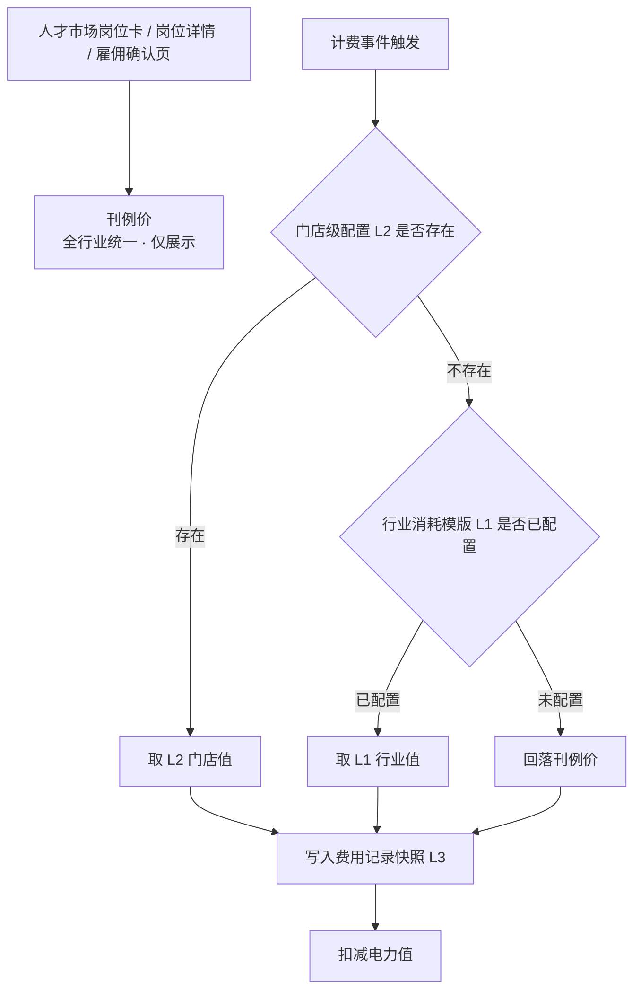
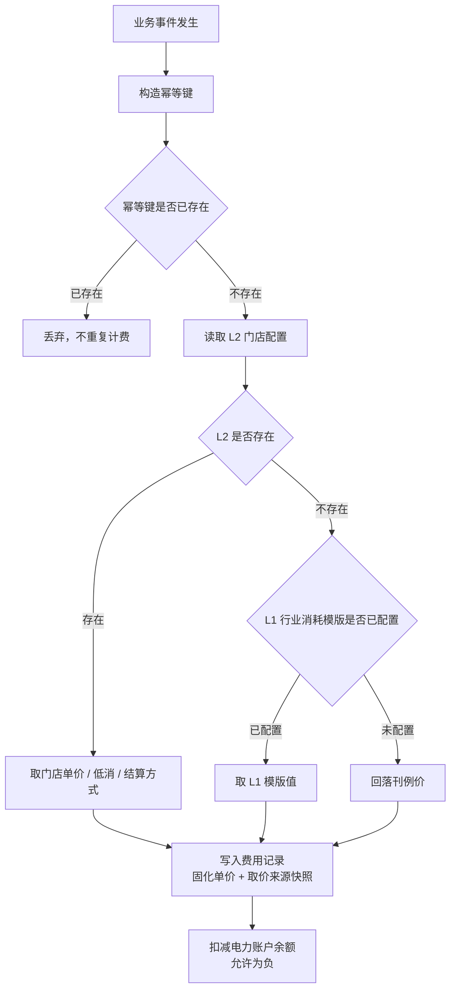
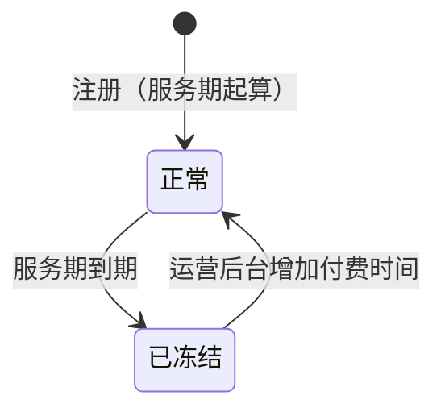

# AI数班 V1.4 · 计费规则 PRD

> 版本：V1.4（当前 V1.4.0）
> 更新日期：2026-09-23
> 状态：设计已定稿，待评审
> 适用范围：全行业数字员工计费、电力账户、充值与运营后台

---

## 版本管理

> 本表记录本文档的历次变更，包含**变更位置**（章节，缩进表示从属子节）与**变更内容**。变更内容按 `① ② ③` 分条、`·` 列具体规则。**本表按模块一行**：同一模块被多次调整时只保留最新结论，**直接改该模块所在行**，不在表末追加新行；**只有新模块才在表末新增一行**。每次调整同步更新头部"更新日期"与"版本"。

| 版本 | 日期 | 变更位置 | 变更内容 |
|------|------|----------|----------|
| V1.4.0 | 2026-09-23 | **2 计费模型（新增）**<br>　2.1 两个独立维度<br>　2.2 四层价格体系（原三层）<br>　2.3 刊例价（对外展示价）<br>　2.4 行业消耗模版（L1）<br>　2.5 门店级价格配置（L2）<br>　2.6 费用记录<br>**3 各岗位计费规则（新增）**<br>　3.2 主号获客专家（基础结算 / 高级结算）<br>　3.3 副号获客专家<br>**4 月度最低消耗（新增）**<br>**5 电力账户（新增）**<br>**6 充值与优惠（新增）**<br>**7 告警（新增）**<br>**8 人才市场与雇佣流程改造（新增）**<br>**9 消耗明细（新增）**<br>**10 运营后台（新增）**<br>　10.3 行业消耗模版配置（L1）<br>　10.4 门店配置（L2）<br>　10.5 运营后台查询视图（新增）<br>**11 存量文档改写清单（新增）**<br>**12 验收标准（新增）**<br>**13 待确认事项（新增）** | **① 建立四层价格体系**：刊例价（全行业统一，仅展示）→ 行业消耗模版（L1 计费基准）→ 门店级配置（L2 覆盖值）→ 费用快照<br>　· 取值优先级 **L2 > L1 > 刊例价**，逐级回落<br>　· 覆盖语义为绝对值覆盖，非差额<br>　· **展示层与计费层解耦**：前台恒展示刊例价，与实际计费价可能不一致<br>　· L2 改价即时生效，只影响之后发生的计费<br>**② 电力值与服务期解耦为两个独立维度**<br>　· 电力值＝消耗维度：充值获得、消耗扣减、可为负、冻结时保留不归零<br>　· 服务期＝时间维度：注册日 + 365 天，由运营后台增减天数<br>　· 充值不等于续期，两者是运营后台的两个独立动作<br>**③ 电力:现金 = 1:1 全面覆盖**（原 v1.3 定稿的 10:1 作废）<br>　· ¥2/次发布 → 2 电力值，原"20 电力值"口径作废<br>**④ 四个岗位的计费口径定稿**：主号获客专家 50 电力/有效线索、副号获客专家 50 电力/条、客服专员 10 电力/转化线索、矩阵视频发布专员 2 电力/次发布（该组数值为**全行业统一的刊例价**，实际计费价由行业模版与门店配置决定，见 ⑭）<br>**⑤ 月度最低消耗按账户级结算**：31 天周期、与员工数量及是否有人服务完全无关、无条件扣满<br>**⑥ 透支规则**：余额可为负，负余额不阻断计费、也不阻断业务执行；充值先抵扣负值<br>**⑦ 冻结与解冻**：服务期到期 → 账户冻结、电力冻结、停止低消结算、界面阻断；运营后台增加付费时间后解冻并重新起算 31 天周期<br>**⑧ 充值全部走运营后台线下**，用户端删除充值表单，仅保留余额展示与联系运营提示<br>**⑨ 岗位更名**：短视频运营专员 → **矩阵视频发布专员**<br>**⑩ 存量改写**：v1.0 §6.4 客服专员按日计费作废、§7.11.2 线上充值面板作废；v1.1 §5.3 告警取消暂停联动、§5.4 有效期起点改注册日；v1.3 §2.4.2 余额阻断项删除、§2.5 余额不足条作废、§2.5.2 电力值列改写<br>**⑪ 服务期统一 365 天（定稿）**：不分行业、不分客户类型，L1 / L2 不设服务期配置项；差异化续期只走运营后台按门店账号增减天数<br>**⑫ 低消周期起点双向展示**：§4.1 新增展示要求，§6.4 客户产品页面展示"本周期起始日 + 剩余天数 + 已消耗电力值 + 本账户月低消"，§10.2 运营后台门店账号详情页同口径展示，两处数值必须一致；§10.2 明确服务期不在 L1 / L2 配置<br>**⑬ 存量改写执行记录（2026-09-23）**：v1.1 已改写并升版为 v1.2（§5.3 / §5.4 重写 + 8 处次生引用 + 岗位更名）；v1.3 已改写（文件更名 + 全文岗位更名 + §1.2 / §2.1 / §2.4 / §2.4.1 / §2.4.2 / §2.4.4 / §2.4.5 / §2.5~§2.5.3 / §4.12.7 计费口径改写，版本管理表按模块行就地更新）<br>**⑭ 价格体系重构：展示层与计费层解耦（2026-09-23 二次定稿）**<br>　· **刊例价全行业统一**（主号 50 / 副号 50 / 客服 10 / 矩阵 2 电力），只对外展示、不参与计费；人才市场不再按行业差异化展示<br>　· §2.2 由三层改为**四层**：刊例价（展示）→ L1 行业消耗模版 → L2 门店配置 → 费用快照，取价 **L2 > L1 > 刊例价**<br>　· §2.3 刊例价改为平台内置常量、后台只读；**不含月最低消耗**<br>　· §2.4 原「刊例价模版」改为「**行业消耗模版**」，新增 `settleMode` 字段；**未配置时回落刊例价、可正常雇佣**（原「展示待上线」作废）<br>　· §2.5 门店配置新增 `settleMode` 覆盖；明确可针对同一门店的不同数字人分别配价<br>　· §3.2 / §3.3 主号、副号获客专家新增**基础结算 / 高级结算**：高级结算口径为"同系统原有获客结算配置"，本 PRD 不展开；两岗位结算方式分别配置<br>　· §6.4 / §8.1 / §8.2 / §8.3 前台展示口径全部改为**只出刊例价、不出月低消、不出差异说明**；低消只在电力账户页展示实际值<br>　· §9.1 / §9.2 消耗明细**不展示单价与取价来源**；`remark` 枚举增加"获客结算扣费"<br>　· §10.3 / §10.4 后台配置项改为行业消耗模版与三项覆盖（单价 / 低消 / 结算方式）；新增 §10.5 运营后台查询视图（可展示单价与取价来源）<br>　· §2.6 费用记录新增 `settleMode`、`priceSource` 快照字段<br>　· 连带：§2.3 低消未配置时**不进入低消周期、不结算**；§12 验收标准重排为 36 条；§13 新增待确认事项 6 / 7 / 8 |

---

## 一、概述

### 1.1 定位

本文档定义 AI数班全行业数字员工的**计费规则、电力账户体系、充值路径与运营后台价格配置能力**。计费规则是横跨人才市场、数字办公室、实时工作、成果中心与运营后台的公共能力，不归属单一数字员工。

本文档不重复定义各数字员工的业务能力与工作流程，相关口径见对应岗位 PRD（主号/副号获客专家、客服专员见 PRD-v1.0；矩阵视频发布专员见 PRD-v1.3）。

### 1.2 本期目标

- 建立**全行业统一的刊例价**，作为人才市场对外展示的唯一价格口径。
- 建立**行业 × 岗位的实际消耗模版**，由运营后台提前预置，承载行业差异化定价。
- 建立**门店级价格配置**能力，支持按门店账号对特定数字人指定特定单价，供商务差异化定价。
- 为**主号、副号获客专家**引入**基础结算 / 高级结算**两种结算方式，高级结算直接沿用系统原有获客结算配置。
- 建立**月度最低消耗**机制，防止客户占用 RPA / 云电脑资源闲置。
- 建立**电力账户**体系，支持透支、冻结与解冻。
- 充值能力收敛到**运营后台**，全部走线下，用户端只读。
- 改造人才市场、雇佣流程与消耗明细：**展示层只出刊例价，计费层走 L2 > L1 > 刊例价**，两层解耦。

### 1.3 与既有版本的关系

| 既有文档 | 关系 |
|---|---|
| PRD-v1.0 | 客服专员按日扣费规则（§6.4）被本文档取代；线上充值面板（§7.11.2 / §7.11.2.1）被本文档取代；余额作为雇佣阻断项的口径被本文档取代。其余内容继续有效。 |
| PRD-v1.1 | 电力值告警档位（§5.3）保留档位数值、取消暂停联动；电力值有效期（§5.4）起点与到期处理被本文档取代。 |
| PRD-v1.3 | 矩阵视频发布专员（原"短视频运营专员"）的按次发布计费口径延续，电力值换算比例改写；余额不足条作废；雇佣依赖检查改造；人才市场展示口径由"实际生效价"改为"刊例价"。 |

> **PRD-v1.0 为只读文档**，本文档只引用其口径与行号，不修改其内容。本文档第十一章列出需要在 v1.0 / v1.1 / v1.3 上执行的改写项，作为独立动作排期。

### 1.4 版本规划

| 版本 | 交付能力 |
|------|----------|
| 本期 V1.4 | 四层价格体系（刊例价 + L1 行业模版 + L2 门店配置 + 快照）、四岗位计费（含获客专家基础/高级结算）、月度最低消耗、电力账户与透支、冻结解冻、运营后台充值与价格配置、人才市场与消耗明细改造 |
| 后续版本 | 套餐（季卡/年卡）、自动开票与线上打款、对公账户对接 |

---

## 二、计费模型

### 2.1 两个独立维度

AI数班的计费由**两个互相独立的维度**组成，两者解耦、互不换算：

```
电力值（消耗维度）              服务期（时间维度）
  充值获得                        注册日 + 365 天
  消耗扣减                        运营后台增减天数
  可为负、可透支                  到期冻结账户
  冻结时保留、不归零              阻断产品使用流程
```

- **电力值**回答"客户用了多少"，按业务结果或按次扣减，余额不足时可透支。
- **服务期**回答"客户能用到什么时候"，是时间维度的卡点，防止客户占用资源闲置。
- **充值不等于续期**：充值只增加电力值，不延长服务期；延长服务期只在运营后台单独操作。运营后台支持在一次线下合同录入中同时完成两个动作。

### 2.2 四层价格体系

**展示价与计费价是两条独立的链路**：人才市场对外展示的是全行业统一的**刊例价**，实际扣费走**行业消耗模版 → 门店级配置**。两者可能不一致，这是商务差异化定价的前提。



| 层级 | 名称 | 配置位置 | 是否参与计费 |
|------|------|----------|--------------|
| — | **刊例价** | 平台内置常量，运营后台只读 | **否**，仅对外展示 |
| L1 | **行业消耗模版** | 运营后台 · 行业模版 | 是，实际计费基准 |
| L2 | **门店级配置** | 运营后台 · 门店配置 | 是，优先于 L1 |
| L3 | 费用快照 | 系统自动写入 | 计费发生时写死实际生效值，**永不回溯** |

**取值规则**

- 计费取价优先级 **L2 > L1 > 刊例价**：门店已配置取门店值；未配置取行业模版值；行业模版也未配置则**回落刊例价**。
- **前台展示恒为刊例价**：客户在人才市场岗位卡、岗位详情、雇佣确认页看到的单价是全行业统一的刊例价，与实际计费价可能不一致；**页面不展示差异说明，也不展示月最低消耗**（业务裁定，见 §8.1）。
- L2 的覆盖语义是**绝对值覆盖**，不是差额。商务谈定"该客户主号 30 电力/条"即填 30，直观且可核对。
- L2 改价**即时生效**，只影响改价之后发生的计费；已写入的费用记录保留原快照。
- 门店级配置可覆盖**单价**、**月最低消耗**、**结算方式**三项，分别独立覆盖。

### 2.3 刊例价（对外展示价）

刊例价是平台对外报价口径，**全行业统一，不参与计费**。

| 岗位 | 刊例价 | 计费方式 |
|------|--------|----------|
| 主号获客专家 | 50 电力 / 有效线索 | 按有效线索 |
| 副号获客专家 | 50 电力 / 条 | 按有效线索 |
| 客服专员 | 10 电力 / 转化线索 | 按转化线索 |
| 矩阵视频发布专员 | 2 电力 / 次发布 | 按次发布 |

- **不随行业变化**：四个行业在人才市场看到的岗位卡单价完全相同。
- 刊例价为平台内置常量，运营后台**只读展示、不提供修改入口**；调整刊例价需走版本发布。
- 人才市场岗位卡、岗位详情、雇佣确认页只展示刊例价；**不展示月最低消耗、不展示行业或门店的实际计费价**。
- 刊例价**不包含月最低消耗**——月低消属于行业消耗模版，不在对外展示口径内（见 §2.4）。

### 2.4 行业消耗模版（L1）

行业消耗模版是实际计费的基准层，由运营在后台按 `行业 × 岗位` **提前预置**。

| 字段 | 说明 |
|------|------|
| `industry` | 行业：二手车 / 新车 / 家居 / 房地产 |
| `positionCode` | 岗位编码：主号获客专家 / 副号获客专家 / 客服专员 / 矩阵视频发布专员 |
| `billingMode` | 计费方式：按有效线索 / 按转化线索 / 按次发布 |
| `settleMode` | **结算方式：基础结算 / 高级结算**；仅主号获客专家、副号获客专家适用，其余岗位固定为基础结算 |
| `unitPrice` | 实际消耗单价，单位电力值 |
| `minMonthly` | 月最低消耗，单位电力值 |
| `effectiveFrom` | 生效时间 |
| `status` | 启用 / 停用 |

- 唯一键为 `industry + positionCode + effectiveFrom`；同一组合同一时间只有一个生效版本。
- **改价 = 追加一条 `effectiveFrom` 更新的记录**，旧记录自动转为历史版本，不修改原记录。
- **未配置兜底**：某 `行业 × 岗位` 未配置模版时，实际计费**回落刊例价**（见 §2.3），岗位可正常雇佣。家居、房地产在数值确认前按此处理。
- **低消未配置不结算**：行业模版未配置 `minMonthly` 时，该账户**不进入低消周期、不产生补差记录**（刊例价不含低消）。避免按未确认的数值扣费。
- 行业可整体停用（如房地产前期不推），停用行业的全部岗位在人才市场展示为待上线、不可雇佣。
- **实际消耗单价与低消数值由运营确认后录入**，本 PRD 不预设行业数值；下表为待配置清单。

**行业消耗模版待配置清单**

| 行业 | 主号获客专家 | 副号获客专家 | 客服专员 | 矩阵视频发布专员 | 月低消 |
|------|-------------|-------------|----------|------------------|--------|
| 二手车 | 待运营配置 | 待运营配置 | 待运营配置 | 待运营配置 | 待运营配置 |
| 新车 | 待运营配置 | 待运营配置 | 待运营配置 | 待运营配置 | 待运营配置 |
| 家居 | 待定 | 待定 | 待定 | 待定 | 待定 |
| 房地产 | 待定（前期停用） | 待定（前期停用） | 待定（前期停用） | 待定（前期停用） | 待定 |

> 未配置期间，四个行业的实际计费均回落刊例价（50 / 50 / 10 / 2 电力），且不结算低消。

### 2.5 门店级价格配置（L2）

门店级配置用于承载商务差异化定价，可按门店账号指定**特定数字人**的特定单价。

| 字段 | 说明 |
|------|------|
| `storeId` | 门店账号（付费主体）标识 |
| `positionCode` | 岗位编码 |
| `unitPrice` | 覆盖单价，单位电力值；留空表示不覆盖 |
| `minMonthly` | 覆盖月低消，单位电力值；留空表示不覆盖 |
| `settleMode` | 覆盖结算方式：基础结算 / 高级结算；留空表示不覆盖 |
| `effectiveFrom` | 生效时间 |
| `operator` | 配置人 |
| `remark` | 备注，建议填写商务谈定依据 |

- 门店级配置按**门店账号**（付费主体）粒度，与月低消的结算粒度一致；同一门店下不同岗位可分别配置不同单价。
- 单价、低消、结算方式**三项分别独立覆盖**：可只覆盖其中一项或多项，未覆盖项逐级回落 L1、再回落刊例价。
- 与充值返电力的分工：

| 机制 | 作用侧 | 适用场景 |
|------|--------|----------|
| L2 门店级价格 | 消耗侧（改单价） | 长期协议价，商务谈定的客户级价格 |
| 充值返电力 | 充值侧（到账 > 实收） | 一次性让利、活动、补偿 |

- 两者可叠加。运营后台的充值页需提示"该门店已配置协议价"，避免商务重复让利。
- 门店级配置的变更需记录操作人、变更时间、变更前后值与生效时间。
- 门店级配置**不影响人才市场展示**：客户在人才市场始终看到刊例价。

### 2.6 费用记录

费用记录是全部扣费的唯一凭证，业务消耗与低消补差共用同一张表。

| 字段 | 说明 |
|------|------|
| `chargeId` | 费用记录唯一标识 |
| `chargeType` | 费用类型：业务消耗 / 月度低消补差 |
| `storeId` | 门店账号（付费主体）标识 |
| `employeeId` | 数字员工 ID |
| `positionCode` | 岗位编码 |
| `industry` | 行业 |
| `accountId` | 抖音账号 ID（低消补差为空） |
| `bizObjectId` | 业务对象标识：线索 ID / 会话 ID / 作品标识（低消补差为空） |
| `billingMode` | 计费方式快照 |
| `settleMode` | 结算方式快照：基础结算 / 高级结算（仅主号、副号获客专家有值） |
| `priceSource` | 取价来源快照：L2 门店配置 / L1 行业模版 / 刊例价兜底 |
| `unitPrice` | 实际生效单价快照（电力值） |
| `power` | 扣减电力值，负数展示 |
| `chargedAt` | 扣费时间 |
| `remark` | 扣费备注 |
| `idempotentKey` | 幂等键 |

- **幂等键**：业务消耗为 `员工 ID + 账号 ID + 业务对象标识`；低消补差为 `门店 ID + 周期起始日`。
- **单价快照**：费用记录写入时固化当时的实际生效单价与取价来源，后续 L1 / L2 / 刊例价变更均不影响历史记录。
- **单价快照不对外展示**：客户侧消耗明细只展示扣减电力值，不展示单价列与取价来源，避免暴露行业/门店差异化定价（见第九章）。
- 费用记录不可由前端删除或修改；退款、冲正等状态由账务结果更新并保留原始记录。

---

## 三、各岗位计费规则

### 3.1 计费口径总表

| 岗位 | 计费方式 | 结算方式 | 刊例价（展示） | 触发点 | 幂等键 |
|------|----------|----------|----------------|--------|--------|
| 主号获客专家 | 按有效线索 | **基础结算 / 高级结算**（可配） | 50 电力/有效线索 | 线索判定为"有效线索"时 | 员工 + 账号 + 线索 ID |
| 副号获客专家 | 按有效线索 | **基础结算 / 高级结算**（可配） | 50 电力/条 | 同上（副号口径） | 员工 + 账号 + 线索 ID |
| 客服专员 | 按转化线索 | 基础结算（固定） | 10 电力/转化线索 | 转化线索（留资结果）产生时 | 员工 + 账号 + 线索 ID |
| 矩阵视频发布专员 | 按次发布 | 基础结算（固定） | 2 电力/次发布 | 作品发布完成时 | 员工 + 账号 + 作品标识 |

- 表中单价为**对外展示的刊例价**（全行业统一），**不是实际计费价**。
- 实际扣费单价按 **L2 门店配置 > L1 行业模版 > 刊例价** 取值；L1 行业模版数值由运营后台提前预置，本 PRD 不预设。
- 电力值与现金的换算比例为 **1:1**。

### 3.2 主号获客专家

主号获客专家支持**两种结算方式**，同一门店账号在同一时间只用其中一种。结算方式由 L1 行业消耗模版预置，可按 L2 门店账号覆盖（见 §2.4 / §2.5）。

#### 3.2.1 基础结算

- **计费单位**：一条有效线索计 1 次。
- **有效线索口径**：沿用 PRD-v1.0 §8.2——近 7 天内被主号获客专家触达且已留资的线索。
- **触发时点**：线索满足有效线索条件时即时扣费，扣费时间等于判定时间。
- **不回溯**：线索判定为有效后即计费，后续不再因线索状态变化回滚或冲正。
- **不计费**：未触达、未留资、被判定为无效的线索不产生费用。
- **单价取值**：按 L2 > L1 > 刊例价取值；L1 未配置时回落刊例价 50 电力/有效线索。

#### 3.2.2 高级结算

- **结算口径**：**同系统原有获客结算配置**。高级结算的结算规则、触发条件与单价全部沿用系统既有的获客结算配置，本 PRD 不重新定义、不改写该配置的内容。
- **本 PRD 的范围**：只定义「结算方式」这一配置开关（`settleMode = 高级结算`）的落位、覆盖与快照规则。开关置为高级结算后，计费由原有获客结算配置接管。
- **配置位置**：L1 行业消耗模版字段（`settleMode`），可按 L2 门店账号覆盖。
- **`unitPrice` 不生效**：结算方式为高级结算时，L1 / L2 的 `unitPrice` 不参与计费，实际单价由原有获客结算配置决定。
- **费用记录**：仍写入统一费用记录表，`settleMode` 快照为"高级结算"，`priceSource` 快照为"高级结算配置"，`power` 取原有获客结算配置的实际扣减结果。
- **月最低消耗**：仍按账户级 31 天周期执行，与结算方式无关（见第四章）。
- **幂等口径**：沿用原有获客结算配置的幂等口径；接入时需与本章的业务幂等键对齐，见第十三章待确认事项。

### 3.3 副号获客专家

- 计费单位、口径、触发规则与结算方式**同主号获客专家**（含 §3.2.1 基础结算与 §3.2.2 高级结算），按副号获客专家的触达与留资记录独立统计。
- 主号与副号的有效线索**分别统计、分别计费**，同一线索若同时满足两个岗位的口径，按各自岗位分别产生费用记录。
- 主号与副号的结算方式**分别配置**：同一门店可主号用基础结算、副号用高级结算，互不影响。

### 3.4 客服专员

> 本节取代 PRD-v1.0 §6.4「客服专员按日扣费规则」。原按日 50 元/天的口径作废。

- **计费单位**：一条转化线索计 1 次。
- **转化线索口径**：客服专员接待的会话产生留资结果，即计 1 条转化线索。
- **触发时点**：留资结果产生时即时扣费。
- **与功能开关解耦**：客服专员的功能开关只控制接待能力，**不再作为计费开关**；不产生转化线索则不产生费用。
- **与授权解耦**：平台账号未授权或授权失效时，客服专员按既有规则进入"待处理"、无法实际接待，因此不产生转化线索、不产生费用；授权恢复后正常计费。
- **费用记录**：记录员工 ID、账号 ID、线索 ID、扣费时间、实际单价、取价来源、应扣电力值与扣费状态；重复回收同一留资结果不重复扣费。
- **结算方式**：固定为基础结算，不支持高级结算。

### 3.5 矩阵视频发布专员

> 本节延续 PRD-v1.3 §2.5 的按发布结果计费口径，改写电力值换算比例与价格取值链路（前台展示刊例价、实际结算按 L2 > L1 > 刊例价）。

- **计费单位**：一次发布 = **一个账号成功发布一条作品**。n 个账号发布同一个作品计 n 次，一个账号发布 m 条作品计 m 次。
- **计费依据**：作品的**发布结果**；作品状态变为"发布完成"即产生一次费用。
- **触发时点**：作品发布完成时**即时扣减**，扣费时间等于该作品的发布完成时间。不设 T+1 次日结算。
- **不计费**：待发布、发布中、发布失败、取消发布四种状态均不产生费用。
- **失败与重试**：发布失败不产生费用；单条重试成功后计 1 次；同一作品重复回收发布结果时按幂等键去重。
- **停止计费**：账号在 Agent 设置中关闭、或员工解雇后，不再参与新的发布任务，因此不再产生新费用；关闭与解雇动作本身不产生费用。
- **费用记录**：幂等键为 `员工 ID + 账号 ID + 作品标识`（任务内作品 ID / 抖音作品 ID）；记录实际结算单价与取价来源。
- **结算方式**：固定为基础结算，不支持高级结算。

### 3.6 计费幂等与快照



- 幂等键在写入前校验，重复事件直接丢弃。
- 单价快照在写入时固化，与后续改价解耦；`priceSource` 同步固化，标记本次取价走的是 L2 / L1 / 刊例价兜底。
- 扣减动作允许余额为负，不因余额不足而阻断写入。
- 结算方式为高级结算时，取价与扣减由原有获客结算配置完成，`priceSource` 快照为"高级结算配置"。

---

## 四、月度最低消耗

### 4.1 周期规则

- **周期长度**：31 天。
- **周期起点**：**首次充值到账日**。首次充值到账后起算第 1 个周期，此后每 31 天滚动。
- **未充值不进入周期**：注册后从未充值的账户不进入低消周期，不产生低消欠款。
- **结算粒度**：**账户级**（付费主体）。周期内全账户所有数字员工的业务消耗合计，与低消比较。
- **与员工无关**：低消与员工数量、是否有人服务**完全无关**——只要账户处于低消周期内，周期末无条件扣满低消，哪怕周期内没有任何员工处于服务中。
- **周期起点必须对客户与运营双向可见**：低消周期的起点不随充值或服务期变更而改写，但**运营后台与客户产品页面均需展示**本周期起始日、剩余天数与本周期已消耗电力值，避免客户在周期末被补差时"看不到账单来源"。
  - **客户产品页面**：展示在电力账户卡片与消耗明细页（口径见 §6.4）。
  - **运营后台**：展示在门店账号详情页（口径见 §10.2）。
- **冻结期间周期暂停**：账户冻结期间不结算、周期不推进；解冻后**重新起算 31 天周期**，起点变为解冻日（见 §5.3）。

### 4.2 结算规则

- **结算时点**：每个周期结束后的次日 00:00 执行结算。
- **补差金额**：`月低消 − 周期内实际消耗合计`。
  - 周期内实际消耗合计 ≥ 月低消 → 不产生补差记录。
  - 周期内实际消耗合计 < 月低消 → 生成一条补差记录，扣减差额。
- **低消金额取值**：按 **L2 门店配置 > L1 行业消耗模版** 逐级取值；两级均未配置 `minMonthly` 时，**该账户不进入低消周期、不产生补差记录**（刊例价不含低消，见 §2.3）。
- **允许透支**：余额不足时补差记录照常写入，余额可为负。
- **冻结时停止结算**：账户处于冻结状态时，不执行低消结算（见第五章）。

### 4.3 幂等与记录

- 一个门店账号在**一个周期内只生成一条**低消补差记录，幂等键为 `门店 ID + 周期起始日`。
- 补差记录写入费用记录表，`chargeType = 月度低消补差`，`power` 为负数，`remark` 固定为"月度最低消耗补差"。
- 补差记录的 `accountId`、`bizObjectId` 为空。
- 周期结算后，周期内消耗计数归零，开始下一个 31 天周期。

### 4.4 验收标准

1. 周期长度为 31 天，起点为首次充值到账日，此后每 31 天滚动一次。
2. 从未充值的账户不进入低消周期，不产生任何低消补差记录。
3. 周期内全账户业务消耗合计 ≥ 月低消时，周期末不产生补差记录。
4. 周期内业务消耗合计 < 月低消时，周期末生成一条补差记录，扣减金额等于差额。
5. 周期内没有任何员工处于服务中时，周期末**仍然**生成补差记录，扣满月低消。
6. 一个门店账号在一个周期内只生成一条补差记录，重复执行结算任务不重复扣费。
7. 补差金额取 L2 门店配置值；未配置时取 L1 行业消耗模版值。
8. L1 与 L2 均未配置 `minMonthly` 时，该账户不进入低消周期，周期末不产生补差记录。
9. 补差记录写入时余额不足，记录照常生成，账户余额可为负。
10. 账户处于冻结状态时，不产生新的低消补差记录。
11. 客户产品页面与运营后台均展示本周期起始日、剩余天数与本周期已消耗电力值，且两处数值一致。
12. 服务期到期冻结后解冻的账户，低消周期起点更新为解冻日，重新起算 31 天。
13. 结算方式为高级结算的岗位，其业务消耗照常计入周期内消耗合计，低消补差规则不变。

---

## 五、电力账户

### 5.1 账户结构

| 字段 | 说明 |
|------|------|
| `storeId` | 门店账号（付费主体）标识 |
| `industry` | 行业，决定取哪一套 L1 刊例价 |
| `balance` | 可用电力值，**可为负** |
| `frozen` | 冻结电力值 |
| `serviceExpireAt` | 服务期截止日 |
| `status` | 正常 / 已冻结 |
| `cycleStartAt` | 当前低消周期起始日 |
| `cycleConsumed` | 当前周期内累计消耗电力值 |
| `firstRechargeAt` | 首次充值到账时间，决定低消周期起点 |

### 5.2 透支规则

- 电力值与现金的换算比例为 **1:1**。
- **余额可为负**：业务消耗与低消补差均可在余额不足时照常扣减，余额无下限。
- **负余额不阻断计费**：系统不因余额为负而拒绝写入费用记录。
- **负余额不阻断业务执行**：数字员工的业务动作（发布、触达、接待）**不因余额为负而暂停**，即纯信用透支。
- **充值先抵扣负值**：再次充值时，到账电力值先抵扣账户负值，抵扣后的剩余部分才计入可用余额。
  - 例：账户余额 −300，充值到账 1000，抵扣后可用余额为 700。

### 5.3 冻结与解冻



| 环节 | 规则 |
|------|------|
| 服务期起算 | **注册日**，无论是否充值 |
| 默认服务期 | 注册日 + 365 天 |
| 调整方式 | 运营后台按**任意天数**增加或减少服务期截止日 |
| 冻结触发 | 当前时间到达服务期截止日 |
| 冻结动作 | ① 账户状态置为"已冻结"；② **电力值冻结（余额保留，不归零）**；③ **停止低消结算** |
| 界面表现 | **阻断式弹窗**，直接中断客户使用产品的流程，引导客户联系运营进行服务期续费 |
| 解冻方式 | 运营后台**增加付费时间**后自动解冻 |
| 解冻后处理 | **重新起算 31 天低消周期**，不论解冻后余额为正数还是负数 |
| 欠款处理 | 冻结前产生的负值**保留**，解冻后通过充值抵扣 |

- 冻结期间不产生新的业务消耗，也不产生新的低消补差。
- 冻结前已经生成的费用记录保持原样，不因冻结而修改或冲销。
- 冻结与解冻动作需记录操作人、操作时间、变更前后的服务期截止日。
- 服务期到期造成的阻断**不替代**电力值告警：前者是产品使用流程的中断，后者是通知（见第七章）。

### 5.4 验收标准

1. 电力值与现金按 1:1 换算。
2. 账户余额可为负，业务消耗与低消补差在余额不足时照常扣减，不产生"扣费失败"状态。
3. 余额为负时，数字员工的业务动作继续执行，不进入"待处理"、不暂停。
4. 充值时先抵扣账户负值，剩余部分计入可用余额；抵扣过程可在充值流水中追溯。
5. 服务期从**注册日**起算 365 天，未充值账户同样起算。
6. 服务期到期后账户冻结，电力值余额保留不归零。
7. 冻结期间不产生新的业务消耗与低消补差记录。
8. 冻结状态下客户使用产品时展示阻断式弹窗，引导联系运营续费。
9. 运营后台增加付费时间后账户自动解冻，低消周期**重新起算 31 天**，不论解冻后余额为正数还是负数。
10. 服务期统一为 365 天，不分行业、不分客户类型；如需差异化只能通过运营后台按门店账号增减天数实现，不在 L1 / L2 增加配置项。
9. 运营后台增加付费时间后账户解冻，并重新起算 31 天低消周期，不论余额正负。
10. 冻结前产生的负值在解冻后保留，充值后按第 4 条抵扣。

---

## 六、充值与优惠

### 6.1 换算基准

- **标准换算比例：1 元 = 1 电力值**。这是定价与账单的换算基准。
- 该比例是**基准值，不是所有充值的固定比例**：优惠充值时到账电力值可以大于实收金额，差额即优惠。
- 优惠只体现在充值流水中，**不修改刊例价与门店级配置**。

### 6.2 运营后台充值

- **充值入口仅在运营后台**，全部走线下（对公转账、合同结算等），用户端不提供任何充值表单或支付流程。
- 运营人员在线下收到款项后，在后台登记充值，系统按登记结果增加电力值。
- 充值登记字段见第十章 10.1。

### 6.3 优惠实现

- **优惠 = 到账电力值 > 实收金额**。差额部分不计入定价体系，只在充值流水中留痕。
- 例：客户按 3000 元签约，运营登记实收 1000 元、到账 3000 电力值，差额 2000 电力值即为优惠。
- 优惠率的记录口径：`powerAmount ÷ payAmount`，1:1 标准充值时该值为 1.0。
- 优惠不影响费用记录中的单价快照；客户侧不展示单价，只展示实际扣减的电力值。

### 6.4 用户端展示

- 用户端**只读**：展示当前可用电力值、冻结状态、服务期截止日与消费明细。
- 不提供充值金额输入、支付方式选择、支付状态流转与充值凭证上传。
- 余额不足或服务期临近到期时，展示"请联系运营人员进行充值 / 续费"提示。
- **低消周期口径必须展示周期起点**：展示"本周期起始日（YYYY-MM-DD）"、"本周期剩余天数"、"本周期已消耗电力值"与"本账户月低消"，四项同屏呈现，使客户在周期末被补差时可自行核对差额来源。周期起点即首次充值到账日（解冻后为解冻日），展示值与运营后台一致。
- **低消只在账户页展示**：人才市场岗位卡、岗位详情与雇佣确认页**不出现月最低消耗**（见 §8.1 / §8.3）；低消数字只出现在电力账户页，且展示的是**本账户实际生效值**（L2 > L1）。
- 账户未配置低消（L1 / L2 均未配置 `minMonthly`）时，账户页展示"本账户未设置月最低消耗"，不展示周期信息。
- 展示口径：可用电力值、**本账户月低消**、**本周期起始日**、本周期已消耗电力值、本周期剩余天数、服务期截止日与剩余天数。
- **不展示单价**：账户页与消耗明细页均不展示单价列与取价来源，只展示扣减电力值。

### 6.5 验收标准

1. 用户端不存在任何充值表单、支付流程或充值按钮。
2. 运营后台可登记充值，分别录入实收金额与到账电力值，两者可不相等。
3. 充值登记成功后电力值即时到账，到账值等于登记的到账电力值。
4. 优惠充值时差额留痕可查，且不影响任何费用记录中的单价快照。
5. 用户端展示可用电力值、月低消、**周期起始日**、周期已消耗与周期剩余天数。
6. 用户端在余额不足或服务期临近到期时展示联系运营的提示。
7. 用户端展示的周期起始日、剩余天数、已消耗电力值、月低消四项，与运营后台同一门店账号的数值完全一致。
8. 人才市场岗位卡、岗位详情与雇佣确认页均不出现月最低消耗数字。
9. 账户未配置低消时，账户页展示"本账户未设置月最低消耗"，不展示周期起始日与剩余天数。
10. 账户页与消耗明细页均不出现单价列与取价来源。

---

## 七、告警

### 7.1 电力值告警

> 本节改写 PRD-v1.1 §5.3。档位数值保持不变，**取消与暂停状态的联动**。

电力值档位按可用电力值区间计算，同一付费主体同一自然日只发送一次告警。

| 档位 | 区间 | 触发动作 |
|------|------|----------|
| 低消缺口档位 | 可用电力值 > 0 且 ≤ **本账户实际月低消**（L2 > L1 取值） | 发送低消缺口提醒 |
| 0 元档位 | 可用电力值 ≤ 0 | 发送电力值告警 |

- **账户未配置低消时不触发低消缺口档位**：L1 / L2 均未配置 `minMonthly` 时，该账户只有 0 元档位，不发送低消缺口提醒。
- **告警保留为纯通知**：任何档位均**不再联动暂停**数字员工，不再将受影响岗位群置为待处理或暂停状态。
- 余额为负时数字员工继续工作（见 5.2），告警只承担告知义务。
- 一次扣费从低消缺口档位直接降至 0 元档位时，发送当前电力值对应的最低已命中档位。
- 次日重置当日发送记录；充值成功后按新电力值重新计算。

**告警文案**

| 档位 | 文案 |
|------|------|
| 低消缺口 | **电力值提醒**：当前账户可用电力值为 **实际电力值**，低于本账户月最低消耗 **月低消** 电力值。本周期结束时将补扣至最低消耗，为避免后续服务受到影响，请联系运营人员进行充值。 |
| 0 元 | **电力值告警**：当前账户电力值已为 **实际电力值**，数字员工仍可继续工作，但账户已产生欠款。请联系运营人员进行充值，充值金额将优先抵扣欠款。 |

### 7.2 低消缺口告警与低消模块的合流

- 低消缺口档位与月度最低消耗共用同一个阈值（本账户实际月低消），两个模块口径一致。
- 客户在**电力账户页、数字办公室顶部余额入口与对话告警**中看到的低消数值，均取同一来源（L2 > L1）。**人才市场与雇佣确认页不展示低消**（见 §8.1 / §8.3）。
- 账户未配置低消时不触发低消缺口档位，只有 0 元档位。
- 周期内已消耗电力值可在用户端查看，用于客户自行判断距离低消的缺口。

### 7.3 服务期到期告警与阻断

服务期是**时间维度的硬卡点**，与电力值告警（软通知）性质不同。

| 时点 | 表现 |
|------|------|
| 到期前第 7 至第 1 天（每天） | **服务期到期提醒**：当前账户服务期将于 **服务期截止日** 到期，距离到期还有 **剩余天数** 天。到期后账户将冻结、数字员工将停止工作，请联系运营人员进行续费。 |
| 到期当天 | **阻断式弹窗**，直接中断产品使用流程，引导客户联系运营续费；弹窗不可通过刷新或返回绕过。 |

- 到期当天电力值**不归零**，余额保留。
- 到期当天停止低消结算。
- 运营后台增加付费时间后，弹窗解除、账户解冻、低消周期重新起算。
- 同一服务期周期内每天只发送一次到期提醒；到期当天的阻断弹窗单独处理。

### 7.4 验收标准

1. 可用电力值首次进入低消缺口档位时发送提醒，文案包含实际电力值与月低消值。
2. 可用电力值降至 0 或以下时发送告警，文案说明数字员工仍可继续工作、账户已产生欠款。
3. 任一档位的告警均**不触发**数字员工暂停或进入待处理状态。
4. 同一付费主体同一自然日只发送一次电力值告警。
5. 服务期到期前第 7 至第 1 天每天发送一次到期提醒。
6. 服务期到期当天展示阻断式弹窗，无法通过刷新或返回绕过。
7. 到期当天电力值不归零，低消结算停止。
8. 运营后台增加付费时间后，阻断弹窗解除、账户解冻、低消周期重新起算。

---

## 八、人才市场与雇佣流程改造

### 8.1 岗位卡与岗位详情

> 改造 PRD-v1.0 §7.4.2 / §7.4.3 与 PRD-v1.3 §2.5.1。

- 岗位卡、岗位详情展示的单价是**全行业统一的刊例价**（见 §2.3），**不读取 L1 / L2 的实际计费价**。
- 展示内容包含：计费方式、刊例价。
- **不展示月最低消耗**：人才市场不出现低消数字，也不出现"周期结束时消耗不足将补扣"的提示；低消只在电力账户页展示（见 §6.4）。
- **不展示差异说明**：页面不提示"实际结算价可能与展示价不同"（业务裁定）。
- 计费提示需说明：按业务结果计费、刊例价单价、以及"实际结算以平台配置为准"。
- **待上线判定改用行业模版**：`行业 × 岗位` 未配置 L1 行业消耗模版时，实际计费回落刊例价、岗位**可正常雇佣**（见 §2.4），不再作为待上线处理。
- 停用行业（如房地产）下的全部岗位展示为待上线、不提供雇佣入口。
- 授权提示与计费提示**分开呈现**，避免"未授权即不产生费用"的误解。

### 8.2 雇佣依赖检查

> 改造 PRD-v1.3 §2.4.2。

| 检查项 | 类型 | 通过条件 | 未通过处理 |
|--------|------|----------|-----------|
| 抖音营销授权 | **阻断项** | 至少一个已绑定抖音账号的营销授权有效，可参与发布/接待 | 状态标记"待授权"，展示受影响账号，提供"去账号绑定/授权"入口；授权有效后进入确认状态 |
| 余额 | **非阻断提示** | 不阻断雇佣 | 展示当前可用电力值，并提示"请联系运营人员充值"；**不展示月最低消耗** |

- **删除余额作为雇佣阻断项**：原 PRD-v1.3 §2.4.2 中"余额足以覆盖至少 1 次发布的费用"的阻断口径作废。
- 余额不足时**不阻断**雇佣流程，客户可在余额为负的情况下正常雇佣并开始工作。
- 余额提示为纯告知，不提供"去充值"跳转（充值走运营后台线下），文案改为"请联系运营人员充值"。
- 抖音营销授权是雇佣的**唯一阻断项**。

### 8.3 雇佣确认页

- 展示岗位头像、岗位名称、抖音营销授权状态、账号启用列表与确认按钮。
- 展示本岗位的**刊例价**（全行业统一），不展示 L1 / L2 实际计费价，**不展示月最低消耗**。
- **不展示"雇佣当日预计费用"**：费用取决于雇佣后的实际业务结果，页面只展示刊例价与计费规则。
- 雇佣动作本身**不产生费用**，也不作为任何计费周期的起点（低消周期起点为首次充值到账日）。

### 8.4 验收标准

1. 岗位卡、岗位详情与雇佣确认页展示的单价为**全行业统一的刊例价**，四个行业展示值完全相同。
2. 门店已配置 L2 价格或行业已配置 L1 模版时，前台展示值**仍为刊例价**，不随 L1 / L2 变化。
3. 岗位卡、岗位详情与雇佣确认页均不出现月最低消耗数字。
4. 未配置 L1 行业模版的 `行业 × 岗位` 可正常雇佣，实际按刊例价计费；停用行业展示为待上线、无雇佣入口。
5. 雇佣依赖检查中**不存在余额阻断项**，余额不足时雇佣流程可正常完成。
6. 抖音营销授权未通过时，雇佣流程被阻断并提供授权处理入口。
7. 雇佣确认页不展示"雇佣当日预计费用"。
8. 前台不出现"实际结算价可能与展示价不同"的说明文案。

---

## 九、消耗明细

### 9.1 展示口径

> 改造 PRD-v1.3 §2.5.2。费用类型从"仅作品发布"扩展为覆盖全部四个岗位与低消补差。

- 消耗明细汇总**全部费用类型**：有效线索计费、转化线索计费、作品发布扣费、月度最低消耗补差。
- 每条费用记录生成一条明细，按扣费时间倒序展示。
- 明细归属付费主体（门店账号），不按员工拆分页面，但支持按员工筛选。
- **不展示单价与取价来源**：明细只展示扣减电力值，不展示单价列、不展示 L2 / L1 / 刊例价兜底中的哪一种，避免暴露行业与门店的差异化定价。

### 9.2 字段列

| 序号 | 列名 | 字段 | 展示口径 |
|------|------|------|----------|
| 1 | 扣费时间 | `chargedAt` | 该笔费用的实际扣减时间，精确到秒 |
| 2 | 数字员工 | `positionCode` | 产生该笔费用的岗位名称；低消补差展示"—" |
| 3 | 扣费账号 | `accountId` | 产生该笔费用的抖音账号名称；低消补差展示"—" |
| 4 | 计费对象 | `bizObjectId` | 该笔费用对应的业务对象：线索（展示线索标识）、转化线索（展示线索标识）、作品（主行展示作品标题，副行展示所属任务「任务 · MM/DD HH:mm」）；低消补差展示"—" |
| 5 | 电力值 | `power` | 该笔费用的扣减电力值，以负数展示（刊例价 2 电力/次发布 → -2） |
| 6 | 扣费备注 | `remark` | 固定枚举：有效线索计费 / 转化线索计费 / 作品发布扣费 / 月度最低消耗补差；主号、副号获客专家为高级结算时展示"获客结算扣费" |

- 明细默认按扣费时间倒序排列，超过一页时提供翻页。
- **电力值列按 1:1 换算**：原 PRD-v1.3 §2.5.2 中"¥2/次 → -20"的口径作废，改为 -2。
- **列数固定为 6 列**：不新增单价列、取价来源列；运营后台的查询视图可另行展示单价与来源（见 §10.6）。
- 表格列的进一步拓展性设计不入本期。

### 9.3 筛选与导出

- 支持按**时间范围、数字员工、扣费账号、费用类型**筛选。
- 支持**导出**，导出范围为当前筛选条件下的全部记录，覆盖全部分页。
- 导出文件使用 `.xlsx` 格式，字段与列表列一致，并补充实收金额口径字段供人工对账使用。
- 导出文件名格式：`消耗明细_开始日期-结束日期_门店名称.xlsx`。

### 9.4 验收标准

1. 消耗明细覆盖有效线索计费、转化线索计费、作品发布扣费与月度最低消耗补差四类记录。
2. 明细按扣费时间倒序排列，每条费用记录对应一条明细。
3. 电力值列以负数展示，按 1:1 换算（刊例价 2 电力/次发布展示为 -2）。
4. 扣费备注为固定枚举，不拼接账号、日期等其他信息；高级结算记录展示"获客结算扣费"。
5. 计费对象列按费用类型展示对应业务对象；低消补差的数字员工、扣费账号、计费对象三列均展示"—"。
6. 支持按时间范围、数字员工、扣费账号与费用类型组合筛选。
7. 导出覆盖当前筛选条件下的全部记录，字段与列表一致。
8. 消耗明细固定 6 列，**不出现单价列与取价来源列**。

---

## 十、运营后台

### 10.1 充值登记

| 字段 | 说明 | 必填 |
|------|------|------|
| 门店账号 | 充值的付费主体 | 是 |
| 实收金额 | 线下实际收到的金额，单位元 | 是 |
| 到账电力值 | 本次到账的电力值；可大于实收金额 | 是 |
| 到账时间 | 电力值生效时间 | 是 |
| 转账凭证号 | 线下转账或合同的凭证标识 | 是 |
| 操作人 | 登记人 | 自动记录 |
| 备注 | 补充说明 | 否 |

- 到账电力值**先抵扣账户负值**，剩余部分计入可用余额。
- 登记成功后即时到账，展示抵扣明细（原负值、抵扣金额、剩余可用）。
- 登记页需提示"该门店已配置协议价"（若存在 L2 配置），避免重复让利。
- 充值记录不可删除；错误登记通过冲正记录修正，保留原始记录。

### 10.2 服务期管理

| 功能 | 说明 |
|------|------|
| 查看服务期 | 展示当前服务期截止日、剩余天数、账户状态 |
| **查看低消周期** | 展示本周期起始日、剩余天数、本周期已消耗电力值、本账户月低消（L2 覆盖值 > L1 模版值），以及与客户产品页面一致的展示口径 |
| 增加付费时间 | 按**任意天数**延长服务期截止日 |
| 减少付费时间 | 按**任意天数**缩短服务期截止日 |
| 解冻 | 增加付费时间后自动解冻，并重新起算 31 天低消周期 |

- 服务期变更需记录操作人、操作时间、变更天数与变更前后截止日。
- 减少付费时间导致截止日早于当前时间时，账户立即冻结。
- 解冻后低消周期重新起算，不论解冻后余额为正数还是负数；周期起始日同步更新为解冻日。
- **低消周期起点在后台必须可见**：运营在门店账号详情页可查看本周期起始日、剩余天数与本周期已消耗电力值，用于向客户解释周期末补差金额的构成；后台数值与客户产品页面展示值必须一致。
- **服务期统一 365 天**：不在 L1 行业消耗模版或 L2 门店配置中增加服务期配置项；差异化续期只能通过本模块按门店账号增减天数实现。

### 10.3 行业消耗模版配置（L1）

- 按 `行业 × 岗位` 维护**实际消耗模版**：计费方式、**结算方式**、实际消耗单价、月最低消耗。
- **结算方式**字段仅主号获客专家、副号获客专家可编辑（基础结算 / 高级结算）；其余两个岗位固定为基础结算、置灰不可改。
- 支持新增、修改、停用；修改采用**追加生效版本**方式，不修改历史记录。
- 支持行业整体停用。
- 支持留空（家居、房地产数值待定）；**留空不阻断雇佣**，实际计费回落刊例价、且不结算低消（见 §2.4）。
- 配置页需展示当前刊例价作为参照，便于运营判断实际价与展示价的差幅。
- 变更需记录操作人、变更时间、变更前后值与生效时间。

### 10.4 门店配置（L2）

- 按 `门店账号 × 岗位` 维护覆盖单价、覆盖月最低消耗与覆盖结算方式。
- **可针对同一门店下的不同数字人分别配置不同单价**（按 `门店账号 × 岗位` 逐条配置）。
- 单价、低消、结算方式**三项分别独立覆盖**；留空表示不覆盖，逐级回落 L1、再回落刊例价。
- 支持按门店账号搜索与批量查看当前生效价。
- 展示该门店的 `刊例价 / L1 模版值 / L2 覆盖值` 三列对比视图，便于商务核对差幅。
- 变更需记录操作人、变更时间、变更前后值与生效时间。

### 10.5 运营后台查询视图

- 运营后台的费用记录查询视图**可展示单价与取价来源**（L2 门店配置 / L1 行业模版 / 刊例价兜底），用于商务对账与定价核对。
- 该视图为客户侧消耗明细之外的后台视图，字段不受 §9.2 六列口径限制。
- 支持按门店账号、行业、岗位、取价来源筛选。

### 10.6 验收标准

1. 充值登记支持分别录入实收金额与到账电力值，两者可不相等。
2. 充值登记后电力值即时到账，负值优先抵扣，抵扣过程可追溯。
3. 存在 L2 配置的门店在充值页展示"已配置协议价"提示。
4. 服务期支持按任意天数增加或减少，变更记录可追溯。
5. 减少付费时间导致截止日早于当前时间时账户立即冻结。
6. L1 行业消耗模版修改采用追加生效版本方式，历史记录不被修改。
7. L2 门店配置支持单价、低消、结算方式分别覆盖，留空时逐级回落 L1、再回落刊例价。
8. 门店配置页展示 `刊例价 / L1 模版值 / L2 覆盖值` 三列对比。
9. 运营后台门店账号详情页展示本周期起始日、剩余天数、本周期已消耗电力值与月低消，且与客户产品页面数值一致。
10. 服务期统一为 365 天，L1 / L2 配置项中不存在服务期字段。
11. 结算方式字段仅主号、副号获客专家可编辑，客服专员与矩阵视频发布专员该字段置灰。
12. L1 模版留空的 `行业 × 岗位` 可正常雇佣，实际按刊例价计费且不结算低消。
13. 运营后台费用记录查询视图可展示单价与取价来源，并支持按取价来源筛选。

---

## 十一、存量文档改写清单

> 本节列出需要在既有 PRD 上执行的改写项。**PRD-v1.0 为只读文档**，其改写项需单独排期并另行确认；v1.1 与 v1.3 的改写项按本清单执行。

### 11.1 PRD-v1.0

| 位置 | 处理 |
|------|------|
| §6.4 客服专员按日扣费规则 | **整节作废**，替换为本文档 §3.4 按转化线索计费口径 |
| §6.3.5 第 6 条（客服专员自动解雇后停止日服务费） | 连带改写为按转化线索口径 |
| §7.4.3 客服专员岗位详情展示"按日服务费" | 改写为按转化线索计费 |
| §7.4.5 客服专员准备项中的"余额" | 删除余额作为准备项/阻断项 |
| §7.11.1 首次引导清单中的"充值" | 改写为"联系运营人员充值" |
| §7.11.2 充值和消费明细 | **线上充值面板作废**，改为用户端只读展示 |
| §7.11.2.1 充值交互和余额状态 | **整节作废** |
| §5.3 准备项规则中的"余额"行 | 阻断口径作废，改为非阻断提示 |

### 11.2 PRD-v1.1

| 位置 | 处理 |
|------|------|
| §5.3 电力值告警 | 档位数值保留（500 档 / 0 档）；**取消与暂停状态的联动**；500 档重定义为"低消缺口告警" |
| §5.4 电力值有效期告警 | 起点由"最后一次充值时间"改为**注册日**；到期处理由"电力值归零"改为**电力值冻结（保留不归零）**；恢复方式由"充值"改为**运营后台增加付费时间**；补充"重新起算 31 天低消周期" |
| §5.4 文案 | 到期当天文案中的"电力值已归 0"改为"账户已冻结、电力值已保留" |
| §4.x 对话中的电力值查询 | 补充低消、周期起始日、周期剩余天数、服务期截止日字段 |

> **执行状态**：已于 2026-09-23 执行完毕，文档升版为 **v1.2**。实际改写范围除上表外，另含 8 处次生引用（§1.x、§4.x、§5.4 文案表、强提醒条件、主动服务触发、示例二 / 示例四），以及岗位更名 1 处。

### 11.3 PRD-v1.3

| 位置 | 处理 |
|------|------|
| §2.5 开头"客服专员沿用按自然日计费，两者口径相互独立、互不换算" | **整句作废**，改为按本文档 §3.4 口径 |
| §2.5 计费单价"默认 ¥2/次发布" | 改写为"**刊例价 2 电力值/次发布**"（全行业统一、仅对外展示），实际结算价按 L2 > L1 > 刊例价取值；补充"电力值:现金 = 1:1" |
| §2.5 "余额不足"条 | **整条作废**（余额为负不再阻断发布） |
| §2.5 "停止计费"条 | 保留；补充"解雇与关闭动作本身不产生费用" |
| §2.4.2 核心依赖检查中的"余额" | **删除阻断项**，降级为非阻断提示（见本文档 §8.2） |
| §2.5.1 人才广场扣费透出 | 展示刊例价；**删除"月最低消耗"展示**；明确前台不展示 L1 / L2 实际计费价 |
| §2.5.2 消耗展示 | 改写为本文档第九章口径；"发布作品"列泛化为"计费对象"；电力值列改为 -2；补充低消补差类型 |
| §2.5.3 计费与消耗验收标准 | 第 9 条（余额不足进入待处理）**作废**；补充 L2 > L1 取价与低消相关验收 |
| §2.1 人物设定（计费行） | 由"¥2 / 次发布"改为"**刊例价 2 电力值 / 次发布**"，补充实际结算价取值链路 L2 > L1 > 刊例价 |
| §4.12.7 第 16 条计费联动 | 电力值口径改为 1:1；补充"余额为负不影响计费与状态流转" |
| §1.2 本期目标、§2.4 概述、§2.4.1、§2.4.4、§2.4.5 | 雇佣依赖口径同步为"阻断项仅抖音营销授权，余额为非阻断提示"（次生引用） |
| 版本管理表 | 按本表"按模块一行、就地更新、不追加新行"的既有规则，在 V1.3.1 / V1.3.2 两行内就地改写并追加 `（V1.4.0 改）` 条目 |

> **执行状态**：已于 2026-09-23 执行完毕。文件已由 `PRD-v1.3-短视频运营专员.md` 更名为 `PRD-v1.3-矩阵视频发布专员.md`，全文岗位更名完成（0 处残留），计费口径改写完成。

### 11.4 岗位更名

**短视频运营专员 → 矩阵视频发布专员**，全量替换。

| 文件 | 出现次数 | 处理 |
|------|----------|------|
| `docs/prd/PRD-v1.3-短视频运营专员.md` | 24（含文件名） | **全文替换**，文件名同步改为 `PRD-v1.3-矩阵视频发布专员.md` |
| `docs/prd/PRD-v1.1-对话逻辑设计方案.md` | 1 | 替换 |
| `docs/prd/PRD-v1.0.md` | 1 | 只读文档，列入改写清单待确认 |
| `app/AI数班-AI军团原型.html` | 26 | 替换（需同步原型版本号） |
| `docs/reviews/20260910-*`（3 个文件） | 6 | **历史评审记录，不修改** |
| `docs/reviews/20260918-数班进展同步-会议纪要.md` | 1 | **会议原始记录，不修改** |

> 历史文档（评审记录、会议纪要）保留原名，以维持记录的原始性。
>
> **执行状态（2026-09-23）**：v1.3 与 v1.1 两处已完成（v1.3 含文件名更名，共 24 处；v1.1 共 1 处）；v1.0 与原型 HTML 待执行——v1.0 为只读文档，原型 HTML 的 26 处替换需同步原型版本号，两项均未在本轮改动范围内。

---

## 十二、验收标准

### 12.1 价格体系

1. **刊例价全行业统一**：四个行业在人才市场看到的岗位卡单价完全相同（主号 50 / 副号 50 / 客服 10 / 矩阵 2 电力），不随行业变化。
2. 刊例价在运营后台只读，无修改入口。
3. 行业消耗模版按 `行业 × 岗位` 配置，四个行业各自独立；家居与房地产可留空。
4. 门店级配置按 `门店账号 × 岗位` 覆盖，单价、低消、结算方式三项可分别独立覆盖。
5. 计费时取价优先级为 **L2 > L1 > 刊例价**；门店未配置回落 L1，L1 也未配置则回落刊例价。
6. 费用记录写入时固化单价快照与取价来源，后续任何改价不影响历史记录。
7. **前台展示的价格恒为刊例价**，与实际生效价可能不一致；页面不出现差异说明。

### 12.2 计费

8. 主号获客专家基础结算按有效线索计费；副号获客专家基础结算按有效线索计费。
9. 主号、副号获客专家支持**高级结算**，口径为"同系统原有获客结算配置"；结算方式由 L1 模版预置、可按 L2 门店覆盖，两岗位分别配置。
10. 结算方式为高级结算时，L1 / L2 的 `unitPrice` 不参与计费，费用记录的 `settleMode` 与 `priceSource` 快照为对应值。
11. 客服专员按转化线索计费；不再按日计费。
12. 矩阵视频发布专员按次发布计费；仅"发布完成"产生费用。
13. 客服专员与矩阵视频发布专员的结算方式固定为基础结算，后台该字段置灰。
14. 电力值与现金按 1:1 换算。
15. 全部计费按幂等键去重，重复事件不重复扣费。

### 12.3 月度最低消耗

16. 周期 31 天，起点为首次充值到账日；未充值账户不进入周期。
17. 周期末按账户级汇总业务消耗，不足月低消时补差至月低消。
18. 周期内没有任何员工服务时，仍然扣满月低消。
19. 一个门店一个周期只生成一条补差记录。
20. 低消按 L2 > L1 取值；两级均未配置时不进入低消周期、不产生补差记录。
21. 高级结算岗位的业务消耗照常计入周期内消耗合计，低消规则不变。

### 12.4 电力账户

22. 余额可为负，负余额不阻断计费、也不阻断业务执行。
23. 充值先抵扣负值，剩余部分计入可用余额。
24. 服务期从注册日起算 365 天，未充值账户同样起算。
25. 服务期到期后账户冻结、电力值保留不归零、停止低消结算。
26. 冻结时展示阻断式弹窗，引导联系运营续费。
27. 运营后台增加付费时间后解冻，并重新起算 31 天低消周期。

### 12.5 充值与告警

28. 用户端不存在任何充值表单或支付流程。
29. 运营后台可分别录入实收金额与到账电力值。
30. 电力值告警保留为纯通知，任一档位均不联动暂停数字员工。
31. 低消缺口档位与月低消共用同一阈值。

### 12.6 前台改造

32. 人才市场岗位卡、岗位详情与雇佣确认页展示**刊例价**，不展示月最低消耗，也不展示 L1 / L2 实际计费价。
33. 雇佣依赖检查中不存在余额阻断项，唯一阻断项为抖音营销授权。
34. 消耗明细覆盖四类费用记录，电力值列按 1:1 以负数展示，且不含单价列与取价来源列。
35. 消耗明细支持按时间、员工、账号、费用类型筛选与导出。
36. 电力账户页展示本账户实际月低消与周期信息，且与运营后台数值一致。

---

## 十三、待确认事项

| # | 事项 | 影响 |
|---|------|------|
| 1 | **四个行业的实际消耗模版数值（单价 + 月低消）** | L1 行业消耗模版配置。当前四个行业均未配置，实际计费回落刊例价（50/50/10/2）且不结算低消；数值确认后录入即生效，无需发版 |
| 2 | **房地产是否确认前期停用** | 停用行业下的全部岗位展示为待上线、不可雇佣 |
| 6 | **低消未配置时的兜底是否为"不结算"** | 当前口径为 L1 / L2 均未配置 `minMonthly` 时**不进入低消周期、不产生补差**（保守，避免按未确认数值扣费）。若业务希望未配置时按平台默认 500 电力执行，需改为固定默认值 |
| 7 | **高级结算的幂等口径** | 高级结算沿用系统原有获客结算配置，其幂等键可能与本文档的 `员工 ID + 账号 ID + 业务对象标识` 不一致；接入时需对齐，否则同一笔线索可能被两套口径重复计费 |
| 8 | **刊例价是否长期保持后台不可改** | 当前口径为平台内置常量、后台只读。若运营需要随时调价，需增加刊例价配置入口并明确其与 L1 模版的关系 |
| 3 | ~~服务期默认时长是否统一为 365 天~~ **已定稿：统一 365 天** | 不分行业、不分客户类型；差异化只能通过运营后台按门店账号增减天数实现，L1 / L2 不设服务期配置项 |
| 4 | **低消周期起点是否允许运营后台调整** | 当前口径固定为首次充值到账日（解冻后为解冻日），**不允许后台调整**；起点须在运营后台与客户产品页面双向展示。若商务需要按合同周期对齐，需增加调整入口 |
| 5 | **消耗明细导出是否需要补充实收金额口径** | 人工对账时可能需要按实收金额而非电力值核对 |

---

## 附：与其他文档的关系

| 文档 | 关系 |
|------|------|
| PRD-v1.0 | 本文档引用其 §8.2 有效线索口径；其 §6.4、§7.11.2 等章节的改写项见第十一章 |
| PRD-v1.1 | 本文档改写其 §5.3、§5.4 的告警与服务期口径；**已于 2026-09-23 执行完毕，该文档升版为 v1.2** |
| PRD-v1.2 | 无冲突，成果中心口径不受影响 |
| PRD-v1.3 | 本文档改写其 §2.4.2、§2.5、§2.5.1~2.5.3；岗位更名见 §11.4 |
| 0918 会议纪要 | 本文档**采纳**其"月度低消、年度有效期、透支逻辑、后台价格与优惠配置"的方向；其"不按行业做差异化价格展示"的结论在**展示层成立**（刊例价全行业统一），差异化只落在实际计费层（L1 行业模版 + L2 门店配置） |
