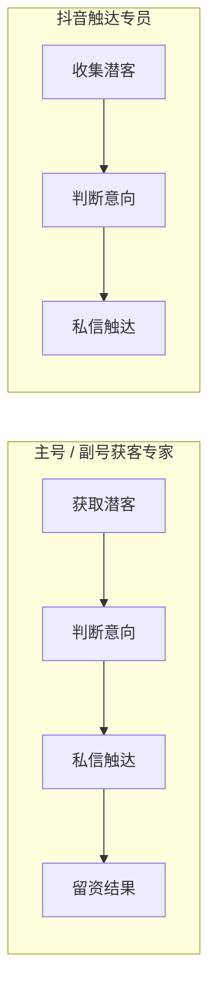

# AI数班 V1.5 · 抖音触达专员 PRD

> 版本：V1.5（当前 V1.5.1）
> 更新日期：2026-10-12
> 状态：设计讨论中，待评审
> 适用范围：全行业数字员工中的**获客类岗位**之一，与主号获客专家、副号获客专家共用同一批抖音账号
> 修订说明：新增岗位「**抖音触达专员**」。该岗位把获客链路**截断在私信触达**——只做「直播弹幕收集潜客 → 判断潜客意向 → 私信触达」，不做触达之后的转化与留资；账号门槛只要求**抖音营销授权**（直播弹幕由云电脑采集），不要求平台授权；计费按**有效触达**（一个潜客计一次），与主号、副号获客专家的「按有效线索」并列。

---

## 版本管理

> 本表记录本文档的历次变更，包含**变更位置**（章节，缩进表示从属子节）与**变更内容**。变更内容按 `① ② ③` 分条、`·` 列具体规则。**本表按模块一行**：同一模块被多次调整时只保留最新结论，直接改该模块所在行，不在表末追加新行；只有新模块才在表末新增一行。每次调整同步更新头部"版本"与"更新日期"。

| 版本 | 日期 | 变更位置 | 变更内容 |
|------|------|----------|----------|
| V1.5.1 | 2026-10-12 | 全篇（新建文档）、§8.5（原型落地） | **新增岗位「抖音触达专员」** 　· 链路截断在私信触达：收集潜客 → 判断意向 → 私信触达，不做触达之后的转化与留资 　· 潜客来源与主号获客专家一致（直播弹幕 / 短视频评论 / 粉丝关注，均由云电脑采集），账号门槛只要求**抖音营销授权**，不要求平台授权 　· 与主号获客专家、副号获客专家**三方账号互斥**；最低启用 1 个账号；账号池只有"账号分别触达"一种形态 　· 计费**按有效触达**：一个潜客计 1 次，**同一账号 90 天内不重复计费**；固定基础结算，不提供高级结算 　· **刊例价 20 电力值 / 有效触达**；各行业预置默认套餐内计价项为 **5 电力值**，是唯一不按刊例价建包的计价项 　· 成果只进**潜客记录**，不进线索记录 　· **既有 PRD 不改写**，被本岗位扩展或取代的口径标注见第八章；运营后台与价格配置见第七章 　· **验收标准统一收在第九章**：正文各章不再列验收项（原 §2.5.6 / §4.8 / §5.3 / §7.7 并入） 　· 原型改动**已执行**（前台版本号 v67 → v68、运营后台同步），清单与复核截图时另修的版式问题见 §8.5 |

---

## 一、概述

### 1.1 定位

抖音触达专员是**只做触达的获客岗位**。它把主号获客专家的四步链路**截断在第三步**：

- **只做前三步**：收集潜客、判断意向、私信触达。触达之后的对话推进、留资、试驾邀约**都不属于本岗位**，本岗位不跟踪、不汇报、不因此计费。
- **潜客来源同主号获客专家**：直播弹幕、短视频评论、粉丝关注三类，全部由**云电脑**采集。
- **只依赖抖音营销授权**：三类来源的采集与私信发送都由**云电脑 / 云电脑 RPA** 承担，都在营销授权范围内，因此平台授权**不是**本岗位的门槛。

### 1.2 本期目标

- 在人才广场交付一个可雇佣的获客岗位，卡片与详情页说明"只做触达、不做转化"的边界。
- 在**实时工作**交付**触达工作台**：两段式流程（潜客挖掘 → 私信触达），顶部漏斗止于触达。
- 建立**账号三方互斥**：同一个抖音账号在主号获客专家、副号获客专家、抖音触达专员之间只能启用一个。
- 建立**按有效触达计费**的口径：一个潜客计一次，判定即扣、不回溯。
- 在**成果中心 / 潜客记录**沉淀本岗位获取的潜客。

### 1.3 与既有版本的关系

| 既有文档 | 关系 |
|---|---|
| PRD-v1.0 | 账号规则（§6.3）、Agent 设置（§7.3）、人才广场（§7.4）、实时工作（§7.6）、账号绑定（§7.9）的公共口径继续有效，本文档在其上**新增第三个获客岗位**；被扩展或取代的口径标注见第八章。**v1.0 为只读文档**，本文档只引用其口径与行号。 |
| PRD-v1.1 | 数据查询能力（§2）的框架沿用，本文档补充本岗位的查询口径与指标集（见第六章）。 |
| PRD-v1.2 | 潜客记录（§2）与线索记录（§3）的定义继续有效；本文档明确本岗位**只进潜客记录**（见第五章）。 |
| PRD-v1.3 | **无口径冲突**。矩阵视频发布专员与本文档岗位同属"只依赖抖音营销授权"的一类，其 §2.3.2「Agent 设置不展示平台授权」的先例被本文档直接沿用。 |
| PRD-v1.4 | 电力账户、套餐包、门店关联套餐、月最低消耗、充值与冻结全部沿用；本文档新增**第六个计价项**与**新的计费方式枚举**，口径落位见第七章、标注见第八章。 |

#### 与主号 / 副号获客专家的差异对照

| 维度 | 主号获客专家 | 副号获客专家 | **抖音触达专员** |
|---|---|---|---|
| 链路终点 | 留资结果 | 留资结果 | **私信触达** |
| 潜客来源 | 直播弹幕 / 短视频评论 / 粉丝关注 | 同主号 | **同主号（三类）** |
| 账号授权门槛 | 平台授权 + 营销授权 | 平台授权 + 营销授权 | **只有营销授权** |
| 最低启用账号 | 1 | 2（1 主号 + ≥1 副号） | **1** |
| 账号池形态 | 账号分别触达 / 主副号触达 | 主副号触达 | **只有账号分别触达** |
| 计费方式 | 按有效线索 | 按有效线索 | **按有效触达** |
| 结算方式 | 基础 / 高级（可配） | 基础 / 高级（可配） | **基础结算（固定）** |
| 是否产生线索 | 是 | 是 | **否** |
| 账号互斥范围 | 与副号、本岗位互斥 | 与主号、本岗位互斥 | **与主号、副号互斥** |

### 1.4 版本规划

| 版本 | 交付能力 |
|------|----------|
| 本期 V1.5 | 抖音触达专员上架：三方账号互斥、按有效触达计费、触达工作台、潜客记录沉淀、对话查询口径 |
| 后续版本 | 快手等其它平台的触达岗位；触达效果的多轮归因 |

---

## 二、角色与账号

### 2.1 人物设定

| 项 | 内容 |
|----|------|
| 岗位名 | 抖音触达专员 |
| 岗位分类 | 获客 |
| 适用平台 | 抖音 |
| 核心功能 | 潜客挖掘（直播弹幕 / 短视频评论 / 粉丝关注）、意向判断、主动私信触达 |
| 工作边界 | **止于私信触达**：不推进对话、不催留资、不做试驾邀约，也不跟踪触达之后的结果 |
| 计费口径 | 按有效触达，一个潜客计一次 |
| 岗位说明（对外文案） | 从直播间弹幕、短视频评论与粉丝关注里找出有购车意向的观众，判断意向等级后主动私信触达；触达之后交给门店跟进。 |

### 2.2 账号绑定与授权

#### 2.2.1 可用账号定义

对抖音触达专员，账号只有同时满足以下条件才算**可用账号**：

1. 抖音**营销授权**已完成；
2. 该账号**未被主号获客专家、副号获客专家启用**。

- **平台授权不是本岗位的门槛**：本岗位覆盖与主号获客专家相同的三类潜客来源，但三类来源的采集与私信发送**全部由云电脑承担**，不调用平台接口，因此只要求营销授权。
- **账号可用性按岗位分别判定**：同一个抖音账号在主号获客专家下可能因缺平台授权而不可用，在本岗位下仍可用。账号能否被本岗位启用，只按营销授权与三方互斥判定，不能用主号的判定结果推断。
- 营销授权不完整时，账号标记为**授权不可用**，展示"去账号绑定/重新授权"入口；该入口按 PRD-v1.0 §7.9.3.1 先检查云电脑状态，云电脑未开启时提示"请联系运营人员开启云电脑服务后重试"。
- 账号已被主号获客专家或副号获客专家启用时，标记为**已被另一数字员工使用**，展示进入对应员工 Agent 设置关闭该账号的处理入口；本岗位不能强制抢占账号。
- 不可用账号仍展示在账号范围列表中，但开关不可操作，且必须同时展示不可用原因与处理办法。

#### 2.2.2 账号三方互斥

主号获客专家、副号获客专家、抖音触达专员**共用同一批抖音账号**，账号的"启用"归属必须三方互斥。

- 同一个抖音账号**只能在其中一方**处于启用状态；一方开启后，另两方立即显示不可用且不能开启。
- **未启用不等于未绑定**：账号授权状态与员工服务状态必须分开记录。
- 三方中任一方完成首次雇佣后，**之后新增的账号默认关闭**，即使授权完整也不得自动加入该员工的启用范围，必须由用户在对应 Agent 设置中手动启用。
- 账号授权失效、营销授权撤销，或被另一方启用后，受影响员工重新计算可用范围；若当前启用范围因此出现不可用账号、或可用账号降为 0，员工进入**待处理**，并生成高优先级待办。
- 三方互斥的占用关系必须**双向实时刷新**：一方启用的结果立即同步到另两方的账号范围、岗位准备状态与待办。

#### 2.2.3 已雇佣后的最低启用账号与自动解雇

- 正常运行时**至少启用 1 个账号**。
- 用户在 Agent 设置中关闭最后一个账号（或本次编辑结果使启用数降为 0）时，弹出确认：**"需要至少保留1个账号，账号全部关闭后该员工将被解雇，是否继续"**。
- 确认后以一次原子操作关闭全部账号并立即解雇；取消则恢复本次操作前的开关状态，不修改账号占用、不改变员工状态。
- 自动解雇只停止后续工作和新任务，不删除 Agent 配置、账号绑定、历史过程、正式结果或费用明细；账号占用在操作完成后释放，另两个获客岗位重新计算可用范围。
- 账号授权失效或被他方占用**不触发**自动解雇，只让员工进入"待处理"。

### 2.3 Agent 设置

Agent 设置的结构与主号获客专家一致（身份 / 知识库 / 账号范围 / 技能四块），差异只在账号范围与技能两块。

#### 2.3.1 身份区域

- 沿用 PRD-v1.0 §7.3.10：Agent 称呼、说话风格与人设，只影响表达方式，不改变岗位能力、数据权限、工作范围和计费规则。
- 默认称呼为"抖音触达专员"。

#### 2.3.2 知识库区域

- 沿用 PRD-v1.0 §7.3.11：展示"对话策略"与"车型库"两类卡片，点击进入对应模块维护，不在设置弹窗内直接编辑。
- **对话策略是本岗位触达内容的来源**：账号级「进私设置」里的第 1~3 次触达消息即本岗位实际发送的私信内容（见 §4.6）。

#### 2.3.3 权限区域（账号范围）

- 本区域只管理当前员工的**员工服务范围**，不替代账号绑定模块的授权管理。
- 账号行字段为：**账号名称、抖音营销授权、启用状态、最近一次检查时间**。
  - **不展示平台授权状态**：照 PRD-v1.3 §2.3.2 的先例，平台授权与本岗位无关，展示它会让用户误以为它是运行门槛。
- 账号营销授权完整且未被另两个获客岗位启用时，显示"可用"，允许开启或关闭；授权不完整显示"不可用"并标注缺失的授权类型；被另两个岗位启用显示"不可用 · 已被另一数字员工使用"，并提供跳转关闭的入口。
- 保存时重新校验：账号授权、三方互斥占用、启用数量门槛（≥1）三项全部重算。
- 保存成功后，互斥占用立即同步到另两个获客岗位、人才广场、账号绑定与数字办公室；正在执行的任务继续使用启动时锁定的账号范围，新任务使用保存后的范围。

#### 2.3.4 技能区域

固定技能，仅做展示，不支持添加、删除或调整；右上角展示"固定 · 不可更改"。

| 序号 | 技能 |
|---|---|
| 1 | 挖掘直播潜客 |
| 2 | 挖掘短视频潜客 |
| 3 | 挖掘粉丝潜客 |
| 4 | 判断潜客意向 |
| 5 | 私信触达潜客 |
| 6 | 数据报告 |

> 与主号获客专家的 7 项技能相比：**删除「转化话术设计」**（本岗位不做触达之后的转化），其余 6 项同名沿用。

#### 2.3.5 设置保存、取消与生效规则

沿用 PRD-v1.0 §7.3.14：身份与知识库改动从下一次新任务生效；账号范围保存并重新检查通过后对新任务生效；技能与授权权限不能通过本弹窗修改。

### 2.4 人才市场雇佣流程

#### 2.4.1 岗位卡与岗位详情

- 岗位卡展示：岗位名、岗位说明、技能标签、适用平台（抖音）、计费口径（刊例价 + "按有效触达计费"）。
- 岗位说明必须写明**只做触达**：说明文案需明确"触达之后由门店跟进"，避免用户误以为本岗位会带来留资结果。
- 计费提示只说明两件事：按业务结果计费、单价为刊例价；**不展示月最低消耗**，不展示"雇佣当日预计费用"（见 PRD-v1.4 §7）。

#### 2.4.2 核心依赖检查

| 检查项 | 是否阻断 | 口径 |
|---|---|---|
| 账户余额为负 | **阻断** | 余额为负时不放行雇佣，提示联系运营充值（PRD-v1.4 §5.2 / §7） |
| 抖音营销授权 | **阻断** | 至少 1 个抖音账号完成营销授权 |
| 车型库 | **阻断** | 至少启用 1 款车型 |
| 数字人配置 | 非阻断 | 默认人设即视为就绪 |
| 抖音平台授权 | **不检查** | 本岗位不需要平台授权，清单中不出现该行 |

- 准备清单只展示本岗位实际需要的项目，不展示门店知识库与对话策略（沿用 PRD-v1.0 §7.4.5）。
- 授权提示与计费提示分开呈现，避免"未授权即不产生费用"的误解。

#### 2.4.3 账号启用/关闭规则

- **可用账号数量为 0 时禁止雇佣**；阻塞信息必须说明是授权问题、还是账号已被主号/副号获客专家使用。
- **首次确认雇佣时，所有满足条件的可用抖音账号默认加入并开启**（沿用 PRD-v1.0 §6.3.2 的主号口径）。
- 雇佣完成后新增的账号默认关闭，必须由用户在本岗位 Agent 设置中手动开启。
- **账号池只有一种形态**：账号分别触达——每个账号各自获取潜客、各自触达，账号之间互不触达，不发生跨账号私信。本岗位**不提供**"主副号触达"（潜客池 + 私信池）模式。

#### 2.4.4 依赖通过后的直接雇佣

- 雇佣确认页为**单页**：展示岗位摘要、可用账号、计费口径与阻断项检查结果。
- **雇佣动作本身不产生费用**，也不作为任何计费周期的起点（低消周期起点为首次充值到账日，见 PRD-v1.4 §4.1）。
- 确认雇佣后直接进入**实时工作 / 触达工作台**，不经过中间页。

#### 2.4.5 雇佣失败、取消与回流

- 提交期间按钮进入处理中并禁止重复点击；提交失败不改变岗位状态，保留已完成准备项与用户选择。
- 雇佣失败时保留准备进度并提示重试，不写入半雇佣状态。

### 2.5 计费规则（按有效触达计费）

> 本节新增的计费方式、计价项与枚举，全部落在本岗位自身，**不要求改写《PRD-v1.4-计费规则》**；运营后台与价格配置的完整口径见第七章，对 v1.4 的波及标注见 §8.4。

#### 2.5.1 计费口径

- **计费方式**：按有效触达。与主号的"按有效线索"、客服专员的"按转化线索"、矩阵视频发布专员的"按次发布"并列。
- **计费单位**：**一个潜客计 1 次**。
- **有效触达的定义**：云电脑向一个潜客**成功发送首轮私信**，即判定为一条有效触达。
- **触发时点**：私信发送成功时**即时扣费**，扣费时间等于发送成功时间。
- **90 天去重**：同一潜客在**同一账号**下，自上一次触达计费时间起 **90 天内再次触达不重复计费**；满 90 天后的首次触达**重新计费一次**。本岗位按「对话策略 → 进私设置」执行最多 3 次触达（见 §4.6），这 3 次都落在 90 天窗口内，因此**只计 1 次**。
- **不计费**：私信发送失败；同一账号下对同一潜客 90 天内的重复触达；未进入触达环节的潜客。
- **不回溯**：判定为有效触达后即计费，后续不再因该潜客的任何状态变化回滚或冲正。
- **幂等键**：员工 ID + 账号 ID + 潜客标识 + 计费窗口（90 天）。重复回收到同一次触达结果时不重复扣费。

#### 2.5.2 结算方式与取价

- **固定基础结算**：本岗位**不提供**基础结算 / 高级结算的选择，也不在平台账号上开放结算方式配置入口。高级结算的口径是"沿用系统原有获客结算配置"，其结算对象是获客结果，与"按触达"不同构，因此不适用于本岗位。
- **刊例价**：**20 电力值 / 有效触达**，全行业统一、运营后台只读、仅对外展示（见 §7.1）。
- **实际消耗单价**：取门店**本店关联套餐**的「抖音触达专员」计价项（PRD-v1.4 §2.5）。门店恒有绑定、套餐内计价项为必配项，因此**不会回落刊例价**。
- **行业预置套餐内的默认值**：各行业预置的默认套餐中，本岗位计价项为 **5 电力值 / 有效触达**。**本岗位是唯一一个预置值不等于刊例价的计价项**，PRD-v1.4 §2.4"预置包按刊例价建包"的表述在本岗位上不成立（见 §7.2）。
- **月最低消耗**：本岗位产生的消耗计入账户 31 天周期的实际消耗合计，与其它岗位同源（PRD-v1.4 §4.2）。

#### 2.5.3 费用记录

在 PRD-v1.4 §2.6 的统一费用记录中，本岗位的记录字段取值如下：

| 记录项 | 取值 |
|---|---|
| 费用类型 | 业务消耗 |
| 数字员工 | 抖音触达专员 |
| 岗位 | 抖音触达专员 |
| 抖音账号 | 产生该笔触达的账号 |
| 计费对象 | **触达**（展示潜客标识） |
| 计费方式快照 | **按有效触达** |
| 转化类型快照 | 空（仅客服专员有值） |
| 结算方式快照 | **基础结算**（本岗位固定） |
| 取价来源快照 | 门店关联套餐 |
| 单价快照 | 实际生效单价（行业预置套餐内为 5 电力值 / 有效触达），单位电力值 |
| 扣减电力值 | 以负数展示 |
| 扣费备注 | **有效触达计费** |

#### 2.5.4 人才广场扣费透出

- 岗位卡、岗位详情与雇佣确认页展示全行业统一的**刊例价 20 电力值 / 有效触达**，以及"按有效触达计费"的口径说明。
- **不展示**月最低消耗、实际计费价与"雇佣当日预计费用"。
- 计费口径说明必须让用户看懂计费单位是**潜客**而不是私信条数：文案需明确"同一个客户只计一次"。

#### 2.5.5 消耗展示

- 本岗位产生的每条费用记录在消耗明细中生成一条明细，按扣费时间倒序。
- **岗位视图**：在公共 6 列（扣费时间 / 数字员工 / 扣费账号 / 计费对象 / 电力值 / 扣费备注）之后追加本岗位业务列：

| 追加列 | 展示口径 |
|---|---|
| 客户信息 | 潜客昵称 |
| 触达时间 | 首轮私信发送成功时间 |
| 城市 | 潜客所在城市 |
| 车型 | 潜客意向车型 |
| 客户意向 | 高意向 / 中意向 / 低意向 |

- **不追加"联系方式"与"留资时间"**：本岗位不产生留资结果，这两列在本岗位永远为空。
- 费用类型筛选项新增「有效触达计费」；「全部」视图的费用类型下拉同步包含该条。
- 任何视图都不出现单价列与取价来源列。

### 2.6 解雇与重新雇佣

- **解雇确认弹窗**固定文案："解雇后正在排队与等待触达的潜客将停止触达，但历史结果和计费记录会保留，是否继续？"
- **发送中的触达不因解雇中断**：跑完当前发送动作并展示最终状态。
- 排队中、待触达的潜客停止触达，不予发送；已经产生的费用不回收。
- **90 天去重跨雇佣状态延续**：解雇不重置同一潜客在同一账号下的 90 天计费窗口，重新雇佣后在窗口内的触达仍不重复计费。
- 影响范围按账号维度生效：一个账号被关闭不影响其它账号继续工作。
- 解雇**不解除**账号绑定与抖音营销授权；账号记录、历史触达过程、潜客记录与计费记录全部保留。
- 解雇后账号占用释放，主号获客专家与副号获客专家重新计算可用范围。
- **重新雇佣不做任何处理**：不恢复、不回填、不自动补发；营销授权有效且未被另两个岗位占用的账号默认全部开启，不沿用解雇前的开关结果。
- 重新雇佣**不重置**费用记录，也不重置 90 天计费窗口。

---

## 三、页面结构

### 3.1 页面层级

| 层级 | 页面 | 本岗位的落点 |
|---|---|---|
| 一级 | 数字办公室 | 员工卡与侧栏，展示形象、状态、今日任务与累计产出 |
| 一级 | 人才广场 | 岗位卡与岗位详情、单页雇佣确认 |
| 一级 | 实时工作 | **触达工作台**（本岗位的主战场，见第四章） |
| 一级 | 成果中心 | **潜客记录**（见第五章） |
| 弹窗 | Agent 设置 | 身份 / 知识库 / 账号范围 / 技能 |
| 无独立页面 | 对话策略、账号绑定、车型库 | 复用平台已有模块，本岗位不自建 |

### 3.2 数字办公室侧栏概览

- 员工卡展示：形象图、岗位名、状态、今日任务文案、累计产出。
- **日报口径调整**：本岗位的四个指标为「发现潜客 / 高意向 / 已触达 / 今日计费」，**不用"有效线索"**——本岗位不产生留资。
- 侧栏工作界面沿用数班通用的**云电脑操作录屏**为主视觉，横屏不拉伸。
- 主动汇报口径沿用数字员工统一规则，须标注统计周期、账号范围与更新时间。
- 侧栏提供进入实时工作与 Agent 设置的入口。
- **待办**：营销授权失效、账号被另两个获客岗位占用、余额为负、云电脑异常时生成高优先级待办，说明原因、影响与处理动作。

---

## 四、实时工作 / 触达工作台

### 4.1 定位

触达工作台是本岗位的作业现场，围绕「**潜客挖掘 → 判断意向 → 私信触达 → 本次计费**」形成一条**止于触达**的可观察链路。每一个账号对应一个触达专员，页面数据只属于当前账号、当前行业和当前统计周期。

> 与主号获客专家工作现场的区别：链路终点是**私信触达**而不是留资结果，因此没有"持续转化"这一段。

### 4.2 顶部：经营指标漏斗

顶部固定展示三张指标卡，顺序与业务流程一致：

| 顺序 | 指标 | 口径 |
|---|---|---|
| 1 | 获取潜客 | 当前周期内从直播弹幕发现的去重潜客数 |
| 2 | 判断意向 | 当前周期内完成意向判断的潜客数 |
| 3 | 私信触达 | 当前周期内完成有效触达（首轮私信发送成功）的潜客数 |

- 每张卡展示指标名称、当前周期数值和数据更新时间；卡片之间的箭头只表达流程顺序，不代表可点击跳转。
- 指标只统计当前账号与当前周期，必须显示周期口径；切换账号或刷新周期后重新拉取，不混用其它账号数据。
- **不出现"留资结果"或任何转化类指标**。
- 新增结果发生时，数值先显示状态变化再更新总数；刷新页面不重复计数、不重复计费。

### 4.3 阶段 Tab

- 页面固定提供两个 Tab：**潜客挖掘、私信触达**，默认进入潜客挖掘。
- 切换 Tab 只切换工作现场与队列筛选，不重置顶部指标、不重复启动 Agent 动作。
- 每个 Tab 保留当前账号与已选客户；返回页面时恢复上次选中的 Tab 与客户。
- **不出现"持续转化"Tab**。

### 4.4 潜客挖掘

左侧为抖音直播现场，中间为实时工作队列，右侧为当前客户的触达流程。

**左侧：直播 / 平台工作现场**

- 展示本岗位账号正在监听的直播或内容平台现场，作为**三类潜客信号来源**：直播弹幕、短视频评论、粉丝关注（口径同 PRD-v1.0 §7.6.4.3）。
- 顶部显示平台、账号名称、直播状态；无法获取直播数据时不继续显示"直播中"。
- 直播画面取自云电脑采集：直播中展示当前直播画面；未直播首次进入展示缺省页；已直播过展示上一场直播回放。
- 直播弹幕类型：潜客卡展示"直播弹幕"来源类型与弹幕内容；弹幕内容作为客户原话保存并进入后续意向判断。
- 短视频评论类型：潜客卡展示"短视频评论"来源类型与评论内容；评论内容作为客户原话保存并进入后续意向判断。
- 粉丝关注类型：潜客卡展示"粉丝关注"来源类型与关注行为；该类型没有客户内容字段，不展示虚构的评论或弹幕文本。
- 只有直播状态为"直播中"且实时收到弹幕时，才播放"弹幕从直播现场飘入实时工作队列"的动效，并同步在中间队列新增对应用户弹幕卡片。
- 短视频评论与粉丝关注进入队列时，只更新对应来源的队列卡片与数量提示，不使用直播弹幕飘入动效。
- 展示上一场直播回放时，回放只用于查看历史场景，不播放飘入动效，也不向实时队列新增潜客。
- 直播画面加载失败时显示最后更新时间与重试入口；平台连接中断时停止新增实时信号，已入队客户不被删除。

**中间：实时工作队列**

- 队列标题显示当前阶段、潜客总数与"历史工作"入口；历史工作只查看历史过程，不改变当前队列。
- 每张潜客卡展示：客户昵称、来源类型、来源内容或行为、意向车型、意向状态、触达状态。
- 来源类型固定为三种：直播弹幕、短视频评论、粉丝关注；来源字段按类型展示，粉丝关注类型不显示内容占位符。
- 状态标签随状态事件实时替换，不叠加互相矛盾的状态。
- 队列按当前阶段与最近更新时间排序；系统自动刷新时只插入新客户、更新状态和数量，不改变用户正在查看的客户详情。
- 点击潜客卡后，卡片进入选中状态，右侧切换到该客户流程。
- 队列支持按意向等级、来源类型、处理状态与更新时间筛选；筛选只影响当前展示，不改变 Agent 的实际工作范围。
- 队列为空时显示"暂无待判断潜客"或"暂无待触达客户"，并保留切换到另一阶段的入口；**不出现"暂无持续转化客户"**。

**队列状态枚举**

| 状态 | 含义 |
|---|---|
| 待判断 | 已从弹幕入队，尚未完成意向判断 |
| 待触达 | 意向判断完成且符合触达规则，等待发送私信 |
| **已触达** | 首轮私信发送成功（**终态**） |

- **不出现"已触达待回复""已回复""已留资"**：触达之后的结果不属于本岗位，队列不再跟踪。

### 4.5 右侧：客户触达流程

- 顶部展示客户昵称、意向车型、意向等级、当前阶段与状态；切换中间卡片时全部同步更新。
- 主流程标题为「**触达流程**」，节点按以下顺序展示：

| 顺序 | 节点 | 说明 |
|---|---|---|
| 1 | 获取潜客 | 从直播弹幕发现该潜客 |
| 2 | 获取来源信号 | 展示原始弹幕内容与来源时间 |
| 3 | 历史互动分析 | 展示引用的车型/门店知识与该账号下的历史互动 |
| 4 | 判断潜客意向 | 展示判断理由与意向等级 |
| 5 | **私信触达** | **终点节点**：展示触达账号、发送内容与发送时间 |

- **不出现"留资/试驾结果"节点**。
- 每个节点显示状态：待处理、进行中、已完成、失败；已完成节点展示原始证据、完成时间与产生的结果。
- 点击节点展开该步骤详情，包括客户原话、来源平台、引用的车型/门店知识、判断理由、触达账号、发送内容与下一步动作。
- 获取潜客节点完成后进入判断；判断意向完成后进入私信触达。
- 判断结果展示高意向、中意向、低意向；用户修改判断结果时必须填写或选择修改原因，并记录修改人与时间。
- 私信触达节点完成后，该客户的流程**结束**，不再有后续节点等待。

### 4.6 私信触达

左侧切换为**远程执行现场**，中间为待触达/已触达队列，右侧为当前客户的触达流程。

- 左侧展示**云电脑 / 平台浏览器快照视频**，与数字办公室的实时快照逻辑保持一致。
- **触达内容取自账号级「对话策略 → 进私设置」**：第 1 次触达默认立即发送，第 2、3 次按配置的延时规则执行；每次触达支持文字与图片。
- 本岗位执行**完整的进私触达序列**（最多 3 次），但**计费只认第 1 次**（见 §2.5.1）。
- 私信发送成功时，远程执行现场显示成功状态，队列卡片从"待触达"变为"已触达"，右侧流程进入终点节点；发送失败不更新已触达指标、不产生费用。
- 发送失败时保留失败原因与重试入口；重试成功按一次有效触达计费。
- 账号授权失效、云电脑异常、余额为负、车型/门店知识缺失时，顶部状态、左侧现场、中间队列与右侧流程统一显示待处理原因，并生成高优先级待办。

### 4.7 动效、刷新与异常

- 阶段推进使用节点高亮、进度变化与完成标记表达业务状态；动效只在真实状态事件发生时触发，刷新页面不重复播放。
- 新潜客进入时，左侧信号区域、中间队列卡片与顶部获取潜客指标按"信号发现—入队—计数更新"顺序更新。
- 判断完成时，客户卡片意向标签、右侧判断节点与顶部判断意向指标同步变化；判断失败保留失败原因并停在当前节点。
- 页面自动刷新只拉取状态、指标、队列与客户详情，不重复执行捕获、判断、发送或计费动作；刷新失败保留最后一次成功快照。

---

## 五、成果中心 / 潜客记录

### 5.1 定位与边界

- 抖音触达专员获取的潜客**进入潜客记录**，与主号获客专家、副号获客专家的潜客同表展示（PRD-v1.2 §2）。
- **不进入线索记录**：本岗位不产生留资结果，线索记录的岗位归属枚举（主号获客专家 / 副号获客专家 / 客服专员 / 自然转化）**不新增本岗位**。
- 潜客记录的数据源不再只由主号获客专家触发：**主号获客专家、副号获客专家、抖音触达专员任一在岗即出数据**。

### 5.2 字段与展示

沿用 PRD-v1.2 §2.2 的字段结构，本岗位潜客各字段的取值口径：

| 字段 | 本岗位口径 |
|---|---|
| 潜客信息 | 有值 |
| 潜客类型 | 直播弹幕 / 短视频评论 / 粉丝关注三类（同 PRD-v1.0 §7.6.4.3） |
| 车型 / 城市 | 有值（判意向时产出） |
| 意向等级 | 有值（高意向 / 中意向 / 低意向） |
| 潜客账号 | 有值（发现该潜客的账号） |
| 触达账号 | 有值；账号分别触达模式下与潜客账号为同一个 |
| 触达状态 / 触达时间 | 有值 |
| 发现时间 | 有值 |
| **回复状态 / 留资状态** | **不跟踪，展示为"—"** |
| 操作 | 对话流、时间轴 |

- **对话流**：展示该潜客与本岗位账号之间的历史私信（含进私设置发出的 1~3 条触达消息）。
- **时间轴**：节点为「获取潜客 → 判断意向 → 发送私信」，**终点为发送私信**；不出现"等待回复""完成留资"节点。
- 筛选枚举不新增潜客类型；潜客类型、意向等级、触达状态筛选对本岗位的潜客同样生效。

---

## 六、对话能力

### 6.1 数据查询

- **查询范围**：本岗位启用的抖音账号，潜客统计与明细最大查询范围为 30 天（沿用 PRD-v1.1 §2.1 通用查询规则）。
- 业务数据分为"统计数据"与"潜客明细"两类；账号授权状态作为独立结果返回，不与两者混合。

**统计数据**

| 指标类别 | 指标 |
|---|---|
| 获客规模 | 潜客数 |
| 获客规模 | 潜客分析数 |
| 获客规模 | 高意向潜客数 |
| 触达效果 | 触达潜客数 |
| 触达效果 | 待触达数 |

- **不含"潜客对话数""潜客留资数"**：本岗位不跟踪触达之后的结果。

**潜客明细**

| 字段类别 | 字段 |
|---|---|
| 潜客信息 | 昵称 |
| 潜客信息 | 意向度 |
| 潜客信息 | 车型 |
| 潜客信息 | 城市 |
| 触达过程 | 触达状态 |
| 触达过程 | 触达时间 |
| 触达过程 | 触达账号 |
| 来源信息 | 潜客账号 |
| 来源信息 | 潜客搜寻时间 |

- **不含回复状态与留资状态**。

### 6.2 主动汇报

- 触发事件、冷却与去重规则沿用数字员工统一规则。
- 汇报内容须标注统计周期、账号范围、数据更新时间与数据来源。
- 汇报口径**止于触达**：不汇报留资、线索或转化相关数字。

### 6.3 分段回复

沿用数字员工的统一分段结构：查询范围 → 查询结果 → 下一步建议。

---

## 七、运营后台与价格配置

> 本章是本岗位在**运营后台与价格体系**中的全部落位，对应 PRD-v1.4 第九章及其价格章节的增补部分。**PRD-v1.4 本身不改写**（见第八章）。

### 7.1 刊例价

- 本岗位刊例价为 **20 电力值 / 有效触达**，全行业统一。
- 与其余四个岗位一致：运营后台**只读展示、不提供修改入口**，调整刊例价需走版本发布。
- 人才市场岗位卡、岗位详情、雇佣确认页只展示该刊例价，不展示月最低消耗与实际计费价（见 §2.5.4）。

### 7.2 行业预置套餐的默认值

- 各行业预置的默认套餐包内，本岗位计价项为 **5 电力值 / 有效触达**。
- **这是唯一一个预置值不等于刊例价的计价项**：其余五个计价项（主号 50 / 副号 50 / 客服自然档 10 / 客服 AI 档 10 / 矩阵 2）均按刊例价建包。
- 该预置值只在**新建门店建号写入关联套餐**那一刻起作用；此后本岗位的实际计费一律走门店关联套餐（见 §2.5.2）。

### 7.3 套餐包管理

**计价项**：套餐包内的计价项由五个增为**六个**——主号获客专家 / 副号获客专家 / **抖音触达专员** / 客服专员·自然转化线索 / 客服专员·AI转化线索 / 矩阵视频发布专员。

**表单行数**：岗位实际消耗单价分组由四行增为**五行**，本岗位**单占一行**（只有客服专员一行内并排两档）。

| 表单行 | 岗位 | 输入形态 |
|---|---|---|
| 1 | 主号获客专家 | 单个单价 |
| 2 | 副号获客专家 | 单个单价 |
| 3 | **抖音触达专员** | **单个单价（本次新增行）** |
| 4 | 客服专员 | 一行内并排自然转化线索 / AI转化线索两档 |
| 5 | 矩阵视频发布专员 | 单个单价 |

- 本岗位单价为**必配项**：留空或不是大于 0 的整数，保存时一律拒绝并提示计价项名。
- **输入框旁的刊例价参照**：本岗位参照值为 **20 电力值 / 有效触达**。
- **参照值与常用值不一致，展示上必须可分辨**：本岗位是全后台唯一一处"参照值与预置值不同"的计价项（参照 20、预置 5）。参照文案须标明这是**刊例价**，**不得**写成"建议价""默认值""参考区间"一类措辞——否则运营会把 5 误读成填错，或把 20 误读成应填值。
- **套餐包列表**：列定义中的"五个计价项单价"增为**六个计价项单价**；表头分两行时本岗位**单占一列**（只有客服专员跨两列）。
- **必配校验**："能被设为默认或关联门店的套餐，其五个计价项必然配齐"扩展为**六个计价项必然配齐**。
- 所属行业锁定、引用保护、删除保护、改价即时生效、改价不影响历史费用快照等规则**不变**。

### 7.4 员工消耗套餐包

- **本店生效单价只读表由四行增为五行**，本岗位一行按"岗位名在上、单位在下"展示。
- **整包生效**：五个岗位一起按关联套餐取值，不提供逐岗位改价。
- 门店关联套餐整包取用，因此本岗位的生效单价**恒等于关联套餐内该计价项的值**，不存在逐岗位覆盖。
- 关联套餐的下拉范围（限本行业）、建号自动关联、改选即时生效、不保留变更历史等规则**不变**。

### 7.5 结算方式

- 本岗位**固定基础结算**，运营后台**不提供结算方式配置入口**——本岗位不往平台账号上落结算方式配置项。
- 运营后台显示结算方式的岗位列举，由"客服专员与矩阵视频发布专员固定基础结算"扩展为**三个岗位固定基础结算**。

### 7.6 不受影响的模块

以下运营后台模块**因本岗位新增不需要任何改动**，此处显式列出，避免评审时反复确认：

| 模块 | 为什么不受影响 |
|---|---|
| VIP 编辑 | 付费状态、充值类型、到期天数与电力值调整四项均与岗位无关；充值类型的两条连带规则（重置 31 天低消周期、自动顺延 365 天）不区分岗位 |
| 服务期管理 | 服务期统一 365 天，按门店账号增减天数，与岗位无关 |
| 月度最低消耗 | 账户级结算，本岗位消耗照常计入周期内实际消耗合计；补差记录不进任何岗位视图 |
| 电力账户与充值记录 | 两本账口径为账户级，与岗位无关 |

---

## 八、对既有文档的波及标注

> **本轮不改写任何既有 PRD**：本岗位的全部口径以本文档为准，PRD-v1.0 / v1.1 / v1.2 / v1.4 保持原样。本章标出**读者在既有文档中会读到的、已被本岗位扩展或取代的口径**，以及该口径在本文档中的落位——两处不一致时以本文档为准。
>
> 若后续决定把本岗位并入某一版 PRD，本章可直接作为改写清单使用。原型不属于文档，其改动照常待执行（见 §8.5）。

### 8.1 PRD-v1.0

| PRD-v1.0 位置 | 被本岗位扩展或取代的口径 | 本文档落位 |
|---|---|---|
| §6.3 主号与副号获客专家账号规则 | 原文只定义**两方互斥**；本岗位加入后为**三方互斥** | §2.2.2 |
| §6.3.1 可用账号定义 | 原文要求"平台授权 + 营销授权"；本岗位**只要求营销授权**，且账号可用性按岗位分别判定 | §2.2.1 |
| §6.3.2 / §6.3.3 阻塞信息与处理入口 | 原文的"另一方"由一处扩为两处 | §2.2.1 |
| §6.3.4 新增账号默认关闭 | 触发方由两方扩为三方 | §2.2.2 |
| §6.3.5 最低启用账号与自动解雇表 | 原文三行（主号 1 / 副号 2 / 客服专员 1）；本岗位为 **1** | §2.2.3 |
| §7.3.12 Agent 设置账号范围 | 互斥描述由两方扩为三方 | §2.3.3 |
| §7.3.13 技能区域表 | 原文两行（主号、副号，各 7 项）；本岗位为 **6 项**，去掉「转化话术设计」 | §2.3.4 |
| §7.4.5 各数字员工准备项表 | 原文两行；本岗位准备项为**营销授权账号 + 车型库 + 余额**，不含平台授权 | §2.4.2 |
| §7.6.4 主号获客专家工作现场 | 本岗位复用其潜客挖掘口径（三类来源、弹幕飘入动效、粉丝关注无内容字段），但链路**止于私信触达** | 第四章 |
| §7.9.3.1 / §7.9.5 / §7.9.6 | 账号可用范围重新计算的受影响员工由两个扩为三个 | §2.2.2 |
| §8.2 结果口径 | 有效线索口径不变；本岗位**不产生有效线索**，避免被读成"触达即有效线索" | 第五章 |
| §10 需求优先级 P0 | 原文的账号互斥与计费条目未含本岗位 | §2.2.2 / §2.5 |

### 8.2 PRD-v1.1

| PRD-v1.1 位置 | 被本岗位扩展或取代的口径 | 本文档落位 |
|---|---|---|
| §2 数据查询能力 | 原文只覆盖获客专家与客服专员；本岗位的指标集**止于触达**，不含"潜客对话数""潜客留资数" | §6.1 |
| §11 一期查询与分析 Skill 目录 | S01 潜客数据查询的作用域扩至本岗位；**S02 潜客转化分析对本岗位不适用**，需在 Skill 边界注明 | §6.1 |

### 8.3 PRD-v1.2

| PRD-v1.2 位置 | 被本岗位扩展或取代的口径 | 本文档落位 |
|---|---|---|
| §2.1 潜客记录定义 | 原文为"主号获客专家和副号获客专家获取的潜客"；本岗位潜客**同表展示**，且其**回复状态与留资状态不跟踪、展示为"—"** | §5.2 |
| §2.2 字段 | 同上；潜客类型覆盖三类来源 | §5.2 |
| §2.2 时间轴 | 原文终点为"完成留资"；本岗位潜客的时间轴**终点为发送私信** | §5.2 |
| §3.1 线索记录定义 | 本岗位**不进线索记录**，岗位归属枚举不新增本岗位 | §5.1 |
| §6 导出 | 潜客记录导出字段随字段口径同步 | §5.2 |

### 8.4 PRD-v1.4

> 价格与运营后台的完整口径已在**第七章**给出，下表只做位置对照，不再重复内容。

| PRD-v1.4 位置 | 被本岗位扩展或取代的口径 | 本文档落位 |
|---|---|---|
| §2.2 价格体系 | "四个岗位""五个计价项" | §7.3 / §7.4 |
| §2.3 刊例价表 | 原文四行，无本岗位 | §7.1 |
| §2.4 行业默认套餐 | "预置包的五个计价项按刊例价建包" | §7.2 |
| §2.5 员工消耗套餐包 | "四个岗位""五个计价项" | §7.4 |
| §2.6 费用记录 | 计费对象、计费方式快照枚举 | §2.5.3 |
| §3.1 计费口径总表 | 原文四行；末句"唯一例外是客服专员" | §2.5.1 |
| §3 各岗位计费规则 | 原文四节，无本岗位 | §2.5 |
| §7 人才市场 | 刊例价列举（主号 50 / 副号 50 / 客服 10 / 矩阵 2） | §2.5.4 / §7.1 |
| §8.1 展示口径 | 费用类型五类 | §2.5.5 |
| §8.2 展示列 | 计费对象枚举、扣费备注枚举、各岗位业务列四行 | §2.5.5 |
| §8.3 筛选 | 费用类型筛选项 | §2.5.5 |
| §8.4 验收 1 / 5 / 10 | 五类记录、"四个岗位视图" | §2.5.5 |
| §9.3 套餐包管理 | 表单四行、计价项五个、刊例价参照展示 | §7.3 |
| §9.4 员工消耗套餐包 | 生效单价四行、"四个岗位整包生效" | §7.4 |
| §9.5 验收 4 / 7 / 8 / 11 / 14 / 16 / 19 | 计价项数量、岗位数量、结算方式列举 | §7.3–§7.5、§9.7 |
| §11.1 / §11.2 / §11.6 | 刊例价列举、计费方式、消耗明细类数 | §2.5、§7.1 |
| §12 待确认 1 / 7 | 预置套餐数值、高级结算的重复计费风险 | §7.2、§2.5.2 |

### 8.5 原型

> 本节是**已执行的改动记录**：`app/AI数班-AI军团原型.html`（版本号 v67 → v68）与 `app/AI数班-运营后台原型.html` 均已按本清单落地。位置列只写可检索的**符号名**——原型主文件约 4.1 万行，行号随每次改动漂移，不作为定位依据。

| 文件 | 位置 | 改写内容 |
|---|---|---|
| `app/AI数班-AI军团原型.html` | `employees[]`（`index:"16"`，销售运营专员顺延为 `"17"`）、`employeeVoiceProfiles`、`employeePlatformMap` | 新增本岗位条目、语音档案与平台归属；人像沿用主号获客专家物料；原型版本号 v67 → v68 |
| 同上 | `prdTalentCopy`、`talentPlazaOrder`、`prdTalentReady` | 人才广场岗位文案（核心功能写着"止于私信触达"，报价"20 电力值 / 有效触达"）、排序位（副号之后、客服之前）、已上线岗位集合 |
| 同上 | `prdEmployeeRequirements`、`prdEmployeeOnline` | 准备项 = 抖音营销授权（阻断）+ 车型库 + 数字人配置（后两项只提示、不阻断），平台授权不参与判定；在线 = 有账号已启用且营销授权完成 |
| 同上 | 账号 `service` 字段：`prdLeadPositions` / `prdLeadPositionLabel` / `prdLeadSeedOwner` / `prdAccountOccupant` / `prdDouyinTouchAvailable` / `prdSetLeadAccountService` | **拆互斥**：老数据里主号与副号共用一个 `service["lead-hunter"]` 标志位，首次加载按 `prdLeadSeedOwner` 迁移成获客类三方占用；开启即独占，一方关闭不影响其它岗位；账号卡片补"获客占用"一行 |
| 同上 | `prdApplyHireConfig`、雇佣白名单 `["smart-reply","lead-hunter","lead-hunter-advanced","douyin-touch","ai-video"]` ×2 | 首次雇佣默认开启全部可用账号；本岗位走**单页确认**，不进"下一步：员工配置" |
| 同上 | 实时工作区：`data-demo-live-job="douyin-touch"` 页签、`demoLiveJobs["douyin-touch"]`、`renderDemoLiveJob` 分派分支、`prdLiveRoleMap`、`prdWorkingEmployeeIds` | 新建触达工作台：漏斗三卡（获取潜客 / 判断意向 / 私信触达）、潜客挖掘与私信触达两个 Tab、队列三状态（待判断 / 待触达 / 已触达）、右侧五节点流程（终点为发送私信）、云电脑现场读本岗位启用账号 |
| 同上 | `routeTitles`、`navigate()`、`prdRenderTouchAccountScope` | 新增 `touch-account-settings` 路由与账号范围页：四列（账号 / 启用归属 / 营销授权 / 工作状态）、独占开关、关到最后一个账号时二次确认 |
| 同上 | `prdRenderProspectRows`、`prdProspectRecords`（`prdProspectOwner` / `prdProspectGateOpen` / `prdProspectUntracked`） | 潜客记录数据源由"仅主号获客专家"改为"三个获客岗位任一在岗"；本岗位潜客的回复状态与留资状态渲染为「—」；时间轴改为三节点（获取潜客 → 判断意向 → 发送私信）；新增 4 条本岗位种子潜客，覆盖直播弹幕 / 短视频评论 / 粉丝关注三类，粉丝关注条目不写来源正文 |
| 同上 | 数字办公室：`workProfiles`、`teamOutputByEmployee`、`officeScreenData`、`__talentPortraitData`、待办入口 | 新增本岗位条目；日报口径改为"发现潜客 / 高意向 / 已触达 / 今日计费" |
| `app/AI数班-运营后台原型.html` | `POSITIONS`、`LIST_PRICE`、`LIST_PRICE_UNIT`、`PRICE_KEYS`、`ADVANCED_POSITIONS` | 四岗位 → 五岗位；新增刊例价 20 电力值 / 有效触达；五计价项 → 六（客服专员按转化线索拆两档）；本岗位不加入 `ADVANCED_POSITIONS`，固定基础结算 |
| 同上 | 套餐包表单（原"五个计价项、表单四行"）、刊例价参照文案 `listPriceHint` | 改为六个计价项、表单五行；本岗位是后台唯一"参照值 20 ≠ 预置值 5"的计价项，参照文案标明是「刊例价」 |

复核截图时另修的两处版式问题（不改口径，仅录入以免回退）：

| 文件 | 位置 | 改写内容 |
|---|---|---|
| `app/AI数班-AI军团原型.html` | `demoLiveJobs["douyin-touch"]` 触达流程的终点节点 | 待办态文案由"这是本岗位的终点节点"改为"按账号「进私设置」发送第 1 次私信"——界面只描述要做的动作，不写岗位边界规则 |
| 同上 | `.lead-account-manager--touch` 网格 | 账号范围沿用主号/副号的页面外壳，但不能沿用其账号路由网格（3 列且 `display:none` 掉归属列，会让"启用归属"整列为空、表头挤到第二行）；单独恢复 4 列，窄屏隐藏表头 |

**尚未执行**：`docs/reference/数班-新增数字人模块地图.html` 仍按旧口径编写（"余额不足转待处理""¥2 次发布"等已被 PRD-v1.4 取代），本岗位也未纳入该页的模块地图，留待后续排期。

---

## 九、验收标准

> 本章汇总本岗位**全部模块**的验收标准；正文各章只写口径，不重复列验收项。

### 9.1 岗位与账号互斥

1. 人才广场展示抖音触达专员岗位卡，岗位说明写明"只做触达、触达之后由门店跟进"。
2. 可用账号定义为"营销授权已完成且未被主号获客专家、副号获客专家启用"；平台授权不参与判定，同一账号在主号下因缺平台授权不可用、在本岗位下仍可用。
3. 同一个抖音账号在主号获客专家、副号获客专家、抖音触达专员三者中只能启用一个；一方开启后，另两方立即显示不可用且不能开启。
4. 授权不完整或被占用时，账号展示不可用原因与处理入口；被占用账号提供跳转到对应员工 Agent 设置关闭该账号的路径。
5. 首次雇佣默认开启全部可用账号；雇佣后新增账号默认关闭。
6. 正常运行时至少保留 1 个启用账号；关闭最后一个账号时弹出"需要至少保留1个账号，账号全部关闭后该员工将被解雇，是否继续"。
7. 三方互斥的占用关系双向实时刷新，一方变更立即同步到另两方的账号范围、准备状态与待办。

### 9.2 Agent 设置

8. 身份、知识库、账号范围、技能四块结构与主号获客专家一致；账号范围区域**不展示平台授权状态**。
9. 技能区域固定展示六项：挖掘直播潜客、挖掘短视频潜客、挖掘粉丝潜客、判断潜客意向、私信触达潜客、数据报告；**不出现"转化话术设计"**。
10. 账号范围保存时重新校验授权、三方互斥占用与启用数量门槛（≥1）。

### 9.3 雇佣流程

11. 准备项含余额、车型库、数字人配置与抖音营销授权；**清单中不出现抖音平台授权**。
12. 阻断项为抖音营销授权与账户余额为负；可用账号为 0 时禁止雇佣，阻塞信息说明原因。
13. 账号池只有"账号分别触达"一种形态，不提供"主副号触达"模式。
14. 雇佣确认为单页；雇佣动作本身不产生费用。
15. 雇佣确认后直接进入实时工作 / 触达工作台。

### 9.4 实时工作

16. 触达工作台顶部为三张指标卡：获取潜客、判断意向、私信触达；不出现"留资结果"或任何转化类指标。
17. 阶段 Tab 为潜客挖掘、私信触达两个；不出现"持续转化"Tab。
18. 潜客来源覆盖直播弹幕、短视频评论、粉丝关注三类；粉丝关注类型不展示虚构的评论或弹幕文本。
19. 队列状态只有待判断、待触达、已触达三个；已触达为终态，不出现"已触达待回复""已回复""已留资"。
20. 右侧客户流程的终点节点为"私信触达"；不出现"留资/试驾结果"节点。
21. 私信触达 Tab 左侧为云电脑 / 平台浏览器快照视频。
22. 触达内容取自账号级「对话策略 → 进私设置」的第 1~3 次触达配置，本岗位执行完整序列。
23. 页面自动刷新不重复执行捕获、判断、发送或计费动作。

### 9.5 成果中心

24. 抖音触达专员的潜客出现在潜客记录中，与主号、副号获客专家的潜客同表。
25. 本岗位潜客的潜客类型覆盖直播弹幕、短视频评论、粉丝关注三类；粉丝关注类型不展示虚构的评论或弹幕文本。
26. 本岗位潜客的回复状态与留资状态展示为"—"。
27. 时间轴终点为"发送私信"，不出现"等待回复""完成留资"节点。
28. 线索记录的岗位归属枚举不新增"抖音触达专员"。
29. 主号获客专家、副号获客专家、抖音触达专员任一在岗，潜客记录即出数据。

### 9.6 计费与消耗

30. 一条有效触达产生一条费用记录，计费单位为潜客；同一潜客在同一账号下 **90 天内只计 1 次**，满 90 天后再次触达重新计费一次。
31. 私信发送失败不产生费用；进私设置的第 2、3 次触达落在 90 天窗口内，不重复计费。
32. 扣费时间为私信发送成功时间，判定即扣、后续不回溯冲正。
33. 扣费备注固定为"有效触达计费"，不拼接账号、日期等其他信息；消耗明细费用类型新增"有效触达计费"。
34. 结算方式快照固定为"基础结算"，本岗位不提供高级结算入口。
35. 岗位卡、岗位详情与雇佣确认页展示全行业统一的刊例价（20 电力值 / 有效触达），三个页面均不出现月最低消耗数字与实际计费价。
36. 消耗明细岗位视图在公共 6 列之后追加客户信息、触达时间、城市、车型、客户意向五列，不追加联系方式与留资时间。
37. 任何视图都不出现单价列与取价来源列。
38. 本岗位产生的消耗计入账户 31 天周期的实际消耗合计。

### 9.7 运营后台与价格配置

39. 【套餐包管理】的岗位实际消耗单价分组为**五行**：主号 / 副号 / 抖音触达专员 / 客服专员 / 矩阵，本岗位单占一行。
40. 套餐包内的计价项为**六个**，全部为必配项；本岗位留空或非大于 0 的整数时拒绝保存并提示计价项名。
41. 本岗位单价输入框旁展示刊例价参照 **20 电力值 / 有效触达**，文案标明为"刊例价"，不出现"建议价""默认值"一类措辞。
42. 【套餐包管理】列表的计价项单价列为**六列**，本岗位单占一列。
43. 各行业预置的默认套餐包内，本岗位计价项为 **5 电力值 / 有效触达**。
44. 【员工消耗套餐包】的本店生效单价只读表为**五行**，本岗位一行按"岗位名在上、单位在下"展示。
45. 门店关联套餐整包生效，五个岗位一起取值，不提供逐岗位改价。
46. 运营后台**不提供**本岗位的结算方式配置入口。
47. VIP 编辑、服务期管理、月度最低消耗、电力账户与充值记录四个模块，因本岗位新增不产生任何改动。

---

## 十、待确认事项

现阶段无待确认事项。定价、去重窗口、结算方式、成果落点、指标口径与岗位命名已逐条裁决并落位到对应章节；后续如出现新的分歧点，在本章按序号追加。

---

## 附：与其他文档的关系

| 既有文档 | 关系 |
|---|---|
| PRD-v1.0 | 公共口径来源；本文档在其上新增第三个获客岗位，**不改写 v1.0**，波及标注见 §8.1 |
| PRD-v1.1 | 对话与查询框架来源；本岗位查询口径见第六章 |
| PRD-v1.2 | 潜客记录 / 线索记录定义来源；本岗位边界见第五章 |
| PRD-v1.3 | 无口径冲突；"只依赖抖音营销授权"的先例来源 |
| PRD-v1.4 | 计费与账务的单一来源；本岗位新增第六个计价项与新的计费方式枚举，运营后台与价格配置见第七章，**不改写 v1.4**，波及标注见 §8.4 |
| `docs/reference/数班-新增数字人模块地图.html` | 本岗位按该页的 8 模块 / 47 接入点结构落位；该页自身需按 v1.4 现行口径复核 |
